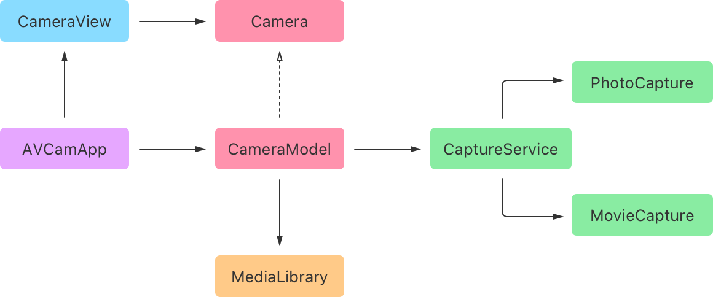
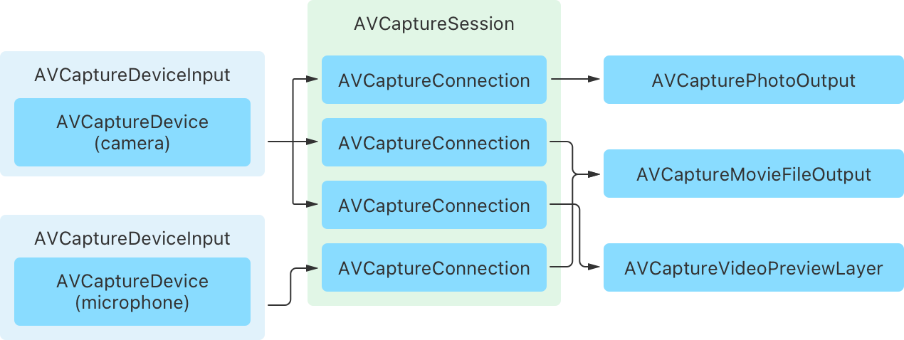

> 导航： [Technologies](../technologies.md) · [AVFoundation](../avfoundation.md) · [Capture setup](capture-setup.md)

# AVCam：构建一个相机 App

<sub>示例代码</sub>

使用 iPhone 和 iPad 的前置和后置相机拍摄照片和录制视频。

## 概述

AVCam 示例向你展示如何为 iOS 构建一个基础的相机 App。它演示了如何使用 AVFoundation 访问设备相机和麦克风、配置采集会话、拍摄照片和视频等等。它还展示了如何使用 [PhotoKit](../photokit.md) 框架把拍摄的媒体保存到照片图库。

这个示例使用 SwiftUI 和 Swift 并发的特性构建了一个响应灵敏的相机 App。下图描述了这个 App 的设计：



<sub>一张描述 App 各对象之间关系的图。App 启动时，会创建一个 CameraModel 实例。相机模型会创建 CaptureService 和 MediaLibrary 类型的实例，并用它们来执行其核心功能。最后，App 创建一个提供主用户界面的 CameraView 实例，并向它传入对 CameraModel 对象的引用。</sub>

这个 App 定义的关键类型是 `CaptureService`，一个管理与 AVFoundation 采集 API 交互的 actor。这个对象配置采集管线并管理其生命周期，并定义一个用于拍摄照片和视频的异步接口。它分别把那些操作的细节处理委托给 App 的 `PhotoCapture` 和 `MovieCapture` 对象。

> [!note] 注意
> 配置和启动采集会话都是可能需要时间完成的阻塞操作。为了让用户界面保持响应，App 把 `CaptureService` 定义为 actor 类型，以确保 AVFoundation 采集 API 调用不会发生在主线程上。

### 配置示例代码项目

由于模拟器无法访问设备相机，它不适合运行这个 App——你需要在设备上运行。要运行这个示例，你需要：

- 一台运行 iOS 26 或更高版本的 iOS 设备

AVCam 采用了 [LockedCameraCapture](../lockedcameracapture.md) 框架，这让 App 有资格从锁定屏幕、控制中心、操作按钮和相机控制启动。为支持该框架，这个示例向主 App target 添加了一个采集扩展 target 和一个控制中心扩展 target。请在每个 target 上设置你的签名凭据，以构建并运行这个示例。

### 配置采集会话

任何采集 App 的核心对象都是一个 [AVCaptureSession](avcapturesession.md) 实例。采集会话是中央枢纽：App 把来自相机和麦克风设备的输入连接到它，并把它们附加到用于采集照片、视频等媒体的输出上。配置好会话后，App 用它来控制流经采集管线的数据流。



<sub>一张描述采集会话配置的图。它展示了采集会话如何把来自相机和麦克风设备的输入连接到兼容的输出，这些输出用于拍摄照片或视频，或显示视频预览。</sub>

采集服务在其 `setUpSession()` 方法中执行会话配置。它获取宿主设备的默认相机和麦克风，并把它们作为输入添加到采集会话。

```swift
// Retrieve the default camera and microphone.
let defaultCamera = try deviceLookup.defaultCamera
let defaultMic = try deviceLookup.defaultMic

// Add inputs for the default camera and microphone devices.
activeVideoInput = try addInput(for: defaultCamera)
try addInput(for: defaultMic)
```

为了添加输入，它使用一个辅助方法：为指定的相机或麦克风设备创建新的 [AVCaptureDeviceInput](avcapturedeviceinput.md)，并在可能的情况下把它添加到采集会话。

```swift
// Adds an input to the capture session to connect the specified capture device.
@discardableResult
private func addInput(for device: AVCaptureDevice) throws -> AVCaptureDeviceInput {
    let input = try AVCaptureDeviceInput(device: device)
    if captureSession.canAddInput(input) {
        captureSession.addInput(input)
    } else {
        throw CameraError.addInputFailed
    }
    return input
}
```

添加设备输入之后，该方法为 App 默认的照片拍摄模式配置采集会话。它通过设置采集会话的 [AVCaptureSessionPresetPhoto](avcapturesession/preset/photo.md) 预设，让管线针对高分辨率照片质量输出进行优化。最后，为了让 App 能够拍摄照片，它向会话添加一个 [AVCapturePhotoOutput](avcapturephotooutput.md) 实例。

```swift
// Configure the session for photo capture by default.
captureSession.sessionPreset = .photo

// Add the photo capture output as the default output type.
if captureSession.canAddOutput(photoCapture.output) {
    captureSession.addOutput(photoCapture.output)
} else {
    throw CameraError.addOutputFailed
}
```

### 设置采集预览

为了预览相机正在采集的内容，AVFoundation 提供了一个名为 [AVCaptureVideoPreviewLayer](avcapturevideopreviewlayer.md) 的 Core Animation 图层子类。SwiftUI 不支持直接使用图层，因此 App 把这个图层托管在一个名为 `PreviewView` 的 [UIView](../uikit/uiview.md) 子类中。它通过重写 [layerClass](../uikit/uiview/layerclass.md) 属性，让预览图层成为该视图的支撑图层。

```swift
class PreviewView: UIView, PreviewTarget {
    
    // Use `AVCaptureVideoPreviewLayer` as the view's backing layer.
    override class var layerClass: AnyClass {
        AVCaptureVideoPreviewLayer.self
    }
    
    var previewLayer: AVCaptureVideoPreviewLayer {
        layer as! AVCaptureVideoPreviewLayer
    }
    
    func setSession(_ session: AVCaptureSession) {
        // Connects the session with the preview layer, which allows the layer
        // to provide a live view of the captured content.
        previewLayer.session = session
    }
}
```

为了让 SwiftUI 能使用这个视图，App 把它包装成一个名为 `CameraPreview` 的 [UIViewRepresentable](../swiftui/uiviewrepresentable.md) 类型。

```swift
struct CameraPreview: UIViewRepresentable {
    
    private let source: PreviewSource
    
    init(source: PreviewSource) {
        self.source = source
    }
    
    func makeUIView(context: Context) -> PreviewView {
        let preview = PreviewView()
        // Connect the preview layer to the capture session.
        source.connect(to: preview)
        return preview
    }
    
    func updateUIView(_ previewView: PreviewView, context: Context) {
        // No implementation needed.
    }
}
```

为了在不直接暴露采集服务受保护状态的情况下把预览连接到采集会话，这个示例定义了 App 特有的 `PreviewSource` 和 `PreviewTarget` 协议。App 向 `CameraPreview` 传入一个预览源，由它提供对采集会话的引用。调用预览源的 `connect(to:)` 方法即可在 `PreviewView` 实例上设置采集会话。

### 请求授权

初始采集配置已完成，但在 App 成功启动采集会话之前，它需要确定自己是否有使用设备输入的授权。系统要求用户明确授权 App 采集来自相机和麦克风的输入。为了确定 App 的状态，采集服务定义了一个异步的 `isAuthorized` 属性，如下所示：

```swift
var isAuthorized: Bool {
    get async {
        let status = AVCaptureDevice.authorizationStatus(for: .video)
        // Determine whether a person previously authorized camera access.
        var isAuthorized = status == .authorized
        // If the system hasn't determined their authorization status,
        // explicitly prompt them for approval.
        if status == .notDetermined {
            isAuthorized = await AVCaptureDevice.requestAccess(for: .video)
        }
        return isAuthorized
    }
}
```

该属性的实现使用 [AVCaptureDevice](avcapturedevice.md) 的方法检查当前状态，并在 App 尚未做出判断时向用户请求授权。如果 App 已获得授权，它就启动采集会话以开始数据流。如果没有，则在用户界面中显示错误消息。

要进一步了解访问相机和麦克风所需的配置，参见[请求采集和保存媒体的授权](requesting-authorization-to-capture-and-save-media.md)。

### 更改采集模式

App 以照片拍摄模式启动。更改模式需要按如下方式重新配置采集会话：

```swift
func setCaptureMode(_ captureMode: CaptureMode) throws {
    
    self.captureMode = captureMode
    
    // Change the configuration atomically.
    captureSession.beginConfiguration()
    defer { captureSession.commitConfiguration() }
    
    // Configure the capture session for the selected capture mode.
    switch captureMode {
    case .photo:
        // The app needs to remove the movie capture output to perform Live Photo capture.
        captureSession.sessionPreset = .photo
        captureSession.removeOutput(movieCapture.output)
    case .video:
        captureSession.sessionPreset = .high
        try addOutput(movieCapture.output)
    }

    // Update the advertised capabilities after reconfiguration.
    updateCaptureCapabilities()
}
```

在照片拍摄模式下，App 在采集会话上设置 [AVCaptureSessionPresetPhoto](avcapturesession/preset/photo.md) 预设，让采集管线针对高质量照片输出进行优化。它还会移除影片拍摄输出，否则会阻止照片输出执行实况照片拍摄。在视频拍摄模式下，它把会话预设设为 [AVCaptureSessionPresetHigh](avcapturesession/preset/high.md)，并把影片文件拍摄输出添加到会话。

### 选择新相机

这个 App 提供一个按钮，让人们可以在前置和后置相机之间切换，在 iPadOS 上还可以切换到已连接的外接相机。为了更改活跃相机，App 按如下方式重新配置会话：

```swift
// Changes the device the service uses for video capture.
private func changeCaptureDevice(to device: AVCaptureDevice) {
    // The service must have a valid video input prior to calling this method.
    guard let currentInput = activeVideoInput else { fatalError() }
    
    // Bracket the following configuration in a begin/commit configuration pair.
    captureSession.beginConfiguration()
    defer { captureSession.commitConfiguration() }
    
    // Remove the existing video input before attempting to connect a new one.
    captureSession.removeInput(currentInput)
    do {
        // Attempt to connect a new input and device to the capture session.
        activeVideoInput = try addInput(for: device)
        // Configure a new rotation coordinator for the new device.
        createRotationCoordinator(for: device)
        // Register for device observations.
        observeSubjectAreaChanges(of: device)
        // Update the service's advertised capabilities.
        updateCaptureCapabilities()
    } catch {
        // Reconnect the existing camera on failure.
        captureSession.addInput(currentInput)
    }
}
```

[AVCaptureSession](avcapturesession.md) 一次只允许附加一个相机输入，因此该方法首先移除现有相机的输入。然后，它尝试为新设备添加输入；如果成功，会执行一些内部配置以反映设备变化。如果采集会话无法添加新设备，它会重新连接被移除的输入。

> [!note] 注意
> 如果你的 App 需要同时从多个相机采集，请改用 [AVCaptureMultiCamSession](avcapturemulticamsession.md)。

### 拍摄照片

采集服务把 App 的照片拍摄功能委托给 `PhotoCapture` 对象处理，后者管理与 [AVCapturePhotoOutput](avcapturephotooutput.md) 的生命周期和交互。App 通过调用它的 [- capturePhotoWithSettings:delegate:](<avcapturephotooutput/capturephoto(with_delegate_).md>) 方法用这个对象拍摄照片，向它传入一个描述要启用的照片拍摄设置的对象，以及一个在拍摄进行时供系统调用的代理。要在 `async` 上下文中使用这个基于代理的 API，App 用一个检查型可抛出 continuation 包裹这个调用，如下所示：

```swift
/// The app calls this method when the user taps the photo capture button.
func capturePhoto(with features: PhotoFeatures) async throws -> Photo {
    // Wrap the delegate-based capture API in a continuation to use it in an async context.
    try await withCheckedThrowingContinuation { continuation in
        
        // Create a settings object to configure the photo capture.
        let photoSettings = createPhotoSettings(with: features)
        
        let delegate = PhotoCaptureDelegate(continuation: continuation)
        monitorProgress(of: delegate)
        
        // Capture a new photo with the specified settings.
        photoOutput.capturePhoto(with: photoSettings, delegate: delegate)
    }
}
```

当系统完成一张照片的拍摄时，它会调用代理的 [- captureOutput:didFinishCaptureForResolvedSettings:error:](<avcapturephotocapturedelegate/photooutput(__didfinishcapturefor_error_).md>) 方法。代理对象对该方法的实现使用 continuation 来恢复执行：返回一张照片或抛出一个错误。

```swift
func photoOutput(_ output: AVCapturePhotoOutput, didFinishCaptureFor resolvedSettings: AVCaptureResolvedPhotoSettings, error: Error?) {

    // If an error occurs, resume the continuation by throwing an error, and return.
    if let error {
        continuation.resume(throwing: error)
        return
    }
    
    /// Create a photo object to save to the `MediaLibrary`.
    let photo = Photo(data: photoData, isProxy: isProxyPhoto, livePhotoMovieURL: livePhotoMovieURL)
    // Resume the continuation by returning the captured photo.
    continuation.resume(returning: photo)
}
```

要进一步了解使用 AVFoundation 拍摄照片，参见[拍摄静态照片和实况照片](capturing-still-and-live-photos.md)。

### 录制影片

采集服务把 App 的视频拍摄功能委托给 `MovieCapture` 对象处理，后者管理与 [AVCaptureMovieFileOutput](avcapturemoviefileoutput.md) 的生命周期和交互。要开始录制影片，App 调用影片文件输出的 [- startRecordingToOutputFileURL:recordingDelegate:](<avcapturefileoutput/startrecording(to_recordingdelegate_).md>) 方法，向它传入一个用于写入影片的 URL，以及一个在录制完成时供系统调用的代理。

```swift
/// Starts movie recording.
func startRecording() {
    // Return early if already recording.
    guard !movieOutput.isRecording else { return }

    // Start a timer to update the recording time.
    startMonitoringDuration()
    
    delegate = MovieCaptureDelegate()
    movieOutput.startRecording(to: URL.movieFileURL, recordingDelegate: delegate!)
}
```

要结束视频录制，App 调用影片文件输出的 [- stopRecording](<avcapturefileoutput/stoprecording().md>) 方法，这会让系统调用代理来处理采集到的输出。为了适配这个基于代理的回调，App 把这次交互包在一个检查型可抛出 continuation 中，如下所示：

```swift
/// Stops movie recording.
/// - Returns: A `Movie` object that represents the captured movie.
func stopRecording() async throws -> Movie {
    // Use a continuation to adapt the delegate-based capture API to an async interface.
    return try await withCheckedThrowingContinuation { continuation in
        // Set the continuation on the delegate to handle the capture result.
        delegate?.continuation = continuation
        
        /// Stops recording, which causes the output to call the `MovieCaptureDelegate` object.
        movieOutput.stopRecording()
        stopMonitoringDuration()
    }
}
```

当 App 调用影片文件输出的 [- stopRecording](<avcapturefileoutput/stoprecording().md>) 方法时，系统会调用代理，由它通过返回一部影片或抛出一个错误来恢复执行。

```swift
func fileOutput(_ output: AVCaptureFileOutput, didFinishRecordingTo outputFileURL: URL, from connections: [AVCaptureConnection], error: Error?) {
    if let error {
        // If an error occurs, throw it to the caller.
        continuation?.resume(throwing: error)
    } else {
        // Return a new movie object.
        continuation?.resume(returning: Movie(url: outputFileURL))
    }
}
```

## 另请参阅

### 采集会话

- [设置采集会话](setting-up-a-capture-session.md) — 在拍摄照片或视频之前配置输入设备、输出媒体、预览视图和基本设置。
- [在 iPad 上多任务时访问相机](../avkit/accessing-the-camera-while-multitasking-on-ipad.md) — 在分屏浏览、侧拉、画中画和舞台管理器模式下操作相机。
- [构建启动迅速的响应式相机 App](build-a-responsive-camera-app-that-launches-quickly.md) — 为你的 iOS 和 iPadOS App 构建快速的相机启动体验。
- [拍摄电影效果视频](capturing-cinematic-video.md) — 拍摄具有可调节景深和焦点的视频。
- [在你的 iOS App 中支持中心舞台前置相机](supporting-center-stage-front-camera-in-your-ios-app.md) — 在 iPhone 前置相机上为照片和视频启用中心舞台。
- [AVMultiCamPiP：从多个相机采集](avmulticampip-capturing-from-multiple-cameras.md) — 使用多相机采集会话，把前置和后置相机的输出同时录制到一个影片文件中。
- [AVCamBarcode：检测条形码和人脸](avcambarcode-detecting-barcodes-and-faces.md) — 使用相机识别机器可读代码或人脸。
- [AVCaptureSession](avcapturesession.md) — 一个配置采集行为并协调从输入设备到采集输出的数据流的对象。
- [AVCaptureMultiCamSession](avcapturemulticamsession.md) — 一种支持从相同媒体类型的多个输入同时采集的采集会话。
- [AVCaptureInput](avcaptureinput.md) — 向采集会话提供输入数据的对象的抽象超类。
- [AVCaptureOutput](avcaptureoutput.md) — 为采集会话提供媒体输出目标的对象的抽象超类。
- [AVCaptureConnection](avcaptureconnection.md) — 一个表示从采集输入到采集输出的连接的对象。

## 下载

- [AVCamBuildingACameraApp.zip](https://docs-assets.developer.apple.com/published/b1de664bee51/AVCamBuildingACameraApp.zip)
