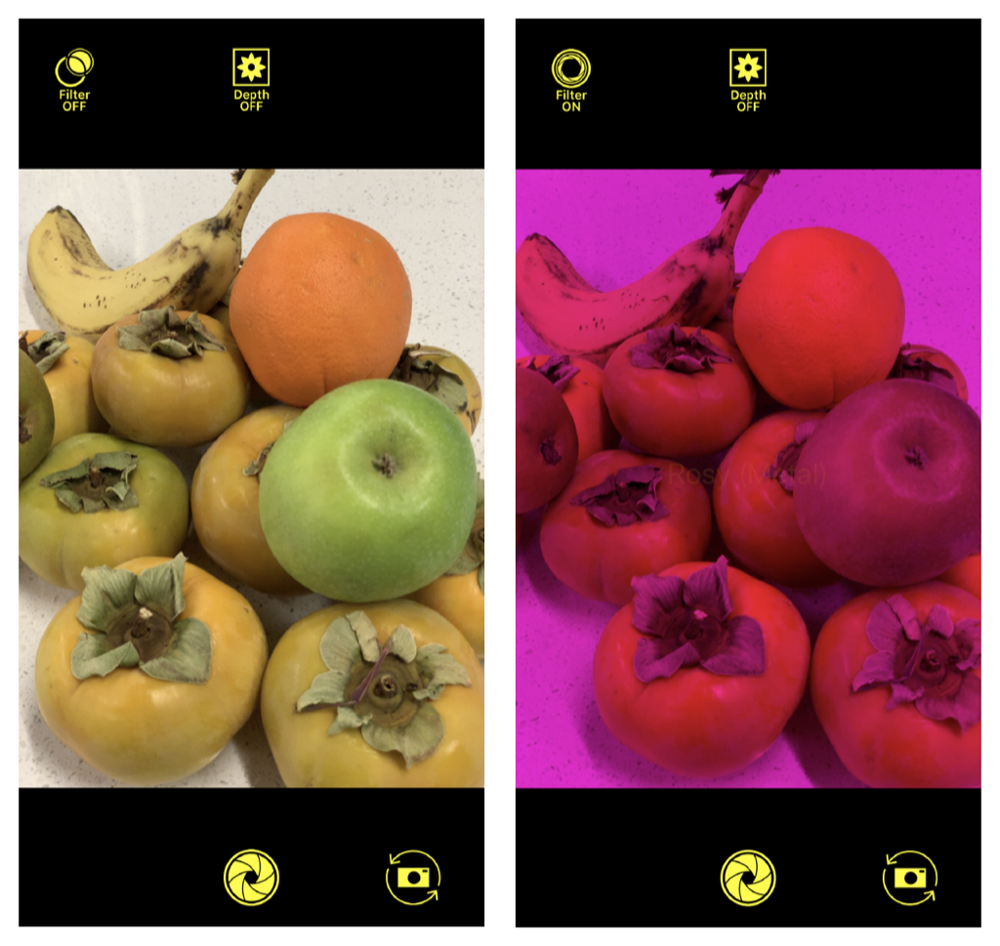

> 导航： [Technologies](../technologies.md) · [AVFoundation](../avfoundation.md) · [Additional data capture](additional-data-capture.md)

# AVCamFilter：为采集流应用滤镜

<sub>示例代码</sub>

以玫红色滤镜和深度效果渲染采集流。

## 概述

AVCamFilter 是一个示例相机 App，可以拍摄带滤镜效果的照片。它向用户实时显示场景的预览，并把效果渲染在其上。



这个示例向你展示如何使用 Core Image 和 Metal 应用一个玫红色镜头的滤镜。它还展示了如何使用灰度滤镜在采集流之上渲染深度和平滑后的深度效果。最后，AVCamFilter 允许用户通过滑块调节帧率和效果。

### 入门

在一台运行 iOS 12 或更高版本的设备上构建并运行 AVCamFilter。这个示例无法在模拟器中运行。另外，由于 Metal 无法在模拟器上编译，请在构建前把构建目标和 scheme 设置为某台设备或“Generic iOS Device”。在不支持深度拍摄的设备（例如 iPhone 6S 及更早机型）上也不会显示深度效果。

### 在 Metal 视图中显示相机预览

AVCamFilter 使用 `PreviewMetalView`——[MTKView](../metalkit/mtkview.md) 的一个自定子类——而不是 [UIView](../uikit/uiview.md) 作为预览视图，因为标准的 [AVCaptureVideoPreviewLayer](avcapturevideopreviewlayer.md) 直接从 [AVCaptureSession](avcapturesession.md) 获取帧，App 没有机会对这些帧应用效果。通过继承 `MTKView`，AVCamFilter 可以在渲染每一帧之前应用玫红色滤镜和深度灰度滤镜。

`PreviewMetalView` 在 `draw` 中定义其渲染行为。它从图像缓冲创建一个 Metal 纹理，从而可以变换该纹理并把纹理渲染成图像：

```swift
let width = CVPixelBufferGetWidth(previewPixelBuffer)
let height = CVPixelBufferGetHeight(previewPixelBuffer)

if textureCache == nil {
    createTextureCache()
}
var cvTextureOut: CVMetalTexture?
CVMetalTextureCacheCreateTextureFromImage(kCFAllocatorDefault,
                                          textureCache!,
                                          previewPixelBuffer,
                                          nil,
                                          .bgra8Unorm,
                                          width,
                                          height,
                                          0,
                                          &cvTextureOut)
```

### 创建滤镜渲染器

自定的 `FilterRenderer` 类是所有渲染类的父类，例如玫红色滤镜和灰度转换器。`RosyMetalRenderer` 和 `DepthToGrayscaleConverter` 都是 `FilterRenderer` 的子类，提供具体的滤镜功能。

`FilterRenderer` 封装了向图像渲染效果所需的全部资源和函数。例如，它为渲染分配一个输出缓冲池：

```swift
var pixelBuffers = [CVPixelBuffer]()
var error: CVReturn = kCVReturnSuccess
let auxAttributes = [kCVPixelBufferPoolAllocationThresholdKey as String: allocationThreshold] as NSDictionary
var pixelBuffer: CVPixelBuffer?
while error == kCVReturnSuccess {
    error = CVPixelBufferPoolCreatePixelBufferWithAuxAttributes(kCFAllocatorDefault, pool, auxAttributes, &pixelBuffer)
    if let pixelBuffer = pixelBuffer {
        pixelBuffers.append(pixelBuffer)
    }
    pixelBuffer = nil
}
pixelBuffers.removeAll()
```

`FilterRenderer` 还维护一个保留缓冲计数，告诉各个渲染器它一次可以持有多少个缓冲。这个提示让渲染器在开始渲染场景之前就确定尺寸并预分配它的缓冲池：

```swift
func prepare(with inputFormatDescription: CMFormatDescription, outputRetainedBufferCountHint: Int)

// Release resources.
func reset()

// The format description of the output pixel buffers.
var outputFormatDescription: CMFormatDescription? { get }

// The format description of the input pixel buffers.
var inputFormatDescription: CMFormatDescription? { get }

// Render the pixel buffer.
func render(pixelBuffer: CVPixelBuffer) -> CVPixelBuffer?
```

### 应用玫红色滤镜

AVCamFilter 以两种方式在相机流之上应用玫红色滤镜：

- `RosyCIRenderer` 对输入缓冲应用 Core Image 的 [CIColorMatrix](../coreimage/cicolormatrix.md) 滤镜。
- `RosyMetalRenderer` 从图像缓冲创建 Metal 纹理，并应用 `RosyEffect.metal` 中的着色器。

两种方式都在 GPU 上运行以获得最佳性能。由于 Core Image 方式不需要 GPU 命令队列，`RosyCIRenderer` 比对应的 Metal 版本涉及的直接 GPU 操作更少，并且能与其他 Core Image 滤镜更无缝地串联。与 Metal 函数不同，`RosyCIRenderer` 需要创建并应用一个 [CIFilter](../coreimage/cifilter-swift.class.md)：

```swift
ciContext = CIContext()
rosyFilter = CIFilter(name: "CIColorMatrix")
rosyFilter!.setValue(CIVector(x: 0, y: 0, z: 0, w: 0), forKey: "inputGVector")
```

在 Metal 方式中，AVCamFilter 设置一个命令队列和线程组来执行渲染：

```swift
guard let inputTexture = makeTextureFromCVPixelBuffer(pixelBuffer: pixelBuffer, textureFormat: .bgra8Unorm),
    let outputTexture = makeTextureFromCVPixelBuffer(pixelBuffer: outputPixelBuffer, textureFormat: .bgra8Unorm) else {
        return nil
}

// Set up command queue, buffer, and encoder.
guard let commandQueue = commandQueue,
    let commandBuffer = commandQueue.makeCommandBuffer(),
    let commandEncoder = commandBuffer.makeComputeCommandEncoder() else {
        print("Failed to create a Metal command queue.")
        CVMetalTextureCacheFlush(textureCache!, 0)
        return nil
}

commandEncoder.label = "Rosy Metal"
commandEncoder.setComputePipelineState(computePipelineState!)
commandEncoder.setTexture(inputTexture, index: 0)
commandEncoder.setTexture(outputTexture, index: 1)

// Set up the thread groups.
let width = computePipelineState!.threadExecutionWidth
let height = computePipelineState!.maxTotalThreadsPerThreadgroup / width
let threadsPerThreadgroup = MTLSizeMake(width, height, 1)
let threadgroupsPerGrid = MTLSize(width: (inputTexture.width + width - 1) / width,
                                  height: (inputTexture.height + height - 1) / height,
                                  depth: 1)
commandEncoder.dispatchThreadgroups(threadgroupsPerGrid, threadsPerThreadgroup: threadsPerThreadgroup)

commandEncoder.endEncoding()
commandBuffer.commit()
```

`RosyEffect.metal` 这个函数把一个像素的输出颜色设为它的输入颜色，因此大部分图像内容保持不变，形成一种透明效果。不过，该内核排除了绿色分量，让图像呈现玫红色的外观：

```
kernel void rosyEffect(texture2d<half, access::read>  inputTexture  [[ texture(0) ]],
					   texture2d<half, access::write> outputTexture [[ texture(1) ]],
					   uint2 gid [[thread_position_in_grid]])
{
    // Don't read or write outside of the texture.
    if ((gid.x >= inputTexture.get_width()) || (gid.y >= inputTexture.get_height())) {
        return;
    }

    half4 inputColor = inputTexture.read(gid);

    // Set the output color to the input color, excluding the green component.
    half4 outputColor = half4(inputColor.r, 0.0, inputColor.b, 1.0);

    outputTexture.write(outputColor, gid);
}
```

有关设置 Metal 计算命令编码器的更多信息，参见 [MTLComputeCommandEncoder](../metal/mtlcomputecommandencoder.md)。

### 调节混合系数

当用户调节 “MixFactor” 滑块时，AVCamFilter 会调节滤镜混合的强度：

```swift
dataOutputQueue.async {
    self.videoDepthMixer.mixFactor = mixFactor
}
processingQueue.async {
    self.photoDepthMixer.mixFactor = mixFactor
}
```

这个示例在代码中通过设置 `VideoMixer.swift` 中的 mix 参数来实现这一点。这个辅助类把混合命令编排到命令队列、缓冲和编码器中。当混合系数变化时，渲染管线通过改变渲染片段中的字节来引入这些变化：

```swift
var parameters = MixerParameters(mixFactor: mixFactor)

commandEncoder.label = "Video Mixer"
commandEncoder.setRenderPipelineState(renderPipelineState!)
commandEncoder.setVertexBuffer(fullRangeVertexBuffer, offset: 0, index: 0)
commandEncoder.setFragmentTexture(inputTexture0, index: 0)
commandEncoder.setFragmentTexture(inputTexture1, index: 1)
commandEncoder.setFragmentSamplerState(sampler, index: 0)
withUnsafeMutablePointer(to: &parameters) { parametersRawPointer in
    commandEncoder.setFragmentBytes(parametersRawPointer, length: MemoryLayout<MixerParameters>.size, index: 0)
}
commandEncoder.drawPrimitives(type: .triangleStrip, vertexStart: 0, vertexCount: 4)
commandEncoder.endEncoding()
```

`Mixer.metal` 这个 Metal 函数为每个片段指定混合操作：

```
fragment half4 fragmentMixer( VertexIO        inputFragment    [[ stage_in ]],
                              texture2d<half> mixerInput0      [[ texture(0) ]],
                              texture2d<half> mixerInput1      [[ texture(1) ]],
                              const device    mixerParameters& mixerParameters [[ buffer(0) ]],
                              sampler         samplr           [[ sampler(0) ]])
{
    half4 input0 = mixerInput0.sample(samplr, inputFragment.textureCoord);
    half4 input1 = mixerInput1.sample(samplr, inputFragment.textureCoord);

    half4 output = mix(input0, input1, half(mixerParameters.mixFactor));

    return output;
}
```

### 流式传输深度数据

除了 RGB 视频之外，AVCamFilter 还通过维护专用于深度信息的缓冲来流式传输深度数据。`CameraViewController` 遵循 [AVCaptureDepthDataOutputDelegate](avcapturedepthdataoutputdelegate.md) 协议并实现代理方法 [- depthDataOutput:didOutputDepthData:timestamp:connection:](<avcapturedepthdataoutputdelegate/depthdataoutput(__didoutput_timestamp_connection_).md>) 来刷新这些缓冲：

```swift
var depthFormatDescription: CMFormatDescription?
CMVideoFormatDescriptionCreateForImageBuffer(allocator: kCFAllocatorDefault,
                                             imageBuffer: depthData.depthDataMap,
                                             formatDescriptionOut: &depthFormatDescription)
if let unwrappedDepthFormatDescription = depthFormatDescription {
    videoDepthConverter.prepare(with: unwrappedDepthFormatDescription, outputRetainedBufferCountHint: 2)
}
```

`outputRetainedBufferCountHint` 是渲染器绘制场景时保留的像素缓冲数量。AVCamFilter 的深度转换器以 `outputRetainedBufferCountHint` 为 2 帧延迟来预分配它的缓冲，以覆盖 `dispatch_async` 调用。

`DepthToGrayscaleConverter` 类在预览中把深度值转换为灰度像素。与玫红色滤镜一样，`DepthToGrayscaleConverter` 依赖一个 Metal 函数 `DepthToGrayscale.metal` 来执行纹理变换：

```
kernel void depthToGrayscale(texture2d<float, access::read> inputTexture   [[ texture(0) ]],
						                 texture2d<float, access::write> outputTexture [[ texture(1) ]],
                             constant converterParameters& converterParameters [[ buffer(0) ]],
                             uint2 gid [[ thread_position_in_grid ]])
{
    // Don't read or write outside of the texture.
    if ((gid.x >= inputTexture.get_width()) || (gid.y >= inputTexture.get_height())) {
        return;
    }

    float depth = inputTexture.read(gid).x;

    // Normalize the value between 0 and 1.
    depth = (depth - converterParameters.offset) / (converterParameters.range);

    float4 outputColor = float4(float3(depth), 1.0);

    outputTexture.write(outputColor, gid);
}
```

### 平滑深度数据

如果不做平滑，每一帧的深度数据可能有缺口或空洞。平滑深度数据通过插值前一帧和后续帧来填补空洞，从而减少帧间差异的影响。要在代码中实现这种平滑，在 [AVCaptureDepthDataOutput](avcapturedepthdataoutput.md) 上设置一个参数：

```swift
sessionQueue.async {
    self.depthDataOutput.isFilteringEnabled = smoothingEnabled
}
```

### 调节帧率

AVCamFilter 还展示了如何更改相机交付深度数据的帧率。当用户移动 “FPS”（每秒帧数）滑块时，App 把这个面向用户的帧率表示转换为它的倒数——帧持续时间——以相应地设置视频设备的 [activeDepthDataMinFrameDuration](avcapturedevice/activedepthdataminframeduration.md)：

```swift
try self.videoInput.device.lockForConfiguration()
self.videoInput.device.activeDepthDataMinFrameDuration = duration
self.videoInput.device.unlockForConfiguration()
```

更改帧率让用户可以控制 App 刷新实时流的速度。例如，不太在意深度信息精细程度的用户可以降低深度数据的帧率，同时保持较高的 RGB 帧率。

## 另请参阅

### 深度数据拍摄

- [拍摄带深度的照片](capturing-photos-with-depth.md) — 获取随照片一起的深度图，以创建类似系统相机人像模式的效果（在兼容设备上）。
- [手动创建辅助深度数据](creating-auxiliary-depth-data-manually.md) — 生成一张深度图像并把它附加到你自己的图像上。
- [使用 LiDAR 相机拍摄深度](capturing-depth-using-the-lidar-camera.md) — 在支持的设备上访问 LiDAR 相机以拍摄精确的深度数据。
- [从原深感相机流式传输深度数据](streaming-depth-data-from-the-truedepth-camera.md) — 以二维和三维方式将原深感相机的深度数据可视化。
- [利用原深感相机数据增强实时视频](enhancing-live-video-by-leveraging-truedepth-camera-data.md) — 为从前置原深感相机流式传输的实时采集画面应用你自己的背景。
- [AVCaptureDepthDataOutput](avcapturedepthdataoutput.md) — 一种在兼容的相机设备上记录场景深度信息的拍摄输出。
- [AVDepthData](avdepthdata.md) — 一种容器，保存兼容相机设备拍摄的逐像素距离或视差信息。
- [AVCameraCalibrationData](avcameracalibrationdata.md) — 关于拍摄图像和深度数据所用相机特性的信息。

## 下载

- [AVCamFilterApplyingFiltersToACaptureStream.zip](https://docs-assets.developer.apple.com/published/282ed3531606/AVCamFilterApplyingFiltersToACaptureStream.zip)
