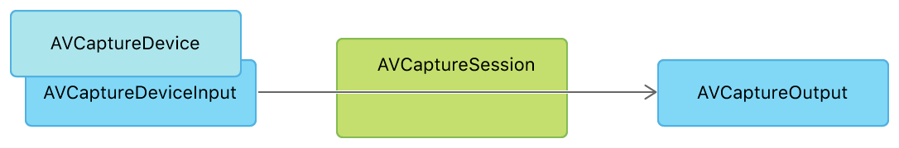

> 导航：[技术](../technologies.md) · [AVFoundation](../avfoundation.md)

# 捕捉设置

API 集合

为媒体捕捉配置内置相机和麦克风，以及外部捕捉设备。

## 概述

AVFoundation 捕捉子系统为 iOS 和 macOS 上的视频、照片和音频捕捉服务提供了一个通用的高级架构。如果你想要：

- 构建自定相机 UI，将拍摄照片或视频融入 App 的用户体验。
- 让用户更直接地控制照片和视频捕捉，例如对焦、曝光和防抖选项。
- 生成与系统相机 UI 不同的结果，例如 RAW 格式照片、深度图或带有自定定时元数据的视频。
- 实时访问直接来自捕捉设备的像素或音频数据流。

那就请使用这个系统。

> [!note] 注意
> 如果你想改为让用户在 App 内使用系统相机 UI 捕捉媒体，请参阅 [UIImagePickerController](../uikit/uiimagepickercontroller.md)。

捕捉架构的主要部分是会话、输入和输出：捕捉会话将一个或多个输入连接到一个或多个输出。输入是媒体的来源，包括 iOS 设备或 Mac 内置的相机和麦克风等捕捉设备。输出从输入获取媒体以产生有用的数据，例如写入磁盘的电影文件，或可供实时处理的原始像素缓冲区。

基本捕捉会话架构的框图：AVCaptureSession 通过 AVCaptureDeviceInput 从 AVCaptureDevice 获取数据，并将数据提供给一个或多个 AVCaptureOutput 对象。

## 主题

### 基础

- [请求捕捉和保存媒体的授权](requesting-authorization-to-capture-and-save-media.md) — 提示用户授权访问相机、麦克风和照片图库。

### 捕捉会话

- [设置捕捉会话](setting-up-a-capture-session.md) — 在捕捉照片或视频之前配置输入设备、输出媒体、预览视图和基本设置。
- [在 iPad 上多任务处理时访问相机](../avkit/accessing-the-camera-while-multitasking-on-ipad.md) — 在分屏浏览、侧拉、画中画和舞台管理模式下操作相机。
- [AVCam：构建相机 App](avcam-building-a-camera-app.md) — 使用 iPhone 和 iPad 的前后置相机拍摄照片和录制视频。
- [构建启动迅速的响应式相机 App](build-a-responsive-camera-app-that-launches-quickly.md) — 为你的 iOS 和 iPadOS App 构建快速的相机启动体验。
- [捕捉电影效果视频](capturing-cinematic-video.md) — 捕捉具有可调景深和焦点的视频。
- [在 iOS App 中支持舞台居中前置相机](supporting-center-stage-front-camera-in-your-ios-app.md) — 在 iPhone 前置相机上为照片和视频启用舞台居中。
- [AVMultiCamPiP：从多个相机捕捉](avmulticampip-capturing-from-multiple-cameras.md) — 使用多相机捕捉会话，将前后相机的输出同时录制到单个电影文件中。
- [AVCamBarcode：检测条形码和人脸](avcambarcode-detecting-barcodes-and-faces.md) — 使用相机识别机器可读代码或人脸。
- [AVCaptureSession](avcapturesession.md) — 一个配置捕捉行为并协调从输入设备到捕捉输出数据流的对象。
- [AVCaptureMultiCamSession](avcapturemulticamsession.md) — 一种捕捉会话，支持从同一媒体类型的多个输入同时捕捉。
- [AVCaptureInput](avcaptureinput.md) — 为捕捉会话提供输入数据的对象的抽象超类。
- [AVCaptureOutput](avcaptureoutput.md) — 为捕捉会话提供媒体输出目的地的对象的抽象超类。
- [AVCaptureConnection](avcaptureconnection.md) — 一个表示从捕捉输入到捕捉输出之间连接的对象。

### 捕捉设备

- [选择捕捉设备](choosing-a-capture-device.md) — 选择前置或后置相机，或使用 TrueDepth 相机、双相机等高级功能。
- [在相机 App 中采用智能取景](adopting-smart-framing-in-your-camera-app.md) — 通过提供自动取景建议来捕捉最佳镜头。
- [AVCaptureDevice](avcapturedevice.md) — 一个表示硬件或虚拟捕捉设备（如相机或麦克风）的对象。
- [AVCaptureDeviceInput](avcapturedeviceinput.md) — 一个将来自捕捉设备的媒体输入提供给捕捉会话的对象。
- [AVContinuityDevice](avcontinuitydevice.md) — 一个类，表示附近的一台实体 iOS 设备，可提供对其相机和麦克风的访问。
- [AVExternalStorageDevice](avexternalstoragedevice.md) — 表示一台存储媒体资产的实体外部存储设备。
- [AVExternalStorageDeviceDiscoverySession](avexternalstoragedevicediscoverysession.md) — 在外部存储设备连接到系统或从系统断开连接时通知你的 App。

### 捕捉预览

- [AVCaptureVideoPreviewLayer](avcapturevideopreviewlayer.md) — 一种显示来自相机设备视频的 Core Animation 图层。
- [AVCaptureAudioPreviewOutput](avcaptureaudiopreviewoutput.md) — 一种提供所捕捉音频预览的捕捉输出。

### 连续互通相机

- [在 tvOS App 中支持连续互通相机](../avkit/supporting-continuity-camera-in-your-tvos-app.md) — 通过连接 iPhone 或 iPad 作为连续互通设备，在你的 Apple TV App 中捕捉高质量的照片、视频和音频。
- [在 macOS App 中支持连续互通相机](supporting-continuity-camera-in-your-macos-app.md) — 使用 iPhone 相机作为外部捕捉设备，实现高质量的照片和视频捕捉。
- [AVCaptureDeskViewApplication](avcapturedeskviewapplication.md) — 一个以编程方式呈现桌面视图（Desk View）的对象。

### 捕捉控制

- [用相机控制增强你的 App 体验](enhancing-your-app-experience-with-the-camera-control.md) — 提供对相机 App 功能的直接访问，帮助人们快速拍出完美镜头。
- [AVCaptureControl](avcapturecontrol.md) — 与相机系统交互的控制的抽象基类。
- [AVCaptureSystemZoomSlider](avcapturesystemzoomslider.md) — 在系统建议范围内调整捕捉设备视频变焦系数的控制。
- [AVCaptureSystemExposureBiasSlider](avcapturesystemexposurebiasslider.md) — 在系统建议范围内调整捕捉设备曝光偏移的控制。
- [AVCaptureSlider](avcaptureslider.md) — 一个从有限范围中选择值的滑块控制。
- [AVCaptureIndexPicker](avcaptureindexpicker.md) — 一种通过索引从一组互斥值中进行选择的控制。

### 外接显示器输出

- [AVCaptureExternalDisplayConfiguration](avcaptureexternaldisplayconfiguration.md) — 用于向你的外接显示器配置器指定配置的一个类。
- [AVCaptureExternalDisplayConfigurator](avcaptureexternaldisplayconfigurator.md) — 一个配置器类，允许你配置外接显示器的属性，使其与相机的当前视频格式相匹配。

### 时码生成

- [AVCaptureTimecodeGenerator](avcapturetimecodegenerator.md) — 从各种来源生成并同步时码数据，以实现精确的视频和音频同步。
- [AVCaptureTimecodeGeneratorDelegate](avcapturetimecodegeneratordelegate.md) — 一个用于从时码生成器接收实时时码更新和错误通知的协议。
- [SynchronizationStatus](avcapturetimecodegenerator/synchronizationstatus.md) — 定义时码生成器同步状态的常量。
- [Source](avcapturetimecode/source.md) — 描述时码生成器可同步到的时码来源。
- [SourceType](avcapturetimecode/sourcetype-swift.enum.md) — 定义使用时码生成器生成时码时的可能来源。
- [AVCaptureTimecode](avcapturetimecode.md) — 该结构体表示一个时码，遵循 SMPTE 标准，为视频或音频同步定义精确的时间信息和关联的时间戳。
- [AVCaptureTimecodeAdvancedByFrames](<avcapturetimecode/advanced(__by_).md>) — 通过向给定时码添加指定数量的帧来生成新时码，并处理秒、分、小时的进位。
- [AVCaptureTimecodeCreateMetadataSampleBufferAssociatedWithPresentationTimeStamp](<avcapturetimecode/createmetadatasamplebuffer(from_associatedwithpresentationtimestamp_).md>) — 创建一个包含时码媒体描述元数据的样本缓冲区，以便与视频轨道集成。
- [AVCaptureTimecodeCreateMetadataSampleBufferForDuration](<avcapturetimecode/createmetadatasamplebuffer(from_forduration_).md>) — 为指定时长创建一个包含时码媒体描述元数据的样本缓冲区。

### 外部同步

- [AVExternalSyncDevice](avexternalsyncdevice.md) — 连接到主机设备的外部同步设备，可用于驱动内部组件（如相机传感器）的计时。
- [AVExternalSyncDeviceDelegate](avexternalsyncdevicedelegate.md) — 为 [AVCaptureDeviceInput](avcapturedeviceinput.md) 的委托定义一个接口，以响应连接、校准和断开外部同步设备时发生的事件。
- [AVExternalSyncDeviceStatus](avexternalsyncdevicestatus.md) — 外部同步设备的连接状态
- [DiscoverySession](avexternalsyncdevice/discoverysession.md) — 一种发现并监控外部同步设备与主机之间连接／断开的方法。

### 专业视频存储

- [AVProVideoStorage](avprovideostorage.md) — 一个用于跟踪和管理高数据率视频捕捉预分配存储的类。_(beta)_

## 另请参阅

### 捕捉

- [照片捕捉](photo-capture.md) — 捕捉高质量静态图像、实况照片以及配套的照片数据。
- [音频与视频捕捉](audio-and-video-capture.md) — 将音频和视频直接捕捉到媒体文件，或捕捉媒体流以直接访问媒体样本缓冲区。
- [附加数据捕捉](additional-data-capture.md) — 捕捉深度和元数据等附加数据，并同步来自多个输出的捕捉。
