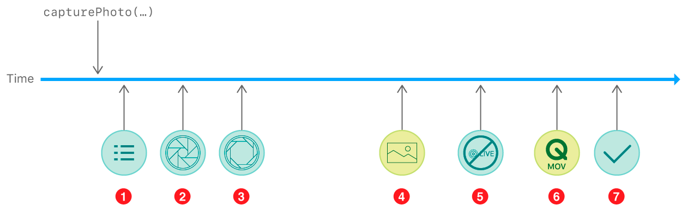

> 导航：[技术](../technologies.md) · [AVFoundation](../avfoundation.md) · [照片捕捉](photo-capture.md) · [捕捉静态照片和实况照片](capturing-still-and-live-photos.md)

# 捕捉并保存实况照片

<sub>文章</sub>

捕捉与系统「相机」App 中创建的实况照片（Live Photo）类似的照片，并将其保存到照片图库。

## 概述

实况照片是一张包含拍摄前后短暂瞬间动作和声音的照片。你的 App 可以使用 AVFoundation 捕捉系统和 [AVCapturePhotoOutput](avcapturephotooutput.md) 类来捕捉并录制实况照片。

> [!note] 注意
> 如果你还不太熟悉捕捉会话、输入设置和照片捕捉，请参阅[设置捕捉会话](setting-up-a-capture-session.md)和[捕捉静态照片和实况照片](capturing-still-and-live-photos.md)。

### 启用实况照片捕捉

对于静态照片，你的捕捉会话只需要一个视频输入，但实况照片包含声音，因此你还需要将一个音频捕捉设备连接到你的会话：

```swift
enum CameraError: Error {
    case configurationFailed
    // ... 其他错误情况 ...
}

func configureSession() throws {
    captureSession.beginConfiguration()
    
    // ... 添加相机输入和照片输出 ...
    
    guard let audioDevice = AVCaptureDevice.default(for: .audio),
          let audioDeviceInput = try? AVCaptureDeviceInput(device: audioDevice) else {
              throw CameraError.configurationFailed
    }
    
    if captureSession.canAddInput(audioDeviceInput) {
        captureSession.addInput(audioDeviceInput)
    } else {
        throw CameraError.configurationFailed
    }
    
    // ... 配置照片输出并开始运行 ...
    
    captureSession.commitConfiguration()
}
```

由于你已经在使用内置相机设备来获取视频（参见[设置捕捉会话](setting-up-a-capture-session.md)），你可以直接使用默认的音频捕捉设备——系统会自动为相机位置使用最佳的麦克风配置。

捕捉实况照片需要对捕捉管线进行内部重新配置，这需要时间并会中断任何正在进行的捕捉。在拍摄第一张实况照片之前，请通过在你的 [AVCapturePhotoOutput](avcapturephotooutput.md) 对象上启用实况照片捕捉，确保已恰当地配置管线：

```swift
let photoOutput = AVCapturePhotoOutput()

// 尝试将照片输出添加到会话。
if captureSession.canAddOutput(photoOutput) {
    captureSession.sessionPreset = .photo
    captureSession.addOutput(photoOutput)
} else {
    throw CameraError.configurationFailed
}

// 配置照片输出的行为。
photoOutput.isHighResolutionCaptureEnabled = true
photoOutput.isLivePhotoCaptureEnabled = photoOutput.isLivePhotoCaptureSupported

// 启动捕捉会话。
captureSession.startRunning()
```

### 捕捉实况照片

一旦你的照片输出已为实况照片准备就绪，你就可以为每次拍摄选择静态图像或实况照片捕捉。要捕捉实况照片，请创建一个 [AVCapturePhotoSettings](avcapturephotosettings.md) 对象，选择实况照片静态图像部分的格式，并提供一个用于写入实况照片影片部分的 URL。然后，调用 [- capturePhotoWithSettings:delegate:](<avcapturephotooutput/capturephoto(with_delegate_).md>) 来触发捕捉：

```swift
let photoSettings = AVCapturePhotoSettings(format: [AVVideoCodecKey: AVVideoCodecType.hevc])
photoSettings.livePhotoMovieFileURL = // 输出 URL

// 使用自定类处理捕捉委托回调，拍摄实况照片。
let captureProcessor = LivePhotoCaptureProcessor()
photoOutput.capturePhoto(with: photoSettings, delegate: captureProcessor)
```

### 处理实况照片结果

实况照片在「照片」App 中以单个资产的形式呈现给用户，但它实际上由单独的文件组成：主静态图像，以及一个包含前后瞬间动作和声音的影片文件。捕捉系统会在每个结果可用时分别交付它们。

[- captureOutput:didFinishProcessingPhoto:error:](<avcapturephotocapturedelegate/photooutput(__didfinishprocessingphoto_error_).md>) 方法以 [AVCapturePhoto](avcapturephoto.md) 对象的形式交付实况照片的静态图像部分。由于你需要将静态图像和影片文件一起保存，最好从 [AVCapturePhoto](avcapturephoto.md) 中提取图像文件数据并保留它，直到影片文件录制完成，如下所示。（你也可以使用此方法在 UI 中指示静态图像已被捕捉。）

```swift
func photoOutput(_ output: AVCapturePhotoOutput,
                 didFinishProcessingPhoto photo: AVCapturePhoto,
                 error: Error?) {
    guard error != nil else {
        print("Error capturing Live Photo still: \(error!)");
        return
    }
    
    // 获取并处理捕捉到的图像数据。
    processImage(photo.fileDataRepresentation())
}
```

[- captureOutput:didFinishProcessingLivePhotoToMovieFileAtURL:duration:photoDisplayTime:resolvedSettings:error:](<avcapturephotocapturedelegate/photooutput(__didfinishprocessinglivephototomoviefileat_duration_photodisplaytime_resolvedsettings_error_).md>) 方法稍后触发，表明你在触发捕捉时指定的 URL 现在包含一个完整的影片文件。一旦你同时拥有实况照片的静态图像和影片部分，就可以一起保存它们：

```swift
func photoOutput(_ output: AVCapturePhotoOutput,
                 didFinishProcessingLivePhotoToMovieFileAt outputFileURL: URL,
                 duration: CMTime,
                 photoDisplayTime: CMTime,
                 resolvedSettings: AVCaptureResolvedPhotoSettings,
                 error: Error?) {
    
    guard error != nil else {
        print("Error capturing Live Photo movie: \(error!)");
        return
    }
    
    guard let stillImageData = stillImageData else { return }
    
    // 保存实况照片。
    saveLivePhotoToPhotosLibrary(stillImageData: stillImageData,
                                 livePhotoMovieURL: outputFileURL)
}
```

> [!note] 注意
> 要在捕捉后显示实况照片，请参阅 [PHLivePhoto](../photos/phlivephoto.md) 和 [PHLivePhotoView](../photosui/phlivephotoview.md)。

### 将实况照片保存到照片图库

使用 [PHAssetCreationRequest](../photos/phassetcreationrequest.md) 类创建一个由来自多个文件的媒体组成的单个照片资产——对于实况照片而言，即静态图像及其配对视频。与[保存捕捉到的照片](saving-captured-photos.md)中一样，你需要将该请求包裹在 [PHPhotoLibrary](../photos/phphotolibrary.md) 更改块中，并首先确保你的 App 已获得用户访问「照片」的许可。

```swift
func saveLivePhotoToPhotosLibrary(stillImageData: Data, livePhotoMovieURL: URL) {    PHPhotoLibrary.requestAuthorization { status in
        guard status == .authorized else { return }
        
        PHPhotoLibrary.shared().performChanges({
            // 将捕捉到的照片的文件数据添加为照片资产的主资源。
            let creationRequest = PHAssetCreationRequest.forAsset()
            creationRequest.addResource(with: .photo, data: stillImageData, options: nil)
            
            // 将影片文件 URL 添加为实况照片的配对视频资源。
            let options = PHAssetResourceCreationOptions()
            options.shouldMoveFile = true
            creationRequest.addResource(with: .pairedVideo, fileURL: livePhotoMovieURL, options: options)
        }) { success, error in
            // 处理完成。
        }
    }
}
```

> [!tip] 提示
> 使用 [shouldMoveFile](../photos/phassetresourcecreationoptions/shouldmovefile.md) 选项，这样 iOS 就能将影片文件从你的 App 沙盒转移到系统照片图库，而无需代价高昂的数据复制操作。

### 跟踪实况照片进度

捕捉实况照片会在[跟踪照片捕捉进度](tracking-photo-capture-progress.md)所示流程的基础上增加两个额外步骤：在交付静态照片结果（第 4 步）之后，照片输出会通知你影片捕捉状态（第 5 步），并交付影片结果（第 6 步）。（最终清理成为第 7 步。）



当用户在系统「相机」App 中捕捉实况照片时，会出现一个「实况」指示符几秒钟，让用户知道视频和音频仍在录制中。要在你的 App 中提供类似的界面，请在你的照片捕捉委托中实现以下方法：

- [- captureOutput:willBeginCaptureForResolvedSettings:](<avcapturephotocapturedelegate/photooutput(__willbegincapturefor_).md>) 方法告诉你捕捉已开始：实现此方法以显示录制指示符。
- [- captureOutput:didFinishRecordingLivePhotoMovieForEventualFileAtURL:resolvedSettings:](<avcapturephotocapturedelegate/photooutput(__didfinishrecordinglivephotomovieforeventualfileat_resolvedsettings_).md>) 方法告诉你实况照片影片已不再录制：实现此方法以隐藏指示符。（注意此时影片文件尚不可用。）

你可以同时进行多个实况照片捕捉，因此最好使用这些方法来跟踪「进行中」捕捉的数量，只有当该数量降至零时才隐藏指示符：

```swift
class LivePhotoCaptureProcessor: NSObject, AVCapturePhotoCaptureDelegate {
    // ... 其他 PhotoCaptureDelegate 方法和配套属性 ...
    
    // 在实况照片捕捉开始和结束时调用的处理程序。
    var livePhotoStatusHandler: (Bool) -> () = { _ in }
    
    // 用于跟踪进行中的捕捉并相应更新 UI 的属性。
    var livePhotosInProgress = 0 {
        didSet {
            // 根据此属性的值相应地更新 UI
        }
    }
    
    // 当 PhotoCaptureDelegate 方法表明实况照片捕捉正在进行时调用处理程序。
    func photoOutput(_ output: AVCapturePhotoOutput,
                     willBeginCaptureFor resolvedSettings: AVCaptureResolvedPhotoSettings) {
        let capturingLivePhoto = (resolvedSettings.livePhotoMovieDimensions.width > 0 && resolvedSettings.livePhotoMovieDimensions.height > 0)
        livePhotoStatusHandler(capturingLivePhoto)
    }
    
    func photoOutput(_ output: AVCapturePhotoOutput,
                     didFinishRecordingLivePhotoMovieForEventualFileAt outputFileURL: URL,
                     resolvedSettings: AVCaptureResolvedPhotoSettings) {
        livePhotoStatusHandler(false)
    }
}
```

## 另请参阅

### 后续步骤

- [保存捕捉到的照片](saving-captured-photos.md) — 将照片捕捉得到的图像和其他数据添加到照片图库。
- [跟踪照片捕捉进度](tracking-photo-capture-progress.md) — 监测捕捉过程中的关键事件，以便在相机 UI 中提供反馈。
