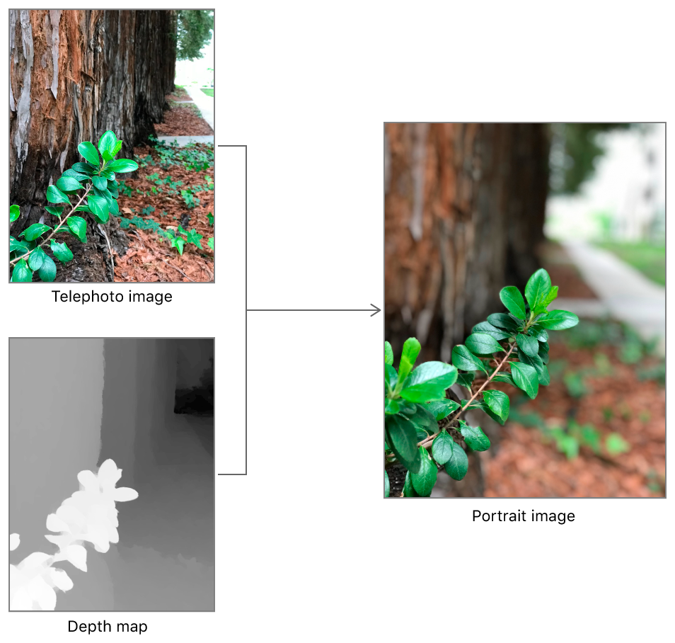
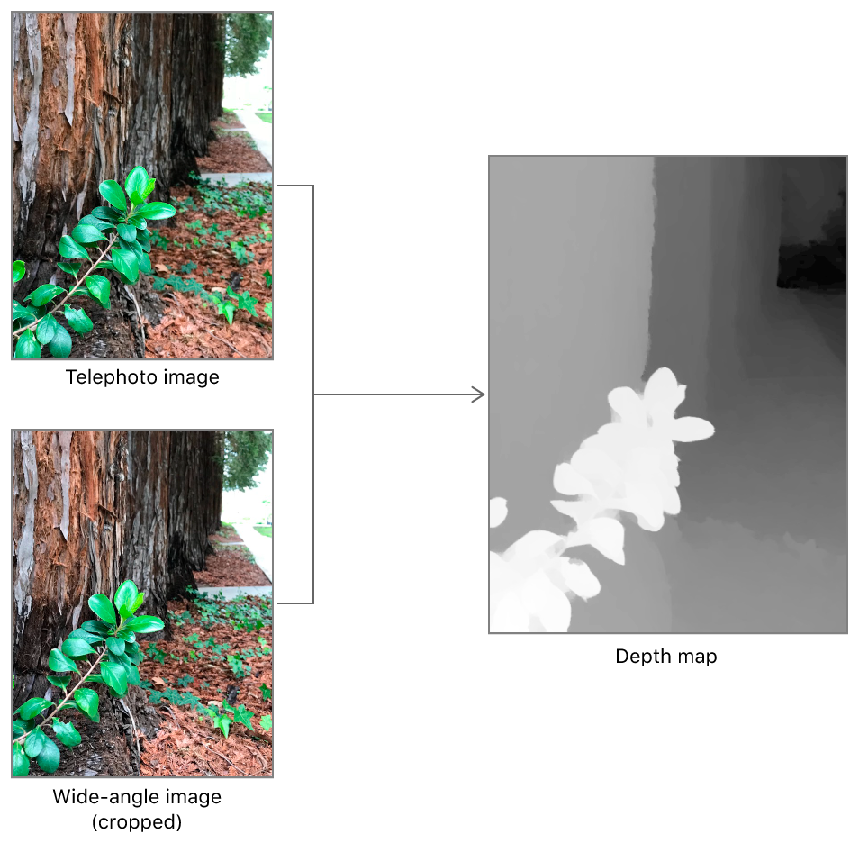

> 导航：[技术](../technologies.md) · [AVFoundation](../avfoundation.md) · [附加数据捕获](additional-data-capture.md)

# 拍摄带深度信息的照片

<sub>文章</sub>

在拍摄照片的同时获取深度图，以创建类似系统相机人像模式的效果（在兼容设备上）。

## 概述

在配备后置双摄像头或前置原深感（TrueDepth）摄像头的 iOS 设备上，捕获系统可以记录深度信息。深度图就像一张图像；不过，它的每个像素提供的不是颜色，而是从相机到图像该部分位置的距离（以绝对值表示，或相对于深度图中其他像素表示）。

你可以将深度图与照片配合使用，创建对照片前景和背景元素区别处理的图像处理效果，就像 iOS「相机」App 中的人像模式那样。通过将颜色数据和深度数据分开保存，你甚至可以在照片拍摄很久之后应用和更改这些效果。



通过添加以下步骤，你可以为[拍摄静态图像和实况照片](capturing-still-and-live-photos.md)中介绍的许多其他摄影工作流添加深度拍摄功能。

### 准备深度照片拍摄

要拍摄深度图，你需要先选择一个 [AVCaptureDeviceTypeBuiltInDualCamera](avcapturedevice/devicetype-swift.struct/builtindualcamera.md) 或 [AVCaptureDeviceTypeBuiltInTrueDepthCamera](avcapturedevice/devicetype-swift.struct/builtintruedepthcamera.md) 捕获设备作为会话的视频输入。即使 iOS 设备拥有双摄像头或原深感摄像头，选择默认的后置或前置摄像头也不会启用深度拍摄。

拍摄深度信息还需要捕获管线进行内部重新配置，这会短暂延迟拍摄并中断任何进行中的拍摄。在拍摄第一张深度照片之前，请确保通过在 [AVCapturePhotoOutput](avcapturephotooutput.md) 对象上启用深度拍摄来正确配置管线。

```swift
// 选择一个支持深度的捕获设备。
guard let videoDevice = AVCaptureDevice.default(.builtInDualCamera,
    for: .video, position: .back)
    else { fatalError("No dual camera.") }
guard let videoDeviceInput = try? AVCaptureDeviceInput(device: videoDevice),
    self.captureSession.canAddInput(videoDeviceInput)
    else { fatalError("Can't add video input.") }
self.captureSession.beginConfiguration()
self.captureSession.addInput(videoDeviceInput)

// 为深度数据拍摄设置照片输出。
let photoOutput = AVCapturePhotoOutput()
guard self.captureSession.canAddOutput(photoOutput)
    else { fatalError("Can't add photo output.") }
self.captureSession.addOutput(photoOutput)
self.captureSession.sessionPreset = .photo
// 将输出添加到捕获会话后启用深度数据的送达。
photoOutput.isDepthDataDeliveryEnabled = photoOutput.isDepthDataDeliverySupported
self.captureSession.commitConfiguration()
```

> [!note] 注意
> 在双摄像头上启用深度拍摄会锁定广角摄像头和长焦摄像头的变焦系数。

### 选择设置

一旦你的照片输出为深度拍摄做好了准备，你就可以请求任何单张照片在拍摄彩色图像的同时捕获深度图。创建一个 [AVCapturePhotoSettings](avcapturephotosettings.md) 对象，选择彩色图像的格式。然后启用深度拍摄和深度输出（以及你希望为该照片指定的任何其他设置），并调用 [- capturePhotoWithSettings:delegate:](<avcapturephotooutput/capturephoto(with_delegate_).md>) 方法。

```swift
let photoSettings = AVCapturePhotoSettings(format: [AVVideoCodecKey: AVVideoCodecType.hevc])
photoSettings.isDepthDataDeliveryEnabled = photoOutput.isDepthDataDeliverySupported

// 拍摄照片，使用自定义类处理捕获委托回调。
let captureProcessor = PhotoCaptureProcessor()
photoOutput.capturePhoto(with: photoSettings, delegate: captureProcessor)
```

### 处理结果

拍摄完成后，照片输出会调用你的委托的 [- captureOutput:didFinishProcessingPhoto:error:](<avcapturephotocapturedelegate/photooutput(__didfinishprocessingphoto_error_).md>) 方法，以 [AVCapturePhoto](avcapturephoto.md) 对象的形式提供照片和捕获到的深度数据。

如果你打算立即使用捕获到的深度数据——例如显示基于深度的图像处理效果的预览——你可以在照片对象的 [depthData](avcapturephoto/depthdata.md) 属性中找到它。

否则，当你使用 [- fileDataRepresentation](<avcapturephoto/filedatarepresentation().md>) 方法生成用于保存照片的文件数据时，捕获输出会在其中嵌入深度数据和与深度相关的元数据。如果你将生成的文件添加到「照片」图库，其他 App（包括系统「照片」App）会自动识别其中的深度数据，并可以应用基于深度的图像处理效果。（如果你需要停用此选项，请参阅 [embedsDepthDataInPhoto](avcapturephotosettings/embedsdepthdatainphoto.md) 设置。）

### 关于视差、深度与精度

当你在兼容设备上使用后置双摄像头启用深度拍摄时（请参阅 [iOS 设备兼容性参考](https://developer.apple.com/library/archive/documentation/DeviceInformation/Reference/iOSDeviceCompatibility/Introduction/Introduction.html#//apple_ref/doc/uid/TP40013599)），系统会使用两个相机同时捕捉图像。由于两个平行摄像头在设备背面相距一小段距离，出现在两张图像中的相同特征会显示出视差偏移：距离相机越近的物体，在两张图像之间偏移的距离越大。捕获系统利用这个差值，即_视差_（disparity），来推断从相机到图像中各物体的相对距离，如下图所示。



由双摄像头设备捕获的深度图中的每个点都以 1/米为视差单位进行度量，并提供 [AVDepthDataAccuracyRelative](avdepthdata/accuracy/relative.md) 精度。单个点并不是对真实世界距离的可靠估计，但点与点之间的变化足够一致，可用于基于深度的图像处理效果。

原深感摄像头会在相机前方投射红外光图案，并用红外相机对该图案成像。通过观察场景中的物体如何使该图案变形，捕获系统可以计算出从相机到图像中每个点的距离。

原深感摄像头默认生成视差图，使得到的深度数据与双摄像头设备生成的数据类似。但与双摄像头设备不同的是，原深感摄像头可以以 [AVDepthDataAccuracyAbsolute](avdepthdata/accuracy/absolute.md) 精度直接测量深度（以米为单位）。要拍摄深度而非视差，请在启动捕获会话之前设置捕获设备的 [activeDepthDataFormat](avcapturedevice/activedepthdataformat.md)：

```swift
// 选择一个与当前色彩格式兼容的深度（而非视差）格式。
let availableFormats = captureDevice.activeFormat.supportedDepthDataFormats

let depthFormat = availableFormats.filter { format in
    let pixelFormatType =
        CMFormatDescriptionGetMediaSubType(format.formatDescription)
    
    return (pixelFormatType == kCVPixelFormatType_DepthFloat16 ||
            pixelFormatType == kCVPixelFormatType_DepthFloat32)
}.first

// 将捕获设备设置为使用该深度格式。
captureSession.beginConfiguration()
captureDevice.activeDepthDataFormat = depthFormat
captureSession.commitConfiguration()
```

## 另请参阅

### 深度数据拍摄

- [手动创建辅助深度数据](creating-auxiliary-depth-data-manually.md) — 生成一张深度图像并将其附加到你自己的图像上。
- [使用 LiDAR 摄像头拍摄深度](capturing-depth-using-the-lidar-camera.md) — 在支持的设备上访问 LiDAR 摄像头以捕获精确的深度数据。
- [AVCamFilter：为捕获流应用滤镜](avcamfilter-applying-filters-to-a-capture-stream.md) — 以玫瑰色滤镜和深度效果渲染捕获流。
- [从原深感摄像头流式传输深度数据](streaming-depth-data-from-the-truedepth-camera.md) — 以 2D 和 3D 形式呈现来自原深感摄像头的深度数据。
- [利用原深感摄像头数据增强实时视频](enhancing-live-video-by-leveraging-truedepth-camera-data.md) — 为从前置原深感摄像头流式传输的实时捕获画面应用你自己的背景。
- [AVCaptureDepthDataOutput](avcapturedepthdataoutput.md) — 一种在兼容相机设备上记录场景深度信息的捕获输出。
- [AVDepthData](avdepthdata.md) — 由兼容相机设备捕获的逐像素距离或视差信息的容器。
- [AVCameraCalibrationData](avcameracalibrationdata.md) — 关于用于捕获图像和深度数据的相机特性的信息。
