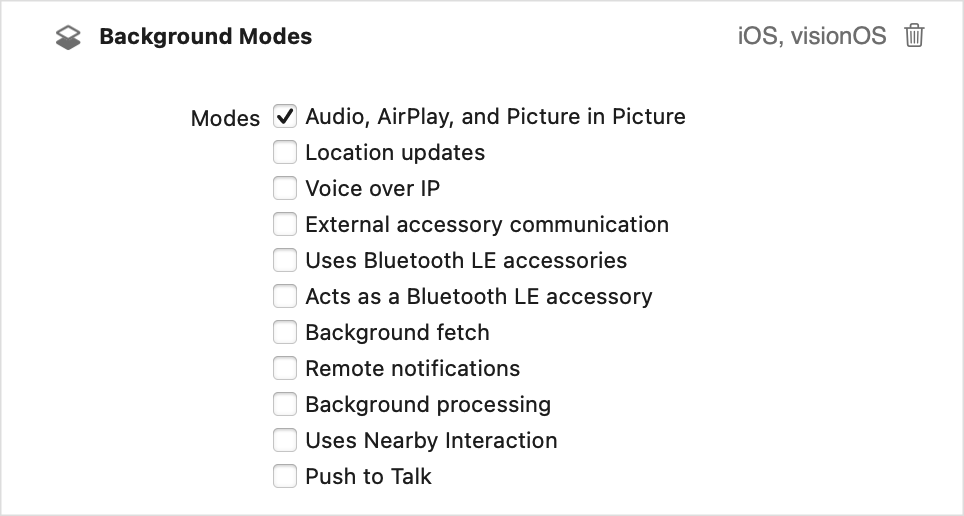

> 导航： [Technologies](../technologies.md) · [AVFoundation](../avfoundation.md) · [Media playback](media-playback.md)

# 为媒体播放配置你的 App

<sub>文章</sub>

配置 App 以启用标准的媒体播放行为。

## 概述

当你为 iOS、tvOS 和 visionOS 构建媒体播放 App 时，需要做额外的配置才能启用预期的播放行为。配置音频体验和后台运行有助于确保你的 App 的音频按预期工作。它还让受支持平台上的高级特性成为可能，例如隔空播放流式传输和画中画播放。

### 配置音频会话

除 macOS（它主要把控制权交给 App）之外，Apple 平台都提供一种由操作系统管理的音频体验。这使操作系统能够在人们切换 App 时提供无缝的音频体验，并响应诸如电话或 FaceTime 通话之类的高优先级音频请求。

你的 App 使用一个 [AVAudioSession](../avfaudio/avaudiosession.md) 以语义化的方式配置其音频行为，例如把播放或录制作为主要用途。你把这些细节的管理委托给音频会话，由它确保操作系统能够最好地管理用户的音频体验。

你的 App 会自动拥有一个由系统按以下默认行为配置的音频会话：

- 你的 App 播放音频时会使其他后台音频静音
- 支持音频播放但不支持录音
- iOS 中响铃/静音开关设为静音模式时会使 App 音频静音
- iOS 中设备锁定时会使 App 音频静音

默认的音频会话提供了有用的行为，但通常不提供构建播放类 App 时所需的体验和功能。要添加所需的行为，请配置你 App 的音频会话类别。

音频会话类别定义你的 App 所需的一般音频行为。AVFoundation 定义了若干可用的音频会话类别，但与媒体播放 App 最相关的是 [playback](../avfaudio/avaudiosession/category-swift.struct/playback.md)。这个类别表明媒体播放是你 App 的核心功能。当你指定这个类别时，系统仅会在 iOS 上有人把响铃/静音开关设为静音模式时才不使你的 App 音频静音。启用这个类别意味着，如果你按下一节所述使用了“音频、隔空播放与画中画”后台模式，你的 App 就可以播放后台音频。

使用一个 [AVAudioSession](../avfaudio/avaudiosession.md) 对象来配置你 App 的音频会话。音频会话是一个单例对象，你用它来设置音频会话的[类别](../avfaudio/avaudiosession/category-swift.property.md)、[模式](../avfaudio/avaudiosession/mode-swift.property.md)和其他设置。要为优化影片播放而配置音频会话：

```swift
class PlayerModel: ObservableObject {
    
    func configureAudioSession() {
        do {
            let session = AVAudioSession.sharedInstance()
            // Configure the app for playback of long-form movies.
            try session.setCategory(.playback, mode: .moviePlayback)
        } catch {
            // Handle error.
        }
    }
}
```

要启用这个类别，使用 [setActive(_:options:)](<../avfaudio/avaudiosession/setactive(__options_).md>) 方法激活音频会话。

> [!note] 注意
> 你可以在设置类别之后的任何时间激活音频会话，但建议把这个调用推迟到你的 App 开始音频播放时。推迟该调用可确保你不会过早打断可能正在进行的其他后台音频。

设置类别是与音频会话最起码的交互，但还有其他配置选项和功能可用。例如，在 visionOS 中，你可以通过配置音频会话来自定用户的空间音频体验。更多信息参见 [AVAudioSession](../avfaudio/avaudiosession.md)。

### 配置后台模式

系统要求你启用某些能力才能执行某些后台操作。播放类 App 需要的一个常见能力是播放后台音频。启用该能力后，当人们切换到另一个 App 或锁定其 iOS 设备时，你的 App 的音频会继续播放。你的 App 也需要这个能力才能在受支持平台上启用高级播放特性，例如隔空播放流式传输和画中画播放。

使用 Xcode 配置这个能力：

1. 在 Xcode 中选择你的 App 的 target，并选择 Signing & Capabilities 标签页。
2. 点按 + Capability 按钮并把 Background Modes 能力添加到项目中。
3. 在 Background Modes 界面中，在其后台模式列表下选择 Audio, AirPlay, and Picture in Picture 选项。



<sub>Xcode target 的 Signing & Capabilities 标签页中 Background Modes 部分的截图。图顶部显示 Background Modes 标题，下方是用于启用特定模式的复选框纵向列表。最上面的复选框已启用，表示该 App 支持音频、隔空播放与画中画后台模式。</sub>

启用这个模式并配置好音频会话后，你的 App 就可以播放后台音频了。在 iOS 中，启用该选项后，你的 App 可以通过隔空播放流式传输其内容；在 iOS 和 tvOS 上，它还可以使用画中画播放。
