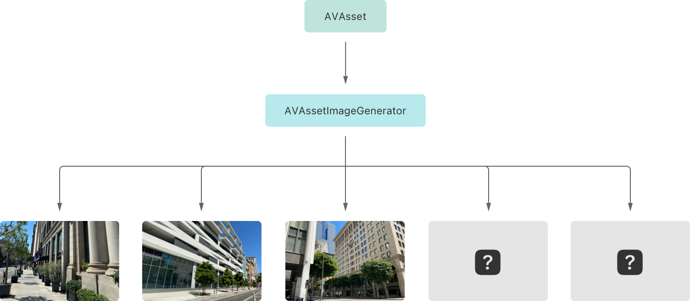

> 导航： [Technologies](../technologies.md) · [AVFoundation](../avfoundation.md) · [Media reading and writing](media-reading-and-writing.md)

# 从视频 asset 创建图像

<sub>文章</sub>

通过从视频的帧生成图像，显示媒体时间线中特定时间点的图像。

## 概述

构建视频 App 时的一个常见需求是显示视频内容的图像。你可能想在列表中视频的旁边显示一张缩略图，或显示横跨视频时长的多张图像，用来构建可视化的拖动浏览或选择用户界面。AVFoundation 让你可以使用 [AVAssetImageGenerator](avassetimagegenerator.md) 轻松地从 App 的视频内容生成图像。



<sub>一幅自上而下的插图，展示使用 AVAssetImageGenerator 时的数据流。图的顶部是一个代表 AVAsset 对象的矩形。从该 asset 有一条带箭头的线指向图中间代表 AVAssetImageGenerator 的另一个矩形。图像生成器下方是五个水平排列的矩形，代表图像生成请求。从图像生成器到每个图像请求都有一条带箭头的线，表明它已生成三张图像，还有两张待处理。</sub>

[AVAssetImageGenerator](avassetimagegenerator.md) 是一个实用工具类，可从包含一个或多个视频轨道的 asset 创建图像。你可以用它为单个时间点生成图像，也可以向它传入一个时间数组来生成一系列图像。

### 配置图像生成器

向 [AVAssetImageGenerator](avassetimagegenerator.md) 传入一个要从中获取图像的视频 asset 来创建它的实例。生成器支持从本地和远程的基于文件的媒体创建图像，也支持从提供仅 I 帧版本（I-frame only renditions）的 HTTP Live Streaming（HLS）视频创建图像。

```swift
let asset: AVAsset = // A video asset.
let generator = AVAssetImageGenerator(asset: asset)
```

> [!note] 注意
> 你可以从提供带 `EXT-X-I-FRAMES-ONLY` 标签的媒体播放列表的 HLS 流生成图像。播放列表指定的 I 帧之间的时长决定了图像生成请求的时间分辨率。

图像生成器在创建时就已准备好生成图像，但它还提供一些可配置的属性供你自定其行为。你通常会设置的一个属性是它的 [maximumSize](avassetimagegenerator/maximumsize.md)。默认情况下，生成器以视频的原生分辨率生成图像，这通常大于所需大小，并且可能消耗大量 CPU 和内存。作为替代，为它的 [maximumSize](avassetimagegenerator/maximumsize.md) 属性设置一个值来限制其输出的大小。例如，你可以把宽度限制为特定值，并指定 `0` 让高度按比例缩放，方法如下设置最大尺寸。

```swift
// Generate the equivalent of a 150-pixel-wide @2x image.
generator.maximumSize = CGSize(width: 300, height: 0)
```

### 指定时间精度

默认情况下，图像生成器会在你请求的时间附近创建图像，但为了效率起见，其实际时间可能稍微提前或推后。要更改允许生成器偏离请求时间的时长，设置它的 [requestedTimeToleranceBefore](avassetimagegenerator/requestedtimetolerancebefore.md) 和 [requestedTimeToleranceAfter](avassetimagegenerator/requestedtimetoleranceafter.md) 属性的值。例如，要让图像生成发生在这样一个时间范围内——不早于你请求的时间，且不晚于其后两秒——可如下设置它的容差值。

```swift
// Configure the generator's time tolerance values.
generator.requestedTimeToleranceBefore = .zero
generator.requestedTimeToleranceAfter = CMTime(seconds: 2, preferredTimescale: 600)
```

你可以通过把前后容差的值都设为 [zero](../coremedia/cmtime/zero.md) 来请求帧级精确的图像生成。不过，以这种方式配置生成器需要它执行额外的帧解码，这会影响其图像生成速度。

### 生成图像

获取并解码生成器生成图像所需的媒体数据需要未知的时间。以同步方式执行图像生成并不安全，因为它会阻塞调用线程，可能降低 App 的用户体验，甚至可能导致崩溃。因此，请以异步方式执行图像生成。

要从视频时间线创建单张图像，调用异步的 [image(at:)](<avassetimagegenerator/image(at_).md>) 方法，向它传入你请求的时间。下面的示例展示如何为视频的第一帧创建图像。

```swift
// Generate an image at time zero.
let (image, actualTime) = try await generator.image(at: .zero)
```

由于创建图像的时间可能与你请求的时间不同，该方法会在元组中把实际的图像生成时间连同图像一起返回。如果你不需要这一信息，可以像下面这样更简洁地获取图像。

```swift
// Generate an image at time zero. Access the image alone.
let image = try await generator.image(at: .zero).image
```

你还可以使用图像生成器从视频时间线创建一系列图像。要从一个视频 asset 生成多张图像，如下所示调用异步的 [images(for:)](<avassetimagegenerator/images(for_).md>) 方法。

```swift
let times: [CMTime] = // An array of times at which to create images.
for await result in generator.images(for: times) {
    switch result {
    case .success(requestedTime: let requested, image: let image, actualTime: let actual):
        // Process the image for the requested time.
    case .failure(requestedTime: let requested, error: let error):
        // Handle the failure for the requested time.
    }
}
```

该方法返回一个 [Images](avassetimagegenerator/images.md) 类型的异步序列，你可以迭代它并等待结果。如果对某个请求时间的图像生成成功，结果会提供该图像以及请求的图像生成时间和实际时间。如果某个请求时间失败了，结果会提供该时间和一个描述失败的错误。

## 另请参阅

### 图像生成

- [AVAssetImageGenerator](avassetimagegenerator.md) — 一个从视频 asset 生成图像的对象。
