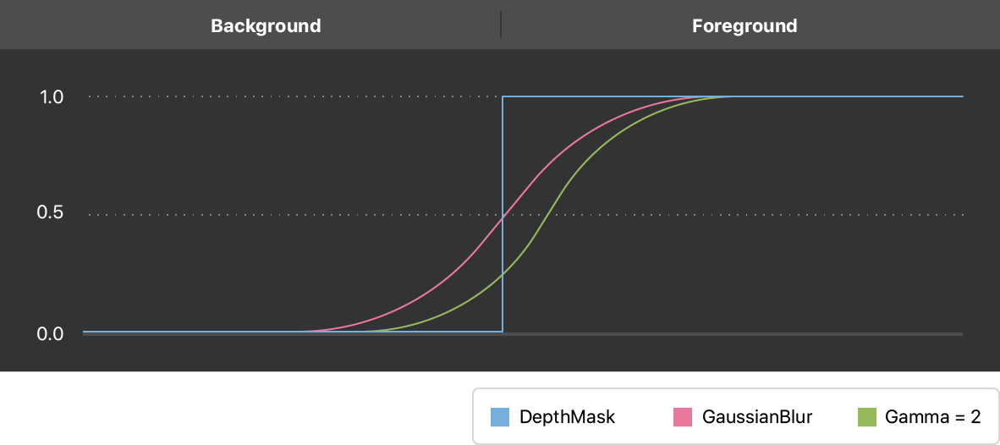

> 导航：[技术](../technologies.md) · [AVFoundation](../avfoundation.md) · [附加数据捕捉](additional-data-capture.md)

# 利用 TrueDepth 相机数据增强实况视频

<sub>示例代码</sub>

为来自前置 TrueDepth 相机的实况捕捉画面应用你自己的背景。

## 概述

TrueDepth 相机提供实时深度数据，让你能够在视频画面中把前景从背景中分割出来。

本示例 App 利用深度数据，用一个自定图像动态替换整个背景。然后，它执行高斯滤波和其他图像处理操作，以消除空洞并平滑效果。

### 预览示例 App

要查看此示例 App 的实际运行效果，请在运行 iOS 11 或更高版本的设备上于 Xcode 中构建并运行该项目。由于 Xcode 无法访问 TrueDepth 相机，本示例无法在 Xcode 模拟器中运行。

示例 App 首先移除背景，将其替换为黑色。在视频画面的任意位置向下轻扫，即可应用你自己的相册图像。

### 设置来自 TrueDepth 相机的实况捕捉

通过会话队列在单独的线程上设置 [AVCaptureSession](avcapturesession.md)。在为捕捉配置相机之前，先初始化这个会话队列。

```swift
// 在此队列上与会话及其他会话对象通信。
private let sessionQueue = DispatchQueue(label: "session queue", attributes: [], autoreleaseFrequency: .workItem)
```

[- startRunning](<avcapturesession/startrunning().md>) 方法是一个阻塞调用，可能耗时较长。将会话设置分派到 sessionQueue，这样主队列就不会被阻塞，App 的 UI 得以保持响应。

```swift
sessionQueue.async {
    self.configureSession()
}
```

设置相机进行视频捕捉的步骤与普通视频捕捉大体相同。有关配置串流设置的详细信息，请参阅[设置捕捉会话](setting-up-a-capture-session.md)。

在常规设置的基础上，通过声明一个单独的输出来请求深度数据：

```swift
private let depthDataOutput = AVCaptureDepthDataOutput()
```

将这种输出类型显式添加到你的捕捉会话：

```swift
if session.canAddOutput(depthDataOutput) {
    session.addOutput(depthDataOutput)
    depthDataOutput.isFilteringEnabled = true
    if let connection = depthDataOutput.connection(with: .depthData) {
        connection.isEnabled = true
    } else {
        print("No AVCaptureConnection")
    }
} else {
    print("Could not add depth data output to the session")
    setupResult = .configurationFailed
    session.commitConfiguration()
    return
}
```

查找具有浮点深度值的最高可用分辨率，并锁定该格式的配置。

```swift
let depthFormats = videoDevice.activeFormat.supportedDepthDataFormats
let depth32formats = depthFormats.filter({
    CMFormatDescriptionGetMediaSubType($0.formatDescription) == kCVPixelFormatType_DepthFloat32
})
if depth32formats.isEmpty {
    print("Device does not support Float32 depth format")
    setupResult = .configurationFailed
    session.commitConfiguration()
    return
}

let selectedFormat = depth32formats.max(by: { first, second in
    CMVideoFormatDescriptionGetDimensions(first.formatDescription).width <
        CMVideoFormatDescriptionGetDimensions(second.formatDescription).width })
```

将普通 RGB 视频数据与深度数据输出同步。dataOutputs 数组中的第一个输出是主输出。

```swift
outputSynchronizer = AVCaptureDataOutputSynchronizer(dataOutputs: [videoDataOutput, depthDataOutput, metadataOutput])
outputSynchronizer!.setDelegate(self, queue: dataOutputQueue)
```

### 创建二值前景掩码

假定前景是人脸。你可以通过 Vision 框架的 [VNDetectFaceRectanglesRequest](../vision/vndetectfacerectanglesrequest.md) 完成人脸检测，但本示例不需要 Vision 的其他功能，因此更简单的做法是查询 [AVMetadataObject](avmetadataobject.md) 的 [AVMetadataObjectTypeFace](avmetadataobject/objecttype/face.md)。

```swift
self.session.addOutput(metadataOutput)
if metadataOutput.availableMetadataObjectTypes.contains(.face) {
    metadataOutput.metadataObjectTypes = [.face]
}
```

利用 [AVMetadataObject](avmetadataobject.md)，找到人脸的边界框和中心。假定只有一张人脸，取元数据对象中的第一个。

```swift
if let syncedMetaData: AVCaptureSynchronizedMetadataObjectData =
    synchronizedDataCollection.synchronizedData(for: metadataOutput) as? AVCaptureSynchronizedMetadataObjectData,
    let firstFace = syncedMetaData.metadataObjects.first,
    let connection = self.videoDataOutput.connection(with: AVMediaType.video),
    let face = videoDataOutput.transformedMetadataObject(for: firstFace, connection: connection) {
    let faceCenter = CGPoint(x: face.bounds.midX, y: face.bounds.midY)
```

深度图的分辨率与普通相机图像不同；因此，普通图像坐标与深度图坐标之间相差一个比例因子。计算这个比例因子，并将人脸中心转换到深度图坐标。

```swift
let scaleFactor = CGFloat(CVPixelBufferGetWidth(depthPixelBuffer)) / CGFloat(CVPixelBufferGetWidth(videoPixelBuffer))
let pixelX = Int((faceCenter.x * scaleFactor).rounded())
let pixelY = Int((faceCenter.y * scaleFactor).rounded())
```

得到深度图坐标中的人脸后，对图像做阈值处理以创建二值掩码图像，其中前景像素为 `1`，背景像素为 `0`。

```swift
let depthWidth = CVPixelBufferGetWidth(depthPixelBuffer)
let depthHeight = CVPixelBufferGetHeight(depthPixelBuffer)

CVPixelBufferLockBaseAddress(depthPixelBuffer, CVPixelBufferLockFlags(rawValue: 0))

for yMap in 0 ..< depthHeight {
    let rowData = CVPixelBufferGetBaseAddress(depthPixelBuffer)! + yMap * CVPixelBufferGetBytesPerRow(depthPixelBuffer)
    let data = UnsafeMutableBufferPointer<Float32>(start: rowData.assumingMemoryBound(to: Float32.self), count: depthWidth)
    for index in 0 ..< depthWidth {
        if data[index] > 0 && data[index] <= depthCutOff {
            data[index] = 1.0
        } else {
            data[index] = 0.0
        }
    }
}
```

### 使用 Core Image 滤镜平滑深度掩码

深度图不具备 RGB 图像那样的清晰分辨率，因此掩码在前景与背景的交界处可能含有空洞。得到下采样后的掩码图像后，使用高斯滤波器平滑空洞，使交界处不会显得参差或像素化。在滤波前对图像做钳制（clamp），之后进行裁剪，这样它与原图像合成应用时才能保持正确的尺寸。

```swift
let depthMaskImage = CIImage(cvPixelBuffer: depthPixelBuffer, options: [:])

// 平滑边缘以创建 alpha 遮罩，然后将其上采样至 RGB 分辨率。
let alphaUpscaleFactor = Float(CVPixelBufferGetWidth(videoPixelBuffer)) / Float(depthWidth)
let alphaMatte = depthMaskImage.clampedToExtent()
    .applyingFilter("CIGaussianBlur", parameters: ["inputRadius": blurRadius])
    .applyingFilter("CIGammaAdjust", parameters: ["inputPower": gamma])
    .cropped(to: depthMaskImage.extent)
    .applyingFilter("CIBicubicScaleTransform", parameters: ["inputScale": alphaUpscaleFactor])
```

`CIGaussianBlur` 和 `CIGammaAdjust` 滤镜的参数直接影响边缘像素的平滑程度。你可以通过调整高斯模糊滤镜的输入半径以及伽马调整滤镜的输入幂来调节模糊度和平滑度。



### 使用 alpha 遮罩混合前景与背景

最后一步是将滤波后的平滑二值掩码应用到输入视频帧上。

由于你已经使用 `CIGaussianBlur` 和 `CIGammaAdjust` 滤镜在 Core Image 中完成了图像处理，因此在 Core Image 中应用生成的掩码在计算上也最高效。这意味着要把你的视频从 [CVPixelBuffer](../corevideo/cvpixelbuffer-q2e.md) 格式转换为 [CIImage](../coreimage/ciimage.md) 格式，从而可以将 alpha 遮罩应用到原图像上，并使用 `CIBlendWithMask` 滤镜混合你的自定背景图像。

```swift
let image = CIImage(cvPixelBuffer: videoPixelBuffer)

// 将 alpha 遮罩应用到视频上。
var parameters = ["inputMaskImage": alphaMatte]
if let background = self.backgroundImage {
    parameters["inputBackgroundImage"] = background
}

let output = image.applyingFilter("CIBlendWithMask", parameters: parameters)
```

更新你的预览以在屏幕上显示最终合成的图像。

```swift
previewView.image = output
```

## 另请参阅

### 深度数据捕捉

- [捕捉带深度的照片](capturing-photos-with-depth.md) — 获取带深度图的照片，以创建类似系统相机人像模式的效果（在兼容设备上）。
- [手动创建辅助深度数据](creating-auxiliary-depth-data-manually.md) — 生成深度图像并将其附加到你自己的图像上。
- [使用 LiDAR 相机捕捉深度数据](capturing-depth-using-the-lidar-camera.md) — 在支持的设备上访问 LiDAR 相机，以捕捉精确的深度数据。
- [AVCamFilter：为捕捉流应用滤镜](avcamfilter-applying-filters-to-a-capture-stream.md) — 以玫瑰色滤镜和深度效果渲染捕捉流。
- [从 TrueDepth 相机串流深度数据](streaming-depth-data-from-the-truedepth-camera.md) — 以 2D 和 3D 形式可视化来自 TrueDepth 相机的深度数据。
- [AVCaptureDepthDataOutput](avcapturedepthdataoutput.md) — 一种捕捉输出，在兼容的相机设备上记录场景深度信息。
- [AVDepthData](avdepthdata.md) — 一个容器，用于存放由兼容相机设备捕捉的逐像素距离或视差信息。
- [AVCameraCalibrationData](avcameracalibrationdata.md) — 关于用于捕捉图像和深度数据的相机特性的信息。

## 下载

- [EnhancingLiveVideoByLeveragingTrueDepthCameraData.zip](https://docs-assets.developer.apple.com/published/3cc4556ec9ec/EnhancingLiveVideoByLeveragingTrueDepthCameraData.zip)
