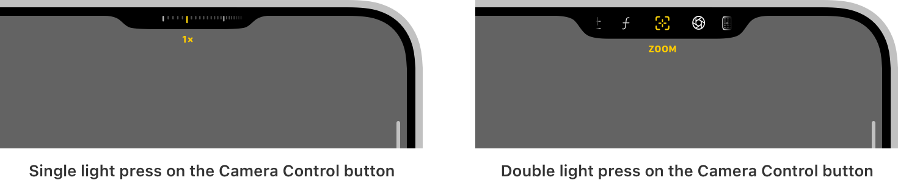
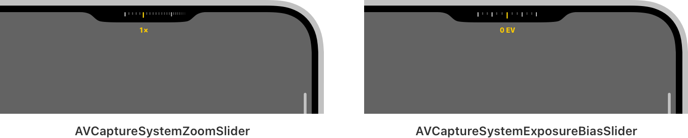
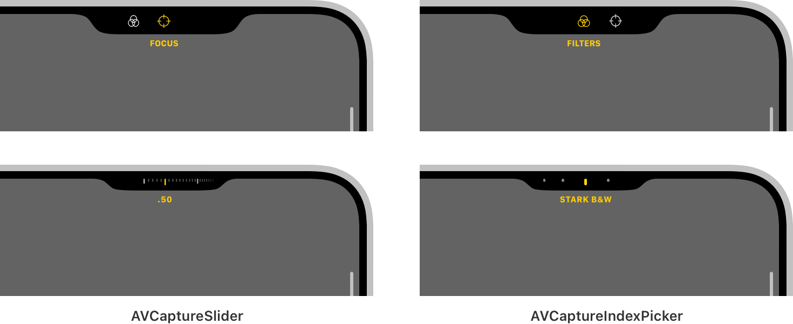

> 导航：[技术](../technologies.md) · [AVFoundation](../avfoundation.md) · [捕捉设置](capture-setup.md)

# 用相机控制增强你的 App 体验

<sub>文章</sub>

提供对相机 App 功能的直接访问，帮助人们快速拍出完美镜头。

## 概述

iPhone 16 设备提供了一个新的硬件接口——相机控制（Camera Control）——可实现与相机系统的直接交互。默认情况下，iOS 会将相机控制配置为启动并控制「相机」App。通过采用对此功能的支持，你可以为你的相机 App 带来同等程度的集成体验。

> [!note] 注意
> 要处理来自相机控制的捕捉事件，你的 App 必须采用 AVKit 框架中的 [AVCaptureEventInteraction](../avkit/avcaptureeventinteraction.md) 类。要从相机控制启动你的 App，则需采用 [LockedCameraCapture](../lockedcameracapture.md) 框架。有关如何在 App 中为相机控制提供完整支持的示例，请参阅 [AVCam：构建相机 App](avcam-building-a-camera-app.md)。

与相机控制交互会显示如下所示的新控制界面。轻按一下相机控制会呈现一个叠层，让用户可以调整某个特定控制的值，例如相机的变焦或曝光。然后轻点两下该按钮，用户即可通过在相机控制上滑动手指来切换 App 提供的各项控制。



<sub>一张水平排列了两张截屏的图像。左侧截屏显示调整相机变焦的控制界面。右侧截屏显示用户轻点两下相机控制时系统呈现的控制叠层。</sub>

该菜单呈现的项目是 [AVCaptureControl](avcapturecontrol.md) 的实例，用于定义控制对象的抽象接口。本文介绍该框架可用的控制类型，以及如何配置你的 App 来使用它们。

> [!note] 注意
> 有关采用此功能的设计考量，请参阅《人机界面指南》中的 [Camera Control](https://developer.apple.com/design/human-interface-guidelines/camera-control)。

### 采用系统控制

该框架提供了两种开箱即用的控制实现，支持常见的相机 App 功能：

- [AVCaptureSystemZoomSlider](avcapturesystemzoomslider.md)：一个连续滑块，用于修改相机设备的 [videoZoomFactor](avcapturedevice/videozoomfactor.md) 属性的值。
- [AVCaptureSystemExposureBiasSlider](avcapturesystemexposurebiasslider.md)：一个连续滑块，用于修改相机设备的 [exposureTargetBias](avcapturedevice/exposuretargetbias.md) 属性的值。

两种控制类型都会通过查询关联设备的当前格式来获取系统建议值，从而确定其范围。当设备格式发生变化时（例如从照片格式切换为视频格式），这些控制会相应地更新其值。

将你的 App 配置为使用这些控制后，会呈现如下所示的用户界面：



<sub>一张水平排列了两张截屏的图像。左侧截屏显示 AVCaptureSystemZoomSlider 的用户界面。该控制在顶部显示一排垂直刻度线以展示变焦值的范围，下方有一个标签指示 1x 的变焦级别。右侧截屏显示 AVCaptureSystemExposureBiasSlider 的用户界面。该控制显示一排垂直刻度线，并在其范围内突出显示各数值，下方有一个标签指示 0 EV 的曝光。</sub>

采用系统控制非常简单。你通过传入一个要配置的 [AVCaptureDevice](avcapturedevice.md) 对象，以及（可选的）在发生更改后要执行的操作来创建实例。系统会在 `@MainActor` 上调用此操作，因此你的 App 可以响应值变化来更新其用户界面。

```swift
// 检索要配置的捕捉设备。
guard let device = activeVideoInput?.device else { return }

// 创建一个用于调整设备视频变焦系数的控制。
let systemZoomSlider = AVCaptureSystemZoomSlider(device: device) { zoomFactor in
    // 计算并显示变焦值。
    let displayZoom = device.displayVideoZoomFactorMultiplier * zoomFactor
    // 更新用户界面。
}

// 创建一个用于调整设备曝光偏移的控制。
let systemBiasSlider = AVCaptureSystemExposureBiasSlider(device: device)
```

### 定义自定控制

该框架还提供了两种通用控制类型，用于定义自定控制：

- [AVCaptureSlider](avcaptureslider.md)：一个连续滑块，从有限范围中选择一个浮点值。
- [AVCaptureIndexPicker](avcaptureindexpicker.md): 一种通过索引从互斥集合中进行选择的控制。

创建这些控制的实例时，需指定一个描述该控制操作的本地化标题、一个来自 SF Symbols 图库并定义其视觉呈现的符号名称，以及一组值：

```swift
// 创建一个用于调整捕捉设备镜头位置的控制。
let focusSlider = AVCaptureSlider("Focus", symbolName: "scope", in: 0...1)

// 从相机滤镜列表中检索标题。
let titles = filters.map { $0.localizedTitle }

// 创建一个用于从相机滤镜列表中进行选择的控制。
let filterPicker = AVCaptureIndexPicker("Filters", symbolName: "camera.filters", localizedIndexTitles: titles)
```

将你的 App 配置为使用这些控制后，会呈现如下所示的用户界面：



<sub>一张包含自定对焦滑块和自定相机滤镜选择器截屏的图像。左上图像显示对焦控制在叠层中的呈现方式，其中显示其 SF Symbol 和本地化标题。其下方截屏显示该控制为调整对焦而呈现的用户界面。右上图像显示相机滤镜控制在叠层中的呈现方式，其中显示其 SF Symbol 和本地化标题。其下方截屏显示该控制为修改滤镜选择而呈现的用户界面。</sub>

每种控制类型都定义了一个表示其当前状态的 `value` 属性，并会响应用户交互来更新它。如果某个控制所表示的状态可能因 App 内其他位置（例如选择相机滤镜的其他 UI）而变化，请相应地更新该控制的 `value` 属性以保持其状态同步。

你通过调用控制的 [setActionQueue(_:action:)](<avcaptureslider/setactionqueue(__action_).md>) 方法来定义其行为，该方法接受一个要执行的操作以及一个调用该操作的委托队列。由于相机 App 通常使用多个 actor 来定义其功能的关键部分，指定要使用的分派队列可以灵活地按需指定控制行为的目标。例如，将相机行为隔离到 `CameraService` actor 的 App 可以定义一个串行分派队列作为该 actor 的执行器，如下所示：

```swift
actor CameraService {
    
    private let captureSession = AVCaptureSession()

    // 用作 actor 执行器的串行分派队列。
    private let sessionQueue = DispatchSerialQueue(label: "com.myapp.sessionQueue")
    
    nonisolated var unownedExecutor: UnownedSerialExecutor {
        sessionQueue.asUnownedSerialExecutor()
    }
}
```

然后，App 可以如下定义一个以会话队列为目标的控制操作：

```swift
// 创建一个用于调整捕捉设备镜头位置的控制。
let focusSlider = AVCaptureSlider("Focus", symbolName: "scope", in: 0...1)
// 在会话队列上执行滑块的操作。
focusSlider.setActionQueue(sessionQueue) { lensPosition in
    do {
        try device.lockForConfiguration()
        device.setFocusModeLocked(lensPosition: lensPosition)
        device.unlockForConfiguration()
    } catch {
        print("Unable to change the lens position: \(error)")
    }
}
```

### 配置捕捉会话

通过将控制添加到 App 的捕捉会话，让系统可以使用这些控制。与 [AVCaptureSession](avcapturesession.md) 为配置会话输入和输出而定义的接口类似，它也提供了类似的 API 来配置捕捉控制，如下所示：

```swift
func configureControls(_ controls: [AVCaptureControl]) {
    
    // 验证主机系统是否支持控制；否则提前返回。
    guard captureSession.supportsControls else { return }
    
    // 开始配置捕捉会话。
    captureSession.beginConfiguration()
    
    // 移除之前配置的控制（如果有）。
    for control in captureSession.controls {
        captureSession.removeControl(control)
    }
    
    // 迭代传入的控制。
    for control in controls {
        // 尽可能将控制添加到捕捉会话。
        if captureSession.canAddControl(control) {
            captureSession.addControl(control)
        } else {
            print("Unable to add control \(control).")
        }
    }
    
    // 提交捕捉会话配置。
    captureSession.commitConfiguration()
}
```

只有主机平台支持时，App 才能配置控制，因此示例首先确定是否支持，然后再继续。接着，它会从会话中移除之前配置的所有控制。最后，它迭代这些控制，并将每个受支持的实例添加到捕捉会话。

> [!important] 重要
> 在尝试添加控制之前，请务必调用捕捉会话的 [- canAddControl:](<avcapturesession/canaddcontrol(__).md>) 方法。即使在受支持的平台上，由于其他系统状态，会话也可能无法添加控制。例如，如果捕捉会话达到了其 [maxControlsCount](avcapturesession/maxcontrolscount.md) 值，此方法会返回 `false`。在这种情况下尝试调用 [- addControl:](<avcapturesession/addcontrol(__).md>) 方法会引发异常。

### 指定控制委托

要让系统呈现已配置的控制，捕捉会话需要定义一个控制委托。该框架为此提供了 [AVCaptureSessionControlsDelegate](avcapturesessioncontrolsdelegate.md) 协议，它定义了以下方法来响应控制的激活和呈现事件：

```swift
func sessionControlsDidBecomeActive(_ session: AVCaptureSession) {
    // 系统呈现了控制。
}

func sessionControlsWillEnterFullscreenAppearance(_ session: AVCaptureSession) {
    // 隐藏会分散控制交互注意力的用户界面。
}

func sessionControlsWillExitFullscreenAppearance(_ session: AVCaptureSession) {
    // 恢复之前隐藏的用户界面。
}

func sessionControlsDidBecomeInactive(_ session: AVCaptureSession) {
    // 系统收起了控制。
}
```

该协议定义了响应激活状态变化的方法，这些变化表明系统何时呈现和收起控制。它还定义了响应控制全屏呈现的方法。当控制进入全屏状态时，App 应将相机 UI 最小化，帮助人们专注于控制交互。同样，当控制退出该状态时，App 应恢复之前的用户界面。

在你的 App 中采用此协议后，通过调用捕捉会话的 [- setControlsDelegate:queue:](<avcapturesession/setcontrolsdelegate(__queue_).md>) 方法设置委托。你向该方法传入委托对象和一个分派队列，供系统调用其方法时使用。

## 另请参阅

### 捕捉控制

- [AVCaptureControl](avcapturecontrol.md) — 与相机系统交互的控制的抽象基类。
- [AVCaptureSystemZoomSlider](avcapturesystemzoomslider.md) — 在系统建议范围内调整捕捉设备视频变焦系数的控制。
- [AVCaptureSystemExposureBiasSlider](avcapturesystemexposurebiasslider.md) — 在系统建议范围内调整捕捉设备曝光偏移的控制。
- [AVCaptureSlider](avcaptureslider.md) — 一个从有限范围中选择值的滑块控制。
- [AVCaptureIndexPicker](avcaptureindexpicker.md) — 一种通过索引从互斥值集合中进行选择的控制。
