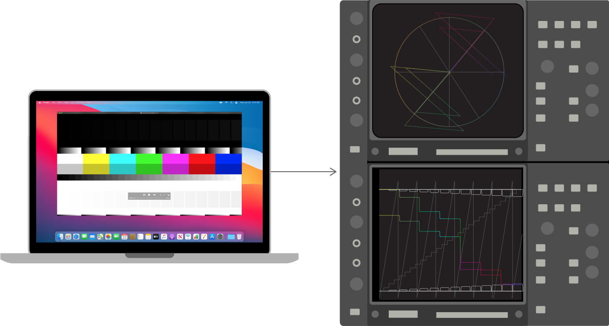
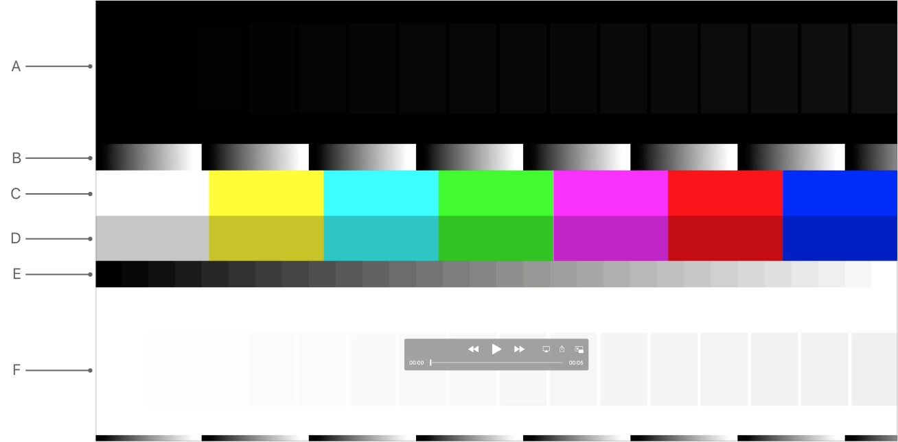

> 导航： [Technologies](../technologies.md) · [AVFoundation](../avfoundation.md) · [Media reading and writing](media-reading-and-writing.md) · [Evaluating an app’s video color](evaluating-an-app-s-video-color.md)

# 使用视频测试设备评估 App 的视频色彩

文章

把测试图案文件输出到矢量示波器或波形监视器，以检查视频信号。

## 概述

AVFoundation 会在播放期间自动对视频应用色彩管理。使用以下任一技术，验证系统是否对你的视频进行了正确的色彩管理：

- 把测试图案文件输出到矢量示波器或波形分析仪来分析视频信号。
- 在矢量示波器上验证正确的色彩空间转换矩阵，并在波形监视器上验证伽马、量化误差以及范围扩展或压缩。

一幅展示两种测试图案分析的插图。上方是使用矢量示波器的分析，下方是使用波形分析仪的分析。

### 使用矢量示波器分析你的视频信号

矢量示波器绘制视频信号的两个色度分量并测量它们的颜色关系。矢量示波器通常带有印制的标示标准颜色的方框。理想情况下，正确再现的彩条信号应当“命中”矢量示波器的各个方框。

把 QuickTime 测试图案输出到矢量示波器来分析视频信号。在矢量示波器上查看测试图案，验证色彩空间转换矩阵是否正确以及是否存在颜色匹配。

> [!important] 重要
> 不要使用标准矢量示波器目标来评估显示输出（Display Port 或 DVI）。系统会为显示器调整伽马，但不会为视频设备调整。请对视频输出（HDMI、复合或分量视频输出）使用标准矢量示波器目标。

通常，矢量示波器包含一组六个方框（黄、青、绿、品红、红、蓝），代表 75% 彩条，以及另一组代表 100% 彩条。这些方框对应测试图案文件 `QuickTime_Test_Pattern_HD.mov,` 的 C 区和 D 区，如下所示：

一个带色彩和灰度图案的 QuickTime 测试图案 HD 影片文件。影片顶部为暗电平，中间是多色彩条，底部为白色亮电平。

如果在测试期间该呈现的色彩矢量“命中”对应方框的内部，则可以认为色彩是正确的。

这些方框通常只代表 HD 或 SD 彩条中的一种，而不代表从一种标准转换到另一种的内容。例如，Rec. 709（HD）的 75% 红色不同于 Rec. 601（SD）的 75% 红色，转换后的信号通常既不会命中 HD 目标也不会命中 SD 目标。

要了解如何使用测试图案文件来确认你的 App 的视频得到了正确的色彩管理，参见[打开测试图案并验证色彩特性](evaluating-video-using-quicktime-test-pattern-files.md#Open-test-patterns-and-verify-color-characteristics)。

### 使用波形监视器分析你的视频信号

波形监视器显示给定视频帧中所有行的幅度随时间变化的复合波形。除其他用途外，这种仪器有助于确保用满所有取值，没有被截断（压碎）的黑色或白色范围。

把你的视频输出到波形分析仪，并在波形监视器上查看测试图案。验证伽马、量化误差以及范围扩展或压缩。

以下是在波形监视器上需要检查的 QuickTime 测试图案影片文件的元素：

- 黑色背景上的黑色方框。波形监视器上的测试信号应显示为从真黑开始的 16 级阶梯（上图中 A 行）。
- 渐变。一个单调递增的渐变，包含超白和超黑。你应当预期包含全范围 RGB 的渲染过程会压碎这样的渐变（上图中 B 行）。波形监视器上的结果应从真黑延伸到全白。不过，在与超白和超黑相对应的范围两端，你可能会看到重复图案的开头和结尾被钳制为黑色或白色。这个渐变应当在波形监视器的显示屏上形成一条直线（否则说明存在伽马转换）。显示屏上任何不均匀的线条都表明存在量化影响。
- 全白背景上的白色方框。在波形监视器上，这部分测试信号应显示为从全白开始的 16 级阶梯（上图中 F 行）。
- 量化渐变。波形监视器会为信号的伽马绘制这些目标下方的区域（上图中 E 行）。

## 另请参阅

### 视频评估

- [使用 QuickTime 测试图案文件评估视频](evaluating-video-using-quicktime-test-pattern-files.md) — 使用测试图案文件检查你的 App 或工作流程的色彩再现。
- [使用光度测量仪器评估 App 的视频色彩](evaluating-an-app-s-video-color-using-light-measurement-instruments.md) — 使用测试图案文件配合分光辐射度计或色度计测量屏前亮度。
