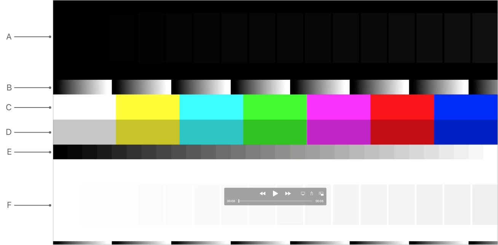
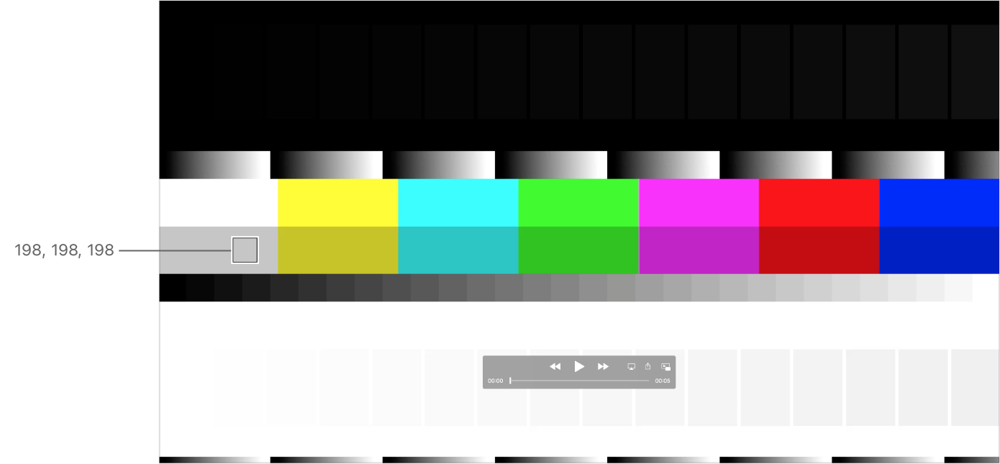
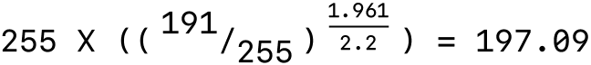

> 导航：[技术](../technologies.md) · [AVFoundation](../avfoundation.md) · [媒体读写](media-reading-and-writing.md) · [评估 App 的视频色彩](evaluating-an-app-s-video-color.md)

# 使用 QuickTime 测试图样文件评估视频

文章

使用测试图样文件检查你的 App 或工作流的色彩再现。

## 概述

QuickTime 测试图样（Test Pattern）影片文件在 Mac 电脑上显示时会产生已知的结果。使用这些文件来评估你的基于 AVFoundation 的 App 或工作流的色彩特性。检查你的 App 中色彩管理的最简单方法，就是使用测试图样文件中的 75% 灰色条。

### 打开测试图样并验证色彩特性

视频行业通常使用已知的、标准的测试图样来评估色彩。将你的视频的色彩与已知标准进行比较，可以让你了解录制或传输对视频信号造成了怎样的改变。利用这些信息来确定你必须做出哪些修改才能使信号恢复到标准。通常，在模拟视频环境中，你会使用电影与电视工程师学会（SMPTE）彩色条或工程指南 EG 1.1990。

> [!important] 重要
> 与任何内容一样，你必须为彩色条本身添加标签，以确保它们得到正确的解读。[用视频色彩信息标记媒体](tagging-media-with-video-color-information.md)讨论了视频标记。

要开始使用测试图样技术评估视频，请从 [AVFoundation 开发者页面](https://developer.apple.com/av-foundation/)下载 QuickTime 测试图样影片文件（参见「Color Test Patterns」）。这些文件在 Mac 电脑上会产生已知的结果。

使用 QuickTime Player App（10.5 或更高版本）或其他支持 [QuickTime 文件格式](../quicktime-file-format.md)的 App 或工作流打开这些文件。使用测试图样文件来评估你的基于 AVFoundation 的 App 或工作流的色彩特性。

下图显示了示例测试图样文件 `QuickTime_Test_Pattern_HD.mov`，其中包含彩色和灰度图案。使用它来评估这里展示的特性：

一个包含彩色和灰度图案的 QuickTime 测试图样 HD 影片文件。影片顶部包含暗电平，中部是多彩的色条，底部是亮白电平。

- 黑色上的 16 个黑电平，或黑位压暗测试/范围扩展（图中的 A 行）
- 连续渐变，或量化/超黑、超白处理（B 行）
- 100% 彩色条，或矩阵色彩匹配（C 行）
- 75% 彩色条，或矩阵色彩匹配（D 行）
- 量化渐变，或伽马（E 行）
- 白色上的 16 个白电平，或白位压暗测试/范围扩展（F 行）

在你的 App 中打开测试图样，并目视检查上述特性。使用「数字测色计」App 读取显示缓冲区的像素值（见下文）。

### 使用数字测色计 App 解读灰度电平

检查你的 App 中色彩管理的最简单方法，是使用示例测试图样文件 `QuickTime_Test_Pattern_HD.mov` 中显示的 75% 灰色条。

macOS 10.6 及更高版本会以 1.96 到 2.2 的伽马转换来处理 75% 灰色条，得到如下图所示的 198 值。

一个包含彩色和灰度图案的 QuickTime 测试图样 HD 影片文件。影片顶部包含暗电平，中部是多彩的色条，底部是亮白电平。有一个标注指向 75% 灰色条，显示「数字测色计」App 报告的经伽马转换后的 198 值。

AVFoundation 使用约 1.96 的值作为视频的伽马（即不包含经典昏暗观看环境所需提升的伽马值）。推导这个数字时，你首先要测量 CRT 的响应。大多数 CRT 报告的伽马介于 2.4 和 2.5 之间（取决于显示器的亮度和对比度设置）。你选取两者之间的中间值（2.45），并去除对比度增强（为在昏暗环境中观看而提供的 1.25 伽马提升）。结果是一个非常接近 1.96 的值（2.45/1.25 = 1.96）。

当 App 执行到显示器的色彩匹配时，macOS 10.6 及更高版本会将视频伽马转换为 2.2 的显示缓冲区伽马。75% 灰色条的 1.96 到 2.2 伽马转换计算推导如下：

一张 75% 灰色条伽马转换计算的数学公式图，结果约为 198。

由于存在舍入误差，你会看到在这个范围内的结果。这是 AVFoundation App 在播放期间的默认行为。如果你得到的值是 191 或其他值，则很可能意味着系统没有应用色彩管理。请参阅[确保你的 App 的视频得到准确的色彩应用](evaluating-an-app-s-video-color.md#Ensure-accurate-color-application-of-your-apps-video)。

默认情况下，系统使用感知渲染意图执行色彩匹配。不过，对于基于矩阵的描述文件，系统色彩匹配会为所有渲染意图报告相同的结果。

### 验证色彩匹配是否保持灰度电平

在显示器描述文件正确的前提下，色彩匹配不会改变灰度值在色彩管理的 App 中显示为灰色的事实。它可能会根据伽马校正调整亮度，但不会为其添加色彩（灰色始终保持 R=G=B）。因此，对于来自任何彩色条的给定灰度值，色彩匹配会为其 RGB 分量报告相同的值。如果不是这样，你应该调查这个问题（请参阅[确保你的 App 的视频得到准确的色彩应用](evaluating-an-app-s-video-color.md#Ensure-accurate-color-application-of-your-apps-video)）。

### 解读彩色条中的非灰色颜色

非灰色的像素值可能会因色彩匹配而改变。这种色彩匹配确保了原始视频在播放期间的色彩保真度。系统使用感知渲染意图执行色彩匹配。这意味着 75% 的绿色在色彩匹配期间可能发生多种颜色偏移中的任何一种，具体取决于源描述文件和显示器描述文件的特性。例如，一个 75% 的绿色值 (0, 191, 0) 在色彩匹配后可能变为 (40, 200, 8)。

## 另请参阅

### 视频评估

- [使用视频测试设备评估 App 的视频色彩](evaluating-an-app-s-video-color-using-video-test-equipment.md) — 将测试图样文件输出到矢量示波器或波形分析仪以查看视频信号。
- [使用光测量仪器评估 App 的视频色彩](evaluating-an-app-s-video-color-using-light-measurement-instruments.md) — 将测试图样文件与光谱辐射计或色度计配合使用来测量屏幕正面亮度。
