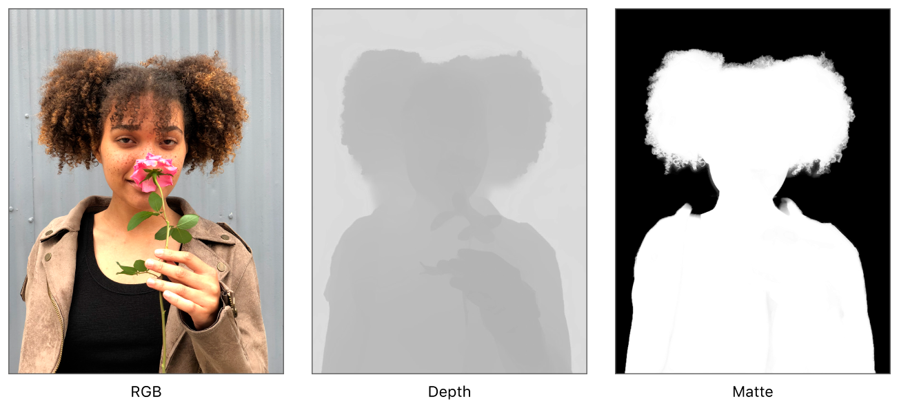

> 导航： [Technologies](../technologies.md) · [AVFoundation](../avfoundation.md) · [Photo capture](photo-capture.md) · [AVPortraitEffectsMatte](avportraiteffectsmatte.md)

# 从照片中提取人像效果蒙版图像数据

<sub>文章</sub>

检查现有图像中的人像效果蒙版元数据。

## 概述

人像效果蒙版与深度数据辅助图像一起存储在图像文件中。你可以把人像效果蒙版作为一个名为 [AVPortraitEffectsMatte](avportraiteffectsmatte.md) 的高级对象来加载、查看和编辑，它与 [AVDepthData](avdepthdata.md) 类似。这在从文件中取出基础辅助图像位的技术上，与使用 [AVDepthData](avdepthdata.md) 的传统深度图访问方式一致。



### 从文件加载并查看蒙版图像

使用 [Image I/O](../imageio.md) 提取类型为 [kCGImageAuxiliaryDataTypePortraitEffectsMatte](../imageio/kcgimageauxiliarydatatypeportraiteffectsmatte.md) 的辅助图像，从而加载人像效果蒙版。把这个辅助图像转换为辅助信息字典，其中蒙版作为 [CGImageMetadata](../imageio/cgimagemetadata.md) 类的元数据存在。把该字典传给 [+ portraitEffectsMatteFromDictionaryRepresentation:error:](<avportraiteffectsmatte/init(fromdictionaryrepresentation_).md>) 生成人像效果蒙版对象 [AVPortraitEffectsMatte](avportraiteffectsmatte.md)。从这个对象，你可以生成一个 [CIImage](../coreimage/ciimage.md) 对象，把图像转换为可查看的形式，例如 [UIImage](../uikit/uiimage.md)。

**Swift**

```swift
func portraitEffectsMatteImage(at path: String) -> UIImage? {
    let bundlePath = Bundle.main.bundlePath
    let fileURL = URL(fileURLWithPath: bundlePath).appendingPathComponent(path)
        
    guard let source = CGImageSourceCreateWithURL(fileURL as CFURL, nil),
          let auxiliaryInfoDict = CGImageSourceCopyAuxiliaryDataInfoAtIndex(source, 0, kCGImageAuxiliaryDataTypePortraitEffectsMatte) as? [AnyHashable: Any] else { return nil }
        
    // Create a portrait effects matte from the auxiliary information.
    if let matteData = try? AVPortraitEffectsMatte(fromDictionaryRepresentation: auxiliaryInfoDict),
       let matteCIImage = CIImage(portaitEffectsMatte: matteData) {
        // Return a matte image by using the core image representation.
        return UIImage(ciImage: matteCIImage)
    }
    return nil
}
```

**Objective-C**

```objc
- (UIImage*) portraitEffectsMatteImageAtPath: (NSString*)path
{
    // Convert image path to a file URL:
    NSString* bundlePath = [NSBundle mainBundle].bundlePath;
    NSString* filePath = [bundlePath stringByAppendingPathComponent:path];
    CFURLRef urlRef = CFBridgingRetain([NSURL fileURLWithPath:filePath]);
    
    // Get reference to the image data:
    CGImageSourceRef source = CGImageSourceCreateWithURL(urlRef, nil);
    
    // Query for auxiliary data of specific type:
    CFDictionaryRef auxiliaryInfoDict = CGImageSourceCopyAuxiliaryDataInfoAtIndex(source, 0, kCGImageAuxiliaryDataTypePortraitEffectsMatte);
    
    NSDictionary* auxDataDictionary = (__bridge NSDictionary*)auxiliaryInfoDict;
    if (auxDataDictionary) {
        AVPortraitEffectsMatte* matteData = [AVPortraitEffectsMatte portraitEffectsMatteFromDictionaryRepresentation:auxDataDictionary error:nil];
        
        // Load matte data into Core Image for conversion to UIImage:
        CIImage* matteCIImage = [CIImage imageWithPortaitEffectsMatte:matteData];
        return [UIImage imageWithCIImage:matteCIImage];
    }
    else {
        return nil;
    }
}
```

有了这张蒙版图像，你的 App 可以：

- 在内存中访问人像效果蒙版的未压缩像素。
- 创建该蒙版的旋转或翻转的衍生副本。
- 用你自己的像素替换蒙版中的像素，以反映你正在应用于主图像的效果。
- 创建一个由基础 PEM 部分组成的字典，适合使用 Image I/O 的 [CGImageDestination](../imageio/cgimagedestination.md) 写入文件。

解压缩后，蒙版图像原生为 L008（[kCVPixelFormatType_OneComponent8](../corevideo/kcvpixelformattype_onecomponent8.md)），这是一种 8 位单分量格式，黑色为零。人像效果蒙版图像不做伽马校正。它们标记为线性传递函数，表明处理它们时不应应用任何色彩校正。

## 另请参阅

### 检查人像效果蒙版

- [mattingImage](avportraiteffectsmatte/mattingimage.md) — 人像效果蒙版的内部图像，格式为像素缓冲。
- [pixelFormatType](avportraiteffectsmatte/pixelformattype.md) — 这个人像效果蒙版内部图像的像素格式类型。
- [- dictionaryRepresentationForAuxiliaryDataType:](<avportraiteffectsmatte/dictionaryrepresentation(forauxiliarydatatype_).md>) — 用于写入带人像效果蒙版的图像文件的基础映射信息字典。
