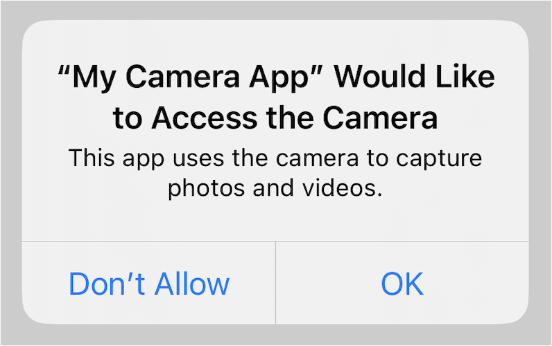
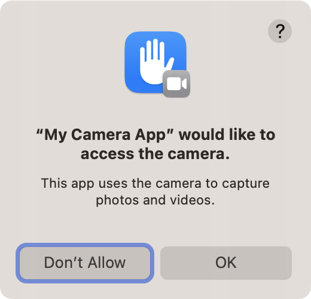
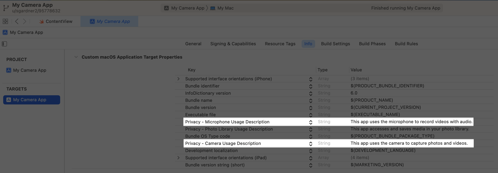
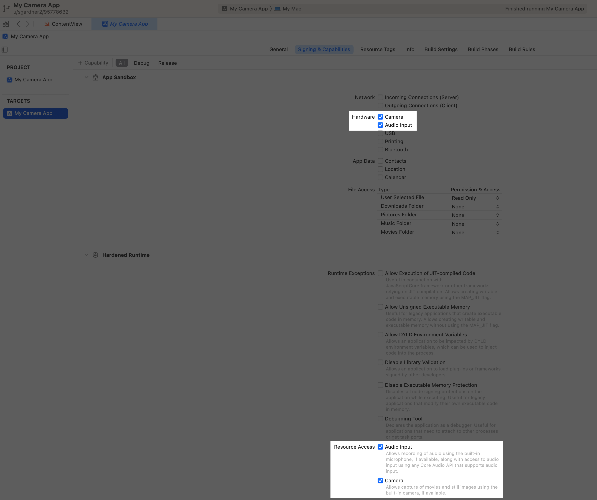

> 导航：[技术](../technologies.md) · [AVFoundation](../avfoundation.md) · [捕获设置](capture-setup.md)

# 请求捕获和保存媒体的授权

<sub>文章</sub>

提示用户授权访问相机、麦克风和照片图库。

## 概述

在 iOS 以及 macOS 10.14 及更高版本中，用户必须显式授予每个 App 访问相机和麦克风的权限。在你的 App 首次使用捕获设备之前，系统会显示一个提醒，其中包含你指定的 App 专属消息，请用户授予你的 App 访问该捕获设备的权限。例如，以下截图显示了 iOS 以及 macOS 10.14 及更高版本中的相机访问提醒：



<sub>iOS 相机访问提醒的截图，带有一条请求访问相机的 App 专属消息，以及两个按钮：不允许（Don't Allow）和好（OK）。</sub>



<sub>macOS 10.14 及更高版本相机访问提醒的截图，带有一条请求访问相机的 App 专属消息，以及两个按钮：不允许（Don't Allow）和好（OK）。</sub>

系统会记住用户对每个访问提醒的响应，因此之后使用相应的捕获设备时不会再出现该提醒。用户可以在 iOS 的「设置 \> 隐私」以及 macOS 的「系统偏好设置 \> 安全性与隐私」中更改你的 App 的权限设置。

本文概述了你可以采取的步骤，以确保你的 App 在尝试捕获媒体之前已获得授权。

### 配置访问提醒

系统要求你的 App 在系统请求访问相机或麦克风的权限时，向用户显示静态消息：

- 如果你的 App 使用设备相机，请在你的 App 的 `Info.plist` 文件中包含 [NSCameraUsageDescription](../bundleresources/information-property-list/nscamerausagedescription.md) 键。
- 如果你的 App 使用设备麦克风，请在你的 App 的 `Info.plist` 文件中包含 [NSMicrophoneUsageDescription](../bundleresources/information-property-list/nsmicrophoneusagedescription.md) 键。

对于每个键，请提供一条消息，向用户解释你的 App 为什么需要捕获媒体，让用户能够放心地向你的 App 授予权限。



### 在 macOS 中启用 entitlement

在 macOS 上，你还需要在 App target 的 Signing & Capabilities 中启用以下 entitlement：

- 如果你的 App 使用设备相机，请启用 [Camera entitlement](../bundleresources/entitlements/com.apple.security.device.camera.md)。
- 如果你的 App 使用设备麦克风，请启用 [Audio Input Entitlement](../bundleresources/entitlements/com.apple.security.device.audio-input.md)。



<sub>一张截图，显示 App target 的 Signing & Capabilities 标签页中已启用的 macOS 相机和音频输入 entitlement。</sub>

> [!important] 重要
> 在请求授权或尝试使用捕获设备之前，你的 App 的 `Info.plist` 文件中必须包含相应的键，并且在 macOS 上必须启用相应的 entitlement。否则，系统会终止你的 App。

### 验证并请求捕获授权

在设置捕获会话之前，请务必测试 [AVCaptureDevice](avcapturedevice.md) 的 [+ authorizationStatusForMediaType:](<avcapturedevice/authorizationstatus(for_).md>) 方法。如果用户尚未授予或拒绝捕获权限，则授权状态为 [AVAuthorizationStatusNotDetermined](avauthorizationstatus/notdetermined.md)。在这种情况下，请使用 [+ requestAccessForMediaType:completionHandler:](<avcapturedevice/requestaccess(for_completionhandler_).md>) 方法让系统提示用户。

在开始捕获之前调用 [+ requestAccessForMediaType:completionHandler:](<avcapturedevice/requestaccess(for_completionhandler_).md>)，但只应在适合你的 App 的时间调用。例如，如果照片或视频捕获不是你的 App 的主要功能，请只在用户调用你的 App 中与相机相关的功能时检查权限。下面是一个示例：

```swift
var isAuthorized: Bool {
    get async {
        let status = AVCaptureDevice.authorizationStatus(for: .video)
        
        // 确定用户之前是否已授权访问相机。
        var isAuthorized = status == .authorized
        
        // 如果系统尚未确定用户的授权状态，
        // 则明确提示用户进行批准。
        if status == .notDetermined {
            isAuthorized = await AVCaptureDevice.requestAccess(for: .video)
        }
        
        return isAuthorized
    }
}

func setUpCaptureSession() async {
    guard await isAuthorized else { return }
    // 设置捕获会话。
}
```

### 请求保存所捕获媒体的授权

你的 App 必须先获得访问照片图库的权限，才能尝试保存照片或视频；否则系统会终止你的 App。你请求哪种权限取决于你要保存的媒体类型：

- 对于大多数照片和视频捕获工作流（包括实况照片和 RAW 格式拍摄），请使用 [PHPhotoLibrary](../photos/phphotolibrary.md) 和 [PHAssetCreationRequest](../photos/phassetcreationrequest.md) 类。这些类需要对照片图库的读写访问权限，因此你需要在 `Info.plist` 文件中使用 [NSPhotoLibraryUsageDescription](../bundleresources/information-property-list/nsphotolibraryusagedescription.md) 键来提供一条请求访问权限的消息。更多信息请参阅[在照片 App 中提供增强的隐私体验](../photokit/delivering-an-enhanced-privacy-experience-in-your-photos-app.md)。
- 如果你的 App 只需要将视频保存到照片图库，那么 [UISaveVideoAtPathToSavedPhotosAlbum(_:_:_:_:)](<../uikit/uisavevideoatpathtosavedphotosalbum(________).md>) 函数是比 [PHPhotoLibrary](../photos/phphotolibrary.md) 更简单的替代方案。该函数只需要对图库的写入权限。请使用 `Info.plist` 文件中的 [NSPhotoLibraryAddUsageDescription](../bundleresources/information-property-list/nsphotolibraryaddusagedescription.md) 键来提供一条请求保存到照片图库权限的消息。

> [!note] 注意
> 不建议将 [UIImageWriteToSavedPhotosAlbum(_:_:_:_:)](<../uikit/uiimagewritetosavedphotosalbum(________).md>) 函数用于通过 [AVCapturePhotoOutput](avcapturephotooutput.md) 拍摄的照片，因为 [UIImage](../uikit/uiimage.md) 不支持照片输出所包含的特性和元数据。
