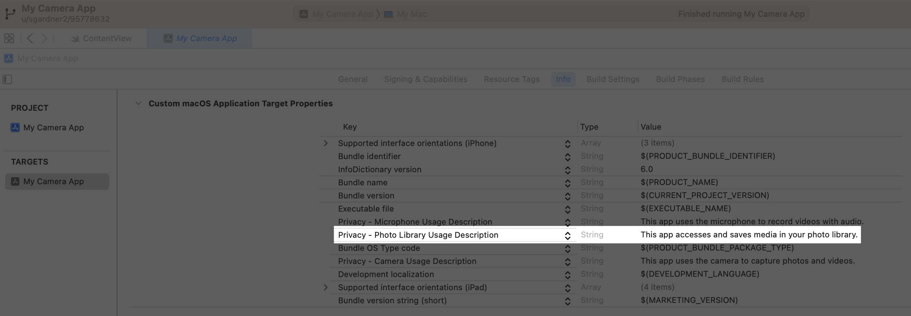
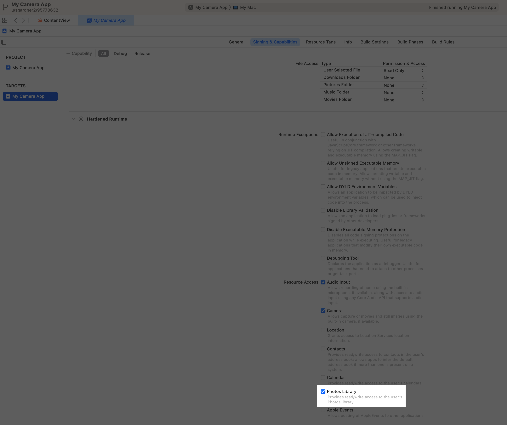

> 导航： [Technologies](../technologies.md) · [AVFoundation](../avfoundation.md) · [Photo capture](photo-capture.md) · [Capturing still and Live Photos](capturing-still-and-live-photos.md)

# 保存拍摄的照片

<sub>文章</sub>

把照片拍摄得到的图像和其他数据添加到照片图库。

## 概述

当你用 [AVCapturePhotoOutput](avcapturephotooutput.md) 完成一次照片拍摄时，会收到一个 [AVCapturePhoto](avcapturephoto.md) 对象，其中包含图像数据、相机元数据，以及你请求的任何辅助图像（例如缩略图或深度图）。你可以从 [AVCapturePhoto](avcapturephoto.md) 对象中逐项获取这些数据，也可以调用它的 [- fileDataRepresentation](<avcapturephoto/filedatarepresentation().md>) 方法，得到一个可直接保存的 [Data](../foundation/data.md) 对象，其编解码器和文件格式就是你在 [AVCapturePhotoSettings](avcapturephotosettings.md) 中为该照片请求的。

拍摄照片后，使用 [PhotoKit](../photokit.md) 把这些数据添加到用户的照片图库。

> [!note] 注意
> 如果你的 App 只需要访问照片图库中的内容，可以改用 [PhotoKit](../photokit.md) 的照片选择器，它不需要你向用户请求访问权限。要了解更多，参见[在 iOS 中选择照片和视频](../photokit/selecting-photos-and-videos-in-ios.md)。

### 为你的 App target 配置属性和能力

你可以使用 [PhotoKit](../photokit.md) 来启用对用户照片图库的读写访问。为此，在 `Info.plist` 文件中为 [NSPhotoLibraryUsageDescription](../bundleresources/information-property-list/nsphotolibraryusagedescription.md) 键提供一条静态消息，在你的 App 请求访问时显示给用户。



<sub>一张截图，显示 App target 的 Info 标签页中的照片图库用途描述。高亮显示的字符串 Privacy Photo Library Usage Description 的内容为 This app accesses and saves media in your photo library。</sub>

在 macOS 上，你还需要在 App target 的 Signing & Capabilities 标签页中启用[照片图库 Entitlement](../bundleresources/entitlements/com.apple.security.personal-information.photos-library.md)。



> [!important] 重要
> 你的 App 在请求授权或尝试使用设备之前，必须在它的 `Info.plist` 文件中包含相应的键，并在 macOS 上启用相应的 entitlement。否则，系统会终止你的 App。

### 请求访问用户照片图库的权限

使用 [PHPhotoLibrary](../photos/phphotolibrary.md) 的 [requestAuthorization(for:handler:)](<../photos/phphotolibrary/requestauthorization(for_handler_).md>) 在合适的时机请求访问照片图库，例如用户第一次打开你 App 的相机功能时。示例如下：

```swift
var isPhotoLibraryReadWriteAccessGranted: Bool {
    get async {
        let status = PHPhotoLibrary.authorizationStatus(for: .readWrite)
        
        // Determine if the user previously authorized read/write access.
        var isAuthorized = status == .authorized
        
        // If the system hasn't determined the user's authorization status,
        // explicitly prompt them for approval.
        if status == .notDetermined {
            isAuthorized = await PHPhotoLibrary.requestAuthorization(for: .readWrite) == .authorized
        }
        
        return isAuthorized
    }
}
```

> [!note] 注意
> 不要等到用户拍了第一张照片之后才请求访问照片图库，因为权限提醒会妨碍他们连续拍摄多张照片。

### 使用创建请求添加照片资产

执行以下步骤来接收拍摄的照片并将其保存到照片图库：

1. 采用 [AVCapturePhotoCaptureDelegate](avcapturephotocapturedelegate.md) 协议并实现它的 [- captureOutput:didFinishProcessingPhoto:error:](<avcapturephotocapturedelegate/photooutput(__didfinishprocessingphoto_error_).md>) 方法，为拍摄请求交付的每张照片接收一次回调。
2. 对协议方法提供的 [AVCapturePhoto](avcapturephoto.md) 对象调用 [- fileDataRepresentation](<avcapturephoto/filedatarepresentation().md>)，得到一个包含照片图像数据及其附件（例如相机元数据和辅助图像）的数据对象。
3. 创建一个 [PHAssetCreationRequest](../photos/phassetcreationrequest.md) 来添加照片资源。

下面的代码给出了这个工作流程的示例：

```swift
func photoOutput(_ output: AVCapturePhotoOutput, didFinishProcessingPhoto photo: AVCapturePhoto, error: Error?) {
    if let error {
        print("Error processing photo: \(error.localizedDescription)")
        return
    }
    
    Task {
        await save(photo: photo)
    }
}

func save(photo: AVCapturePhoto) async {
    // Confirm the user granted read/write access.
    guard await isPhotoLibraryReadWriteAccessGranted else { return }
    
    // Create a data representation of the photo and its attachments.
    if let photoData = photo.fileDataRepresentation() {
        PHPhotoLibrary.shared().performChanges {
            // Save the photo data.
            let creationRequest = PHAssetCreationRequest.forAsset()
            creationRequest.addResource(with: .photo, data: photoData, options: nil)
        } completionHandler: { success, error in
            if let error {
                print("Error saving photo: \(error.localizedDescription)")
                return
            }
        }
    }
}
```

## 另请参阅

### 后续步骤

- [跟踪照片拍摄进度](tracking-photo-capture-progress.md) — 监视拍摄过程中的关键事件，在你的相机 UI 中提供反馈。
- [拍摄并保存实况照片](capturing-and-saving-live-photos.md) — 拍摄类似系统相机 App 创建的实况照片，并把它们保存到照片图库。
