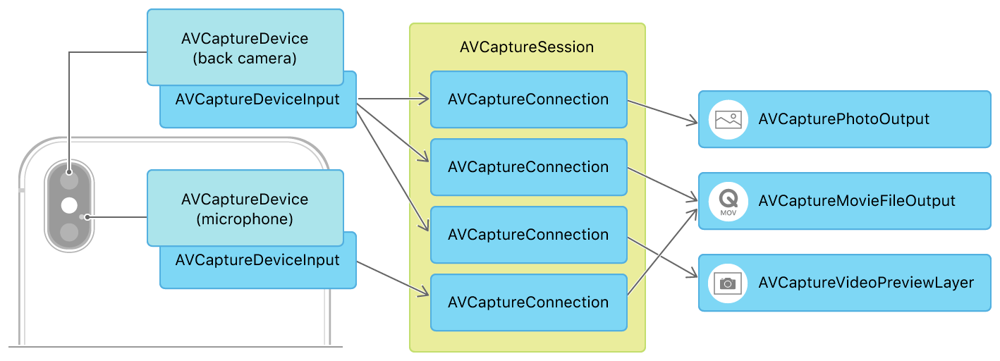

> 导航：[技术](../technologies.md) · [AVFoundation](../avfoundation.md) · [捕获设置](capture-setup.md)

# 设置捕获会话

<sub>文章</sub>

在拍摄照片或视频之前配置输入设备、输出媒体、预览视图和基本设置。

## 概述

[AVCaptureSession](avcapturesession.md) 是 iOS 和 macOS 中所有媒体捕获的基础。它管理你的 App 对操作系统捕获基础设施和捕获设备的独占访问，以及从输入设备到媒体输出的数据流。你如何配置输入与输出之间的连接，决定了你的捕获会话的能力。例如，下图展示了一个可以同时捕获照片和影片并提供相机预览的捕获会话，它使用的是 iPhone 的后置摄像头和麦克风。



<sub>详细捕获会话架构示例的框图：分别用于摄像头和麦克风的 AVCaptureDeviceInput 对象，通过由 AVCaptureSession 管理的 AVCaptureConnection 对象，连接到 AVCapturePhotoOutput、AVCaptureMovieFileOutput 和 AVCaptureVideoPreviewLayer。</sub>

### 将输入和输出连接到会话

所有捕获会话都需要至少一个捕获输入和一个捕获输出。捕获输入（[AVCaptureInput](avcaptureinput.md) 的子类）是媒体来源——通常是内置于 iOS 设备或 Mac 中的摄像头和麦克风等录制设备。捕获输出（[AVCaptureOutput](avcaptureoutput.md) 的子类）使用捕获输入提供的数据来生成媒体，例如图像和影片文件。

要使用摄像头作为视频输入（以拍摄照片或影片），请选择一个合适的 [AVCaptureDevice](avcapturedevice.md)，创建一个对应的 [AVCaptureDeviceInput](avcapturedeviceinput.md)，并将其添加到会话中：

```swift
captureSession.beginConfiguration()
let videoDevice = AVCaptureDevice.default(.builtInWideAngleCamera,
                                          for: .video, position: .unspecified)
guard
    let videoDeviceInput = try? AVCaptureDeviceInput(device: videoDevice!),
    captureSession.canAddInput(videoDeviceInput)
    else { return }
captureSession.addInput(videoDeviceInput)
```

> [!note] 注意
> iOS 提供了其他几种选择摄像头设备的方式。更多信息请参阅[选择捕获设备](choosing-a-capture-device.md)。

接下来，为你计划从所选摄像头捕获的媒体类型添加输出。例如，要启用照片拍摄，请向会话添加一个 [AVCapturePhotoOutput](avcapturephotooutput.md)：

```swift
let photoOutput = AVCapturePhotoOutput()
guard captureSession.canAddOutput(photoOutput) else { return }
captureSession.sessionPreset = .photo
captureSession.addOutput(photoOutput)
captureSession.commitConfiguration()
```

一个会话可以有多个输入和输出。例如：

- 要在影片中同时录制视频和音频，请为摄像头和麦克风设备分别添加输入。
- 要从同一个摄像头同时捕获照片和影片，请将 [AVCapturePhotoOutput](avcapturephotooutput.md) 和 [AVCaptureMovieFileOutput](avcapturemoviefileoutput.md) 都添加到你的会话中。

> [!important] 重要
> 在更改会话的输入或输出之前，请调用 [- beginConfiguration](<avcapturesession/beginconfiguration().md>)，并在完成更改后调用 [- commitConfiguration](<avcapturesession/commitconfiguration().md>)。

### 显示相机预览

让用户在选择拍照或开始录制视频之前能够看到摄像头的输入非常重要，就像传统相机的取景器那样。你可以通过将 [AVCaptureVideoPreviewLayer](avcapturevideopreviewlayer.md) 连接到你的捕获会话来提供这样的预览，只要会话正在运行，它就会显示来自摄像头的实时视频流。

[AVCaptureVideoPreviewLayer](avcapturevideopreviewlayer.md) 是一个 Core Animation 图层，因此你可以像对待任何其他 [CALayer](../quartzcore/calayer.md) 子类一样，在界面中显示它并为它设置样式。将预览图层添加到 UIKit App 的最简单方式是定义一个 [UIView](../uikit/uiview.md) 子类，其 [layerClass](../uikit/uiview/layerclass.md) 为 [AVCaptureVideoPreviewLayer](avcapturevideopreviewlayer.md)，如下所示。

```swift
class PreviewView: UIView {
    override class var layerClass: AnyClass {
        return AVCaptureVideoPreviewLayer.self
    }
    
    /// Convenience wrapper to get layer as its statically known type.
    var videoPreviewLayer: AVCaptureVideoPreviewLayer {
        return layer as! AVCaptureVideoPreviewLayer
    }
}
```

然后，要将预览图层与捕获会话配合使用，请设置该图层的 [session](avcapturevideopreviewlayer/session.md) 属性：

```swift
self.previewView.videoPreviewLayer.session = self.captureSession
```

> [!note] 注意
> 如果你的 App 支持多种界面方向，请使用预览图层与捕获会话之间的 [connection](avcapturevideopreviewlayer/connection.md) 来设置一个与你的 UI 相匹配的 [videoOrientation](avcaptureconnection/videoorientation.md)。

### 运行捕获会话

配置好输入、输出和预览之后，调用 [- startRunning](<avcapturesession/startrunning().md>) 让数据从输入流向输出。

对于某些捕获输出，运行会话就足以开始媒体捕获。例如，如果你的会话包含一个 [AVCaptureVideoDataOutput](avcapturevideodataoutput.md)，那么一旦会话开始运行，你就会开始接收视频帧。

对于其他捕获输出，你需要先让会话开始运行，然后再使用捕获输出类本身来发起捕获。例如，在摄影 App 中，运行会话可以启用取景器式的预览，但你需要使用 [AVCapturePhotoOutput](avcapturephotooutput.md) 的 [- capturePhotoWithSettings:delegate:](<avcapturephotooutput/capturephoto(with_delegate_).md>) 方法来拍照。

## 另请参阅

### 捕获会话

- [在 iPad 上多任务处理时访问相机](../avkit/accessing-the-camera-while-multitasking-on-ipad.md) — 在分屏浏览、侧拉、画中画和台前调度模式下操作相机。
- [AVCam：构建相机 App](avcam-building-a-camera-app.md) — 使用 iPhone 和 iPad 的前后摄像头拍摄照片和录制视频。
- [构建快速启动的响应式相机 App](build-a-responsive-camera-app-that-launches-quickly.md) — 为你的 iOS 和 iPadOS App 构建快速的相机启动体验。
- [拍摄电影效果视频](capturing-cinematic-video.md) — 拍摄具有可调景深和焦点的视频。
- [在你的 iOS App 中支持 Center Stage 前置摄像头](supporting-center-stage-front-camera-in-your-ios-app.md) — 在 iPhone 前置摄像头拍摄的照片和视频中启用人物居中功能。
- [AVMultiCamPiP：从多个相机捕获](avmulticampip-capturing-from-multiple-cameras.md) — 使用多相机捕获会话将前后摄像头的输出同时录制到一个影片文件中。
- [AVCamBarcode：检测条形码和人脸](avcambarcode-detecting-barcodes-and-faces.md) — 使用相机识别机器可读代码或人脸。
- [AVCaptureSession](avcapturesession.md) — 一个配置捕获行为并协调数据从输入设备流向捕获输出的对象。
- [AVCaptureMultiCamSession](avcapturemulticamsession.md) — 一种支持从相同媒体类型的多个输入同时捕获的捕获会话。
- [AVCaptureInput](avcaptureinput.md) — 向捕获会话提供输入数据的对象的抽象超类。
- [AVCaptureOutput](avcaptureoutput.md) — 为捕获会话提供媒体输出目的地的对象的抽象超类。
- [AVCaptureConnection](avcaptureconnection.md) — 一个表示从捕获输入到捕获输出的连接的对象。
