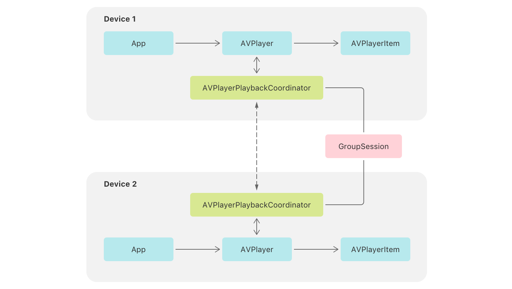

> 导航：[技术](../technologies.md) · [AVFoundation](../avfoundation.md) · [媒体播放](media-playback.md)

# 支持协调媒体播放

<sub>示例代码</sub>

创建同步的媒体体验，让用户能够跨设备观看和收听。

## 概述

与亲朋好友一起看电视、看电影、听音乐会更有乐趣。然而，当面的相聚并不总是可行。从 iOS 15、tvOS 15 和 macOS 12 开始，你可以创建让人们无论身在何处都能一起观看和收听的媒体 App。这一能力通过 AVFoundation 和新的 GroupActivities 框架实现。

AVFoundation 引入了一个新类 [AVPlayerPlaybackCoordinator](avplayerplaybackcoordinator.md)，用于跨设备同步 [AVPlayer](avplayer.md) 对象的计时。App 使用 GroupActivities 框架，通过一个 [GroupSession](../groupactivities/groupsession.md) 对象连接各播放协调器。



<sub>一张示意图，表示两台设备通过一个 GroupSession 对象建立连接。设备 1 和设备 2 各自包含 App、AVPlayer、AVPlayerItem 和 AVPlayerPlaybackCoordinator 关系的表示。两个 AVPlayerPlaybackCoordinator 项目之间有双向虚线连接。</sub>

本示例 App 向你展示如何为你的 App 添加协调媒体播放支持。它提供了一个简单的电影播放 App，用户从媒体库中选择一部电影，并在标准的播放器用户界面中播放。

### 配置示例代码项目

- 你必须使用 Xcode 13 和 Swift 5.5 构建本示例。
- 你必须在运行 iOS 15 或更高版本的实体设备上运行本示例。

要体验协调播放，你需要把 App 安装在两台或更多使用不同 Apple ID 的设备上。在设备之间发起 FaceTime 通话，并在其中一台设备的媒体库中选择一个项目。系统会提示你是本地播放还是与群组一起播放该电影。选择与群组一起播放，之后在一台设备上开始播放，另一台设备也会开始播放。系统会自动将速率和时间变化传播到所有播放协调器，以保持群组播放同步。

### 创建活动

示例 App 播放电影，用一个 `Movie` 结构体表示电影，该结构体定义了媒体库中条目的基本数据。

```swift
struct Movie: Hashable, Codable {
    var url: URL
    var title: String
    var description: String
}
```

为了让观影成为群组体验，示例创建了一个名为 `MovieWatchingActivity` 的结构体，它采用 [GroupActivity](../groupactivities/groupactivity.md) 协议。该协议定义了 App 中的一种可分享体验。活动存储要与群组分享的电影，并提供系统在用户分享活动时显示的配套元数据。

```swift
// 一起观看电影的群组活动。
struct MovieWatchingActivity: GroupActivity {
    
    // 要观看的电影。
    let movie: Movie
    
    // 系统向参与者显示的元数据。
    var metadata: GroupActivityMetadata {
        var metadata = GroupActivityMetadata()
        metadata.type = .watchTogether
        metadata.fallbackURL = movie.url
        metadata.title = movie.title
        return metadata
    }
}
```

> [!note] 注意
> `GroupActivity` 扩展自 [Codable](../swift/codable.md)，因此活动存储的任何数据也必须符合 `Codable`。

### 分享活动

当用户选择一部电影时，示例会判断是只为当前用户播放该电影，还是与群组分享。它通过调用活动的异步 [prepareForActivation()](<../groupactivities/groupactivity/prepareforactivation().md>) 方法来做出这一判断，该方法使系统能够呈现一个界面，让用户选择其偏好的操作。

```swift
// 为选定的电影创建一个新活动。
let activity = MovieWatchingActivity(movie: selectedMovie)

// 等待准备调用的结果。
switch await activity.prepareForActivation() {
    
case .activationDisabled:
    // 播放协调未激活，或者用户偏好不与群组一起
    // 播放电影。将该电影排入队列仅供本地播放。
    self.enqueuedMovie = selectedMovie
    
case .activationPreferred:
    // 用户偏好与群组分享此活动。
    // App 将该电影排入队列，待活动开始后播放。
    do {
        _ = try await activity.activate()
    } catch {
        print("Unable to activate the activity: \(error)")
    }
    
case .cancelled:
    // 用户取消了操作。不执行任何操作。
    break
    
default: ()
}
```

该调用返回一个结果，指明应采取的适当操作。结果为 [GroupActivityActivationResult.activationDisabled](../groupactivities/groupactivityactivationresult/activationdisabled.md) 表示群组播放未激活，或用户选择仅在本地播放电影。此时，App 将该电影设为 `enqueuedMovie`，将其排入队列仅供本地播放。结果为 [GroupActivityActivationResult.activationPreferred](../groupactivities/groupactivityactivationresult/activationpreferred.md) 表示可以进行群组播放，且用户希望发起群组活动。此时，示例调用活动的 [activate()](<../groupactivities/groupactivity/activate().md>) 方法，这会启动一个群组会话并与群组分享该活动。示例不会立即将电影排入播放队列，而是等待群组会话把新活动通知给所有参与者。

### 等待群组会话

当示例激活一个 `MovieWatchingActivity` 时，系统会创建一个群组会话。示例通过调用 [sessions()](<../groupactivities/groupactivity/sessions().md>) 方法访问该会话，该方法以异步序列的形式返回该活动的各个会话。

```swift
// 等待新的会话以一起观看电影。
for await groupSession in MovieWatchingActivity.sessions() {
    // 设置 App 的当前活跃群组会话。
    self.groupSession = groupSession
    
    // 移除之前的订阅。
    subscriptions.removeAll()
    
    // 观察会话状态的变化。
    groupSession.$state.sink { [weak self] state in
        if case .invalidated = state {
            // 将 groupSession 设为 nil，以发布
            // 会话已失效的状态。
            self?.groupSession = nil
            self?.subscriptions.removeAll()
        }
    }.store(in: &subscriptions)
    
    // 加入会话以参与播放协调。
    groupSession.join()
    
    // 观察本地用户或远程参与者何时发起活动。
    groupSession.$activity.sink { [weak self] activity in
        // 设置要排入播放器队列的电影。
        self?.enqueuedMovie = activity.movie
    }.store(in: &subscriptions)
}
```

当示例收到新会话时，会将其设为当前活跃的群组会话，然后加入该会话，使 App 有资格参与会话。接着它订阅会话的活动发布者，收到新值时将该活动的电影排入播放队列。

### 准备协调播放

示例为实现群组播放所做的最后一步，是访问播放器的协调器并将其与群组会话连接。它通过调用协调器对象的 [coordinateWithSession(_:)](<avplaybackcoordinator/coordinatewithsession(__).md>) 方法来完成，该方法将它与会话中其他参与者的协调器连接起来。

```swift
// 用于协调播放的群组会话。
private var groupSession: GroupSession<MovieWatchingActivity>? {
    didSet {
        guard let session = groupSession else {
            // 如果会话终止，则停止播放。
            player.rate = 0
            return
        }
        // 与活跃会话协调播放。
        player.playbackCoordinator.coordinateWithSession(session)
    }
}
```

在示例建立这一连接后，系统会在参与者的播放器之间协调速率和时间变化。App 继续以常规方式将电影排入队列，并使用播放器的标准传输方法（如 [- play](<avplayer/play().md>)、[- pause](<avplayer/pause().md>) 和 [- seekToTime:](<avplayer/seek(to_)-87h2r.md>)）控制播放。协调器会拦截这些变化，并视情况将它们传达给其他协调器。同样，它也会响应来自其他参与者的速率和时间变化，并将其设置到本地播放器上。

### 暂停参与协调播放

在大多数情况下，示例会让播放与群组保持同步。但有时它需要防止本地的中断影响其他参与者。在这些情况下，它会通过发出播放暂停来临时断开与群组的连接。[AVPlayerPlaybackCoordinator](avplayerplaybackcoordinator.md) 会针对网络停滞和音频会话中断等常见系统事件自动发出播放暂停。App 也可以定义自定的暂停。

示例提供了一个功能，让观看者快速补看错过的内容。此操作不影响群组，因此 App 会发起一个自定的播放暂停。它在 [Reason](avcoordinatedplaybacksuspension/reason-swift.struct.md) 上创建了一个扩展，定义新的 `whatHappened` 暂停原因。

```swift
extension AVCoordinatedPlaybackSuspension.Reason {
    static var whatHappened = AVCoordinatedPlaybackSuspension.Reason(rawValue: "com.example.groupwatching.suspension.what-happened")
}
```

当用户在用户界面中轻点该功能的按钮时，示例会调用其 `performWhatHappened()` 方法。在该方法中，它启动自定暂停，回退 10 秒，然后以两倍速播放，直到播放追上群组。

```swift
func performWhatHappened() {
    
    // 回退 10 秒。
    let rewindDuration = CMTime(value: 10, timescale: 1)
    let rewindTime = player.currentTime() - rewindDuration
    
    // 启动自定暂停。
    let suspension = player.playbackCoordinator.beginSuspension(for: .whatHappened)
    player.seek(to: rewindTime)
    player.rate = 2.0
    
    DispatchQueue.main.asyncAfter(deadline: .now() + rewindDuration.seconds) {
        // 结束暂停，并恢复与群组一起播放。
        suspension.end()
    }
}
```

在本地设备追上群组播放后，示例会结束暂停。虽然它在开始暂停后将播放器的速率设为了 `2.0`，但在结束暂停时无需显式地将其设回原始速率，因为当播放器重新加入群组播放时，协调器会自动进行设置。

## 另请参阅

### SharePlay

- [Destination Video](../visionos/destination-video.md) — 利用 SwiftUI 在多平台 App 中构建沉浸式媒体体验。
- [AVPlaybackCoordinator](avplaybackcoordinator.md) — 一个协调已连接群组中各播放器播放的对象。
- [AVPlayerPlaybackCoordinator](avplayerplaybackcoordinator.md) — 一种播放协调器子类，协调已连接群组中各播放器对象的播放。
- [AVDelegatingPlaybackCoordinator](avdelegatingplaybackcoordinator.md) — 一种播放协调器子类，协调已连接群组中各自定播放器对象的播放。
- [AVPlaybackCoordinationMedium](avplaybackcoordinationmedium.md) — AVPlaybackCoordinationMedium 在其连接的各播放协调器之间传递状态和消息。

## 下载

- [SupportingCoordinatedMediaPlayback.zip](https://docs-assets.developer.apple.com/published/367117687a0a/SupportingCoordinatedMediaPlayback.zip)
