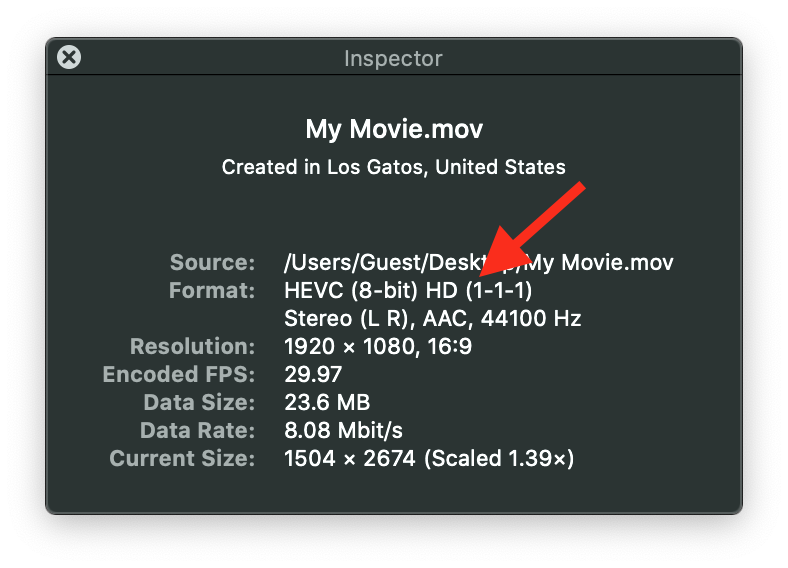
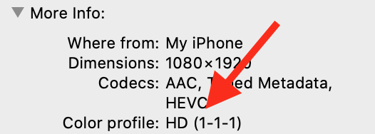

> 导航： [Technologies](../technologies.md) · [AVFoundation](../avfoundation.md) · [Media reading and writing](media-reading-and-writing.md)

# 使用视频色彩信息标记媒体

<sub>文章</sub>

在写入和转码媒体时检查并设置视频色彩空间信息。

## 概述

媒体文件可能包含描述视频媒体的视频色彩空间信息标记。系统的色彩管理使用这些视频色彩标记来确保色彩外观在所有环境中保持一致。你可以从媒体中检索并检查色彩信息标记，并在写入和转码媒体时指定新的标记。你还可以检测广色域媒体，防止媒体被压缩到更小的色域色彩空间。

### 视频标记描述关键视频参数

出于历史原因，色彩科学家定义了广播视频色彩空间的许多变体。因此，你应当用描述视频媒体的色彩信息来 _标记_ 你的媒体文件。如果不这样做，未标记的媒体内容在客户遇到的各种不同配置和环境中的表现可能不符合你的预期。

> [!note] 注意
> _标记_ 一词指的是媒体中描述内容的可选色彩空间信息参数。这些标记以简化的方式描述视频色彩特性。

这种色彩信息标记机制支持三个关键的视频参数：

- **色彩基色**（Color Primaries） — 指向一个表的索引，该表指定白点以及红、绿、蓝基色的 CIE 1931 xy 色度坐标。这个基色表为一个视频系统指定白点和红、绿、蓝基色点。
- **传递函数**（Transfer Function） — 定义指向一个表的索引，该表指定在 RGB 色彩空间值与 Y´CbCr 值之间转换的非线性传递函数系数。这个传递函数系数表指定在存储的 Y´CbCr 值与视频采集或显示系统之间转换的非线性函数系数。
- **转换矩阵**（Conversion Matrix） — 指向一个表的索引，该表指定在 RGB 色彩空间值与 Y´CbCr 值之间转换的变换矩阵系数。这个矩阵表指定用于转换的矩阵。

> [!note] 注意
> 三者都是索引，而不是实际值。[QuickTime 文件格式](../quicktime-file-format.md)和 [Uncompressed Y´CbCr Video in QuickTime Files](https://developer.apple.com/library/archive/technotes/tn2162/_index.html#//apple_ref/doc/uid/DTS40013070-CH1-TNTAG10) 在类型为 `‘nclc’` 的 `‘colr’` 扩展中描述了这些索引。

ColorSync 使用这些视频参数生成以下视频色彩空间之一：

- SD（SMPTE-C）
- HD（Rec. 709）
- P3（D65）
- UHD（Rec. 2020）

[ISO/IEC 23001-8:2016](https://www.iso.org/standard/69661.html)《Coding-Independent Code Points》定义了这些标准标记编号。

### 使用 asset writer 标记你的视频

初始化 [AVAssetWriterInput](avassetwriterinput.md) 对象时，你可以选择性地指定一个字典，其中包含对追加到输出的媒体进行编码的设置。[AVVideoColorPropertiesKey](avvideocolorpropertieskey.md) 是一个字典，其中包含指定视频色彩的属性（细节参见[为特定分辨率设置色彩属性](setting-color-properties-for-a-specific-resolution.md)）。在 `AVAssetWriterInput` 的输出设置字典中设置这个键，即可覆盖视频中的色彩属性标记。

如果输出设置中存在视频色彩属性键，writer 会按如下方式标记输出：

- 如果源缓冲没有色彩属性标记，asset writer 会根据视频色彩属性标记输出。
- 如果源缓冲也有色彩属性标记，writer 会在必要时对源缓冲进行色彩转换，以匹配视频色彩属性。writer 还会根据视频色彩属性标记输出。

如果你不打算覆盖视频中的色彩属性标记，就不要为视频色彩属性键设置值。如果输出设置中没有视频色彩属性键，框架会按如下方式标记输出：

- 如果源缓冲有色彩属性标记，writer 会根据源缓冲的色彩属性标记输出。
- 如果源缓冲没有色彩属性标记，writer 不会用任何色彩属性标记输出。

以下示例代码在输出设置中为视频色彩属性键指定 Rec. 709 输出色彩空间：

```swift
// Use the asset writer object you create.
let writer = AVAssetWriter(contentType: .movie)
        
let colorPropertySettings = [
    AVVideoColorPrimariesKey: AVVideoColorPrimaries_ITU_R_709_2,
    AVVideoYCbCrMatrixKey: AVVideoTransferFunction_ITU_R_709_2,
    AVVideoTransferFunctionKey: AVVideoYCbCrMatrix_ITU_R_709_2
]
        
let compressionSettings: [String: Any] = [
    AVVideoCodecKey: AVVideoCodecType.h264,
    AVVideoWidthKey: 1920,
    AVVideoHeightKey: 1080,
    AVVideoColorPropertiesKey: colorPropertySettings
]

let input = AVAssetWriterInput(mediaType: .video,
                               outputSettings: compressionSettings)
writer.add(input)
```

### 为你的视频合成指定色彩空间信息

你可以使用类似的属性为视频合成配置色彩空间信息。

你使用 [colorPrimaries](avmutablevideocomposition/colorprimaries.md) 属性为整个视频合成指定一个工作色彩空间。使用 [colorTransferFunction](avmutablevideocomposition/colortransferfunction.md) 键设置传递函数，使用 [colorYCbCrMatrix](avmutablevideocomposition/colorycbcrmatrix.md) 键设置 Y’CbCr 矩阵。分别为它们指定适合 `AVVideoColorPrimariesKey`、[AVVideoTransferFunctionKey](avvideotransferfunctionkey.md) 和 [AVVideoYCbCrMatrixKey](avvideoycbcrmatrixkey.md) 这几个键的值。

代码示例如下：

```swift
let videoComposition = AVMutableVideoComposition()
videoComposition.colorPrimaries = AVVideoColorPrimaries_P3_D65
videoComposition.colorTransferFunction = AVVideoTransferFunction_ITU_R_709_2
videoComposition.colorYCbCrMatrix = AVVideoYCbCrMatrix_ITU_R_709_2
```

> [!note] 注意
> 上述属性的默认值为 `nil`。当属性值为 `nil` 时，系统会采用并传播源的值。

### 用色彩空间信息标记你的 Core Video 缓冲

如果你生成用于渲染的 Core Video 源缓冲（例如，在 Metal 中使用像素缓冲池），应当用色彩信息标记它们。

你可以像下面的示例那样，在缓冲的附件字典中显式设置色彩空间标记：

```swift
CVBufferSetAttachment(pixelBuffer, kCVImageBufferColorPrimariesKey, kCVImageBufferColorPrimaries_P3_D65, .shouldPropagate)
CVBufferSetAttachment(pixelBuffer, kCVImageBufferTransferFunctionKey, kCVImageBufferTransferFunction_ITU_R_709_2, .shouldPropagate)
CVBufferSetAttachment(pixelBuffer, kCVImageBufferYCbCrMatrixKey, kCVImageBufferYCbCrMatrix_ITU_R_709_2, .shouldPropagate)
inputPixelBufferAdaptor.append(pixelBuffer, withPresentationTime: presentationTime)
```

### 获取你的媒体的色彩空间信息

你可以使用 [CMFormatDescription](../coremedia/cmformatdescription.md) 访问某个 asset 的视频轨道媒体的底层细节。`CMFormatDescriptionRef` 对象描述特定类型（音频、视频等）的媒体。你可以使用 [AVAssetTrack](avassettrack.md) 的 [formatDescriptions](avassettrack/formatdescriptions.md) 属性获取 asset 轨道媒体样本引用的格式描述。在格式描述中查找定义媒体色彩属性的 [kCVImageBufferColorPrimariesKey](../corevideo/kcvimagebuffercolorprimarieskey.md) 扩展键。`CMFormatDescription.h` 头文件定义了色彩基色键的取值。

下面的示例在 [kCVImageBufferColorPrimariesKey](../corevideo/kcvimagebuffercolorprimarieskey.md) 扩展中检查 [kCMFormatDescriptionColorPrimaries_ITU_R_709_2](../coremedia/kcmformatdescriptioncolorprimaries_itu_r_709_2-swift.var.md) 色彩基色键值：

```swift
let assetTracks = try await asset.loadTracks(withMediaType: .video)
        
for assetTrack in assetTracks {
    let formatDescriptions = try await assetTrack.load(.formatDescriptions)
    for formatDescription in formatDescriptions {
        guard let colorPrimaries = CMFormatDescriptionGetExtension(formatDescription, extensionKey: kCMFormatDescriptionExtension_ColorPrimaries) else {
            return
        }

        if CFGetTypeID(colorPrimaries) == CFStringGetTypeID() {
            let result = CFStringCompareWithOptions((colorPrimaries as! CFString),
                                                    kCMFormatDescriptionColorPrimaries_ITU_R_709_2,
                                                    CFRangeMake(0, CFStringGetLength((colorPrimaries as! CFString))),
                                                    CFStringCompareFlags.compareCaseInsensitive)

            if result == CFComparisonResult.compareEqualTo {
                // The color space is Rec. 709.
            }
        }
    }
}
```

### 查看你的媒体的色彩信息

你可以使用 macOS QuickTime Player App 中的“显示影片检查器”命令查看文件中视频媒体的色彩空间信息。在该 App 中打开文件，然后选择“窗口” \> “显示影片检查器”。检查器窗口会显示关于视频媒体的色彩信息和其他细节。



<sub>QuickTime Player App 中检查器窗口的截图，有一个箭头指向某个视频的格式信息。</sub>

访达的“显示简介”命令也会显示文件中视频媒体的色彩信息。在访达中选择一个文件，然后选择“文件” \> “显示简介”。“更多信息”部分包含色彩描述文件信息。



### 检测你的媒体中的广色域标记

[AVMediaCharacteristicUsesWideGamutColorSpace](avmediacharacteristic/useswidegamutcolorspace.md) 媒体特性表明视频轨道包含比 Rec. 709 更宽的色彩基色，系统无法精确表示它们。像 P3 D65 这样的广色域色彩空间包含额外的动态范围，在工作流程中进行合成时可能需要特殊处理才能受益。你应当谨慎处理，避免把色彩压缩回 Rec. 709 空间。如果不做特殊处理，通常最好让你的处理保持在 Rec. 709 空间内。

示例：

```swift
let asset = <# Your AVAsset #>
let wideGamutTracks = asset.tracks(withMediaCharacteristic: .usesWideGamutColorSpace)
if wideGamutTracks.count > 0 {
    // Use wide color aware processing.
} else {
    // Use Rec 709 processing.
}
```

### 在你的媒体中保留广色域

把 [AVAssetReaderOutput](avassetreaderoutput.md) 的 [AVVideoAllowWideColorKey](avvideoallowwidecolorkey.md) 属性设为 `true`，即可按原始色彩空间接收缓冲。默认值（`false`）允许隐式色彩转换到非广色域的色彩空间。

```swift
let allowWideColorSettings = [AVVideoAllowWideColorKey: true]
let readerOutput = AVAssetReaderOutput(outputSettings: allowWideColorSettings) 
```

### 在自定视频合成器中支持广色域

你可以实现可选的 [supportsWideColorSourceFrames](avvideocompositing/supportswidecolorsourceframes.md) 属性并返回 `true`，表明你的自定视频合成器能处理包含广色域属性的帧。在这种情况下，合成器会检查并尊重每个源帧缓冲上的色彩空间标记。

```swift
class MyCustomVideoCompositor : AVVideoCompositing { 
   // ...
   var supportsWideColorSourceFrames: Boolean  { return true }
}
```

## 另请参阅

### 媒体写入

- [将投影视频转换为 Apple 投影媒体配置文件](converting-projected-video-to-apple-projected-media-profile.md) — 将等距柱状或半等距柱状投影的内容转换为 APMP。
- [将并排 3D 视频转换为多视图 HEVC 和空间视频](converting-side-by-side-3d-video-to-multiview-hevc-and-spatial-video.md) — 通过把现有的 3D HEVC 文件转换为多视图 HEVC 格式来为 visionOS 创建视频内容，并可选择添加空间元数据以创建空间视频。
- [向影片文件添加显示遮罩矩形元数据轨道](adding-a-display-mask-rectangle-metadata-track-to-a-movie-file.md) — 使用定时显示遮罩矩形元数据显示视频的特定区域。
- [为 HTTP Live Streaming 写入分片 MPEG-4 文件](writing-fragmented-mpeg-4-files-for-http-live-streaming.md) — 通过把影片文件变成一系列分片 MPEG-4 文件来创建 HTTP Live Streaming 演示。
- [使用空间元数据创建空间照片和视频](../imageio/creating-spatial-photos-and-videos-with-spatial-metadata.md) — 向立体照片和视频添加空间元数据，以创建可在 Apple Vision Pro 上观看的空间媒体。
- [评估 App 的视频色彩](evaluating-an-app-s-video-color.md) — 使用测试图案、视频测试设备和光照测量仪器检查 App 中视频的色彩再现。
- [AVOutputSettingsAssistant](avoutputsettingsassistant.md) — 一个构建音频和视频输出设置字典的对象。
- [AVAssetWriter](avassetwriter.md) — 一个将媒体数据写入容器文件的对象。
- [AVAssetWriterInput](avassetwriterinput.md) — 一个将媒体样本追加到 asset writer 的输出文件中的轨道的对象。
- [AVAssetWriterInputPixelBufferAdaptor](avassetwriterinputpixelbufferadaptor.md) — 一个将视频样本追加到 asset writer 输入的对象。 _(已废弃)_
- [AVAssetWriterInputTaggedPixelBufferGroupAdaptor](avassetwriterinputtaggedpixelbuffergroupadaptor.md) — 一个将标记的缓冲区组追加到 asset writer 输入的对象。 _(已废弃)_
- [AVAssetWriterInputMetadataAdaptor](avassetwriterinputmetadataadaptor.md) — 一个将定时元数据组追加到 asset writer 输入的对象。 _(已废弃)_
- [AVAssetWriterInputGroup](avassetwriterinputgroup.md) — 一组输入，其轨道在播放或处理时互斥。
