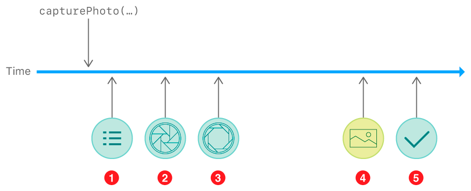

> 导航：[技术](../technologies.md) · [AVFoundation](../avfoundation.md) · [照片拍摄](photo-capture.md) · [拍摄静态图像和实况照片](capturing-still-and-live-photos.md)

# 跟踪照片拍摄进度

<sub>文章</sub>

监控拍摄过程中的关键事件，以便在你的相机 UI 中提供反馈。

## 概述

用 iOS 设备相机拍摄照片是一个复杂的过程，涉及物理相机机制、图像信号处理、操作系统和你的 App。虽然你的 App 可以忽略这个过程的许多阶段而只是等待最终结果，但你可以通过监控每个步骤来创建一个响应更灵敏的相机界面。

在你调用 [- capturePhotoWithSettings:delegate:](<avcapturephotooutput/capturephoto(with_delegate_).md>) 之后，你的委托对象可以跟随该过程中的五个主要步骤（或更多，取决于你的照片设置）。根据你的拍摄工作流和你想要创建的拍摄 UI，你的委托可以处理其中部分或全部步骤：



1. 设置已解析
2. 曝光开始
3. 曝光完成
4. 结果数据送达
5. 拍摄完成

捕获系统会在这个过程的每个步骤提供一个 [AVCaptureResolvedPhotoSettings](avcaptureresolvedphotosettings.md) 对象。由于可能同时进行多个拍摄，每个已解析照片设置对象都有一个 [uniqueID](avcaptureresolvedphotosettings/uniqueid.md)，其值与你用来拍照的 [AVCapturePhotoSettings](avcapturephotosettings.md) 的 [uniqueID](avcapturephotosettings/uniqueid.md) 相匹配。

### 获取已解析的拍摄设置

当你为照片指定设置时，你所选择的某些设置可以是自动的，留给捕获系统在拍摄的确切时刻来决定。例如，你可以选择 [AVCaptureFlashModeAuto](avcapturedevice/flashmode-swift.enum/auto.md) 闪光模式，让相机本身根据场景照明来决定在为照片曝光时是否打开闪光灯。

在曝光开始之前，照片输出会调用你的委托的 [- captureOutput:willBeginCaptureForResolvedSettings:](<avcapturephotocapturedelegate/photooutput(__willbegincapturefor_).md>) 方法，其 `resolvedSettings` 参数会告诉你该次拍摄的实际设置。例如，如果你选择了 [AVCaptureFlashModeAuto](avcapturedevice/flashmode-swift.enum/auto.md) 闪光模式，已解析设置对象会告诉你当前拍摄是否使用了闪光灯——你可以利用这个信息在 UI 中显示使用了闪光灯。

### 处理曝光开始

当曝光时间开始时，照片输出会调用你的委托的 [- captureOutput:willCapturePhotoForResolvedSettings:](<avcapturephotocapturedelegate/photooutput(__willcapturephotofor_).md>) 方法。在传统摄影中，这一时刻相当于相机快门开启。系统也会在此刻自动播放快门音。

在 UI 中，你可以响应这个方法来显示快门动画或其他指示，表明请求的照片正在拍摄。

### 处理曝光结束

曝光时间一完成，照片输出就会调用你的委托的 [- captureOutput:didCapturePhotoForResolvedSettings:](<avcapturephotocapturedelegate/photooutput(__didcapturephotofor_).md>) 方法。系统仍需要时间来处理相机数据才能向你的 App 提供图像，但你可以利用这个时刻在 UI 中显示曝光已完成。例如，你可以通过在 `willCapturePhoto` 方法中隐藏相机预览并在 `didCapturePhoto` 方法中重新显示，来模拟快门效果。

### 处理照片结果

当照片输出有可供你的 App 使用的图像数据时，它会调用你的委托的 [- captureOutput:didFinishProcessingPhoto:error:](<avcapturephotocapturedelegate/photooutput(__didfinishprocessingphoto_error_).md>) 方法。根据你的照片设置，照片输出可能会多次调用这个方法：

- 如果你请求包围式拍摄，这个方法会为包围中的每次曝光触发（至少）一次，提供该次曝光的图像。
- 如果你同时请求 RAW 和已处理格式（例如 HEIF/HEVC 或 JPEG）的拍摄，这个方法会为每种格式触发（至少）一次。

例如，如果你在三次曝光的包围中请求 RAW+HEIF 拍摄，照片输出会调用你的委托的 `didFinishProcessingPhoto` 方法六次（2 种格式 × 3 次曝光），提供六个 [AVCapturePhoto](avcapturephoto.md) 对象。要跟踪多个结果，请将每张照片的 [photoCount](avcapturephoto/photocount.md) 与你已解析设置的 [expectedPhotoCount](avcaptureresolvedphotosettings/expectedphotocount.md) 进行比较。

> [!note] 注意
> 如果你请求实况照片拍摄，额外的委托方法会提供该过程的反馈。请参阅[拍摄并保存实况照片](capturing-and-saving-live-photos.md)。

### 在拍摄完成时清理

当系统为一次拍摄所做的全部工作完成后，照片输出会调用你的委托的 [- captureOutput:didFinishCaptureForResolvedSettings:error:](<avcapturephotocapturedelegate/photooutput(__didfinishcapturefor_error_).md>) 方法。你可以利用这个时刻来完成你的 App 在拍摄过程中的收尾工作：

- 如果你的拍摄预期有多个结果，请在你的 [- captureOutput:didFinishProcessingPhoto:error:](<avcapturephotocapturedelegate/photooutput(__didfinishprocessingphoto_error_).md>)（和 [- captureOutput:didFinishProcessingLivePhotoToMovieFileAtURL:duration:photoDisplayTime:resolvedSettings:error:](<avcapturephotocapturedelegate/photooutput(__didfinishprocessinglivephototomoviefileat_duration_photodisplaytime_resolvedsettings_error_).md>)）方法中缓存这些结果，然后在你的 `didFinishCapture` 方法中将结果保存到本地存储或添加到「照片」图库。
- 如果你的拍摄过程管理着其他资源，请在你的 `didFinishCapture` 方法中清理这些资源。如果你为每次拍摄使用单独的照片拍摄委托对象，这是移除对这些对象的任何强引用的好时机。

下面的代码展示了管理多个照片拍摄委托对象的一种方式：

```swift
class PhotoCaptureProcessor: NSObject, AVCapturePhotoCaptureDelegate {
    var completionHandler: () -> () = {}
    func photoOutput(_ output: AVCapturePhotoOutput, didFinishCaptureFor resolvedSettings: AVCaptureResolvedPhotoSettings, error: Error?) {
        completionHandler()
    }
    // ... 用于处理拍摄结果的其他委托方法...
}

// 保存一组进行中的拍摄委托。
var capturesInProgress = Set<PhotoCaptureProcessor>()

func shootPhoto() {    
    // 为每次拍摄创建一个新的拍摄委托并将其加入集合。
    let captureProcessor = PhotoCaptureProcessor()
    capturesInProgress.insert(captureProcessor)
    
    // 安排在拍摄完成后将该拍摄委托从集合中移除。
    captureProcessor.completionHandler = { [weak self] in
        self?.capturesInProgress.remove(captureProcessor); return
    }
    
    self.photoOutput.capturePhoto(with: self.settingsForNextPhoto(), delegate: captureProcessor)
}

```

## 另请参阅

### 后续步骤

- [保存拍摄的照片](saving-captured-photos.md) — 将照片拍摄得到的图像和其他数据添加到照片图库。
- [拍摄并保存实况照片](capturing-and-saving-live-photos.md) — 拍摄与系统「相机」App 中创建的实况照片类似的照片，并将其保存到「照片」图库。
