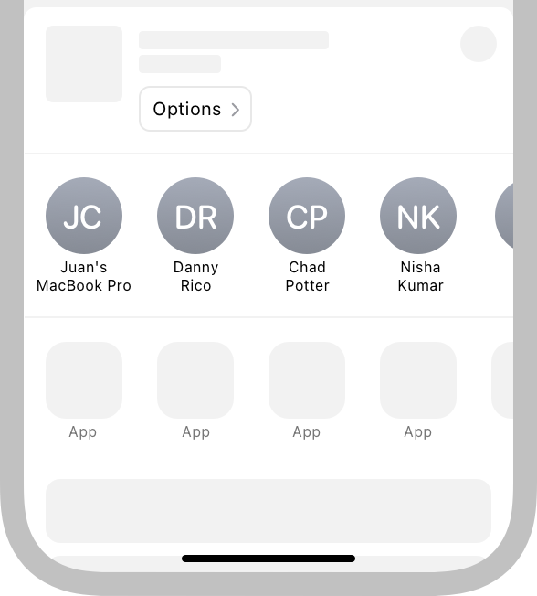
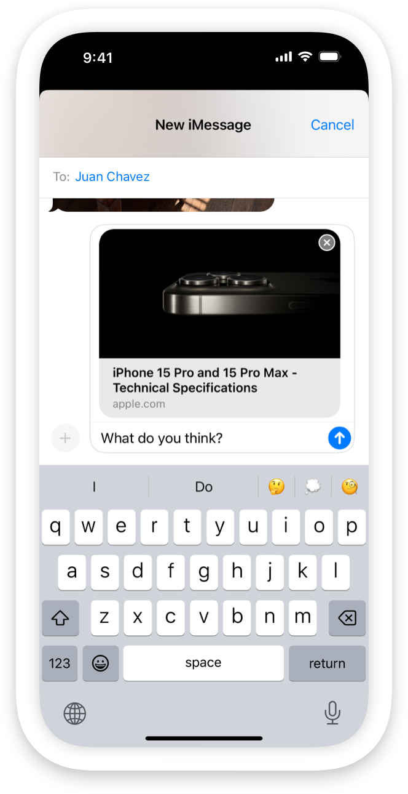
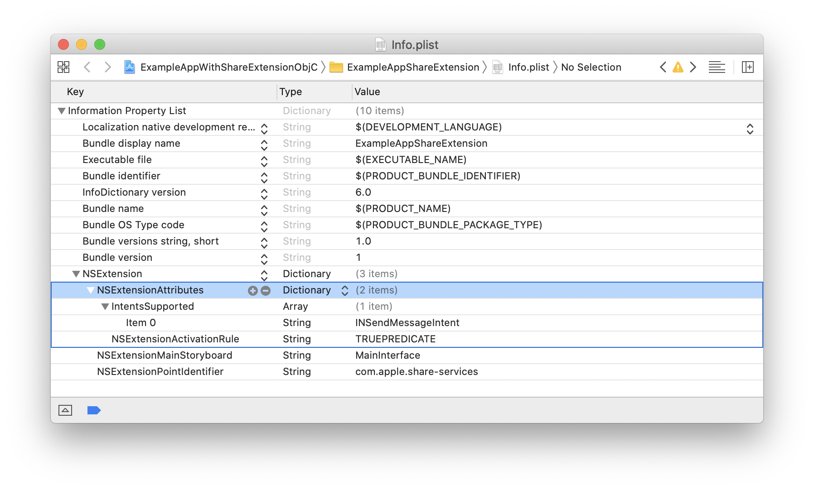

> 导航：[技术](../technologies.md) · [Foundation](../foundation.md) · [App Extension Support](app-extension-support.md)

# 在 App 的共享扩展中支持建议

<sub>文章</sub>

让你的信息 App 可用于共享表单建议，并使用 SiriKit intent 填充 App 的共享扩展。

## 概述

通过 iOS 共享表单，人们在分享链接、图像、视频或文件等内容时，可以从建议列表中立即启动你的信息 App。共享表单会建议与用户经常交互的 App 中的人的对话，并根据用户偏爱的 App 和对话随时间更新建议。在 iOS 16 或更高版本中，当用户分享图像时，共享表单会优先显示它在这张图像中识别出的人们的对话。



<sub>一张 iPhone 截屏。上半部分显示 Safari 中的 apple.com 网站。下半部分显示用户决定与他人分享该网站后的共享表单。iOS 在「信息」App 和另一个 App 中建议了对话。</sub>

要让 iOS 将你的信息 App 中的对话包含在建议列表中：

- 按照[了解共享扩展](https://developer.apple.com/library/archive/documentation/General/Conceptual/ExtensibilityPG/Share.html#//apple_ref/doc/uid/TP40014214-CH12-SW2)中的说明，向你的 App 添加共享扩展。
- 声明支持 [INSendMessageIntent](../intents/insendmessageintent.md) intent 类型。
- 在你的信息 App 及其共享扩展中捐赠 [INSendMessageIntent](../intents/insendmessageintent.md)。

当用户从建议列表中选择某个 App 时，该 App 以共享扩展形式实现的共享界面会访问额外的元数据。iOS 提供了 [INSendMessageIntent](../intents/insendmessageintent.md)，供你预填充 App 共享扩展的界面。例如，你可以访问 [conversationIdentifier](../intents/insendmessageintent/conversationidentifier.md) 属性并预先选择要分享内容的对话，这样用户就无需在列表中搜索联系人或输入朋友的名字。

一张 iPhone 截屏，Safari 浏览器正在显示 apple.com 主页。用户轻点了共享按钮，并从建议列表中选择了一个 App。基于 SLComposeViewController 的平台默认共享界面可见。根据可用的元数据，扩展已用收件人（Juan Chavez）预填充了界面。



<sub>一张 iPhone 截屏，Safari 浏览器正在显示 apple.com 主页。用户轻点了共享按钮，并从建议列表中选择了一个 App。基于 SLComposeViewController 的平台默认共享界面可见。根据可用的元数据，扩展已用收件人（Juan Chavez）预填充了界面。</sub>

### 向你的 App 添加共享扩展

要向你的 App 添加共享扩展，请在 Xcode 中打开你的 App 项目，然后从菜单栏中选择 File \> New \> Target。Xcode 会显示一个包含不同种类 target 模板的表单。从 iOS 窗格中选择共享扩展模板，并按照 Xcode 界面中的步骤将其添加到你的 App。更多信息，请参阅《App 扩展编程指南》中的[了解共享扩展](https://developer.apple.com/library/archive/documentation/General/Conceptual/ExtensibilityPG/Share.html#//apple_ref/doc/uid/TP40014214-CH12-SW2)。

### 支持发送消息 intent

打开共享扩展的 `Info.plist`，并展开 [NSExtension](../bundleresources/information-property-list/nsextension.md) 和 [NSExtensionAttributes](../bundleresources/information-property-list/nsextension/nsextensionattributes.md) 键。使用 [IntentsSupported](../bundleresources/information-property-list/nsextension/intentssupported.md) 键添加一个新条目，并将其值类型选择为 `Array`。向该数组添加字符串 `INSendMessageIntent` 作为新值，以声明支持 [INSendMessageIntent](../intents/insendmessageintent.md) intent 类型。



<sub>一张 Xcode 截屏，显示开发者使用 Xcode 共享扩展模板创建的共享扩展的 Info.plist 文件。NSExtension 键下方的条目已展开，显示 IntentsSupported 键，其中一项的值设置为 INSendMessageIntent。NSExtensionActivationRule 条目设置为 TRUEPREDICATE。</sub>

为了让调试更容易，在首次使用 Xcode 模板添加共享扩展时，请将 [NSExtensionActivationRule](../bundleresources/information-property-list/nsextension/nsextensionattributes/nsextensionactivationrule.md) 的值设置为 `TRUEPREDICATE`。在提交 App 审核之前，按照[为共享或操作扩展声明支持的数据类型](https://developer.apple.com/library/archive/documentation/General/Conceptual/ExtensibilityPG/ExtensionScenarios.html#//apple_ref/doc/uid/TP40014214-CH21-SW8)中的说明，将其替换为有效的激活规则。

### 捐赠发送消息 intent

仅当用户在你的 App 及其共享扩展中发送或接收消息时，才捐赠 [INSendMessageIntent](../intents/insendmessageintent.md)。在初始化 [INPerson](../intents/inperson.md) 时，通过在联系人的 [contactIdentifier](../intents/inperson/contactidentifier.md) 字段中添加值，为 [sender](../intents/insendmessageintent/sender.md) 和 [recipients](../intents/insendmessageintent/recipients.md) 随 [INSendMessageIntent](../intents/insendmessageintent.md) 一起捐赠 [CNContact](../contacts/cncontact.md)。

在初始化 [INSendMessageIntent](../intents/insendmessageintent.md) 对象时，提供稍后当用户从建议列表中选择你的 App 的共享扩展时可用的元数据。下面的代码片段捐赠一个带有 [speakableGroupName](../intents/insendmessageintent/speakablegroupname.md)、[conversationIdentifier](../intents/insendmessageintent/conversationidentifier.md) 和 [INImage](../intents/inimage.md) 的 [INSendMessageIntent](../intents/insendmessageintent.md)。

```swift
// 创建一个 INSendMessageIntent，为与 Juan Chavez 的对话捐赠一个 intent。
let groupName = INSpeakableString(spokenPhrase: "Juan Chavez")
let sendMessageIntent = INSendMessageIntent(recipients: nil,
                                            content: nil,
                                            speakableGroupName: groupName,
                                            conversationIdentifier: "sampleConversationIdentifier",
                                            serviceName: nil,
                                            sender: nil)

// 将此人的头像添加到 intent。
let image = INImage(named: "Juan Chavez")
sendMessageIntent.setImage(image, forParameterNamed: \.speakableGroupName)

// 捐赠该 intent。
let interaction = INInteraction(intent: sendMessageIntent, response: nil)
interaction.donate(completion: { error in
    if error != nil {
        // 在此处添加错误处理。
    } else {
        // 执行一些操作，例如将内容发送给联系人。
    }
})
```

当 iOS 将你的 App 中的某个对话作为建议包含在共享表单中时，它会显示你的 App 图标，以及你与 [INSendMessageIntent](../intents/insendmessageintent.md) 关联的 [INImage](../intents/inimage.md)。如果 intent 上没有设置 [INImage](../intents/inimage.md)，iOS 会为每位收件人使用 [INPerson](../intents/inperson.md) 对象的 [image](../intents/inperson/image.md) 属性。如果 [INPerson](../intents/inperson.md) 对象的 [image](../intents/inperson/image.md) 为 `nil`，iOS 会使用人的 [contactIdentifier](../intents/inperson/contactidentifier.md) 在「通讯录」App 中查找对应的联系人。共享表单随后会使用该联系人的图像。

在 iOS 16 或更高版本中，当用户在启用了「来自 Apple 的建议」设置的情况下分享图像时，共享表单会优先在建议列表中显示与系统在这张图像中识别出的人们的对话。在你捐赠的共享 intent 中包含一个 [INImage](../intents/inimage.md)，让系统能够尝试识别图像中的人。请提供高度或宽度至少为 360 像素的图像，以改善匹配效果。

> [!tip] Tip
> 你的 App 和它的共享扩展都会捐赠 [INSendMessageIntent](../intents/insendmessageintent.md)。创建一个捐赠 intent 的对象，并使其对扩展和 App 都可用，从而编写可重用的代码。

### 用元数据填充共享扩展的界面

当用户从建议列表中选择你的 App 时，你可以访问你的 App 捐赠 [INSendMessageIntent](../intents/insendmessageintent.md) 时创建的元数据。用它来填充你的共享扩展的界面。

下面的代码清单展示了 [SLComposeServiceViewController](../social/slcomposeserviceviewcontroller.md) 子类的模板实现。它访问 [intent](nsextensioncontext/intent.md) 属性，确认它是 [INSendMessageIntent](../intents/insendmessageintent.md)，并使用 intent 的 [conversationIdentifier](../intents/insendmessageintent/conversationidentifier.md) 创建一个新的 `Recipient` 对象。然后在 [configurationItems()](<../social/slcomposeserviceviewcontroller/configurationitems().md>) 方法中使用 `Recipient` 对象来填充共享扩展的界面。

```swift
import Intents
import Social
import UIKit

class ShareViewController: SLComposeServiceViewController {

    var recipient: Recipient = Recipient(withName: "Placeholder")
    
    override func viewDidLoad() {
        super.viewDidLoad()
        
        // 用元数据填充收件人属性，以防用户轻点共享表单中的建议。
        let intent = self.extensionContext?.intent as? INSendMessageIntent
        if intent != nil {
            let conversationIdentifier = intent!.conversationIdentifier
            self.recipient = recipient(identifier: conversationIdentifier!)
        }
    }

    func recipient(identifier: String) -> Recipient {
        // 创建一个收件人对象，例如从数据库加载。
        return Recipient(withName: identifier)
    }

    override func isContentValid() -> Bool {
        // 在此处验证 contentText 和 NSExtensionContext 附件。
        return true
    }

    override func didSelectPost() {
        // 此方法在用户选择「发布」后调用。上传 contentText 和 NSExtensionContext 附件。
        
        // 通知宿主选择已完成，以便其解除 UI 阻塞。
        // 注意：你也可以调用 super 的 -didSelectPost，它同样会完成扩展上下文。
        self.extensionContext!.completeRequest(returningItems: [], completionHandler: nil)
    }

    override func configurationItems() -> [Any]! {
        // 要通过表单底部的表格单元格添加配置选项，请在此处返回一个 SLComposeSheetConfigurationItem 数组。
        
        // 使用 Recipient 对象来填充共享表单。
        let item = SLComposeSheetConfigurationItem()
        item?.title = NSLocalizedString("To:", comment: "The To: label when sharing content.")
        item?.value = self.recipient.name
        item?.tapHandler = {
            self.validateContent()
            item!.value = self.recipient.name
        }
        
        return [item!]
    }
}
```
