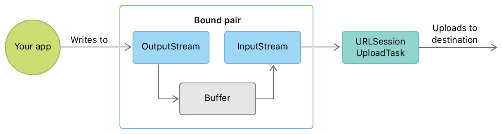

> 导航：[技术](../technologies.md) · [Foundation](../foundation.md) · [URL Loading System](url-loading-system.md)

# 上传数据流

<sub>文章</sub>

向服务器发送数据流。

## 概述

流媒体 App 以及发送持续更新的长时间运行 App 使用持续的流来上传数据，而不是发送单个数据块或平面文件。你可以将 [URLSessionUploadTask](urlsessionuploadtask.md)（[URLSessionTask](urlsessiontask.md) 的子类）的实例配置为使用你提供的流，然后不限量地向该流填充数据。

任务通过调用你的会话的委托来获取流，因此你需要创建一个会话并将你自己的代码设为它的委托。

### 创建 URL 会话

首先创建一个 URLSession 并为其提供委托。下面的示例使用默认的 [URLSessionConfiguration](urlsessionconfiguration.md) 创建一个 URL 会话，并将 `self` 设为委托。稍后你会在[向上传任务提供流](uploading-streams-of-data.md#Provide-the-stream-to-the-upload-task)中实现 [URLSessionTaskDelegate](urlsessiontaskdelegate.md)。

创建带委托的 URLSession

```swift
lazy var session: URLSession = URLSession(configuration: .default,
                                          delegate: self,
                                          delegateQueue: .main)

```

### 创建流式上传任务

使用 [URLSession](urlsession.md) 的 [- uploadTaskWithStreamedRequest:](<urlsession/uploadtask(withstreamedrequest_).md>) 方法创建上传任务。它接受一个 [URLRequest](urlrequest.md)，指定你要上传到的 URL 以及其他参数。你通过调用 [- resume](<urlsessiontask/resume().md>) 来启动任务。下面的示例展示了如何创建并启动一个上传任务，连接到本机（`127.0.0.1`）上监听 `12345` 端口的服务器。

创建上传任务

```swift
let url = URL(string: "http://127.0.0.1:12345")!
var request = URLRequest(url: url,
                         cachePolicy: .reloadIgnoringLocalCacheData,
                         timeoutInterval: 10)
request.httpMethod = "POST"
let uploadTask = session.uploadTask(withStreamedRequest: request)
uploadTask.resume()
```

### 使用一对绑定流来提供输入流

你以 [InputStream](inputstream.md) 的形式向上传任务提供流式数据。任务从这个流中读取数据，并将其上传到目的地。

向输入流提供数据的一个好办法是使用一对_绑定流_。绑定流包含一个你向其写入数据的 [OutputStream](outputstream.md)。得益于流之间的绑定，你写入输出流的数据会提供给输入流，任务随后可以从输入流读取。[图 1](/documentation/foundation/url_loading_system/uploading_streams_of_data#3037791) 展示了这种安排。



<sub>流程图，展示 App 写入绑定流输出流的数据如何进入缓冲区，再到绑定流的输入流，然后交给上传任务，由其发送到目的地。</sub>

下面的示例展示了一个名为 `Streams` 的结构体，它由一个 [InputStream](inputstream.md) 和一个 [OutputStream](outputstream.md) 组成。代码清单通过调用 [Stream](stream.md) 类的 [+ getBoundStreamsWithBufferSize:inputStream:outputStream:](<stream/getboundstreams(withbuffersize_inputstream_outputstream_).md>) 方法，并传入输入流和输出流的进出引用，创建了一个此类型的属性 `boundStreams`。

创建一对绑定的输入流和输出流

```swift
struct Streams {
    let input: InputStream
    let output: OutputStream
}
lazy var boundStreams: Streams = {
    var inputOrNil: InputStream? = nil
    var outputOrNil: OutputStream? = nil
    Stream.getBoundStreams(withBufferSize: 4096,
                           inputStream: &inputOrNil,
                           outputStream: &outputOrNil)
    guard let input = inputOrNil, let output = outputOrNil else {
        fatalError("On return of `getBoundStreams`, both `inputStream` and `outputStream` will contain non-nil streams.")
    }
    // 配置并打开输出流
    output.delegate = self
    output.schedule(in: .current, forMode: .default)
    output.open()
    return Streams(input: input, output: output)
}()

```

创建绑定流时，请确保指定的缓冲区大小足以容纳你写入输出流的所有数据，直到这些数据从输入流中被读取。下面的示例使用了 4096 字节的缓冲区。

代码清单还将 `self` 设为输出流的委托。声明你的类实现 [StreamDelegate](streamdelegate.md) 协议，以便接收指示输出流何时准备好接收新数据的事件。稍后你会在[在流就绪时写入数据](uploading-streams-of-data.md#Write-data-to-the-stream-when-its-ready)中提供 [StreamDelegate](streamdelegate.md) 的实现。

> [!tip] Tip
> 你对 [StreamDelegate](streamdelegate.md) 和 [URLSessionTaskDelegate](urlsessiontaskdelegate.md) 的实现可以在同一个类中，也可以在不同的类中，以哪种方式更符合你的 App 架构为准。

### 向上传任务提供流

你在 [URLSessionTaskDelegate](urlsessiontaskdelegate.md) 方法 [- URLSession:task:needNewBodyStream:](<urlsessiontaskdelegate/urlsession(__task_neednewbodystream_).md>) 的实现中向上传任务提供输入流，该方法在你通过调用 [- resume](<urlsessiontask/resume().md>) 启动上传任务后被调用。回调传入一个完成处理程序，你直接调用它，并传入你之前创建的 `boundStreams.input` 流。下面的示例展示了此方法的一个实现。

在委托回调中向上传任务提供输入流

```swift
func urlSession(_ session: URLSession, task: URLSessionTask,
                needNewBodyStream completionHandler: @escaping (InputStream?) -> Void) {
    completionHandler(boundStreams.input)
}
```

### 在流就绪时写入数据

只在流准备好接收数据时才向输出流写入数据。流的就绪状态会通过 [StreamDelegate](streamdelegate.md) 方法 [- stream:handleEvent:](<streamdelegate/stream(__handle_).md>) 通知你。当此回调将 [NSStreamEventHasSpaceAvailable](stream/event/hasspaceavailable.md) 作为其 `eventCode` 参数发送时，流已准备好接受更多数据。

如果你在处理事件时还未准备好写入，而是希望按自己的节奏写入，可以设置一个标志变量，稍后检查它以确定写入流是否安全。下面的示例演示了这种技巧。它通过将私有的 `canWrite` 属性设为 `true.` 来处理 [NSStreamEventHasSpaceAvailable](stream/event/hasspaceavailable.md) 事件。

在处理流事件时，还要检查 `eventCode` 是否为 [NSStreamEventErrorOccurred](stream/event/erroroccurred.md)。这表示流已失败。发生这种情况时，请关闭流并放弃上传。

处理 StreamDelegate 事件

```swift
func stream(_ aStream: Stream, handle eventCode: Stream.Event) {
    guard aStream == boundStreams.output else {
        return
    }
    if eventCode.contains(.hasSpaceAvailable) {
        canWrite = true
    }
    if eventCode.contains(.errorOccurred) {
        // 关闭流，并提醒用户上传失败。
    }
}

```

一旦你在处理 [NSStreamEventHasSpaceAvailable](stream/event/hasspaceavailable.md) 事件，就可以在知道流已准备好接收更多数据时随时写入。你通过调用流的 [- write:maxLength:](<outputstream/write(__maxlength_).md>) 方法来写入，提供要写入的原始字节的引用，以及要写入的最大字节数。

下面的示例使用定时器等待私有的 `canWrite` 属性变为 true。一旦满足条件，代码就会创建一个表示当前日期的字符串，并将其转换为原始字节。然后代码清单调用 [- write:maxLength:](<outputstream/write(__maxlength_).md>) 将这些字节发送到输出流。由于此输出流与一个输入流绑定，上传任务随后可以自动从输入流读取这些字节，并将它们发送到目标 URL。

创建一个定时器，在流有可用空间时向输出流写入

```swift
timer = Timer.scheduledTimer(withTimeInterval: 1.0, repeats: true) {
    [weak self] timer in
    guard let self = self else { return }

    if self.canWrite {
        let message = "*** \(Date())\r\n"
        guard let messageData = message.data(using: .utf8) else { return }
        let messageCount = messageData.count
        let bytesWritten: Int = messageData.withUnsafeBytes() { (buffer: UnsafePointer<UInt8>) in
            self.canWrite = false
            return self.boundStreams.output.write(buffer, maxLength: messageCount)
        }
        if bytesWritten < messageCount {
            // 处理写入的数据少于预期的情况。
        }
    }
}

```

> [!tip] Tip
> 如果你要串流的数据来自异步过程（例如来自媒体捕捉设备的回调），你仍然必须等待输出流就绪后才能写入。在这些情况下，你可以使用循环缓冲区来暂存数据，直到流准备好接受它。

一旦你向输出流写入了数据，在 [StreamDelegate](streamdelegate.md) 收到新的 [NSStreamEventHasSpaceAvailable](stream/event/hasspaceavailable.md) 事件之前，你都不能再次写入。本示例通过将类的 `canWrite` 属性设为 `false` 来强制执行这一约束。当输出流的委托收到新的 [NSStreamEventHasSpaceAvailable](stream/event/hasspaceavailable.md) 事件时，该属性会重置为 `true`，如前面的 `Handling StreamDelegate events` 所示。

## 另请参阅

### 上传

- [Building a resumable upload server with SwiftNIO](building-a-resumable-upload-server-with-swiftnio.md) — 通过将可恢复上传转换为常规上传，在 SwiftNIO 中支持 HTTP 可恢复上传协议。
- [Uploading data to a website](uploading-data-to-a-website.md) — 从你的 App 向服务器发布数据。
- [Pausing and resuming uploads](pausing-and-resuming-uploads.md) — 暂停并恢复上传而无需重新开始，即使连接中断也不例外。
