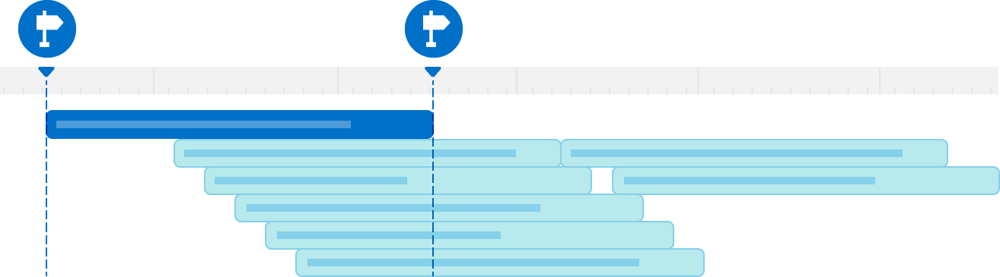

> 导航：[技术](../technologies.md) · [os](../os.md)

# OSSignposter

<sub>结构体</sub>

用于借助统一日志系统测量任务性能的对象。

<sub>iOS, iPadOS, Mac Catalyst, macOS, tvOS, visionOS, watchOS</sub>

```swift
struct OSSignposter
```

## 概述

signpost 让你可以用与日志记录相同的子系统和分类，记录有关 App 任务时长的有意义信息。使用 `OSSignposter` 在代码中创建带 signpost 标记的时间区间，然后使用 Instruments 的 `os_signposts` instrument，在运行 App 并执行待测量操作时记录这些时间区间。Instruments 会在时间线上以可视化方式显示 signpost 数据。



<sub>一张展示 Instruments 时间线上若干带 signpost 标记的时间区间的图片。第一个时间区间带有高亮，并在其起点和终点显示 OS signpost 图标。这些图标代表代码中开始和结束该带 signpost 标记的时间区间的调用。</sub>

要添加带 signpost 标记的时间区间，请先创建 signpost ID——一种标识符，用于消除具有相同名称、子系统和分类、且位于同一作用域内的多个时间区间之间的歧义——然后在要测量的代码之前，调用该类的某个 `beginInterval` 方法。保留它返回的时间区间状态，并在被测量代码之后立即把该状态传给该类的某个 `endInterval` 方法以结束该时间区间。signposter 使用时间区间状态来强制执行若干运行时断言，其行为取决于你的 App 的构建配置。更多信息参见 [OSSignpostIntervalState](ossignpostintervalstate.md)。带 signpost 标记的时间区间仅由一次 begin 调用和一次 end 调用组成。

`OSSignposter` 还提供为闭包打上 signpost 的功能，以及发出没有持续时间的单个 signpost 的功能；你可以用后者来突出显示关注点，例如用户轻点按钮或执行特定手势时。

## 关系

- **遵循**： [Sendable](../swift/sendable.md)、[SendableMetatype](../swift/sendablemetatype.md)

## 主题

### 创建 Signposter

- [init()](<ossignposter/init().md>) — 创建一个使用默认子系统的 signposter。
- [init(subsystem:category:)](<ossignposter/init(subsystem_category_)-94xpb.md>) — 创建一个使用指定子系统和分类的 signposter。
- [init(subsystem:category:)](<ossignposter/init(subsystem_category_)-4vdri.md>) — 创建一个使用指定子系统和系统定义的日志分类的 signposter。
- [init(logger:)](<ossignposter/init(logger_).md>) — 创建一个使用现有 logger 的子系统和分类的 signposter。
- [init(logHandle:)](<ossignposter/init(loghandle_).md>) — 创建一个使用现有日志的子系统和分类的 signposter。
- [disabled](ossignposter/disabled.md) — 一个共享的 signposter，运行时不会发出 signpost。

### 获取状态

- [isEnabled](ossignposter/isenabled.md) — 一个布尔值，指示该 signposter 是否可以发出 signpost。

### 生成 Signpost ID

- [makeSignpostID()](<ossignposter/makesignpostid().md>) — 返回在该 signposter 作用域内唯一的标识符。
- [makeSignpostID(from:)](<ossignposter/makesignpostid(from_).md>) — 返回由该 signposter 从指定对象派生出的标识符。
- [OSSignpostID](ossignpostid.md) — 用于消除带 signpost 标记的时间区间之间歧义的标识符。

### 开始带 signpost 标记的时间区间

- [beginInterval(_:id:)](<ossignposter/begininterval(__id_).md>) — 开始一个带 signpost 标记的时间区间。
- [beginInterval(_:id:_:)](<ossignposter/begininterval(__id___).md>) — 开始一个带 signpost 标记的时间区间，并附加指定的消息。
- [beginAnimationInterval(_:id:)](<ossignposter/beginanimationinterval(__id_).md>) — 开始一个用于测量动画的、带 signpost 标记的时间区间。
- [beginAnimationInterval(_:id:_:)](<ossignposter/beginanimationinterval(__id___).md>) — 开始一个用于测量动画的、带 signpost 标记的时间区间，并附加一条消息。
- [OSSignpostIntervalState](ossignpostintervalstate.md) — 跟踪带 signpost 标记的时间区间状态的对象。
- [SignpostMetadata](signpostmetadata.md) — 表示你附加到 signpost 的消息的类型。

### 结束带 signpost 标记的时间区间

- [endInterval(_:_:)](<ossignposter/endinterval(____).md>) — 结束与指定名称和状态对应的带 signpost 标记的时间区间。
- [endInterval(_:_:_:)](<ossignposter/endinterval(______).md>) — 结束一个带 signpost 标记的时间区间，并附加指定的消息。

### 测量闭包

- [withIntervalSignpost(_:id:around:)](<ossignposter/withintervalsignpost(__id_around_).md>) — 测量指定闭包的执行。
- [withIntervalSignpost(_:id:_:around:)](<ossignposter/withintervalsignpost(__id___around_).md>) — 测量闭包的执行，并附加指定的消息。

### 发出单个 Signpost

- [emitEvent(_:id:)](<ossignposter/emitevent(__id_).md>) — 标记时间上的一个关注点。
- [emitEvent(_:id:_:)](<ossignposter/emitevent(__id___).md>) — 标记时间上的一个关注点，并附加指定的消息。

## 另请参阅

### 测量事件

- [Recording Performance Data](recording-performance-data.md) — 添加 signpost 来记录感兴趣的、基于时间的事件。
- [Legacy Signpost Symbols](legacy-signpost-symbols.md) — 把你的代码从这些遗留符号迁移出来。
- [OSSignpostType](ossignposttype.md) — signpost 的各种类型。 _(已废弃)_
- [os_signpost_id_t](os_signpost_id_t.md) — 用于区分名称和目标日志相同的多个 signpost 的标识符。
