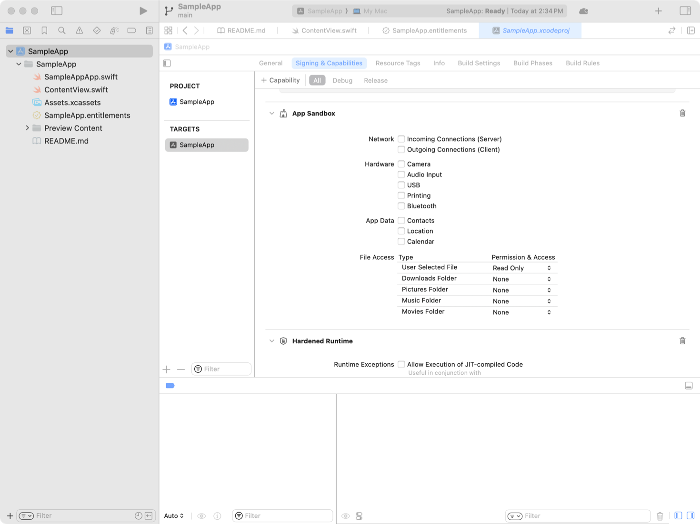
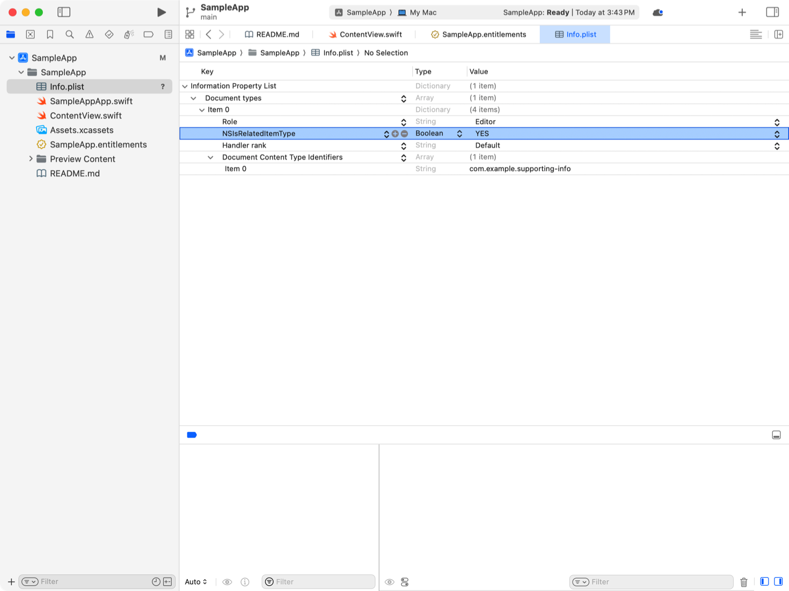
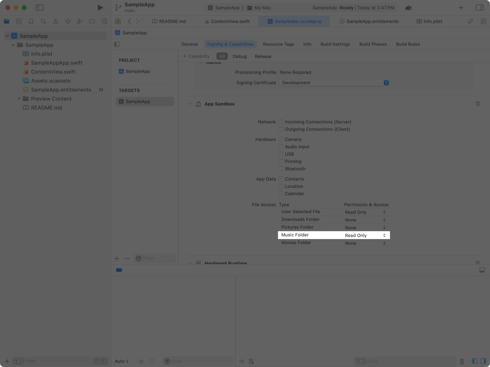

> 导航： [Technologies](../technologies.md) · [Security](../security.md) · [App Sandbox](app-sandbox.md)

# 从 macOS App 沙盒访问文件

<sub>文章</sub>

在保持安全防护的同时读写文稿和辅助文件。

## 概述

App 沙盒通过限制你的 App 对受保护资源的访问来提升 Mac 的整体安全性。macOS 允许你的 App 不受限制地访问 Mac 文件系统的有限部分，但你可以把这种访问扩展到：

- 读写用户选择的文稿。
- 在运行中的进程之间共享文件。
- 在你的 App 下一次运行时维持对文件的访问。
- 处理与其他文稿相关的辅助文件。
- 在 App 组内的多个 App 之间共享文件。
- 使用存储在标准位置的常见文件类别。

即使在 App 沙盒允许你的 App 处理某个文件的情况下，自主访问控制（如 POSIX 权限或访问控制列表）或 macOS 内置的强制访问控制，也可能在你的 App 尝试使用该文件时导致错误。

### 使用 App 容器中的文件

当你的沙盒化 App 首次启动时，macOS 会在文件系统上（`~/Library/Containers` 中）创建一个沙盒容器，并把它与你的 App 关联。你的 App 对其沙盒容器拥有完全的读写访问权，也可以运行位于其中的程序。

在 macOS 14 及更高版本中，操作系统使用你 App 的代码签名来把它与其沙盒容器关联。如果你的 App 尝试访问另一个 App 拥有的沙盒容器，系统会询问使用你 App 的人是否授予访问权。如果此人拒绝访问且你的 App 已经在运行，那么它就无法读写另一个 App 沙盒容器中的文件。如果此人在你的 App 正在启动并尝试进入另一个 App 的沙盒容器时拒绝访问，你的 App 将启动失败。如果尝试访问文件的 App 的代码签名中没有 app sandbox entitlement，系统也会请求允许该 App 访问另一个 App 容器中的文件。如果此人授予了权限，那么该 App 就可以访问任何 App 沙盒容器中的文件，直到它退出。

对于辅助工具（包括 launch agent），操作系统同样会追踪 App 代码签名身份与其沙盒容器之间的关联。如果某人拒绝了某个 launch agent 进入其沙盒容器的权限，导致 App 无法启动，`launchd` 会再次启动该 launch agent，操作系统会重新请求访问权。

> [!note] 注意
> 在某些情况下，你的 App 的两个不同版本可能具有不同的指定要求（designated requirements），导致操作系统在第二个版本尝试访问沙盒容器时请求权限。一种情况是在同一台计算机上同时使用来自 Mac App Store 的 App 版本和 Xcode 中创建的本地构建版本。另一种情况是，你把一个 App 转移到另一个 App Store 团队，发布版本之间用于签署 App 的代码签名身份发生了变化。

### 通过标准用户交互访问文件

为你的 App 提供访问用户在打开和存储面板中选择的文件的权限，或按以下步骤操作：

1. 打开你的 Xcode 项目。
2. 在文件导航器中选择你的项目。
3. 选择你 App 的 target。
4. 打开 Signing & Capabilities 标签页。
5. 在 App Sandbox 组中，从 User Selected File 菜单中选择 Read Only 或 Read/Write。



<sub>Xcode 中 Signing and Capabilities 编辑器的截图。在 App Sandbox 能力中，User Selected Files 的权限和访问被设为 Read Only。</sub>

呈现标准的打开或存储面板，让人们能够选择你 App 沙盒之外的文稿：

- 在 SwiftUI 中，使用文件导入修饰符，例如 [fileImporter(isPresented:allowedContentTypes:onCompletion:)](<../swiftui/view/fileimporter(ispresented_allowedcontenttypes_oncompletion_).md>)，以及文件导出修饰符，例如 [fileExporter(isPresented:document:contentType:defaultFilename:onCompletion:)](<../swiftui/view/fileexporter(ispresented_document_contenttype_defaultfilename_oncompletion_)-32vwk.md>)。
- 在 AppKit 中，使用 [NSOpenPanel](../appkit/nsopenpanel.md) 和 [NSSavePanel](../appkit/nssavepanel.md)。
- 在 Mac Catalyst 中，使用 [UIDocumentPickerViewController](../uikit/uidocumentpickerviewcontroller.md)。

操作系统在一个单独的进程中显示打开和存储面板，并把你的 App 的沙盒扩展到包含所选的 URL。

对于从打开面板、存储面板或拖到 Dock 中你 App 图标上的项目传来的 URL，操作系统会启动安全作用域访问，就像你调用了 [startAccessingSecurityScopedResource()](<../foundation/nsurl/startaccessingsecurityscopedresource().md>) 一样。当你用完这些资源后，调用 [stopAccessingSecurityScopedResource()](<../foundation/nsurl/stopaccessingsecurityscopedresource().md>) 来撤销你 App 的访问权。

当你 App 从标准用户界面交互中收到的 URL 代表一个文件夹时，操作系统会把你的 App 的沙盒扩展到该文件夹内的项目，并递归地扩展到嵌套文件夹中。由于其他原因，文件夹内的某些项目可能仍然无法访问，这在下文“诊断你的 App 无法访问文件的其他原因”中讨论。

你的 App 无法使用访问用户所选文件的 entitlement 来运行位于其 App bundle、沙盒容器或 App 组容器之外位置中的程序。要在用户选择的位置运行程序，添加 `com.apple.security.files.user-selected.executable` entitlement，其布尔值为 `YES`。

### 使用安全作用域 URL 书签持久化文件访问

使用 [bookmarkData(options:includingResourceValuesForKeys:relativeTo:)](<../foundation/nsurl/bookmarkdata(options_includingresourcevaluesforkeys_relativeto_).md>) 从 URL 创建书签数据，并包含 [withSecurityScope](../foundation/nsurl/bookmarkcreationoptions/withsecurityscope.md) 选项。Foundation 会创建一个带显式安全作用域的 URL 书签，你的 App 可以存储并取回它，以便随后访问该 URL 处的资源，而无论你的 App 是否在两次访问之间退出。如果你的 App 在后续访问时不需要写入该文件，可以包含 [securityScopeAllowOnlyReadAccess](../foundation/nsurl/bookmarkcreationoptions/securityscopeallowonlyreadaccess.md) 选项。

与你的 App 通过标准系统交互或与其他进程通信时收到的隐式安全作用域书签不同，当你解析一个从存储表示中取回的安全作用域书签时，系统不会自动把你的 App 的沙盒扩展到包含该书签所指的文件。在使用解析出的 URL 处的文件之前，调用 [startAccessingSecurityScopedResource()](<../foundation/nsurl/startaccessingsecurityscopedresource().md>)；用完该文件后，调用 [stopAccessingSecurityScopedResource()](<../foundation/nsurl/stopaccessingsecurityscopedresource().md>)。

访问该文件的步骤：

1. 使用 [init(resolvingBookmarkData:options:relativeTo:bookmarkDataIsStale:)](<../foundation/nsurl/init(resolvingbookmarkdata_options_relativeto_bookmarkdataisstale_).md>) 解析 URL，并在选项中包含 [withSecurityScope](../foundation/nsurl/bookmarkcreationoptions/withsecurityscope.md)。
2. 如果 `bookmarkDataIsStale` 中返回的布尔值为 true，则使用 [bookmarkData(options:includingResourceValuesForKeys:relativeTo:)](<../foundation/nsurl/bookmarkdata(options_includingresourcevaluesforkeys_relativeto_).md>) 重新创建书签，并更新你 App 中存储的书签版本。
3. 对解析出的 URL 调用 [startAccessingSecurityScopedResource()](<../foundation/nsurl/startaccessingsecurityscopedresource().md>)。
4. 使用解析出的 URL 处的文件。
5. 对解析出的 URL 调用 [stopAccessingSecurityScopedResource()](<../foundation/nsurl/stopaccessingsecurityscopedresource().md>)。

只有当你的 App 可能在退出并重新启动后尝试访问该书签所指的资源时，才需要创建安全作用域书签。在其他情况下，例如在进程之间传递 URL 书签，你可以创建并使用不带安全作用域的书签。

### 使用 URL 书签在进程之间共享文件访问

使用 [bookmarkData(options:includingResourceValuesForKeys:relativeTo:)](<../foundation/nsurl/bookmarkdata(options_includingresourcevaluesforkeys_relativeto_).md>) 从 URL 创建书签数据，把 `[]`（Swift）或 `0`（Objective-C）作为 options 参数的值传入。Foundation 创建的这个书签指向一个安全作用域 URL，把对该资源的访问权授予解析该书签的进程。你的 App 可以把这个书签传给另一个进程，例如 launch agent 或 XPC 服务。在接收进程中，使用下面的示例来访问该资源：

**Swift**

```swift
do {
  let location = try URL(resolvingBookmarkData: bookmark)
  defer {
    location.stopAccessingSecurityScopedResource()
  }
  // Use the resource at the location URL.
}
catch let error {
  // Handle any errors.
} 
```

**Objective-C**

```objc
BOOL isStale = NO;
NSError *error = nil;
NSURL *location = [NSURL URLByResolvingBookmarkData:bookmark
                                            options:0
                                      relativeToURL:0
                                bookmarkDataIsStale:&isStale
                                              error:&error];
if (location == nil) {
  // Handle any errors.
} else {
  // Use the resource at the location URL.
  [location stopAccessingSecurityScopedResource];
}
```

接收进程在使用这个安全作用域 URL 时，会自动尝试把它的沙盒扩展到包含该书签所指的资源，就像它在解析书签后调用了 [startAccessingSecurityScopedResource()](<../foundation/nsurl/startaccessingsecurityscopedresource().md>) 一样。要推迟扩展该进程的沙盒，直到你显式调用 [startAccessingSecurityScopedResource()](<../foundation/nsurl/startaccessingsecurityscopedresource().md>)，请传入 [withoutImplicitStartAccessing](../foundation/nsurl/bookmarkresolutionoptions/withoutimplicitstartaccessing.md) 选项。

### 使用文稿相对书签访问与文稿相关的文件

文稿相对书签把对项目文件的访问扩展到覆盖这些项目引用的辅助文件。以一个集成开发环境（IDE）App 为例。IDE 项目文件可能包含对源代码文件、图像和其他资产的引用。把文稿相对书签存储在项目文稿中，这样当沙盒化 App 打开该项目文稿时，它就可以解析这些书签来访问其他文件。

使用 [bookmarkData(options:includingResourceValuesForKeys:relativeTo:)](<../foundation/nsurl/bookmarkdata(options_includingresourcevaluesforkeys_relativeto_).md>) 从 URL 创建书签数据，把文稿的 URL 作为 `url` 参数。Foundation 创建的这个书签可以被任何有权访问 `relativeTo` URL 处资源的进程解析。

### 使用 App 组容器在相关 App 之间共享文件

属于同一 App 组的 App 可以创建任意数量的共享容器，用于交换文件。你的 App 在满足以下条件时可以访问 App 组容器中的文件和文件夹：

- 你通过调用 [FileManager](../foundation/filemanager.md) 的 [containerURL(forSecurityApplicationGroupIdentifier:)](<../foundation/filemanager/containerurl(forsecurityapplicationgroupidentifier_).md>) 方法获取 App 组容器的位置。
- 你的 App 声明了 [App Groups Entitlement](../bundleresources/entitlements/com.apple.security.application-groups.md)，其值包含该 App 组的标识符。
- 你的 App 通过 Mac App Store 分发，或经过公证。
- 如果你的 App 经过公证，则该 App 组的标识符包含在你 App 的描述文件中，或以你的 Apple Developer 团队标识符为前缀。

在其他情况下，系统会显示一个请求，要求某人授权你的 App 访问该 App 组容器。

### 使用相关文件访问来处理成组的文件

要处理与使用你 App 的人所选文稿相关的文件（例如辅助文件或不同格式的版本），按以下步骤标识你 App 的相关文件类型：

1. 打开你的 Xcode 项目。
2. 在文件导航器中选择你 App 的 `Info.plist` 文件。
3. 展开Document types旁边的显示三角形。
4. 在代表你 App 相关文件类型的字典中添加 `NSIsRelatedItemType` 键，其布尔值为 `YES`。



<sub>Xcode 的截图，显示某个 App 的 Info.plist 文件的属性列表编辑器。该属性列表包含一个文稿类型，带有 NSIsRelatedItemType 键和值 YES。</sub>

相关文件类型的 `Info.plist` 文件条目应类似于此示例。

```xml
<key>CFBundleDocumentTypes</key>
<array>
  <dict>
    <key>NSIsRelatedItemType</key>
    <true/>
    <key>CFBundleTypeRole</key>
    <string>Editor</string>
    <key>LSHandlerRank</key>
    <string>Default</string>
    <key>LSItemContentTypes</key>
    <array>
      <string>com.example.supporting-info</string>
    </array>
  </dict>
  <!-- Entries for your app’s main document types and other supporting files. -->
</array>
```

在你的代码中，创建一个遵循 [NSFilePresenter](../foundation/nsfilepresenter.md) 的对象。对于给定的文稿文件，把该对象的 [primaryPresentedItemURL](../foundation/nsfilepresenter/primarypresenteditemurl.md) 设为文稿的 URL，把 [presentedItemURL](../foundation/nsfilepresenter/presenteditemurl.md) 设为辅助文件的 URL。把创建的文件呈现器传给一个 [NSFileCoordinator](../foundation/nsfilecoordinator.md) 实例，并使用文件协调器访问该辅助文件。操作系统会自动扩展你的 App 的沙盒，让你的 App 能够访问该辅助文件。

### 请求访问标准文件夹的能力

处理常见文件类型（包括音乐、影片或照片）的 App 可以请求一些能力，获得对存放这些文件的标准文件夹的访问权，从而无需逐个文件单独请求同意。例如，要访问“音乐”文件夹：

1. 打开你的 Xcode 项目。
2. 在文件导航器中选择你的项目。
3. 选择你 App 的 target。
4. 打开 Signing & Capabilities 标签页。
5. 在 App Sandbox 组中，从 Music Folder 菜单中选择 Read Only 或 Read/Write。



<sub>Xcode 中 Signing and Capabilities 编辑器的截图。在 App Sandbox 能力中，Music Folder 的权限和访问被设为 Read Only。</sub>

### 请求完全磁盘访问以使用 Mac 上的所有文件

某些 App 工作流程（例如备份 Mac 的 App）需要访问文件系统中任意位置的文件。你的 App 无法通过 entitlement 或代码自动获得完全磁盘访问权：使用你 App 的人必须在“系统设置” \> “隐私与安全性”中选择授予访问权。

在你的 App 尝试使用其沙盒之外的文件的情况下，请进行防御性编程，处理好失败的情况，因为用户可能选择不向你的 App 授予完全磁盘访问权。

### 诊断你的 App 无法访问文件的其他原因

即使 App 沙盒没有阻止访问，你的 App 也可能无法访问某个文件。下面列出的任何操作系统机制都可能限制对该文件的访问。

- **POSIX 权限** — 文件上或文件路径中某个文件夹上的读、写或执行权限标志，拒绝了运行你 App 的用户账户的访问。App 收到一个域为 [NSPOSIXErrorDomain](../foundation/nsposixerrordomain.md)、代码为 13（`EACCES`）的错误。
- **POSIX.1e 访问控制列表** — 文件上或文件路径中某个文件夹上的访问控制列表，拒绝了运行你 App 的用户账户的访问。App 收到一个域为 [NSPOSIXErrorDomain](../foundation/nsposixerrordomain.md)、代码为 13（`EACCES`）的错误。
- **系统完整性保护** — 操作系统阻止软件修改文件系统的某些部分，以防止对已安装软件造成破坏。App 收到一个域为 [NSPOSIXErrorDomain](../foundation/nsposixerrordomain.md)、代码为 1（`EPERM`）的错误。
- **数据保护** — 该文件的数据保护类别阻止 App 打开它，例如该文件的数据保护类别为 [complete](../foundation/fileprotectiontype/complete.md) 且设备已锁定。App 收到一个域为 [NSPOSIXErrorDomain](../foundation/nsposixerrordomain.md)、代码为 1（`EPERM`）的错误。

> [!note] 注意
> 要确定是否是 App 沙盒拒绝了你的 App 对某个文件的访问，参见[发现并诊断 App 沙盒违规](discovering-and-diagnosing-app-sandbox-violations.md)。
