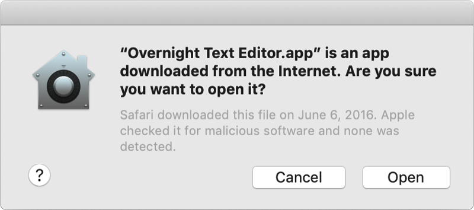
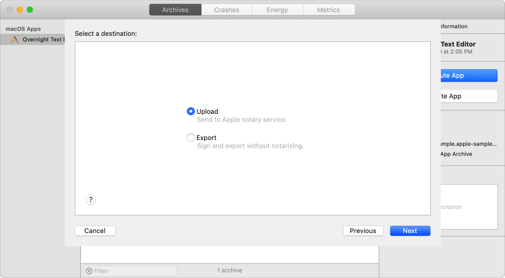

> 导航： [Technologies](../technologies.md) · [Security](../security.md)

# 在分发前公证 macOS 软件

把你的 macOS 软件提交给 Apple 进行公证，让用户对你的软件更有信心。

## 概述

> [!important] 重要
> 自 2023 年 11 月 1 日起，Apple 公证服务不再接受来自 `altool` 或 Xcode 13 及更早版本的上传。如果你目前使用 `altool` 命令行工具或 Xcode 13 及更早版本通过 Apple 公证服务公证你的 Mac 软件，你需要迁移到 `notarytool` 命令行工具，或升级到 Xcode 14 或更高版本。

公证你的 macOS 软件，能让用户更加确信你分发的 Developer ID 签名软件已经过 Apple 对恶意组件的检查。macOS 软件的公证并不是 App 审核。Apple 公证服务是一个自动化系统，它扫描你的软件以查找恶意内容、检查代码签名问题，并快速把结果返回给你。如果没有问题，公证服务会生成一张票据（ticket）供你装订（staple）到你的软件上；公证服务还会把这张票据发布到线上，供 Gatekeeper 查找。

当用户首次安装或运行你的 macOS 软件时，票据的存在（无论在线还是附加在可执行文件上）会告诉 Gatekeeper 该软件已经过 Apple 公证。Gatekeeper 随后会在初次启动对话框中放置描述性信息，帮助用户就是否启动该 App 做出明智的选择。

你可以公证多种不同类型的软件交付物，包括：

- macOS App
- 非 App bundle，例如内核扩展
- 磁盘映像（UDIF 格式）
- 扁平安装器包

公证还能在你的 Developer ID 签名密钥泄露时保护你的用户。公证服务会维护一份使用你的签名密钥分发的软件的审计记录。如果你发现自己软件的未授权版本，你可以与 Apple 协作，吊销与那些版本相关联的票据。

> [!important] 重要
> 从 macOS 10.14.5 开始，使用新 Developer ID 证书签名的软件以及所有新的或更新的内核扩展必须经过公证才能运行。从 macOS 10.15 开始，2019 年 6 月 1 日之后构建并以 Developer ID 分发的所有软件都必须经过公证。不过，通过 Mac App Store 分发的软件不要求公证，因为 App Store 提交流程已经包含等效的安全检查。

### 为公证做好准备

Apple 的公证服务要求你采用以下防护措施：

- 为你分发的所有可执行文件启用代码签名，并确保可执行文件具有有效的代码签名，如[确保有效的代码签名](resolving-common-notarization-issues.md#Ensure-a-valid-code-signature)所述。
- 为你的代码签名使用“Developer ID”应用、内核扩展、系统扩展或安装器证书。（不要使用 Mac Distribution、临时（ad hoc）、Apple Developer 或本地开发证书。）在提交之前验证证书类型，如[使用有效的 Developer ID 证书](resolving-common-notarization-issues.md#Use-a-valid-Developer-ID-certificate)所述。更多信息参见[让你的开发者账户同步代码签名身份](../xcode/sharing-your-teams-signing-certificates.md)。
- 为你的 App 和命令行 target 启用强化运行时（Hardened Runtime）能力，如[启用强化运行时](https://help.apple.com/xcode/mac/current/#/devf87a2ac8f)所述。
- 在你的代码签名中包含安全时间戳。（Xcode 分发工作流程默认包含安全时间戳。对于自定工作流程，参见[包含安全时间戳](resolving-common-notarization-issues.md#Include-a-secure-timestamp)。）
- 不要包含 `com.apple.security.get-task-allow` entitlement，也不要把它的值设为任何形式的 `true`。如果你的软件托管第三方插件，并需要这个 entitlement 在宿主可执行文件的上下文中调试插件，参见[避免使用 get-task-allow entitlement](resolving-common-notarization-issues.md#Avoid-the-get-task-allow-entitlement)。
- 链接 macOS 10.9 或更高版本的 SDK，如[使用 macOS 10.9 SDK 或更高版本](resolving-common-notarization-issues.md#Use-the-macOS-109-SDK-or-later)所述。
- 确保你的进程具有格式正确、ASCII 编码的 entitlement，如[确保 entitlement 格式正确](resolving-common-notarization-issues.md#Ensure-properly-formatted-entitlements)所述。

Apple 建议你公证你分发过的所有软件，包括较旧的版本，甚至是不满足所有这些要求或未签名的软件。Apple 的公证服务会使用包括遥测在内的多种方法，来决定对既有软件放宽上述哪些规则。更多信息参见[公证你的既有软件](notarizing-macos-software-before-distribution.md#Notarize-your-preexisting-software)。

> [!important] 重要
> 某些既有软件在成功公证后可能无法正常运行。例如，Gatekeeper 可能会发现放宽的公证流程未强制执行的一些代码签名问题。请务必查看公证日志中的任何警告，并在分发前测试你的软件。

### 公证插件

在 macOS 10.15 及更高版本中，App 只有在插件经过公证的情况下才能加载被隔离的插件——即从互联网下载或通过隔空投送传输的插件。对于未经公证的插件，用户必须通过打开“系统偏好设置”并前往“安全性与隐私”的“通用”标签页来明确批准该插件。

### 添加插件所需的 entitlement

当你启用强化运行时所强制的额外安全措施时（公证要求如此），这会同时影响你的 App 和你的 App 托管的任何插件。插件不声明自己的 entitlement，而是继承宿主进程的 entitlement。因此，宿主 App 必须包含潜在插件所需的全部 entitlement，即使这些插件是单独公证的。

例如，如果某个插件通过 C 函数指针覆盖与宿主可执行文件深度集成，或使用 JavaScript 引擎执行自定工作流程，那么宿主可执行文件必须分别声明[允许未签名的可执行内存 Entitlement](../bundleresources/entitlements/com.apple.security.cs.allow-unsigned-executable-memory.md) 或[允许执行 JIT 编译代码 Entitlement](../bundleresources/entitlements/com.apple.security.cs.allow-jit.md)。在某些情况下，如果宿主可执行文件缺少相应的 entitlement，插件甚至无法加载。

请注意，即使你的 App 没有提供专门的插件架构，它仍可能加载插件，例如不支持无驱动 USB 视频设备类（UVC）标准的专业无反相机和传统单反相机的驱动程序。如果你的 App 要配合这类硬件工作，请务必声明[停用库验证 Entitlement](../bundleresources/entitlements/com.apple.security.cs.disable-library-validation.md) 来加载相应的插件。

同时还要包含资源访问 entitlement（例如通讯录或位置访问 entitlement）以及支持你 App 插件所需的相应用途字符串。例如，如果提供传真服务的打印对话框扩展（PDE）想要访问用户的联系人列表，宿主可执行文件必须声明[通讯录 entitlement](../bundleresources/entitlements/com.apple.security.personal-information.addressbook.md)，并在其[信息属性列表](../bundleresources/information-property-list.md)中包含 [NSContactsUsageDescription](../bundleresources/information-property-list/nscontactsusagedescription.md) 用途字符串，插件才能运作。

强化运行时 entitlement 的完整列表参见 [Hardened Runtime](hardened-runtime.md)。有关用途字符串的信息，参见[请求访问受保护资源](../uikit/requesting-access-to-protected-resources.md)。

> [!important] 重要
> 在 macOS 10.14.x 中，对于使用强化运行时的可执行文件，只有当宿主可执行文件具有[停用库验证 Entitlement](../bundleresources/entitlements/com.apple.security.cs.disable-library-validation.md) 时 PDE 才会加载。从 macOS 10.15 开始，不再需要该 entitlement。

### 把公证纳入分发流程自动完成

在把你的 App 直接分发给客户之前，你的账户持有人必须用你的 Developer ID 签署该 App。Xcode 的 Organizer 窗口包含一个用于生成可分发版本的工作流程。这个工作流程包含一个自动公证 macOS App 的选项。要使用这个工作流程公证你的 App，请执行以下操作：

1. 打开你的 Xcode 项目。
2. 为你的 App 创建一个归档。
3. 选取“窗口” \> “Organizer”打开 Organizer 窗口。
4. 在 Archives 标签页中，选择你创建的归档。
5. 点按 Distribute App 查看分发选项。
6. 选择 Developer ID 作为你的分发方式。
7. 点按 Next。
8. 选择 Upload，把你的归档发送给 Apple 公证服务。
9. 点按 Next。

当你点按 Next 时，Xcode 会把你的归档上传到公证服务。上传完成后，公证服务开始扫描流程，通常不到一小时即可完成。在公证服务扫描你的软件期间，你可以继续为分发准备归档。例如，你可以导出归档，并在向客户开放你的软件之前完成所需的最终测试。

公证流程完成后，Xcode 会下载票据并把它装订到你的归档上。此时，再次导出你的归档，即可获得包含公证票据的软件可分发版本。有关如何使用 Xcode 界面上传软件的更多信息，参见[上传 macOS App 进行公证](https://help.apple.com/xcode/mac/current/#/dev88332a81e)。

如果 Xcode 不允许你上传进行公证，请确保你正在构建的是 macOS 归档，如[公证有外部依赖的 macOS App](resolving-common-notarization-issues.md#Notarize-macOS-apps-with-external-dependencies)所述。对于 macOS App 以外的 target，请使用 `notarytool` 命令行工具进行公证，如[自定公证工作流程](customizing-the-notarization-workflow.md)所述。

### 公证你的既有软件

公证你的既有软件，可以让 Gatekeeper 在用户尝试运行它时发出警告。这也有助于公证服务把你的正规软件与被篡改的变体区分开来。你可以公证现有的磁盘映像、安装器包或包含你 App 的 ZIP 归档。

要公证你的既有软件，请执行以下操作：

1. 使用 `xcode-select` 命令行工具，把当前使用的 Xcode 安装更换为支持公证的版本。有关如何使用该工具的信息，参见其 man 手册页，如[阅读 UNIX 手册页](../os/reading-unix-manual-pages.md)所述。
2. 把你的软件上传到 Apple 公证服务，如[把你的 App 上传到公证服务](customizing-the-notarization-workflow.md#Upload-your-app-to-the-notarization-service)所述。
3. 把返回的票据装订到你的既有软件上，如[把票据装订到你的分发内容](customizing-the-notarization-workflow.md#Staple-the-ticket-to-your-distribution)所述。

> [!note] 注意
> 在提交公证之前，你不需要重新构建或重新签署你的软件，但必须使用合适版本的 Xcode 来执行公证步骤。请提交你之前发布过的所有内容以及最新版本，以保护仍在使用你软件旧版本的用户。

有关如何解决公证期间可能出现的问题的提示，参见[解决常见的公证问题](resolving-common-notarization-issues.md)。

### 在构建脚本中添加公证步骤

如果你使用自动化构建系统，可以把公证流程整合到现有的构建脚本中。`notarytool` 和 `stapler` 命令行工具（随 Xcode 提供）让你可以把软件上传到 Apple 公证服务，并把生成的票据装订到你的可执行文件上。或者，你也可以使用[公证 API](../notaryapi.md) 直接与公证服务交互。

有关如何把公证纳入你的自定构建脚本的信息，参见[自定公证工作流程](customizing-the-notarization-workflow.md)。

## 主题

### 公证

- [自定公证工作流程](customizing-the-notarization-workflow.md) — 从命令行公证你的 App，以处理特殊的分发情况。
- [解决常见的公证问题](resolving-common-notarization-issues.md) — 处理公证日志文件中报告的或在装订票据时出现的常见问题。

## 另请参阅

### 相关文档

- [公证 API](../notaryapi.md) — 通过网页界面提交你的 macOS 软件进行公证。
