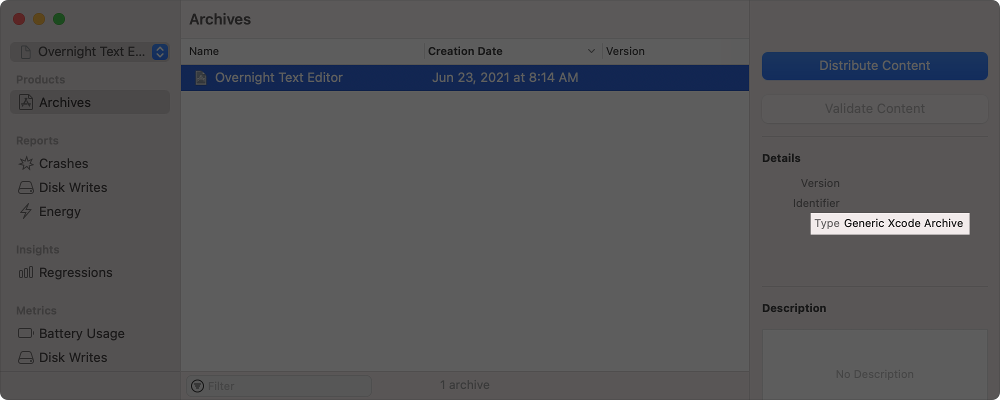
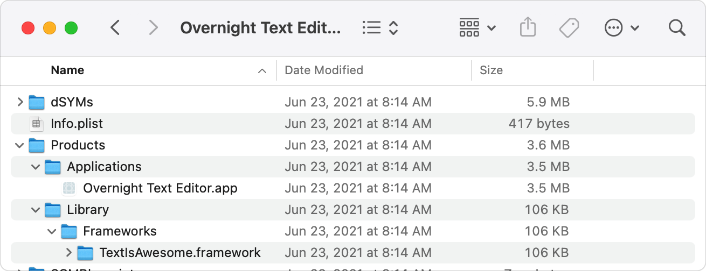
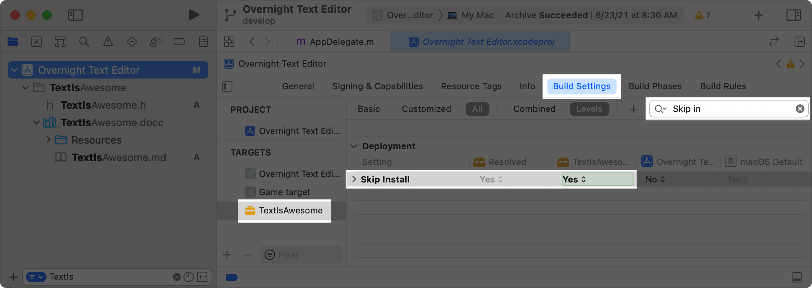

> 导航： [Technologies](../technologies.md) · [Security](../security.md) · [Notarizing macOS software before distribution](notarizing-macos-software-before-distribution.md)

# 解决常见的公证问题

<sub>文章</sub>

处理公证日志文件中报告的或在装订票据时出现的常见问题。

## 概述

如果 Apple 公证服务在公证你的 App 时遇到任何问题，它会把这些错误记录在日志文件中，如[查看你的请求的状态](customizing-the-notarization-workflow.md#Check-the-status-of-your-request)所述。请修复该服务报告的所有问题，然后重新公证你的 App。

> [!note] 注意
> 使用标准的 App 分发界面时，Xcode 会自动解决许多问题。有关如何使用这个界面的信息，参见[把公证纳入分发流程自动完成](notarizing-macos-software-before-distribution.md#Notarize-your-app-automatically-as-part-of-the-distribution-process)。

### 确保有效的代码签名

在公证 App 之前，你必须先对它进行代码签名。如果你没有签名，或者在签名之后对 bundle 做了修改，公证会失败并显示以下消息：

```console
The signature of the binary is invalid.
```

要调试安装器包以外任何内容的签名问题，使用 `codesign` 工具测试签名：

```sh
% codesign -vvv --deep --strict /path/to/binary/or/bundle
```

`vvv` 选项以更高的详细程度执行验证。`deep` 选项让该工具检查嵌套的代码内容。`strict` 选项把验证的严格程度提高到与公证所要求的水平一致。有关这些选项以及如何解读输出的更多信息，参见 `codesign` 的 man 手册页。

要调试安装器包的签名问题，改用 `pkgutil` 工具：

```sh
% pkgutil --check-signature /path/to/file.pkg
```

对于正确签名的安装器，该工具的输出会包含字符串“Signed with a trusted timestamp”和“1. Developer ID Installer:”。如果签名测试失败，请确保你使用的是 Developer ID Installer 证书，并且你在创建包的过程中使用了 `pkgutil` 或 `productbuild` 工具，或者使用 `productsign` 命令为现有安装器签名。所有这些命令行工具都接受 `sign` 选项，默认包含一个安全时间戳。有关使用每个工具的更多信息，参见各自的手册页。

> [!important] 重要
> Apple 不再维护不支持代码签名的 PackageMaker 工具。请迁移到 `pkgbuild` 或 `productbuild`（它们支持 PackageMaker 的大部分命令行选项），或使用包装了 `pkgbuild` 或 `productbuild` 并支持签名的第三方工具。

### 使用有效的 Developer ID 证书

你只能公证使用 Developer ID 证书签署的 App。如果你使用任何其他证书——例如 Mac App Distribution 证书或自签名证书——公证会失败并显示以下消息：

```console
The binary is not signed with a valid Developer ID certificate.
```

请务必为给定 target 使用正确的 Developer ID 证书。在对 Mach-O 文件、磁盘映像、bundle、App、命令行工具、照片等项目进行代码签名时，使用 Developer ID Application 证书签名。安装器包使用 Developer ID Installer 证书签名。虽然不建议分发内核扩展（kext），但你可以使用具有 kext 能力的 [Developer ID Application 证书](https://developer.apple.com/contact/kext)来分发它们。

要了解如何在 Xcode 中管理你的签名证书，参见[让你的开发者账户同步代码签名身份](../xcode/sharing-your-teams-signing-certificates.md)。

此外，你可以使用 `spctl` 工具来确定要公证的软件能否在当前生效的系统策略下运行：

```sh
% spctl -vvv --assess --type exec /path/to/application
```

添加 `raw` 选项可以生成更详细的属性列表形式输出。

### 包含安全时间戳

默认情况下，Xcode 在构建过程中不会把安全时间戳包含在 App 的代码签名中。它只在归档（自 Xcode 10.2 起）和导出工作流程期间添加安全时间戳。如果你使用自定的导出流程，公证可能会失败并显示以下消息：

```console
The signature does not include a secure timestamp.
```

在这种情况下，请务必通过在 `OTHER_CODE_SIGN_FLAGS` 构建设置中添加 `timestamp` 选项来添加安全时间戳；如果你是手动签名，也可以按上一节所述直接在 `codesign` 工具中使用该选项。

生成安全时间戳需要访问互联网。macOS 只接受一个安全时间戳服务器，即 `timestamp.apple.com`，它拥有多个 IPv4 和 IPv6 地址段。

**IPv4**

- `17.32.213.0/24`
- `17.157.80.0/24`
- `17.179.249.0/24`

**IPv6**

- `2620:149:980:500::/64`
- `2620:149:981:603::/64`
- `2620:149:982:404::/64`

你可以使用以下命令检查某个二进制文件是否具有安全时间戳：

```sh
% codesign -dvv /path/to/binary/or/bundle
```

`dvv` 选项让 `codesign` 以更高的详细程度显示给定路径处代码的信息。对于具有安全时间戳的二进制文件，该命令的输出包含一个带相应日期的 `Timestamp` 值。相反，如果输出中出现 `Signed Time`，则表明该二进制文件没有安全时间戳。

### 避免使用 get-task-allow entitlement

当你创建一个新的 macOS 项目时，Xcode 会自动把 target 的 `CODE_SIGN_INJECT_BASE_ENTITLEMENTS` 构建设置设为 `YES`。这个设置告诉 Xcode 在构建时把 `com.apple.security.get-task-allow` entitlement 添加到你的 App。这个 entitlement 通过绕过某些安全检查，让在使用系统完整性保护（SIP）的系统上进行调试成为可能。

然而，这对要上架的 App 构成了安全风险，因为它可能允许攻击者在运行时注入代码。因此，当你使用标准工作流程导出并签署 App 时，Xcode 会自动从这个 App 中剥离该 entitlement。如果你使用自定工作流程，并且未能移除 `com.apple.security.get-task-allow` entitlement，公证会失败并显示以下消息：

```console
The executable requests the com.apple.security.get-task-allow entitlement.
```

为避免收到这条错误消息，请直接从 Xcode 归档（自 Xcode 10.2 起）或导出你的 App，或者在为分发构建你的 App 之前把 `CODE_SIGN_INJECT_BASE_ENTITLEMENTS` 构建设置设为 `NO`。但只有在完成调试、准备分发时才更改这个构建设置，因为这样做之后，在使用系统完整性保护的系统上就无法调试该二进制文件了。

> [!note] 注意
> 为了能在宿主可执行文件的上下文中调试插件，宿主可以包含 `com.apple.security.get-task-allow` entitlement，前提是它同时包含[停用库验证 Entitlement](../bundleresources/entitlements/com.apple.security.cs.disable-library-validation.md)。对于不托管插件的可执行文件，不要停用库验证，因为库验证保护它们不会加载不受信任的代码。

### 使用 macOS 10.9 SDK 或更高版本

由于 macOS 10.9 之前代码签名的工作方式存在重大差异（参见 [Code Signing Changes in OS X Mavericks 10.9](https://developer.apple.com/library/archive/technotes/tn2206/_index.html#//apple_ref/doc/uid/DTS40007919-CH1-TNTAG20)），公证只适用于链接 macOS 10.9 或更高版本 SDK 的二进制文件。如果你使用较旧的 SDK，公证会失败并报告以下消息所示的问题：

```console
The binary uses an SDK older than the 10.9 SDK.
```

使用较新的 SDK 不影响你的二进制文件与 macOS 更早版本的兼容性。相反，版本兼容性取决于 App 的部署目标，如[编辑部署信息设置](https://help.apple.com/xcode/mac/current/#/deve69552ee5)所述。

### 启用强化运行时

按[启用强化运行时（macOS）](https://help.apple.com/xcode/mac/current/#/devf87a2ac8f)所述启用强化运行时能力。这会默认为你的 App 添加安全限制，同时允许你在需要时请求特定的例外。如果你不启用强化运行时，公证会失败并报告以下消息所示的问题：

```console
The executable does not have the hardened runtime enabled.
```

强化运行时在 Xcode 10 或更高版本的 Capabilities 窗格中可用，但只要你使用 macOS 10.13.6 或更高版本，也可以在较早版本的 Xcode 中手动启用该功能。为此，把以下选项添加到 `OTHER_CODE_SIGN_FLAGS` 构建设置：

```sh
--options=runtime
```

如果你需要例外，把相应的 entitlement 手动添加到你的 App 的 entitlements 文件中。如果你在较早版本的 macOS 上手动启用强化运行时，请确保同时测试你的 App 在 macOS 10.14 或更高版本上运行的情况。

### 处理装订工具问题

你可以通过升级工具来解决几个常见的装订问题。具体来说，如果你在 macOS 10.13.x 上看到 `error -68`，可以通过升级到 macOS 10.14 或更高版本解决该问题。或者，运行一次以下命令来清除 Valid 缓存：

```sh
% sudo killall -9 trustd; sudo rm /Library/Keychains/crls/valid.sqlite3
```

如果你在使用 Xcode 10 时看到 `error -73`，可以通过升级到 Xcode 10.1 或更高版本解决该问题。另外，在这种情况下，请检查确保你正在公证的磁盘映像或扁平安装器包是可写的，这样你才能使用 `stapler` 工具把票据附加到该包上。

有关其他退出代码的讨论，参见 `stapler` 的 man 手册页。

### 确保 entitlement 格式正确

命令行工具和 App 使用 entitlement 来获得对系统资源和能力的访问。声明 App entitlement 的文件必须是 ASCII 编码，且不得包含 Unicode 字节顺序标记（BOM）。使用 Xcode 进行代码签名时，Xcode 会确保 entitlements 文件是格式良好的 XML 属性列表，没有多余的字符。它还会自动把以二进制属性列表（`bplist`）形式存储的 entitlement 文件转换为格式正确的 XML 属性列表。

使用自定工作流程时，请使用 `plutil` 工具确保 entitlements 文件的格式正确。如果你手动编辑过该文件，尤其要这样做。在把 entitlements 文件作为参数传给 `codesign` 工具之前，先验证其格式。`convert` 选项把 entitlements 转换为 XML 属性列表，`lint` 选项验证格式是否正确：

```sh
% plutil -convert xml1 <Project_Name.entitlements>
% plutil -lint <Project_Name.entitlements>
```

在代码签名之后——公证之前——你可以验证你的 App 或命令行工具是否具有格式正确的 XML entitlement 属性列表：

```sh
% codesign -d --entitlements :- <path to signed .app or command-line tool>
```

如果这条命令的输出包含文本 `bplist00`，说明该可执行文件使用的是二进制属性列表，公证服务会拒绝它并显示类似以下的错误消息：

```console
Embedded entitlements are invalid: syntax error near line 1
```

此外，从 macOS 10.15.4 开始，带有格式错误的嵌入式 entitlement 的进程不再运行，而是中止并显示一条代码签名验证错误消息：

```console
The signature could not be validated because AMFI could not load its entitlements for validation: entitlements cannot be parsed
```

### 公证有外部依赖的 macOS App

在 Xcode 中你只能公证 macOS App target。你不能使用 Xcode 公证 Aggregate 或 Build System 类型的 target，即使该 target 最终会生成一个 Mac App。对于不受支持的 target 类型的归档，Archives organizer 会报告 Generic Xcode Archive：



<sub>Xcode 归档浏览器窗口的截图，包含一个名为 Overnight Text Editor 的归档。详细信息窗格显示该归档的类型为 Generic Xcode Archive。</sub>

即使是 macOS target，如果该 App 的依赖项的 Skip Install 构建设置为 `No`，归档也可能是 Generic Xcode Archive。这个设置会让构建系统把依赖项放到 `xcarchive` 文件中它的最终安装路径上，把本应为 macOS App Archive 的归档变成 Generic Xcode Archive。下面的截图显示了一个归档的内容，其 Products 文件夹内有两个文件夹。`TextIsAwesome.framework` bundle 的存在表明该 framework target 的 Skip Install 被设为了 `No`。



<sub>一个 Finder 窗口的截图，显示 Overnight Text Editor 归档 bundle 的内容。Products 文件夹中同时包含一个带 App 可执行文件的 Applications 文件夹，和一个带 TextIsAwesome 框架的 Library 文件夹。</sub>

要确保归档你的 macOS App target 会生成 macOS App Archive，请为你 App 的所有依赖项把 Skip Install 设为 `Yes`。例如，你可以通过编辑 target 的构建设置来为框架做这件事：



<sub>Xcode 的截图，显示 Overnight Text Editor 项目中 TextIsAwesome target 的构建设置。Skip Install 设置已高亮显示，并被设为 Yes。</sub>

在所有依赖项上启用 Skip Install 之后，你就可以使用 Xcode 公证界面来公证你的 macOS App 了。
