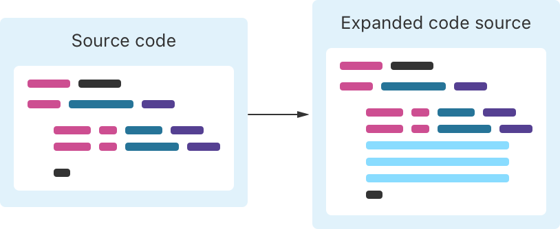

> 导航：[技术](../technologies.md) · [Swift](../swift.md) · [Swift 标准库](swift-standard-library.md) · [宏](macros.md)

# 应用宏

<sub>文章</sub>

使用宏在编译期生成重复性的代码。

## 概述

Swift 宏会在编译期生成你源代码中的那部分内容，帮助你避免在 Swift 中编写重复代码。调用宏始终是增量的：宏会在你编写的代码旁边添加新代码，但绝不会修改或删除已属于项目一部分的代码。

许多库都提供宏，包括 Swift 标准库和许多框架。你也可以编写自己的宏。

由于宏生成的是 Swift 代码，因此无论你的代码是否使用宏，你都可以使用相同的工具进行开发和调试。



<sub>宏展开概览的示意图。左侧是 Swift 代码的风格化表示。右侧是相同的代码，其中若干行由宏添加。</sub>

### 调用宏

调用宏所用的语法略有不同，取决于你是否将宏附加到声明上。

要将宏附加到声明上，请在宏名称之前写一个 at 符号（`@`），并在其名称之后写上任何宏实参。这种语法与书写特性（attribute）相同。例如：

```swift
@Observable
public final class MyObject {
    public var someProperty: String = ""
    public var someOtherProperty: Int = 0
    fileprivate var somePrivateProperty: Int = 1
}
```

附加到声明上的宏会生成代码，并将该代码添加到声明中。例如，上面代码中的 [Observable()](<../observation/observable().md>) 宏会向 `MyObject` 类添加额外的成员，使其实现 [Observable](../observation/observable.md) 协议，并标记 `MyObject` 符合 `Observable`。

要在不附加到声明的情况下调用宏，请在宏名称之前写一个井号（`#`），并在其名称之后写上任何宏实参。这种语法与 `#if` 及其他编译期操作相同。例如：

```swift
let messagePredicate = #Predicate<Message> { message in
    message.recipient == "John Appleseed"
}
```

未附加到声明的宏会生成代码，并将该代码添加到你调用宏的位置。例如，上面代码中的 `Predicate` 宏会创建 [Predicate](../foundation/predicate.md) 结构体的一个实例。

更多信息，请参阅《[The Swift Programming Language](https://docs.swift.org/swift-book/documentation/the-swift-programming-language)》中的 [Macros](https://docs.swift.org/swift-book/documentation/the-swift-programming-language/macros)。

### 检查展开后的宏

当你构建项目时，Swift 会读取你的代码，并找到你调用宏的位置。然后 Swift 会调用每个宏的实现来展开代码。最后，Swift 会照常构建你的项目，包括生成的代码。

要查看宏生成的代码，请在 Xcode 中点击你调用宏的代码，然后选择 Editor \> Expand Macro（编辑器 \> 展开宏）。你可以阅读展开后的代码，以帮助你了解宏行为的细节，也可以使用展开后的代码来帮助调试使用宏的代码。例如，你可以在宏生成的代码内部设置断点。
