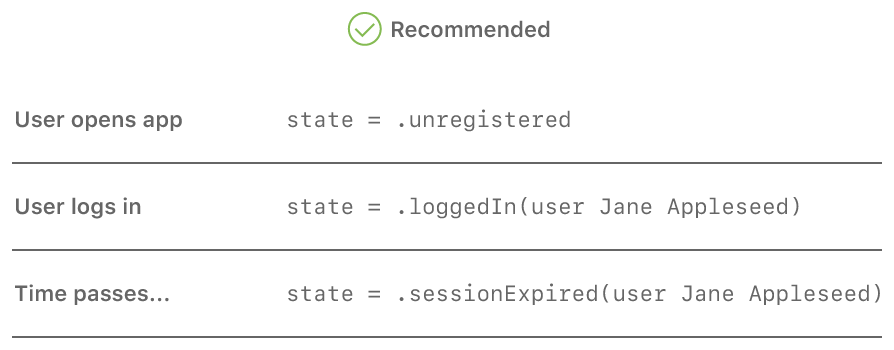

> 导航：[技术](../technologies.md) · [Swift](../swift.md)

# 在 App 中维护状态

<sub>文章</sub>

使用枚举来捕捉和跟踪你的 App 的状态。

## 概述

高效地管理状态——即跟踪 App 当前使用情况的一些数据——是开发你的 App 的重要一环。由于枚举定义了有限数量的状态，并且可以为每个单独的状态捆绑关联值，因此你可以用它们来为你的 App 及其内部过程的状态建模。

### 使用枚举捕捉状态

考虑一个要求用户登录帐户的 App。当 App 首次打开时，用户是未知的，所以 App 的状态可以称为_未注册_。用户注册或登录帐户后，状态就是_已登录_。一段时间不活动后，用户的会话可能过期，使 App 处于_会话过期_状态。

你可以使用枚举来指定你的 App 所需的确切状态。这种方式定义了一个 `App` 类，其中嵌套了一个 `State` 枚举，只包含你所需要的特定状态：

```swift
class App {
    enum State {
        case unregistered
        case loggedIn(User)
        case sessionExpired(User)
    }

    var state: State = .unregistered

    // ...
}
```

在这个模型中，每个状态都由一个同名 case 表示。`loggedIn` 和 `sessionExpired` 这两个 case 把用户作为关联值，而 `unregistered` case 不包含关联值。更新 App 的状态时，无论发生什么转换，都只需要修改一个变量 `state`。



### 不要把状态分散在多个变量中

也可以通过组合使用多个单独的变量来保存状态和所需数据，从而为 App 的状态建模，但不推荐这样做。

在这个模型中，App 定义了两个变量：一个存储用户信息的可选值 `user`，以及一个名为 `sessionExpired` 的布尔值。用户未登录时 `user` 变量为 `nil`，用户登录后它就有值了。`sessionExpired` 变量初始为 `false`，会话过期时被设为 `true`。三种状态由这两个变量的不同组合来表示。

这种方式容易出错，原因有以下几点，它们可能导致 bug，并让你的代码更难推理：

- 每次状态变化，你都需要同时更新 `user` 和 `sessionExpired`。
- 如果将来对 App 的更改需要一个额外的状态，你需要在每一处现有的状态变化中再更新一个变量。
- 这两个变量存在一种未使用的组合——可以把 `user` 设为 `nil` 并把 `sessionExpired` 设为 `true`，尽管这并没有对应的状态。

## 另请参阅

### 数据流与控制流

- [防止使用闭包时出现时序问题](preventing-timing-problems-when-using-closures.md) — 了解对你的闭包进行的不同 API 调用会如何影响你的 App。
