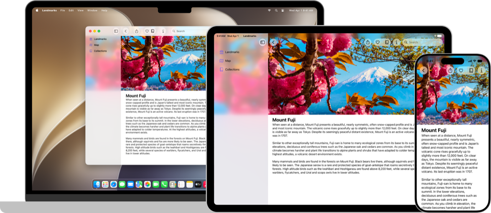

> 导航： [Technologies](technologies.md)

# SwiftUI

框架

在每个平台上声明你的 App 的用户界面和行为。

## 概述

SwiftUI 提供用于声明 App 用户界面的视图、控制和布局结构。该框架提供事件处理程序，把轻点、手势和其他类型的输入传递给你的 App，并提供工具来管理从 App 的模型流向用户所见并与之交互的视图和控制的数据流。

使用 [App](swiftui/app.md) 协议定义你的 App 结构，并用包含构成 App 用户界面的视图的场景来填充它。创建遵循 [View](swiftui/view.md) 协议的自定视图，并使用叠放、列表等把它们与用于显示文本、图像和自定形状的 SwiftUI 视图组合起来。对内置视图和你自己的视图应用强大的修饰符，来自定它们的渲染和交互性。借助能适应其上下文和呈现方式的视图和控制，在多个平台的 App 之间共享代码。

你可以把 SwiftUI 视图与 [UIKit](uikit.md)、[AppKit](appkit.md) 和 [WatchKit](watchkit.md) 框架中的对象集成，以进一步利用平台特定的功能。你还可以在 SwiftUI 中自定辅助功能支持，并针对不同的语言、国家或文化地区对 App 的界面进行本地化。

> [!tip] 提示
> 如果你是 SwiftUI 新手，请访问 [SwiftUI Pathway](https://developer.apple.com/swiftui/get-started/)。这是一个汇集了教程、文章和示例项目的合集，帮助你上手 SwiftUI。

### 精选示例

- [Landmarks：使用 Liquid Glass 构建 App](swiftui/landmarks-building-an-app-with-liquid-glass.md)
- [Wishlist：在 SwiftUI App 中规划旅行](swiftui/wishlist-planning-travel-in-a-swiftui-app.md)
- [Destination Video](visionos/destination-video.md)
- [使用 SwiftUI 构建基于文稿的 App](swiftui/building-a-document-based-app-with-swiftui.md)

## 主题

### 基础

- [采用 Liquid Glass](technologyoverviews/adopting-liquid-glass.md) — 了解如何把这种新材质引入你的 App。
- [使用 Swift 开发](tutorials/develop-in-swift.md#explore-xcode) — 「使用 Swift 开发」教程向所有学习为 Apple 平台构建 App 的人介绍使用 Swift 和 Xcode 的 App 开发。
- [SwiftUI 更新](updates/swiftui.md) — 了解 SwiftUI 的重要变化。
- [Landmarks：使用 Liquid Glass 构建 App](swiftui/landmarks-building-an-app-with-liquid-glass.md) — 用系统提供的和自定的 Liquid Glass 增强你的 App 体验。

### App 结构

- [App 组织](swiftui/app-organization.md) — 定义 App 的入口点和顶层结构。
- [场景](swiftui/scenes.md) — 声明构成 App 各个部分的用户界面分组。
- [窗口](swiftui/windows.md) — 在一个窗口或一组窗口中显示用户界面内容。
- [沉浸式空间](swiftui/immersive-spaces.md) — 在人的周围环境中显示无边界的内容。
- [文稿](swiftui/documents.md) — 让人们能够打开和管理文稿。
- [导览](swiftui/navigation.md) — 让人们能够在场景内的 App 视图层级结构的不同部分之间移动。
- [模态呈现](swiftui/modal-presentations.md) — 在提供专注交互的单独视图中呈现内容。
- [工具栏](swiftui/toolbars.md) — 提供对常用命令和控制的即时访问。
- [搜索](swiftui/search.md) — 让人们能够在你的 App 中搜索文本或其他内容。
- [App 扩展](swiftui/app-extensions.md) — 把 App 的基本功能扩展到系统的其他部分，例如添加小组件。

### 数据与存储

- [模型数据](swiftui/model-data.md) — 管理 App 用来驱动其界面的数据。
- [环境值](swiftui/environment-values.md) — 使用环境在整个视图层级结构中共享数据。
- [偏好](swiftui/preferences.md) — 从视图向其容器视图指示配置偏好。
- [持久化存储](swiftui/persistent-storage.md) — 存储数据，供 App 的多次会话使用。

### 视图

- [视图基础](swiftui/view-fundamentals.md) — 使用视图层级结构定义 App 的视觉元素。
- [视图配置](swiftui/view-configuration.md) — 调整层级结构中视图的特性。
- [视图样式](swiftui/view-styles.md) — 为不同类型的视图应用内置和自定的外观与行为。
- [动画](swiftui/animations.md) — 创建平滑的视觉更新，以响应状态的变化。
- [文本输入与输出](swiftui/text-input-and-output.md) — 显示格式化的文本并获取用户的文本输入。
- [图像](swiftui/images.md) — 向 App 的用户界面添加图像和符号。
- [控制与指示符](swiftui/controls-and-indicators.md) — 显示值并获取用户的选择。
- [菜单与命令](swiftui/menus-and-commands.md) — 以节省空间、依赖上下文的方式提供对命令和控制的访问。
- [形状](swiftui/shapes.md) — 用颜色、渐变或其他图案描边和填充内置及自定形状。
- [绘图与图形](swiftui/drawing-and-graphics.md) — 用图形效果和自定绘图增强你的视图。

### 视图布局

- [布局基础](swiftui/layout-fundamentals.md) — 在叠放、网格等内置布局容器内安排视图。
- [布局调整](swiftui/layout-adjustments.md) — 对对齐、间距、内边距和其他布局参数进行微调。
- [自定布局](swiftui/custom-layout.md) — 以自定方式放置视图，并在布局类型之间创建动画过渡。
- [列表](swiftui/lists.md) — 显示一个结构化的、可滚动的信息纵栏。
- [表格](swiftui/tables.md) — 显示按行列排列的可选择、可排序数据。
- [视图分组](swiftui/view-groupings.md) — 在不同类型的、以目标为导向的容器（例如表单或控制组）中呈现视图。
- [滚动视图](swiftui/scroll-views.md) — 让人们能够滚动查看超出当前显示屏的内容。

### 事件处理

- [手势](swiftui/gestures.md) — 定义从轻点、点按、轻扫到精细手势的各种交互。
- [输入事件](swiftui/input-events.md) — 响应来自硬件设备的输入，例如键盘或 Touch Bar。
- [剪贴板](swiftui/clipboard.md) — 让人们通过发出“拷贝”和“粘贴”命令来移动或复制项目。
- [拖放](swiftui/drag-and-drop.md) — 让人们通过把项目从一个位置拖到另一个位置来移动或复制项目。
- [焦点](swiftui/focus.md) — 识别并控制哪个可见对象响应用户交互。
- [系统事件](swiftui/system-events.md) — 对系统事件作出响应，例如打开 URL。

### 辅助功能

- [辅助功能基础](swiftui/accessibility-fundamentals.md) — 让你的 SwiftUI App 对每个人（包括残障人士）都无障碍可用。
- [辅助功能外观](swiftui/accessible-appearance.md) — 增强 App 界面中内容的易读性。
- [辅助功能控制](swiftui/accessible-controls.md) — 改善对 App 可执行操作的访问。
- [辅助功能描述](swiftui/accessible-descriptions.md) — 描述界面元素，帮助人们理解它们代表什么。
- [辅助功能导览](swiftui/accessible-navigation.md) — 让用户能够使用转子（rotor）导览到特定的用户界面元素。

### 框架集成

- [AppKit 集成](swiftui/appkit-integration.md) — 向你的 SwiftUI App 添加 AppKit 视图，或在你的 AppKit App 中使用 SwiftUI 视图。
- [UIKit 集成](swiftui/uikit-integration.md) — 向你的 SwiftUI App 添加 UIKit 视图，或在你的 UIKit App 中使用 SwiftUI 视图。
- [WatchKit 集成](swiftui/watchkit-integration.md) — 向你的 SwiftUI App 添加 WatchKit 视图，或在你的 WatchKit App 中使用 SwiftUI 视图。
- [技术特定视图](swiftui/technology-specific-views.md) — 使用其他 Apple 框架提供的 SwiftUI 视图。

### 工具支持

- [Xcode 中的预览](swiftui/previews-in-xcode.md) — 为你的自定视图生成动态、可交互的预览。
- [Xcode 资源库自定](swiftui/xcode-library-customization.md) — 在 Xcode 资源库中公开自定视图和修饰符。
- [性能分析](swiftui/performance-analysis.md) — 测量并改进你的 App 的响应能力。
