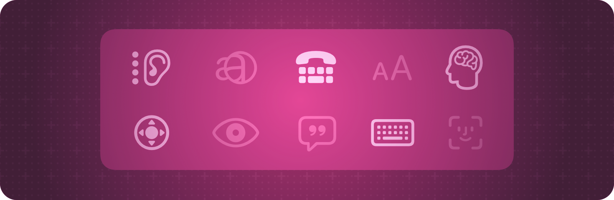

> 导航：[技术](../technologies.md) · [SwiftUI](../swiftui.md)

# 辅助功能基础

API 集合

让你的 SwiftUI App 对每个人都无障碍可用，包括残障人士。

## 概述

与所有 Apple UI 框架一样，SwiftUI 自带内置的辅助功能支持。该框架会内省导览视图、列表、文本栏、滑块、按钮等常见元素，并默认提供基本的辅助功能标签和值。启用这些标准辅助功能特性不需要你做任何额外工作。

SwiftUI 还提供了帮助你增强 App 辅助功能的工具。要了解需要哪些增强，请尝试使用旁白、语音控制、切换控制等辅助功能来使用你的 App，或者从经常使用这些功能的 App 用户那里获取反馈。然后使用 SwiftUI 提供的辅助功能视图修饰符来改善体验。例如，你可以使用 [accessibilityLabel(_:)](<view/accessibilitylabel(__).md>) 或 [accessibilityValue(_:)](<view/accessibilityvalue(__).md>) 视图修饰符，为 UI 中的元素显式添加辅助功能标签。

针对你 App 运行的所有平台自定辅助功能修饰符的使用。例如，对于与 iOS App 共用同一代码库的配套 Apple Watch App，你可能需要调整其辅助功能元素。如果你在 SwiftUI 中集成了 AppKit 或 UIKit 控制，请暴露所有辅助功能标签，并让它们可以从你的 [NSViewRepresentable](nsviewrepresentable.md) 或 [UIViewRepresentable](uiviewrepresentable.md) 视图访问；如果底层辅助功能标签不可用，则提供自定的辅助功能信息。

有关设计指引，请参阅《人机界面指南》中的 [Accessibility](../design/human-interface-guidelines/accessibility.md)。

## 主题

### 基础

- [Creating accessible views](creating-accessible-views.md) — 通过向你的 SwiftUI 视图应用辅助功能修饰符，让你的 App 对所有人都无障碍可用。

### 创建辅助功能元素

- [accessibilityElement(children:)](<view/accessibilityelement(children_).md>) — 创建一个新的辅助功能元素，或修改现有辅助功能元素的 [AccessibilityChildBehavior](accessibilitychildbehavior.md)。
- [accessibilityChildren(children:)](<view/accessibilitychildren(children_).md>) — 用一个或多个新的合成辅助功能元素替换现有辅助功能元素的子元素。
- [accessibilityRepresentation(representation:)](<view/accessibilityrepresentation(representation_).md>) — 用新的辅助功能元素替换此视图的一个或多个辅助功能元素。
- [AccessibilityChildBehavior](accessibilitychildbehavior.md) — 定义新父元素的子元素的行为。

### 标识元素

- [accessibilityIdentifier(_:)](<view/accessibilityidentifier(__).md>) — 使用你指定的字符串来标识视图。
- [accessibilityIdentifier(_:isEnabled:)](<view/accessibilityidentifier(__isenabled_).md>) — 使用你指定的字符串来标识视图。

### 隐藏元素

- [accessibilityHidden(_:)](<view/accessibilityhidden(__).md>) — 指定是否在系统辅助功能中隐藏此视图。
- [accessibilityHidden(_:isEnabled:)](<view/accessibilityhidden(__isenabled_).md>) — 指定是否在系统辅助功能中隐藏此视图。

### 支持类型

- [AccessibilityTechnologies](accessibilitytechnologies.md) — 系统可用的辅助功能技术。
- [AccessibilityAttachmentModifier](accessibilityattachmentmodifier.md) — 为视图添加辅助功能属性的一种视图修饰符

## 另请参阅

### Accessibility

- [Accessible appearance](accessible-appearance.md) — 增强 App 界面中内容的易读性。
- [Accessible controls](accessible-controls.md) — 改善对 App 可执行操作的访问。
- [Accessible descriptions](accessible-descriptions.md) — 描述界面元素，帮助人们理解它们代表什么。
- [Accessible navigation](accessible-navigation.md) — 让用户能够使用转子（rotor）导览到特定的用户界面元素。
