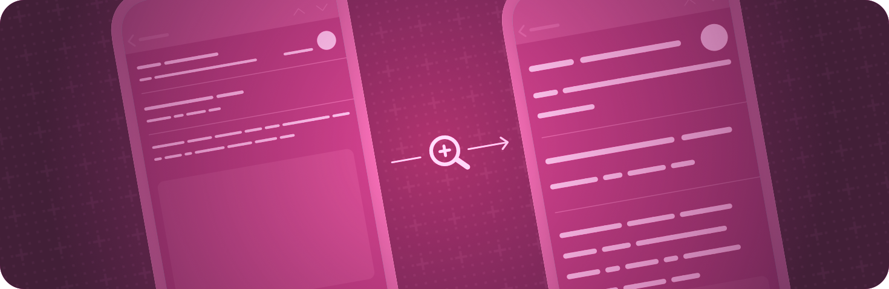

> 导航：[技术](../technologies.md) · [SwiftUI](../swiftui.md)

# 辅助功能外观

API 集合

增强 App 界面中内容的易读性。

## 概述

通过放大内容、提高对比度或减少令人分心的动态效果，让人们更容易看清内容。

有关设计指引，请参阅《人机界面指南》辅助功能部分中的 [Accessibility](../design/human-interface-guidelines/accessibility.md#Text-display)。

## 主题

### 管理颜色

- [accessibilityIgnoresInvertColors(_:)](<view/accessibilityignoresinvertcolors(__).md>) — 设置此视图是否应忽略系统的智能反转设置。
- [accessibilityInvertColors](environmentvalues/accessibilityinvertcolors.md) — 「反转颜色」系统偏好是否已启用。
- [accessibilityDifferentiateWithoutColor](environmentvalues/accessibilitydifferentiatewithoutcolor.md) — 「不用颜色区分」系统偏好是否已启用。

### 放大内容

- [accessibilityShowsLargeContentViewer()](<view/accessibilityshowslargecontentviewer().md>) — 添加一个默认的大内容视图，供大内容查看器显示。
- [accessibilityShowsLargeContentViewer(_:)](<view/accessibilityshowslargecontentviewer(__).md>) — 添加一个自定义的大内容视图，供大内容查看器显示。
- [accessibilityLargeContentViewerEnabled](environmentvalues/accessibilitylargecontentviewerenabled.md) — 大内容查看器是否已启用。

### 提升易读性

- [accessibilityShowButtonShapes](environmentvalues/accessibilityshowbuttonshapes.md) — 「显示按钮形状」系统偏好是否已启用。_(已废弃)_
- [accessibilityReduceTransparency](environmentvalues/accessibilityreducetransparency.md) — 「降低透明度」系统偏好是否已启用。
- [legibilityWeight](environmentvalues/legibilityweight.md) — 要应用到文本的字体字重。
- [LegibilityWeight](legibilityweight.md) — 辅助功能粗体文本的用户设置选项。

### 减少动态效果

- [accessibilityDimFlashingLights](environmentvalues/accessibilitydimflashinglights.md) — 减少视频内容中闪烁或频闪灯光的设置是否开启。此设置也可用于确定播放控制中的 UI 是否应显示，以提示即将出现的内容包含闪烁或频闪灯光。
- [accessibilityPlayAnimatedImages](environmentvalues/accessibilityplayanimatedimages.md) — 播放动画图像中动画的设置是否开启。当此值为 false 时，任何包含动画的所呈现图像都不应自动播放。
- [accessibilityReduceMotion](environmentvalues/accessibilityreducemotion.md) — 「减弱动态效果」系统偏好是否已启用。

### 使用辅助访问

- [accessibilityAssistiveAccessEnabled](environmentvalues/accessibilityassistiveaccessenabled.md) — 一个布尔值，指示是否正在使用辅助访问。
- [AssistiveAccess](assistiveaccess.md) — 一种场景，在 iOS 和 iPadOS 上呈现适合辅助访问的界面。在其他平台上，此场景不会被使用。
- [assistiveAccessNavigationIcon(_:)](<view/assistiveaccessnavigationicon(__).md>) — 为导览目的配置视图的图标。
- [assistiveAccessNavigationIcon(systemImage:)](<view/assistiveaccessnavigationicon(systemimage_).md>) — 为导览目的配置视图的图标。

## 另请参阅

### Accessibility

- [Accessibility fundamentals](accessibility-fundamentals.md) — 让你的 SwiftUI App 对每个人（包括残障人士）都无障碍可用。
- [Accessible controls](accessible-controls.md) — 改善对 App 可执行操作的访问。
- [Accessible descriptions](accessible-descriptions.md) — 描述界面元素，帮助人们理解它们代表什么。
- [Accessible navigation](accessible-navigation.md) — 让用户能够使用转子（rotor）导览到特定的用户界面元素。
