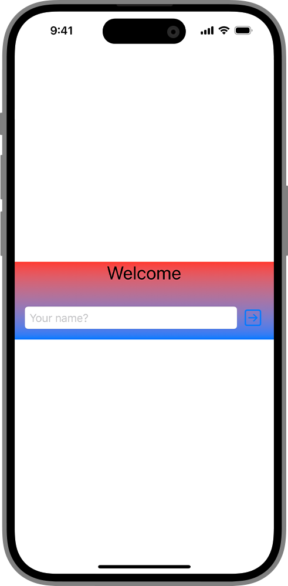
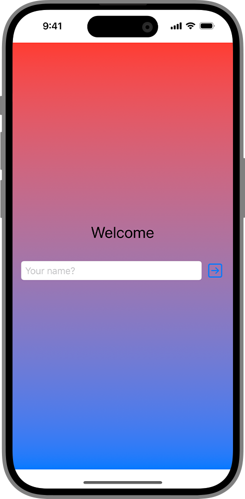
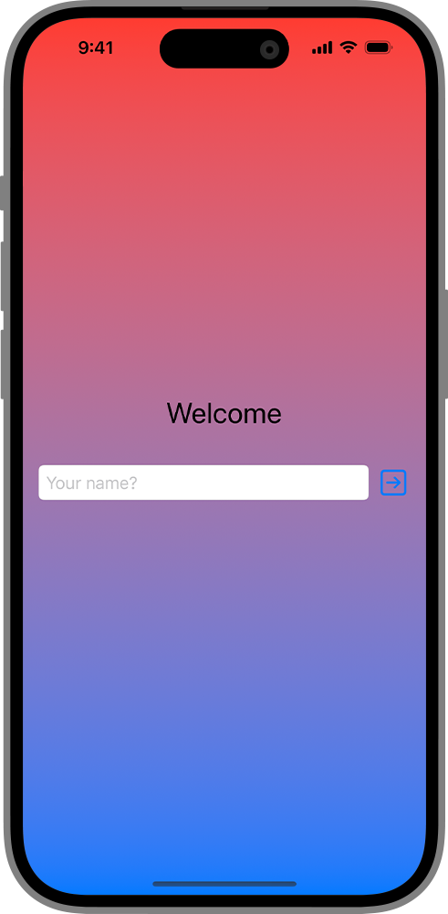
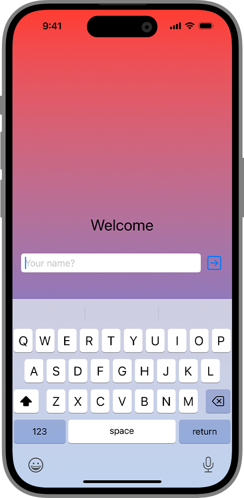
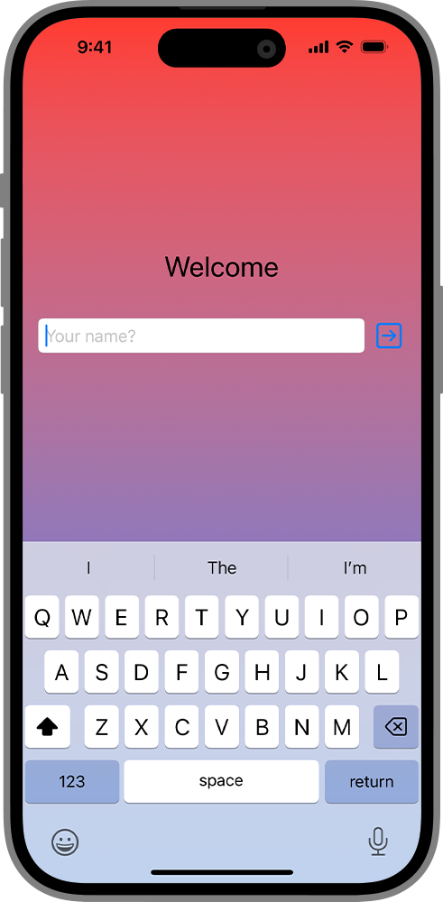

> 导航：[技术](../technologies.md) · [SwiftUI](../swiftui.md) · [布局基础](layout-fundamentals.md)

# 为视图添加背景

<sub>文章</sub>

在视图后面组合一个背景，并将其延伸到安全区嵌入量之外。

## 概述

你可以使用 [background(alignment:content:)](<view/background(alignment_content_).md>) 视图修饰符将一个视图添加为背景。要在多个视图下方添加背景，或者让背景大于现有视图，你可以把这些视图层叠放置在一个 [ZStack](zstack.md) 中，并将你希望充当背景的视图放在视图叠放的底部。你可以指定背景视图忽略安全区嵌入量，从而把背景延伸到部分或全部边缘。

### 添加背景

如果你的设计需要背景，你可以使用 [background(alignment:content:)](<view/background(alignment_content_).md>) 修饰符把它添加到现有视图下方。下面的示例使用 [background(alignment:content:)](<view/background(alignment_content_).md>) 视图修饰符为垂直叠放添加一个渐变：

```swift
let backgroundGradient = LinearGradient(
    colors: [Color.red, Color.blue],
    startPoint: .top, endPoint: .bottom)

struct SignInView: View {
    @State private var name: String = ""

    var body: some View {
        VStack {
            Text("Welcome")
                .font(.title)
            HStack {
                TextField("Your name?", text: $name)
                    .textFieldStyle(.roundedBorder)
                Button(action: {}, label: {
                    Image(systemName: "arrow.right.square")
                        .font(.title)
                })
            }
            .padding()
        }
        .background {
            backgroundGradient
        }
    }
}
```

[background(alignment:content:)](<view/background(alignment_content_).md>) 视图修饰符会把背景视图的大小约束为与其所附加的视图相同的大小：



<sub>一张 iPhone 截图，显示水平叠放中欢迎标题、文本栏和按钮的渐变背景，但未填满手机背景的其余部分。</sub>

### 在视图下方扩展背景

要创建一个大于垂直叠放的背景，需要使用不同的技术。你可以在 [VStack](vstack.md) 中内容的上方和下方添加 [Spacer](spacer.md) 视图来扩展它，但那也会扩大叠放本身的大小，可能改变它的布局。要在不改变叠放大小的情况下添加更大的背景，请把这些视图嵌套在一个 [ZStack](zstack.md) 中，让 [VStack](vstack.md) 层叠在背景视图之上：

```swift
struct SignInView: View {
    @State private var name: String = ""

    var body: some View {
        ZStack {
            backgroundGradient
            VStack {
                Text("Welcome")
                    .font(.title)
                HStack {
                    TextField("Your name?", text: $name)
                        .textFieldStyle(.roundedBorder)
                    Button(action: {}, label: {
                        Image(systemName: "arrow.right.square")
                            .font(.title)
                    })
                }
                .padding()
            }
        }
    }
}
```

与使用 background 视图修饰符时不同，深度叠放内各视图的大小是相互独立的。来自 [Gradient](gradient.md) 的视图会扩展以填满叠放的可用空间，但默认会避开安全区嵌入量：



<sub>一张 iPhone 截图，显示一个几乎填满整个背景的渐变背景，但不含顶部状态栏和底部栏。</sub>

有关使用叠放组合视图的更多信息，请参阅[用叠放视图构建布局](building-layouts-with-stack-views.md)。

### 将背景延伸到安全区

默认情况下，SwiftUI 会对视图进行大小设置和定位以避开系统定义的安全区，确保系统内容或设备边缘不会遮挡你的视图。如果你的设计要求背景延伸到屏幕边缘，请使用 [ignoresSafeArea(_:edges:)](<view/ignoressafearea(__edges_).md>) 修饰符来覆盖默认行为。

```swift
struct SignInView: View {
    @State private var name: String = ""
    var body: some View {
        ZStack {
            backgroundGradient
            VStack {
                Text("Welcome")
                    .font(.title)
                HStack {
                    TextField("Your name?", text: $name)
                        .textFieldStyle(.roundedBorder)
                    Button(action: {}, label: {
                        Image(systemName: "arrow.right.square")
                            .font(.title)
                    })
                }
                .padding()
            }
        }
        .ignoresSafeArea()
    }
}
```

背景渐变填满设备的显示区域，并忽略安全区嵌入量。



### 显示键盘时调整视图

你可以通过添加 [ignoresSafeArea(_:edges:)](<view/ignoressafearea(__edges_).md>) 修饰符来忽略键盘的安全区。当你激活键盘时，垂直叠放的内容保持固定，忽略键盘占用的空间：



<sub>一张 iPhone 截图，显示填满整个背景的渐变背景，键盘覆盖在屏幕底部。水平叠放中的欢迎标题、文本栏和按钮居中显示在 iPhone 顶部与底部之间，键盘遮挡了背景的下半部分。</sub>

要让垂直叠放的内容遵守安全区并针对键盘进行调整，请移动该修饰符，使其只应用于背景视图。

```swift
struct SignInView: View {
    @State private var name: String = ""
    var body: some View {
        ZStack {
            backgroundGradient
                .ignoresSafeArea()
            VStack {
                Text("Welcome")
                    .font(.title)
                HStack {
                    TextField("Your name?", text: $name)
                        .textFieldStyle(.roundedBorder)
                    Button(action: {}, label: {
                        Image(systemName: "arrow.right.square")
                            .font(.title)
                    })
                }
                .padding()
            }
        }
    }
}
```

为了给键盘腾出空间，SwiftUI 会调整你的视图的大小和位置。由于背景视图带有 [ignoresSafeArea(_:edges:)](<view/ignoressafearea(__edges_).md>) 修饰符，它保持不变。



<sub>一张 iPhone 截图，显示填满整个背景的渐变背景，键盘覆盖在屏幕底部。水平叠放中的欢迎标题、文本栏和按钮居中显示在键盘顶部与 iPhone 顶部之间，渐变背景在键盘下方延伸至 iPhone 的完整高度。</sub>

## 另请参阅

### 层叠视图

- [ZStack](zstack.md) — 一个覆盖其子视图并在两个轴上对齐它们的视图。
- [zIndex(_:)](<view/zindex(__).md>) — 控制重叠视图的显示顺序。
- [background(alignment:content:)](<view/background(alignment_content_).md>) — 将你指定的视图层叠在此视图后面。
- [background(_:ignoresSafeAreaEdges:)](<view/background(__ignoressafeareaedges_).md>) — 将视图的背景设置为某种样式。
- [background(ignoresSafeAreaEdges:)](<view/background(ignoressafeareaedges_).md>) — 将视图的背景设置为默认背景样式。
- [background(_:in:fillStyle:)](<view/background(__in_fillstyle_).md>) — 将视图的背景设置为一个用某种样式填充的可嵌入形状。
- [background(in:fillStyle:)](<view/background(in_fillstyle_).md>) — 将视图的背景设置为一个用默认背景样式填充的可嵌入形状。
- [overlay(alignment:content:)](<view/overlay(alignment_content_).md>) — 将你指定的视图层叠在此视图前面。
- [overlay(_:ignoresSafeAreaEdges:)](<view/overlay(__ignoressafeareaedges_).md>) — 将指定的样式层叠在此视图前面。
- [overlay(_:in:fillStyle:)](<view/overlay(__in_fillstyle_).md>) — 将你指定的形状层叠在此视图前面。
- [backgroundMaterial](environmentvalues/backgroundmaterial.md) — 当前视图下方的材质。
- [containerBackground(_:for:)](<view/containerbackground(__for_).md>) — 使用视图设置所包含容器的容器背景。
- [containerBackground(for:alignment:content:)](<view/containerbackground(for_alignment_content_).md>) — 使用视图设置所包含容器的容器背景。
- [ContainerBackgroundPlacement](containerbackgroundplacement.md) — 容器背景的位置。
