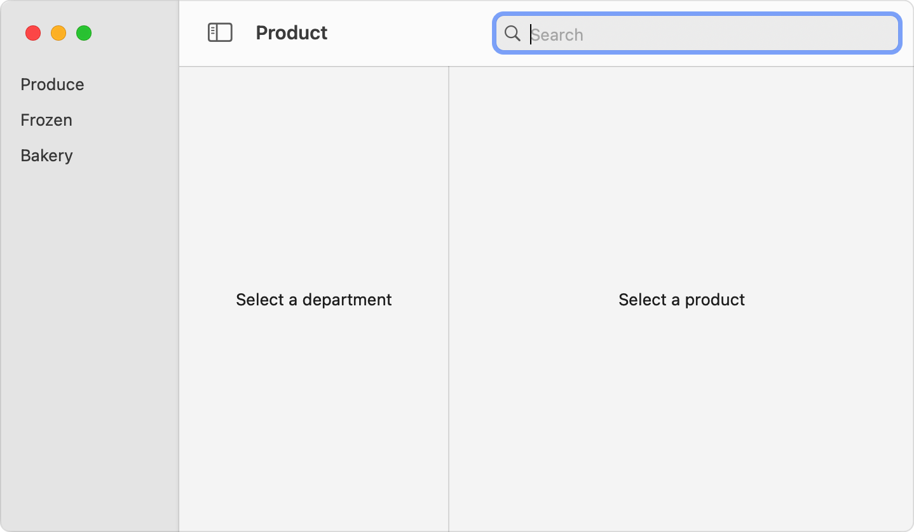
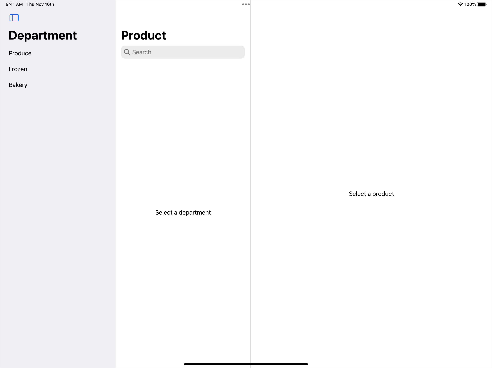
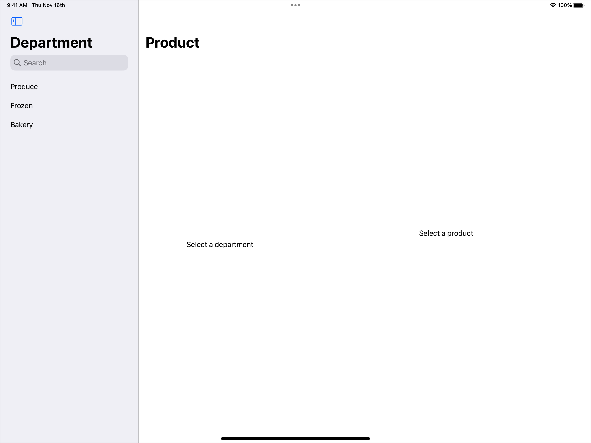
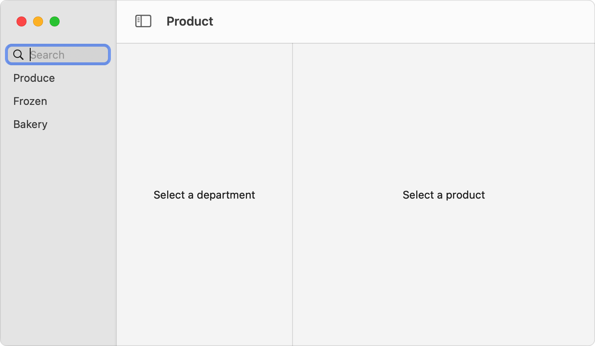
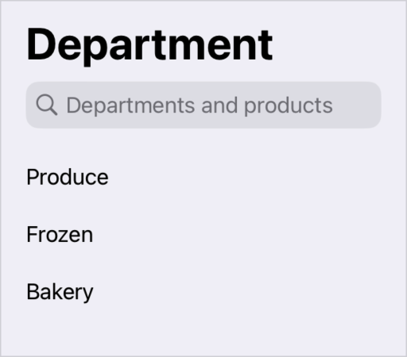

> 导航：[技术](../technologies.md) · [SwiftUI](../swiftui.md) · [搜索](search.md)

# 为你的 App 添加搜索界面

<sub>文章</sub>

呈现一个人们可以用来搜索你的 App 内内容的界面。

## 概述

通过将某个 searchable 视图修饰符——例如 [searchable(text:placement:prompt:)](<view/searchable(text_placement_prompt_).md>)——应用于 [NavigationSplitView](navigationsplitview.md) 或 [NavigationStack](navigationstack.md)，或应用于其中包含的某个视图，来为你的 App 添加搜索界面。这样工具栏中就会出现一个搜索栏。搜索栏的精确位置和外观取决于平台、你在代码中放置修饰符的位置以及它的配置。


<sub>一个宽的圆角矩形，左侧包含一个放大镜，后跟灰色的文字 Search。</sub>

创建搜索栏的 searchable 修饰符接受一个指向字符串的 [Binding](binding.md)，该字符串表示搜索栏的文本。你要为这个字符串提供存储——也可以选择为一个由离散搜索令牌组成的数组提供存储——你将用它来执行搜索。要了解如何管理搜索栏的数据，请参阅[执行搜索操作](performing-a-search-operation.md)。

### 自动放置搜索栏

你可以通过向导航元素（例如导航拆分视图）添加 [searchable(text:placement:prompt:)](<view/searchable(text_placement_prompt_).md>) 修饰符来自动放置搜索栏：

```swift
struct ContentView: View {
    @State private var departmentId: Department.ID?
    @State private var productId: Product.ID?
    @State private var searchText: String = ""

    var body: some View {
        NavigationSplitView {
            DepartmentList(departmentId: $departmentId)
        } content: {
            ProductList(departmentId: departmentId, productId: $productId)
        } detail: {
            ProductDetails(productId: productId)
        }
        .searchable(text: $searchText) // 添加一个搜索栏。
    }
}
```

采用这种配置时，搜索栏会出现在 macOS 中工具栏的尾随边缘。在 iOS 和 iPadOS 上，双栏或三栏导航视图分别会在第一栏或第二栏中显示搜索栏。上面这个三栏示例在 iPad 上把搜索栏放在了中间一栏的顶部。

**macOS**



<sub>一个带有三个导航面板的 macOS 窗口。左侧面板列出了 Produce、Frozen 和 Bakery 条目。中间面板显示占位文字 Select a Department。右侧面板显示占位文字 Select a Product。工具栏在窗口右上角有一个搜索栏，其中显示占位文字 Search。</sub>

**iOS**



<sub>一个带有三个导航面板的 iPad 屏幕。左侧面板在标题 Department 下列出了 Produce、Frozen 和 Bakery 条目。中间面板在标题 Product 下显示占位文字 Select a Department。右侧面板显示占位文字 Select a Product。中间面板的工具栏在标题正下方有一个搜索栏，显示占位文字 Search。</sub>

### 从结构上控制放置位置

要在 iOS 和 iPadOS 上将搜索栏添加到特定的一栏，请将 searchable 修饰符添加到该栏中的某个视图上。例如，要表明搜索范围涵盖上一个示例中的院系，你可以把搜索栏放在第一栏中，方法是将修饰符添加到该栏的 `DepartmentList` 视图而不是导航拆分视图上：

```swift
NavigationSplitView {
    DepartmentList(departmentId: $departmentId)
        .searchable(text: $searchText)
} content: {
    ProductList(departmentId: departmentId, productId: $productId)
} detail: {
    ProductDetails(productId: productId)
}
```



<sub>一个带有三个导航面板的 iPad 屏幕。左侧面板在标题 Department 下列出了 Produce、Frozen 和 Bakery 条目。中间面板在标题 Product 下显示占位文字 Select a Department。右侧面板显示占位文字 Select a Product。最左侧面板的工具栏在标题正下方有一个搜索栏，显示占位文字 Search。</sub>

### 以编程方式控制放置位置

你也可以使用 `placement` 输入参数来为搜索界面建议一个 [SearchFieldPlacement](searchfieldplacement.md) 值。例如，在 macOS 上，你可以使用 [sidebar](searchfieldplacement/sidebar.md) 放置位置来获得与上一个示例相同的结果：

```swift
NavigationSplitView {
    DepartmentList(departmentId: $departmentId)
} content: {
    ProductList(departmentId: departmentId, productId: $productId)
} detail: {
    ProductDetails(productId: productId)
}
.searchable(text: $searchText, placement: .sidebar)
```



<sub>一个带有三个导航面板的 macOS 窗口。左侧面板列出了 Produce、Frozen 和 Bakery 条目。中间面板显示占位文字 Select a Department。右侧面板显示占位文字 Select a Product。最左侧面板在条目列表上方有一个搜索栏，显示占位文字 Search。</sub>

如果 SwiftUI 无法满足放置请求，例如当你在一个并未应用于导航拆分视图的 searchable 修饰符上请求边栏放置时，SwiftUI 会转而依赖它的自动放置规则。

### 为搜索栏设置提示

默认情况下，搜索栏中包含作为占位文字的 Search，以提示人们如何使用该栏。你可以通过为 searchable 修饰符的 `prompt` 输入参数设置一个字符串、一个 [Text](text.md) 视图或一个 [LocalizedStringKey](localizedstringkey.md) 来自定提示。例如，你可以用它来表明 Department 栏中的搜索栏同时搜索院系和每个院系中的产品：

```swift
DepartmentList(departmentId: $departmentId)
    .searchable(text: $searchText, prompt: "Departments and products")
```



<sub>一张截图，顶部以标题字体显示文字 Department，标题下方是一个搜索栏，搜索栏下方列出了名为 Produce、Frozen 和 Bakery 的三个条目。搜索栏中显示占位文字 Departments and products。</sub>

## 另请参阅

### 搜索你的 App 的数据模型

- [执行搜索操作](performing-a-search-operation.md) — 基于你存储的搜索文本和可选令牌更新搜索结果。
- [searchable(text:placement:prompt:)](<view/searchable(text_placement_prompt_).md>) — 将此视图标记为可搜索，这会配置搜索栏的显示。
- [searchable(text:tokens:placement:prompt:token:)](<view/searchable(text_tokens_placement_prompt_token_).md>) — 将此视图标记为可搜索，支持文本和令牌。
- [searchable(text:editableTokens:placement:prompt:token:)](<view/searchable(text_editabletokens_placement_prompt_token_).md>) — 将此视图标记为可搜索，这会配置搜索栏的显示。
- [SearchFieldPlacement](searchfieldplacement.md) — 搜索栏在视图层级结构中的放置位置。
