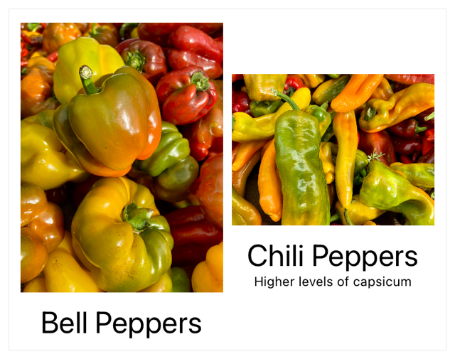
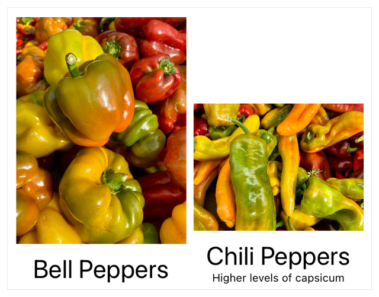
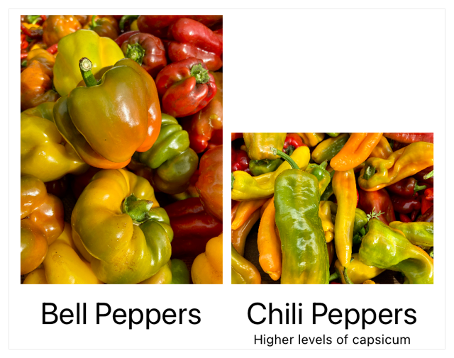

> 导航：[技术](../technologies.md) · [SwiftUI](../swiftui.md) · [布局调整](layout-adjustments.md)

# 跨叠放对齐视图

<sub>文章</sub>

创建一个自定义对齐方式，并用它跨多个叠放对齐视图。

## 概述

当你把叠放嵌套在一起时，你可能希望这些叠放中的特定条目彼此对齐。默认情况下，你为某个叠放指定的对齐方式只应用于该叠放的子视图。要对齐位于嵌套叠放中的子视图，请定义一个自定义对齐方式，将它指定给外围视图，并使用对齐参考线修饰符标识要对齐的特定视图。

### 从默认的中心对齐开始

为了说明如何跨叠放对齐条目，下面的视图展示了一个水平叠放，其中环绕着两个子视图数量不同的嵌套垂直叠放。外围的 [HStack](hstack.md) 没有定义对齐方式，因此默认为 [center](verticalalignment/center.md)。

```swift
struct ImageRow: View {
    var body: some View {
        HStack {
            VStack {
                Image("bell_peppers")
                    .resizable()
                    .scaledToFit()
                Text("Bell Peppers")
                    .font(.title)
            }
            VStack {
                Image("chili_peppers")
                    .resizable()
                    .scaledToFit()
                Text("Chili Peppers")
                    .font(.title)
                Text("Higher levels of capsicum")
                    .font(.caption)
            }
        }
    }
}
```

下图显示了嵌套垂直叠放的内容在叠放中心对齐的情况。垂直叠放内的子元素（例如每张图像下方的标题）彼此之间并未对齐。



<sub>两个叠放，每个都包含一张图像和图像下方垂直居中的标题。左侧叠放包含一张竖排图像，其下方标题为 Bell Peppers。右侧叠放包含一张横排图像，其下方标题为 Chili Peppers，另有一条附加说明写着 Higher levels of capsicum。</sub>

### 定义自定义对齐方式

要创建一个新的垂直对齐参考线，请扩展 [VerticalAlignment](verticalalignment.md)，为你的参考线添加一个新的静态属性。根据参考线所对齐的内容来命名它，以便于使用。以下示例使用底部定位作为该参考线的默认值：

```swift
extension VerticalAlignment {
    /// 用于图像标题的自定义对齐方式。
    private struct ImageTitleAlignment: AlignmentID {
        static func defaultValue(in context: ViewDimensions) -> CGFloat {
            // 如果没有设置参考线，则默认为底部对齐。
            context[VerticalAlignment.bottom]
        }
    }

    /// 用于对齐标题的参考线。
    static let imageTitleAlignmentGuide = VerticalAlignment(
        ImageTitleAlignment.self
    )
}
```

### 指定并应用自定义对齐方式

要使用对齐参考线，请将它指定给一个包含你想要对齐的视图的父视图。以下示例将 `imageTitleAlignmentGuide` 指定为水平叠放的对齐方式：

```swift
struct RowOfAlignedImages: View {
    var body: some View {
        HStack(alignment: .imageTitleAlignmentGuide) {
            VStack {
                Image("bell_peppers")
                    .resizable()
                    .scaledToFit()

                Text("Bell Peppers")
                    .font(.title)
            }
            VStack {
                Image("chili_peppers")
                    .resizable()
                    .scaledToFit()

                Text("Chili Peppers")
                    .font(.title)

                Text("Higher levels of capsicum")
                    .font(.caption)
            }
        }
    }
}
```

现在这两个垂直叠放会使用你在自定义参考线规范中指定的默认值，在叠放的底部对齐。



<sub>两个叠放，每个都包含一张图像和图像下方的标题，并按叠放底部对齐。左侧叠放包含一张竖排图像，其下方标题为 Bell Peppers。右侧叠放包含一张横排图像，其下方标题为 Chili Peppers，另有一条附加说明写着 Higher levels of capsicum。</sub>

当你在叠放上定义对齐方式时，它会投射到所包含的子视图中。在嵌套的 [VStack](vstack.md) 实例内，对要对齐的视图应用 [alignmentGuide(_:computeValue:)](<view/alignmentguide(__computevalue_).md>)，并使用你的自定义参考线作为 [HStack](hstack.md) 的对齐方式。

```swift
struct RowOfAlignedImages: View {
    var body: some View {
        HStack(alignment: .imageTitleAlignmentGuide) {
            VStack {
                Image("bell_peppers")
                    .resizable()
                    .scaledToFit()

                Text("Bell Peppers")
                    .font(.title)
                    .alignmentGuide(.imageTitleAlignmentGuide) { context in
                        context[.firstTextBaseline]
                    }
            }
            VStack {
                Image("chili_peppers")
                    .resizable()
                    .scaledToFit()

                Text("Chili Peppers")
                    .font(.title)
                    .alignmentGuide(.imageTitleAlignmentGuide) { context in
                        context[.firstTextBaseline]
                    }

                Text("Higher levels of capsicum")
                    .font(.caption)
            }
        }
    }
}
```

对齐参考线修饰符的闭包返回 [firstTextBaseline](verticalalignment/firsttextbaseline.md)，使标题的基线与对齐参考线 `imageTitleAlignmentGuide` 对齐。



<sub>两个叠放，每个都包含一张图像和图像下方的标题，并按标题对齐。左侧叠放包含一张竖排图像，其下方标题为 Bell Peppers。右侧叠放包含一张横排图像，其下方标题为 Chili Peppers，另有一条附加说明写着 Higher levels of capsicum。</sub>

## 另请参阅

### 对齐视图

- [在叠放内对齐视图](aligning-views-within-a-stack.md) — 使用对齐参考线在叠放内定位视图。
- [alignmentGuide(_:computeValue:)](<view/alignmentguide(__computevalue_).md>) — 设置视图的水平对齐。
- [Alignment](alignment.md) — 两个轴向上的对齐。
- [HorizontalAlignment](horizontalalignment.md) — 沿水平轴的对齐位置。
- [VerticalAlignment](verticalalignment.md) — 沿垂直轴的对齐位置。
- [DepthAlignment](depthalignment.md) — 沿深度轴的对齐位置。
- [AlignmentID](alignmentid.md) — 用于创建自定义对齐参考线的类型。
- [ViewDimensions](viewdimensions.md) — 视图在其自身坐标空间中的尺寸和对齐参考线。
- [ViewDimensions3D](viewdimensions3d.md) — 视图在其自身坐标空间中的 3D 尺寸和对齐参考线。
- [SpatialContainer](spatialcontainer.md) — 一种在 3D 空间中对齐重叠内容的布局容器。
