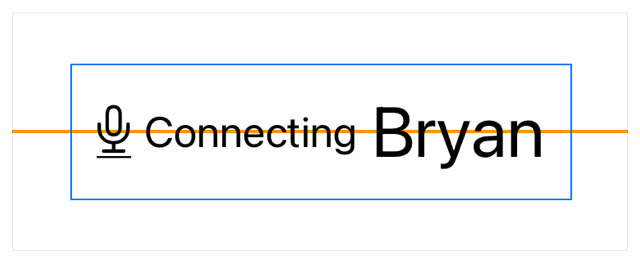
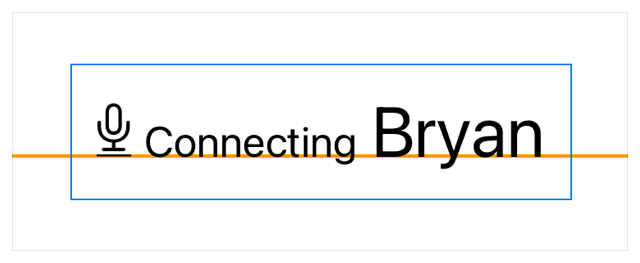
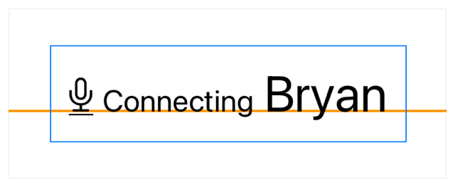
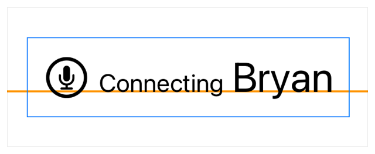

> 导航：[技术](../technologies.md) · [SwiftUI](../swiftui.md) · [布局调整](layout-adjustments.md)

# 在叠放内对齐视图

<sub>文章</sub>

使用对齐参考线在叠放（stack）内定位视图。

## 概述

叠放会按照自己的对齐方式放置子视图，默认为中心对齐。初始化叠放时，你可以为叠放指定一种对齐方式，该对齐方式同样应用于叠放的子视图。如果你想调整单个子视图的放置位置，可以使用对齐参考线修饰符进行调整，使视图从叠放提供的对齐位置偏移。

要跨多个叠放对齐视图，请参阅[跨叠放对齐视图](aligning-views-across-stacks.md)。

### 基本对齐使用默认值

举个例子来看 SwiftUI 如何将默认对齐应用于 [HStack](hstack.md) 中的视图：检查以下为一个录音 App 提供状态视图的代码。该 `HStack` 包含一个用于图标的图像视图和两个带有标签的文本视图，标签使用 [font(_:)](<view/font(__).md>) 修饰符来调整文本的字号。

```swift
HStack {
    Image("microphone")
    Text("Connecting")
        .font(.caption)
    Text("Bryan")
        .font(.title)
}
.padding()
.border(Color.blue, width: 1)
```

下图中的橙色参考线显示了叠放内视图的默认对齐位置。这条线仅作为本文说明用的视觉参考。



<sub>一个蓝色矩形定义了 HStack 带内边距的边界，其中左侧是一个麦克风图像，后跟样式为说明文字（caption）的单词 Connecting，再后跟样式为标题（title）的名字 Bryan。子视图在叠放中均匀间隔分布并垂直居中。一条橙色线从视图下方穿过，显示默认中心对齐参考线的位置。</sub>

### 自定叠放对齐

你可以根据叠放所支持的对齐方式提供的参考线来对齐叠放内的内容。各种类型的叠放支持以下对齐方式：

- [HStack](hstack.md) 使用 [VerticalAlignment](verticalalignment.md) 中定义的参考线。
- [VStack](vstack.md) 使用 [HorizontalAlignment](horizontalalignment.md) 中定义的参考线。
- [ZStack](zstack.md) 使用 [Alignment](alignment.md) 中定义的参考线，以及 `HorizontalAlignment` 和 `VerticalAlignment` 的组合。

在初始化叠放时使用 `alignment` 参数来定义叠放的对齐参考线。以下示例将 `HStack` 的对齐方式设置为 [firstTextBaseline](verticalalignment/firsttextbaseline.md)，这会将其子视图对齐到第一个文本视图（包含字符串「Connecting」）的基线上：

```swift
HStack(alignment: .firstTextBaseline) {
    Image("microphone")
    Text("Connecting")
        .font(.caption)
    Text("Bryan")
        .font(.title)
}
.padding()
.border(Color.blue, width: 1)
```



<sub>一个蓝色矩形定义了 HStack 带内边距的边界，其中左侧是一个麦克风图像，后跟样式为说明文字的单词 Connecting，再后跟样式为标题的名字 Bryan。子视图在叠放中均匀间隔分布，并对齐到与麦克风图像底部相匹配的文本基线上。一条橙色线从视图下方穿过，显示基线对齐参考线的位置。</sub>

### 调整叠放内单个视图的对齐

自定义图像不提供文本基线参考线，因此图像的底部会与文本视图的基线对齐。使用 [alignmentGuide(_:computeValue:)](<view/alignmentguide(__computevalue_).md>) 调整图像的对齐，以获得你想要的视觉效果。对齐参考线的闭包提供了一个 [ViewDimensions](viewdimensions.md) 实例（本例中的参数 `context`），你可以用它来返回一个偏移值。通过 [bottom](verticalalignment/bottom.md) 从 `context` 中查得的值提供了一个偏移量，使图像的底部按该偏移量调整后与叠放上定义的基线参考线对齐：

```swift
HStack(alignment: .firstTextBaseline) {
    Image("microphone")
        .alignmentGuide(.firstTextBaseline) { context in
            context[.bottom] - 0.12 * context.height
        }
    Text("Connecting")
        .font(.caption)
    Text("Bryan")
        .font(.title)
}
.padding()
.border(Color.blue, width: 1)
```

使用对齐参考线修饰符时，请确保指定叠放的一个生效对齐方式。否则，SwiftUI 不会调用闭包来偏移视图。在上面的示例中，对齐参考线的输入 [firstTextBaseline](verticalalignment/firsttextbaseline.md) 与叠放的对齐方式相匹配，因此调整会影响到图像的放置：



<sub>一个蓝色矩形定义了 HStack 带内边距的边界，其中左侧是一个麦克风图像，后跟样式为说明文字的单词 Connecting，再后跟样式为标题的名字 Bryan。子视图在叠放中均匀间隔分布并对齐到文本基线上。麦克风图像略有偏移，使麦克风的底部与基线对齐。一条橙色线从视图下方穿过，显示基线对齐参考线的位置。</sub>

### 与文本对齐时使用 SF 符号简化视图

你可以用 [SF 符号](../design/human-interface-guidelines/sf-symbols.md)中类似的图标替换麦克风图像来简化视图。SF 符号的图标使用文本基线参考线，这意味着它们支持你应用于视图的任何字体样式。

```swift
HStack(alignment: .firstTextBaseline) {
    Image(systemName: "mic.circle")
        .font(.title)
    Text("Connecting")
        .font(.caption)
    Text("Bryan")
        .font(.title)
}
.padding()
.border(Color.blue, width: 1)
```



<sub>一个蓝色矩形定义了 HStack 带内边距的边界，其中左侧是圆圈内的麦克风符号，后跟样式为说明文字的单词 Connecting，再后跟样式为标题的名字 Bryan。子视图在叠放中均匀间隔分布，名字的基线与圆圈中麦克风的底部相匹配。一条橙色线从视图下方穿过，显示基线对齐参考线的位置。</sub>

## 另请参阅

### 对齐视图

- [跨叠放对齐视图](aligning-views-across-stacks.md) — 创建一个自定义对齐方式，并用它跨多个叠放对齐视图。
- [alignmentGuide(_:computeValue:)](<view/alignmentguide(__computevalue_).md>) — 设置视图的水平对齐。
- [Alignment](alignment.md) — 两个轴向上的对齐。
- [HorizontalAlignment](horizontalalignment.md) — 沿水平轴的对齐位置。
- [VerticalAlignment](verticalalignment.md) — 沿垂直轴的对齐位置。
- [DepthAlignment](depthalignment.md) — 沿深度轴的对齐位置。
- [AlignmentID](alignmentid.md) — 用于创建自定义对齐参考线的类型。
- [ViewDimensions](viewdimensions.md) — 视图在其自身坐标空间中的尺寸和对齐参考线。
- [ViewDimensions3D](viewdimensions3d.md) — 视图在其自身坐标空间中的 3D 尺寸和对齐参考线。
- [SpatialContainer](spatialcontainer.md) — 一种在 3D 空间中对齐重叠内容的布局容器。
