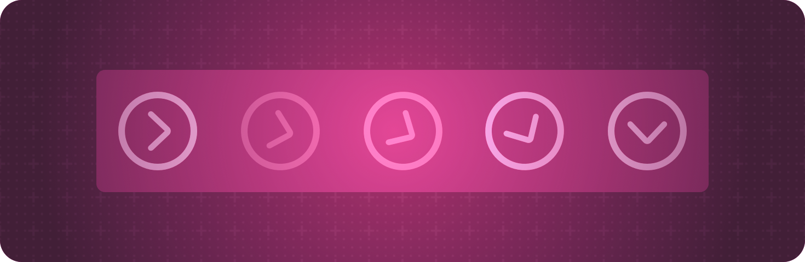

> 导航： [Technologies](../technologies.md) · [SwiftUI](../swiftui.md)

# 动画

API 集合

创建平滑的视觉更新，以响应状态的变化。

## 概述

你告诉 SwiftUI 在不同状态下如何绘制 App 的用户界面，然后依靠 SwiftUI 在状态变化时更新界面。

为了避免状态变化时突兀的视觉过渡，可以用以下方式之一添加动画：

- 通过在 [withAnimation(_:_:)](<withanimation(____).md>) 全局函数的调用中更改状态，为一次状态变化的所有视觉变化添加动画。
- 通过对视图应用 [animation(_:value:)](<view/animation(__value_).md>) 视图修饰符，在特定值变化时为特定视图添加动画。
- 使用绑定的 [animation(_:)](<binding/animation(__).md>) 方法为 [Binding](binding.md) 的变化添加动画。

SwiftUI 会为许多内置视图修饰符产生的效果添加动画，例如设置缩放或不透明度值的那些效果。你可以让自己的自定视图遵循 [Animatable](animatable.md) 协议，并告诉 SwiftUI 你想为哪些值添加动画，从而为其他值添加动画。

当带动画的状态变化导致视图被添加到视图层级结构或从中移除时，你可以使用 [AnyTransition](anytransition.md) 定义的内置过渡（例如 [slide](anytransition/slide.md) 或 [scale](anytransition/scale.md)）告诉 SwiftUI 如何让视图移入或移出原位。你也可以创建自定过渡。

如需设计指导，参见《人机界面指南》中的[动效](../design/human-interface-guidelines/motion.md)。

## 主题

### 为操作添加基于状态的动画

- [withAnimation(_:_:)](<withanimation(____).md>) — 使用提供的动画重新计算视图的 `body`，并返回结果。
- [withAnimation(_:completionCriteria:_:completion:)](<withanimation(__completioncriteria___completion_).md>) — 使用提供的动画重新计算视图的 `body` 并返回结果，并在所有动画完成时运行完成处理程序。
- [AnimationCompletionCriteria](animationcompletioncriteria.md) — 决定动画何时被视为结束的标准。
- [Animation](animation.md) — 视图随时间变化的方式，用于创建从一个状态到另一个状态的平滑视觉过渡。

### 为视图添加基于状态的动画

- [animation(_:)](<view/animation(__).md>) — 当此视图变化时，对它应用给定的动画。
- [animation(_:value:)](<view/animation(__value_).md>) — 当指定的值变化时，对视图应用给定的动画。
- [animation(_:body:)](<view/animation(__body_).md>) — 对 `body` 闭包内的所有可动画值应用给定的动画。

### 创建基于阶段的动画

- [控制动画的时序与运动](controlling-the-timing-and-movements-of-your-animations.md) — 使用阶段动画器和关键帧动画器构建你能控制的精细动画。
- [phaseAnimator(_:content:animation:)](<view/phaseanimator(__content_animation_).md>) — 为你应用于视图的效果添加动画，效果随一组连续变化的阶段而变化。
- [phaseAnimator(_:trigger:content:animation:)](<view/phaseanimator(__trigger_content_animation_).md>) — 为你应用于视图的效果添加动画，效果随一组由触发器驱动的阶段而变化。
- [PhaseAnimator](phaseanimator.md) — 一种容器，通过自动循环遍历你提供的一组阶段来为其内容添加动画，每个阶段定义动画中的一个离散步骤。

### 创建基于关键帧的动画

- [keyframeAnimator(initialValue:repeating:content:keyframes:)](<view/keyframeanimator(initialvalue_repeating_content_keyframes_).md>) — 持续循环播放给定的关键帧，并使用你在 `body` 中应用的修饰符来更新视图。
- [keyframeAnimator(initialValue:trigger:content:keyframes:)](<view/keyframeanimator(initialvalue_trigger_content_keyframes_).md>) — 当给定的触发值变化时播放给定的关键帧，并使用你在 `body` 中应用的修饰符来更新视图。
- [KeyframeAnimator](keyframeanimator.md) — 一种使用关键帧为其内容添加动画的容器。
- [Keyframes](keyframes.md) — 一种定义某个值随时间变化的类型。
- [KeyframeTimeline](keyframetimeline.md) — 对某个值如何随时间变化的描述，使用关键帧建模。
- [KeyframeTrack](keyframetrack.md) — 为根类型的单个属性添加动画的关键帧序列。
- [KeyframeTrackContentBuilder](keyframetrackcontentbuilder.md) — 根据你在闭包中定义的关键帧创建关键帧轨道内容的构建器。
- [KeyframesBuilder](keyframesbuilder.md) — 把多个关键帧内容值组合成单一值的构建器。
- [KeyframeTrackContent](keyframetrackcontent.md) — 定义某个可动画值插值曲线的一组关键帧。
- [CubicKeyframe](cubickeyframe.md) — 使用三次曲线在值之间平滑插值的关键帧。
- [LinearKeyframe](linearkeyframe.md) — 使用简单线性插值的关键帧。
- [MoveKeyframe](movekeyframe.md) — 立即移动到给定值而不插值的关键帧。
- [SpringKeyframe](springkeyframe.md) — 使用弹簧函数插值到给定值的关键帧。

### 创建自定动画

- [CustomAnimation](customanimation.md) — 一种定义可动画值如何随时间变化的类型。
- [AnimationContext](animationcontext.md) — 自定动画可用于管理状态和访问视图环境的一组上下文值。
- [AnimationState](animationstate.md) — 存储自定动画状态的容器。
- [AnimationStateKey](animationstatekey.md) — 用于访问动画状态值的键。
- [UnitCurve](unitcurve.md) — 一种由二维曲线定义的函数，把 [0,1] 范围内的输入进度映射到同样处于 [0,1] 范围内的输出进度。通过改变曲线的形状，可以改变动画或其他插值的有效速度。
- [Spring](spring.md) — 对弹簧运动的一种表示。

### 让数据可动画

- [Animatable](animatable.md) — 一种描述如何为视图的属性添加动画的类型。
- [AnimatableValues](animatablevalues.md)
- [AnimatablePair](animatablepair.md) — 一对可动画值，其本身也是可动画的。
- [VectorArithmetic](vectorarithmetic.md) — 一种可以充当可动画类型的可动画数据的类型。
- [EmptyAnimatableData](emptyanimatabledata.md) — 用于可动画数据的空类型。

### 按计划更新视图

- [使用时间线更新 watchOS App](../watchos-apps/updating-watchos-apps-with-timelines.md) — 无缝地为你的用户界面安排更新，即使它处于非活跃状态。
- [TimelineView](timelineview.md) — 一种按照你提供的时间表进行更新的视图。
- [TimelineSchedule](timelineschedule.md) — 一种提供日期序列以充当时间表的类型。
- [TimelineViewDefaultContext](timelineviewdefaultcontext.md) — 传递给时间线视图内容回调的信息。

### 同步几何形状

- [matchedGeometryEffect(id:in:properties:anchor:isSource:)](<view/matchedgeometryeffect(id_in_properties_anchor_issource_).md>) — 使用你提供的标识符和命名空间定义一组几何形状同步的视图。
- [MatchedGeometryProperties](matchedgeometryproperties.md) — 一组可以使用 `View.matchedGeometryEffect()` 函数在视图之间同步的视图属性。
- [GeometryEffect](geometryeffect.md) — 一种改变视图视觉外观的效果，且基本不影响它的祖先或后代。
- [Namespace](namespace.md) — 一种动态属性类型，允许访问由包含该属性的对象（例如视图）的持久身份所定义的命名空间。
- [geometryGroup()](<view/geometrygroup().md>) — 将视图的几何属性（例如位置和大小）与其父视图隔离。

### 定义过渡

- [transition(_:)](<view/transition(__).md>) — 为视图关联一个过渡。
- [Transition](transition.md) — 对视图被添加到视图层级结构和从中移除时所应用的视图变化的描述。
- [TransitionProperties](transitionproperties.md) — `Transition` 可以拥有的属性。
- [TransitionPhase](transitionphase.md) — 指示过渡当前所处阶段的标识。
- [AsymmetricTransition](asymmetrictransition.md) — 一种复合 `Transition`，对插入和移除使用不同的过渡。
- [AnyTransition](anytransition.md) — 一种类型擦除的过渡。
- [contentTransition(_:)](<view/contenttransition(__).md>) — 修改视图，让它使用给定的过渡作为为其内容添加动画的方法。
- [contentTransition](environmentvalues/contenttransition.md) — 当前为视图内容添加动画的方法。
- [contentTransitionAddsDrawingGroup](environmentvalues/contenttransitionaddsdrawinggroup.md) — 一个布尔值，控制渲染内容过渡的视图是否使用 GPU 加速渲染。
- [ContentTransition](contenttransition.md) — 一种作用于单个视图内部内容的过渡，而不是作用于视图的插入或移除。
- [PlaceholderContentView](placeholdercontentview.md) — 一种占位符，用于构建内联修饰符、过渡或其他辅助类型。

### 定义匹配过渡

- [matchedTransitionSource(id:in:)](<view/matchedtransitionsource(id_in_).md>) — 将此视图标识为导览过渡（例如缩放过渡）的源。
- [matchedTransitionSource(id:in:configuration:)](<view/matchedtransitionsource(id_in_configuration_).md>) — 将此视图标识为导览过渡（例如缩放过渡）的源。
- [MatchedTransitionSourceConfiguration](matchedtransitionsourceconfiguration.md) — 定义匹配过渡源外观的配置。
- [EmptyMatchedTransitionSourceConfiguration](emptymatchedtransitionsourceconfiguration.md) — 无样式的匹配过渡源配置。

### 定义导览过渡

- [navigationTransition(_:)](<view/navigationtransition(__).md>) — 为此视图设置导览过渡样式。
- [NavigationTransition](navigationtransition.md) — 一种定义导览到某个视图时所使用的过渡的类型。
- [AnyNavigationTransition](anynavigationtransition.md) — 一种类型擦除的导览过渡，允许动态提供任意导览过渡值。 _(beta)_
- [CrossFadeNavigationTransition](crossfadenavigationtransition.md) — 一种在出现的视图和消失的视图之间进行交叉淡入淡出的导览过渡。 _(beta)_

### 把动画移到另一个视图

- [withTransaction(_:_:)](<withtransaction(____).md>) — 使用指定的事务执行一个闭包并返回结果。
- [withTransaction(_:_:_:)](<withtransaction(______).md>) — 使用指定的事务键路径和值执行一个闭包并返回结果。
- [transaction(_:)](<view/transaction(__).md>) — 对视图内使用的所有动画应用给定的事务修改函数。
- [transaction(value:_:)](<view/transaction(value___).md>) — 对视图内使用的所有动画应用给定的事务修改函数。
- [transaction(_:body:)](<view/transaction(__body_).md>) — 对 `body` 闭包内使用的所有动画应用给定的事务修改函数。
- [Transaction](transaction.md) — 当前状态处理更新的上下文。
- [Entry()](<entry().md>) — 创建环境值、事务、容器值或焦点值条目。
- [TransactionKey](transactionkey.md) — 用于访问事务中值的键。

### 已废弃类型

- [AnimatableModifier](animatablemodifier.md) — 一种可以带动画创建另一个修饰符的修饰符。 _(已废弃)_

## 另请参阅

### 视图

- [View fundamentals](view-fundamentals.md) — 使用视图层级结构定义 App 的视觉元素。
- [View configuration](view-configuration.md) — 调整层级结构中视图的特性。
- [View styles](view-styles.md) — 为不同类型的视图应用内置和自定的外观与行为。
- [Text input and output](text-input-and-output.md) — 显示格式化的文本并获取用户的文本输入。
- [Images](images.md) — 向 App 的用户界面添加图像和符号。
- [Controls and indicators](controls-and-indicators.md) — 显示值并获取用户的选择。
- [Menus and commands](menus-and-commands.md) — 以节省空间、依赖上下文的方式提供对命令和控制的访问。
- [Shapes](shapes.md) — 用颜色、渐变或其他图案描边和填充内置及自定形状。
- [Drawing and graphics](drawing-and-graphics.md) — 用图形效果和自定绘图增强你的视图。
