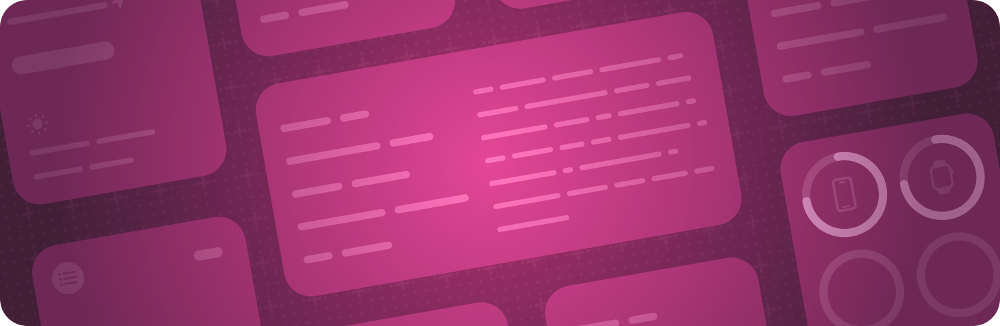

> 导航：[技术](../technologies.md) · [SwiftUI](../swiftui.md)

# App 扩展

API 集合

把你 App 的基础功能扩展到系统的其他部分，例如添加小组件。

## 概述

将 SwiftUI 与 [WidgetKit](../widgetkit.md) 结合使用，为你的 App 添加小组件。

小组件提供对来自你 App 的相关内容的快速访问。定义一个符合 [Widget](widget.md) 协议的结构体，并为该小组件声明一个视图层级结构。像配置其他 SwiftUI 视图一样，使用视图修饰符配置小组件内的视图，其中包括一些小组件专用的修饰符。

有关设计指引，请参阅《人机界面指南》中的 [Widgets](../design/human-interface-guidelines/widgets.md)。

## 主题

### 创建小组件

- [使用 WidgetKit 和 SwiftUI 构建小组件](../widgetkit/building-widgets-using-widgetkit-and-swiftui.md) — 创建小组件以在主屏幕上显示你 App 的内容，并带有供用户自定设置的自定义 intent。
- [创建小组件扩展](../widgetkit/creating-a-widget-extension.md) — 在各种设备上通过便捷、信息丰富的小组件显示你 App 的内容。
- [让小组件保持最新](../widgetkit/keeping-a-widget-up-to-date.md) — 规划小组件的时间线，使用动态视图显示及时、相关的信息，并在情况变化时更新时间线。
- [制作可配置的小组件](../widgetkit/making-a-configurable-widget.md) — 通过向项目添加自定义 App intent，让人们可以自定他们的小组件。
- [Widget](widget.md) — 要在主屏幕或通知中心显示的小组件的配置和内容。
- [WidgetBundle](widgetbundle.md) — 一个容器，用于从单个小组件扩展暴露多个小组件。
- [LimitedAvailabilityConfiguration](limitedavailabilityconfiguration.md) — 一个类型擦除的小组件配置。
- [WidgetConfiguration](widgetconfiguration.md) — 一个描述小组件内容的类型。
- [EmptyWidgetConfiguration](emptywidgetconfiguration.md) — 一个空的小组件配置。

### 组合控制小组件

- [ControlWidget](controlwidget.md) — 要在控制中心、锁定屏幕和操作按钮等系统空间中显示的控制小组件的配置和内容。
- [ControlWidgetConfiguration](controlwidgetconfiguration.md) — 一个描述控制小组件内容的类型。
- [EmptyControlWidgetConfiguration](emptycontrolwidgetconfiguration.md) — 一个空的控制小组件配置。
- [ControlWidgetConfigurationBuilder](controlwidgetconfigurationbuilder.md) — 一个用于构建控制小组件 body 的自定义特性。
- [ControlWidgetTemplate](controlwidgettemplate.md) — 一个描述控制小组件内容的类型。
- [EmptyControlWidgetTemplate](emptycontrolwidgettemplate.md) — 一个空的控制小组件模板。
- [ControlWidgetTemplateBuilder](controlwidgettemplatebuilder.md) — 一个用于构建控制小组件模板 body 的自定义特性。
- [controlWidgetActionHint(_:)](<view/controlwidgetactionhint(__).md>) — 被修饰标签所描述控制的操作提示。
- [controlWidgetStatus(_:)](<view/controlwidgetstatus(__).md>) — 被修饰标签所描述控制的状态。

### 为小组件添加标签

- [widgetLabel(_:)](<view/widgetlabel(__).md>) — 返回一个本地化的文本标签，在附件族小组件的主 SwiftUI 视图之外显示附加内容。
- [widgetLabel(label:)](<view/widgetlabel(label_).md>) — 创建一个标签，用于在附件族小组件的主 SwiftUI 视图之外显示附加内容。

### 为小组件组设置样式

- [accessoryWidgetGroupStyle(_:)](<view/accessorywidgetgroupstyle(__).md>) — 可应用于 `AccessoryWidgetGroup` 的视图修饰符，用于指定三个内容视图将被遮罩成的形状。`style` 的值被设为 `.automatic`，默认为 `.circular`。

### 控制强调组

- [widgetAccentable(_:)](<view/widgetaccentable(__).md>) — 将该视图及其所有子视图添加到强调组中。

### 管理灵动岛中的位置

- [dynamicIsland(verticalPlacement:)](<view/dynamicisland(verticalplacement_).md>) — 为出现在灵动岛中的展开实时活动视图指定垂直位置。

## 另请参阅

### App 结构

- [App 组织](app-organization.md) — 定义 App 的入口点和顶层结构。
- [场景](scenes.md) — 声明构成 App 各部分的用户界面分组。
- [窗口](windows.md) — 在一个窗口或一组窗口中显示用户界面内容。
- [沉浸式空间](immersive-spaces.md) — 在用户的周围环境中显示无边界内容。
- [文稿](documents.md) — 让人们能够打开和管理文稿。
- [导览](navigation.md) — 让人们能够在场景内移动到你 App 视图层级结构的不同部分。
- [模态呈现方式](modal-presentations.md) — 在提供专注交互的独立视图中呈现内容。
- [工具栏](toolbars.md) — 提供对常用命令和控制的即时访问。
- [搜索](search.md) — 让人们能够在你的 App 中搜索文本或其他内容。
