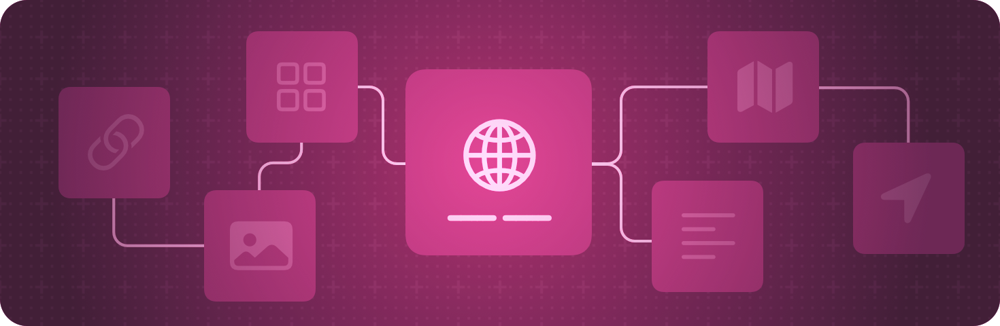

> 导航：[技术](../technologies.md) · [SwiftUI](../swiftui.md)

# App 组织

API 集合

定义 App 的入口点和顶层结构。

## 概述

以声明式方式描述 App 的结构，就像声明视图的外观一样。创建一个符合 [App](app.md) 协议的类型，并用它来枚举代表 App 用户界面各方面的[场景](scenes.md)。

SwiftUI 让你能够编写在 Apple 所有平台上都可运行的代码。不过，它也让你能够针对每个平台的特定能力定制你的 App。例如，如果你需要响应系统传统上在 UIKit、AppKit 或 WatchKit App 的委托上进行的回调，请定义一个委托对象，并使用合适的委托适配器属性包装器（例如 [UIApplicationDelegateAdaptor](uiapplicationdelegateadaptor.md)）在你的 App 结构中将其实例化。

有关特定平台的设计指引，请参阅《人机界面指南》中的 [Getting started](../design/human-interface-guidelines/getting-started.md)。

## 主题

### 创建 App

- [Destination Video](../visionos/destination-video.md) — 利用 SwiftUI 在多平台 App 中构建沉浸式媒体体验。
- [Hello World](../visionos/world.md) — 使用窗口、volume 和沉浸式空间向人们介绍地球。
- [Backyard Birds: Building an app with SwiftData and widgets](backyard-birds-sample.md) — 创建一个具有持久化数据、可交互小组件和全新 App 内购买体验的 App。
- [Food Truck: Building a SwiftUI multiplatform app](food-truck-building-a-swiftui-multiplatform-app.md) — 为 Mac、iPad 和 iPhone 创建单一的代码库和 App target。
- [Fruta: Building a feature-rich app with SwiftUI](../appclip/fruta-building-a-feature-rich-app-with-swiftui.md) — 创建共享代码库，构建一个提供小组件和轻 App 的多平台 App。
- [Migrating to the SwiftUI life cycle](migrating-to-the-swiftui-life-cycle.md) — 在 SwiftUI 中使用基于场景（scene）的生命周期，同时保留你现有的代码库。
- [App](app.md) — 表示 App 的结构和行为的类型。

### 面向 iOS 和 iPadOS

- [UILaunchScreen](../bundleresources/information-property-list/uilaunchscreen.md) — App 启动时要显示的用户界面。
- [UILaunchScreens](../bundleresources/information-property-list/uilaunchscreens.md) — App 为响应不同 URL scheme 而启动时要显示的用户界面。
- [UIApplicationDelegateAdaptor](uiapplicationdelegateadaptor.md) — 一种属性包装器类型，用于创建 UIKit App 委托。

### 面向 macOS

- [NSApplicationDelegateAdaptor](nsapplicationdelegateadaptor.md) — 一种属性包装器类型，用于创建 AppKit App 委托。

### 面向 watchOS

- [WKApplicationDelegateAdaptor](wkapplicationdelegateadaptor.md) — 一种属性包装器，在 `App` 中用于提供来自 WatchKit 的委托。
- [WKExtensionDelegateAdaptor](wkextensiondelegateadaptor.md) — 一种属性包装器类型，用于创建 WatchKit 扩展委托。_(已废弃)_

### 面向 tvOS

- [Creating a tvOS media catalog app in SwiftUI](creating-a-tvos-media-catalog-app-in-swiftui.md) — 为你的 tvOS App 构建标准内容联锁和内容架的行。

### 处理系统重新居中事件

- [WorldRecenterPhase](worldrecenterphase.md) — 一种类型，表示与系统重新居中事件的某个阶段相关联的信息。此类型的值会传递给 View.onWorldRecenter(action:) 中指定的闭包。

## 另请参阅

### App 结构

- [Scenes](scenes.md) — 声明构成 App 各部分的用户界面分组。
- [Windows](windows.md) — 在一个窗口或一组窗口中显示用户界面内容。
- [Immersive spaces](immersive-spaces.md) — 在用户周围显示无边界的内容。
- [Documents](documents.md) — 让人们能够打开和管理文稿。
- [Navigation](navigation.md) — 使用户能够在场景内你的 App 视图层级结构的不同部分之间移动。
- [Modal presentations](modal-presentations.md) — 在提供专注交互的独立视图中呈现内容。
- [Toolbars](toolbars.md) — 提供对常用命令和控制的即时访问。
- [Search](search.md) — 让人们能够在你的 App 中搜索文本或其他内容。
- [App extensions](app-extensions.md) — 把你 App 的基础功能扩展到系统的其他部分，例如添加小组件。
