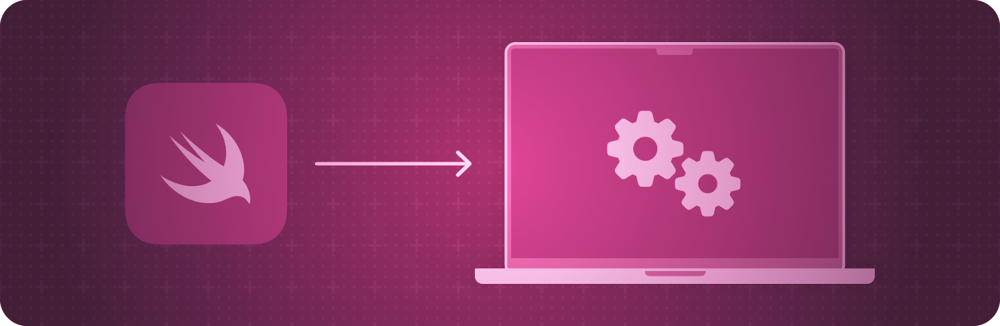

> 导航：[技术](../technologies.md) · [SwiftUI](../swiftui.md)

# AppKit 集成

API 集合

向你的 SwiftUI App 添加 AppKit 视图，或在你的 AppKit App 中使用 SwiftUI 视图。

## 概述

使用托管控制器将 SwiftUI 与 App 的现有内容集成，把 SwiftUI 视图添加到 AppKit 界面中。托管控制器将一组 SwiftUI 视图封装成一种形式，然后你可以把它添加到基于 storyboard 的 App 中。

你还可以向你的 SwiftUI 界面添加 AppKit 视图和视图控制器。可表示对象会包装指定的视图或视图控制器，并促进被包装对象与你的 SwiftUI 视图之间的通信。

有关设计指引，请参阅《人机界面指南》中的 [Designing for macOS](../design/human-interface-guidelines/designing-for-macos.md)。

## 主题

### 在 AppKit 中显示 SwiftUI 视图

- [Unifying your app’s animations](unifying-your-app-s-animations.md) — 在 SwiftUI、UIKit 和 AppKit 中打造一致的 UI 动画体验。
- [NSHostingController](nshostingcontroller.md) — 一种 AppKit 视图控制器，用于承载 SwiftUI 视图层级结构。
- [NSHostingView](nshostingview.md) — 一种 AppKit 视图，用于承载 SwiftUI 视图层级结构。
- [NSHostingMenu](nshostingmenu.md) — 一种 AppKit 菜单，其菜单项由 SwiftUI View 定义。
- [NSHostingSizingOptions](nshostingsizingoptions.md) — 控制承载视图和控制器如何把其内容的大小反映到 Auto Layout 约束中的选项。
- [NSHostingSceneRepresentation](nshostingscenerepresentation.md) — 一种承载并能够呈现 SwiftUI 场景的 AppKit 类型
- [NSHostingSceneBridgingOptions](nshostingscenebridgingoptions.md) — 控制承载视图和控制器如何管理相关窗口各方面事务的选项。

### 将 AppKit 视图添加到 SwiftUI 视图层级结构

- [NSViewRepresentable](nsviewrepresentable.md) — 一个用于将 AppKit 视图集成到你的 SwiftUI 视图层级结构中的包装器。
- [NSViewRepresentableContext](nsviewrepresentablecontext.md) — 关于系统状态的上下文信息，用于创建和更新你的 AppKit 视图。
- [NSViewControllerRepresentable](nsviewcontrollerrepresentable.md) — 一个用于将 AppKit 视图控制器集成到你的 SwiftUI 界面中的包装器。
- [NSViewControllerRepresentableContext](nsviewcontrollerrepresentablecontext.md) — 关于系统状态的上下文信息，用于创建和更新你的 AppKit 视图控制器。

### 将 AppKit 手势识别器添加到 SwiftUI 视图层级结构

- [NSGestureRecognizerRepresentable](nsgesturerecognizerrepresentable.md) — 一个 `NSGestureRecognizer` 的包装器，用于将该手势识别器集成到你的 SwiftUI 层级结构中。
- [NSGestureRecognizerRepresentableContext](nsgesturerecognizerrepresentablecontext.md) — 关于系统状态的上下文信息，用于创建和更新被表示的手势识别器。
- [NSGestureRecognizerRepresentableCoordinateSpaceConverter](nsgesturerecognizerrepresentablecoordinatespaceconverter.md) — 一个结构体，用于在与 [NSGestureRecognizerRepresentable](nsgesturerecognizerrepresentable.md) 关联的 SwiftUI 视图层级结构中进行位置与坐标空间之间的相互转换。

## 另请参阅

### 框架集成

- [UIKit integration](uikit-integration.md) — 向你的 SwiftUI App 添加 UIKit 视图，或在你的 UIKit App 中使用 SwiftUI 视图。
- [WatchKit integration](watchkit-integration.md) — 向你的 SwiftUI App 添加 WatchKit 视图，或在你的 WatchKit App 中使用 SwiftUI 视图。
- [Technology-specific views](technology-specific-views.md) — 使用其他 Apple 框架提供的 SwiftUI 视图。
