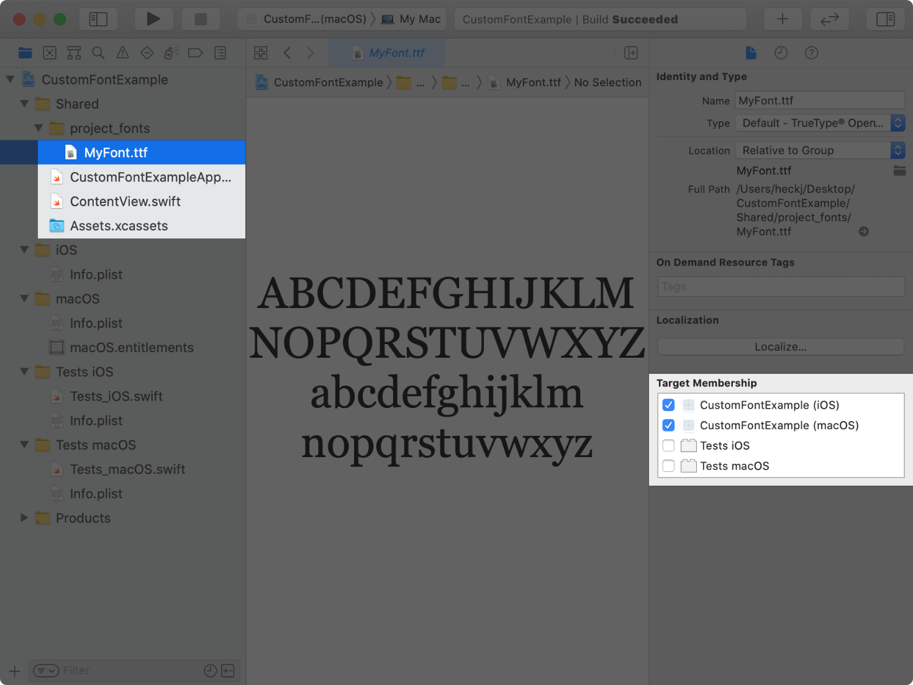
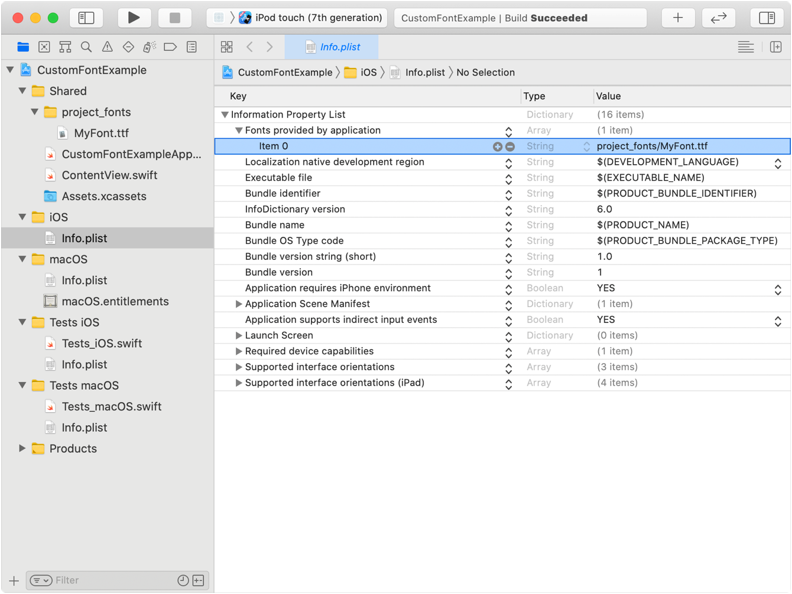
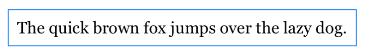
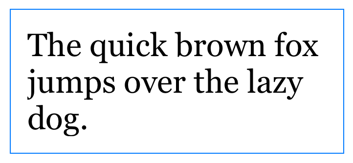

> 导航：[技术](../technologies.md) · [SwiftUI](../swiftui.md) · [文本输入与输出](text-input-and-output.md)

# 为文本应用自定义字体

<sub>文章</sub>

在你的 App 中添加并使用可随动态字体缩放的字体。

## 概述

SwiftUI 支持使用内置字体为文本视图设置样式，并且默认使用系统字体。除了使用系统提供的字体之外，你也可以通过把字体文件加入你的 Xcode 项目来使用自定义字体。要使用自定义字体，请将包含你的已授权字体的字体文件添加到你的 App 中，然后将该字体应用于文本视图，或在容器视图内将其设为默认字体。SwiftUI 的自适应文本显示会使用动态字体自动缩放该字体。

动态字体让用户可以选择屏幕上显示的文字内容的大小。它帮助需要更大文字以获得更好可读性的用户，并兼顾能够阅读较小文字的用户，从而让更多信息显示在屏幕上。

### 将字体文件添加到项目中

要将字体文件添加到你的 Xcode 项目中：

1. 在 Xcode 中选择项目导航器。
2. 把你的字体从访达窗口拖入你的项目。这会把字体拷贝到你的项目中。
3. 选中该字体或包含字体的文件夹，并确认文件在检查器中已为你的 App 的 target 勾选了 target 成员资格。



<sub>Xcode 的截图，显示 Info plist 文件，其中字体已添加到选定的 App。截图显示文件检查器中 macOS 和 iOS target 的 target 成员资格复选框已被选中。</sub>

### 确定要包含在 App 软件包中的字体文件

对于 iOS、watchOS、tvOS 或 Mac Catalyst target，请将 [UIAppFonts](../bundleresources/information-property-list/uiappfonts.md) 键添加到你的 App 的 `Info.plist` 文件中。对于该键的值，请提供一个字符串数组，其中包含指向任何已添加字体文件的相对路径。对于 macOS App target，请使用 target 的 `Info.plist` 文件中的 [ATSApplicationFontsPath](../bundleresources/information-property-list/atsapplicationfontspath.md) 键，并将存放字体的文件夹的名称提供为该键的值。

在下面的示例中，字体文件位于 `project_fonts` 目录内，因此你要在 `Info.plist` 文件中使用 `project_fonts/MyFont.ttf` 作为字符串值。



<sub>Xcode 的截图，显示 Info plist 文件，其中「Fonts provided by the app」键是一个数组，包含唯一的条目 project_fonts/MyFont.ttf。</sub>

### 应用支持动态缩放的字体

使用 [custom(_:size:)](<font/custom(__size_).md>) 方法获取你的字体的实例，并通过 [font(_:)](<text/font(__).md>) 修饰符将其应用于文本视图。使用 [custom(_:size:)](<font/custom(__size_).md>) 获取字体时，请让字体的名称与字体的 PostScript 名称相匹配。你可以通过用「字体册」App 打开字体并选择「字体信息」标签页来找到字体的 PostScript 名称。如果 SwiftUI 无法获取并应用你的字体，它会改用默认系统字体来渲染文本视图。

以下示例将字体 `MyFont` 应用于一个文本视图：

```swift
Text("Hello, world!")
    .font(Font.custom("MyFont", size: 18))
```

该字体会从提供的尺寸开始自适应缩放，以与 [body](font/body.md) 的默认文本样式保持一致。使用 `relativeTo` 参数可以指定一个不同于默认值 `body` 的文本样式来进行缩放。例如，要将字号设置为 `32` 点并相对于 [title](font/title.md) 文本样式自适应缩放：

```swift
Text("Hello, world!")
    .font(Font.custom("MyFont", size: 32, relativeTo: .title))
```

SwiftUI 不会为字体合成粗体或斜体样式。如果该字体支持字重或斜体变体，你可以通过使用 [weight(_:)](<font/weight(__).md>) 或 [italic()](<font/italic().md>) 修饰符为字体设置样式，来自定文本视图的字体排印。

有关选择字体以在目标平台上增强你的 App 的设计指引，请参阅《人机界面指南》中的[字体排印](../design/human-interface-guidelines/typography.md)。

### 使用缩放度量缩放内边距

视图属性上的 [ScaledMetric](scaledmetric.md) 属性包装器提供了一个随辅助功能设置自动变化的缩放值。在处理自适应尺寸的字体时，你可以使用这个属性包装器来缩放文本之间或周围的间距，以改进视觉设计。

以下示例使用 `@ScaledMetric` 相对于 `body` 文本样式缩放包围文本视图的内边距值，并添加一个蓝色边框以标识内边距增加的间距：

```swift
struct ContentView: View {
    @ScaledMetric(relativeTo: .body) var scaledPadding: CGFloat = 10

    var body: some View {
        Text("The quick brown fox jumps over the lazy dog.")
            .font(Font.custom("MyFont", size: 18))
            .padding(scaledPadding)
            .border(Color.blue)
    }
}

struct ContentView_Previews: PreviewProvider {
    static var previews: some View {
        ContentView()
    }
}
```

在未开启任何辅助功能设置时，预览显示如下图像：



使用 [environment(_:_:)](<view/environment(____).md>) 修饰符将预览上的辅助功能大小类别设置为 [ContentSizeCategory.accessibilityLarge](contentsizecategory/accessibilitylarge.md)：

```swift
struct ContentView_Previews: PreviewProvider {
    static var previews: some View {
        ContentView()
            .environment(\.sizeCategory, .accessibilityLarge)
    }
}
```

随后预览会显示如下图像，反映了增大后的辅助功能尺寸和缩放后的内边距：



<sub>文字 the quick brown fox jumps over the lazy dog 分三行显示，周围有一个蓝色边框，蓝色边框与文字内容之间有更大的空白。</sub>

## 另请参阅

### 设置字体

- [font(_:)](<view/font(__).md>) — 设置此视图中文本的默认字体。
- [fontDesign(_:)](<view/fontdesign(__).md>) — 设置此视图中文本的字体设计。
- [fontWeight(_:)](<view/fontweight(__).md>) — 设置此视图中文本的字重。
- [fontWidth(_:)](<view/fontwidth(__).md>) — 设置此视图中文本的字体宽度。
- [font](environmentvalues/font.md) — 此环境的默认字体。
- [Font](font.md) — 一种依赖环境的字体。
