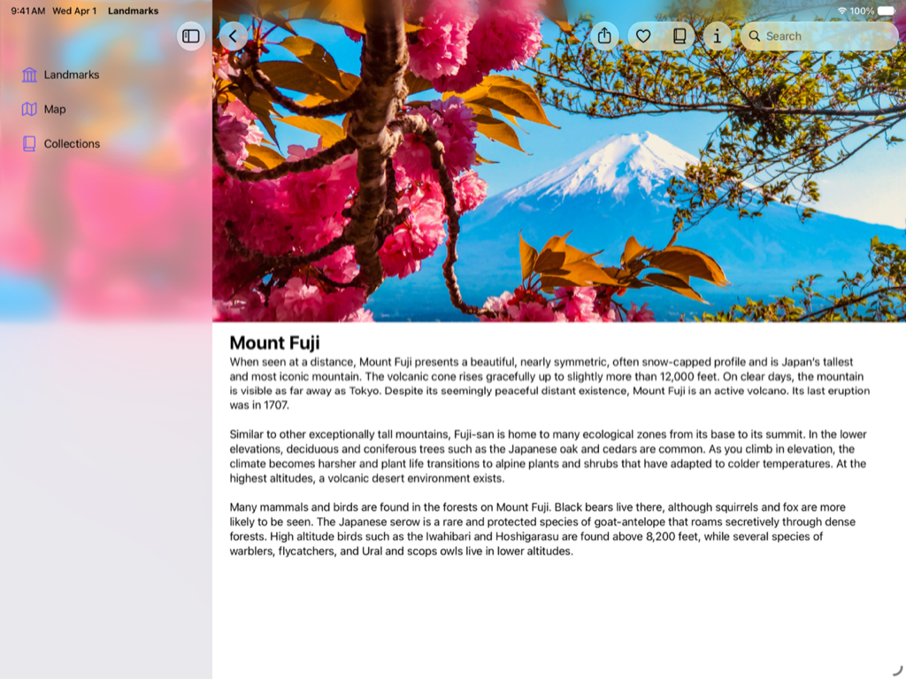
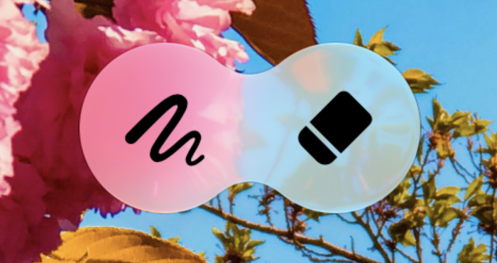
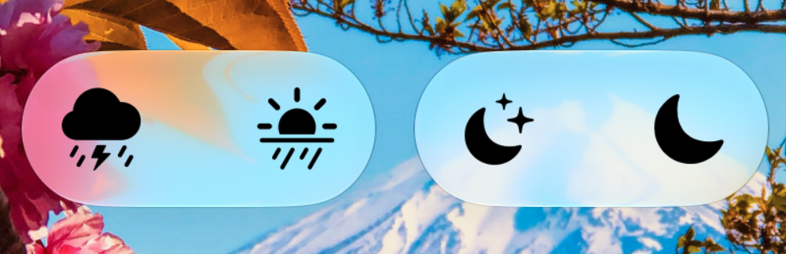

> 导航：[技术](../technologies.md) · [SwiftUI](../swiftui.md) · [视图样式](view-styles.md)

# 将 Liquid Glass 应用到自定视图

<sub>文章</sub>

使用 Liquid Glass 效果配置、组合和形变视图。

## 概述

Apple 各平台的界面采用了一种名为 Liquid Glass 的新动态材质，它将玻璃的光学特性与流动感结合在一起。Liquid Glass 是一种会模糊其后方内容、反射周围内容的颜色和光线，并实时响应触控和指针交互的材质。SwiftUI 的标准组件使用 Liquid Glass。在自定组件上采用 Liquid Glass，可以通过独特的动画和过渡让它们移动、组合并相互形变。



要了解 Liquid Glass 及更多内容，请参阅 [Landmarks：使用 Liquid Glass 构建 App](landmarks-building-an-app-with-liquid-glass.md)。

## 应用并配置 Liquid Glass 效果

使用 [glassEffect(_:in:)](<view/glasseffect(__in_).md>) 修饰符为视图添加 Liquid Glass 效果。默认情况下，该修饰符使用 [Glass](glass.md) 的 [regular](glass/regular.md) 变体，并在视图内容后方的 [Capsule](capsule.md) 形状中应用给定效果。

通过多种方式配置该效果来自定你的组件：

- 使用不同的形状，让你 App 中的自定组件拥有一致的外观和感觉。例如，如果将效果应用到较大的组件，而它们以 `Capsule` 或 [Circle](circle.md) 呈现会显得不协调，就可以使用圆角矩形。
- 指定色调颜色以暗示醒目程度。
- 为自定组件添加 [interactive(_:)](<glass/interactive(__).md>)，使它们响应触控和指针交互。这会应用与 [glass](primitivebuttonstyle/glass.md) 为标准按钮提供的相同的响应式流动反应。

在下面的示例中，观察如何将 Liquid Glass 效果应用到视图、如何使用具有特定圆角半径的替代形状，以及如何创建响应交互的带色调视图：

[一段视频，展示的示例包括应用了 Liquid Glass 效果的 Text 视图、应用了自定形状、圆角半径效果和 Liquid Glass 效果的 Text 视图，以及应用了响应交互的橙色色调颜色效果并带有 Liquid Glass 效果的 Text 视图。](https://docs-assets.developer.apple.com/published/fd1df61adf23123bd504c5ddf4d83b00/liquid-glass-view-examples.mp4)

```swift
Text("Hello, World!")
    .font(.title)
    .padding()
    .glassEffect()

Text("Hello, World!")
    .font(.title)
    .padding()
    .glassEffect(in: .rect(cornerRadius: 16.0))

Text("Hello, World!")
    .font(.title)
    .padding()
    .glassEffect(.regular.tint(.orange).interactive())
```

## 使用 Liquid Glass 容器组合多个视图

在多个视图上应用 Liquid Glass 效果时，请使用 [GlassEffectContainer](glasseffectcontainer.md) 以获得最佳渲染性能。容器还可以让带有 Liquid Glass 效果的视图将其形状融合在一起，并在过渡期间相互形变。在容器内，每个带有 [glassEffect(_:in:)](<view/glasseffect(__in_).md>) 修饰符的视图都会在其后方的效果中渲染。

自定容器上的间距，以控制视图后方的 Liquid Glass 效果之间的相互作用。容器上的间距值越大，视图后方的 Liquid Glass 效果就越快在过渡期间融合在一起并合并形状。如果容器上的间距值大于内部 [HStack](hstack.md)、[VStack](vstack.md) 或其他布局容器的间距，Liquid Glass 效果会在静止状态下就融合在一起，因为视图彼此靠得太近。将视图移入或移出时的动画会使形状随着容器内空间的变化而相互分开或合并形变。

`glassEffect(_:in:)` 修饰符会捕获要发送到容器进行渲染的内容。请在其他影响视图外观的修饰符之后应用 `glassEffect(_:in:)` 修饰符。

在下面的示例中，两个图像彼此靠近放置，Liquid Glass 效果开始将它们的形状融合在一起。当组件在容器内相互移动时，这会创建流畅的动画：



<sub>两个 Image 视图，左侧为涂鸦符号，右侧为橡皮擦符号。这两个视图彼此靠近，导致 Liquid Glass 效果将它们合并。</sub>

```swift
GlassEffectContainer(spacing: 40.0) {
    HStack(spacing: 40.0) {
        Image(systemName: "scribble.variable")
            .frame(width: 80.0, height: 80.0)
            .font(.system(size: 36))
            .glassEffect()

        Image(systemName: "eraser.fill")
            .frame(width: 80.0, height: 80.0)
            .font(.system(size: 36))
            .glassEffect()

            // 一个 `offset` 展示了 Liquid Glass 效果在容器中如何相互反应。
            // 使用动画以及组件的出现和消失来获得看起来有目的性的效果。
            .offset(x: -40.0, y: 0.0)
    }
}
```

在某些情况下，你希望多个视图的几何形状贡献给单个 Liquid Glass 效果胶囊，即使内容处于静止状态也是如此。使用 [glassEffectUnion(id:namespace:)](<view/glasseffectunion(id_namespace_).md>) 修饰符指定某个视图贡献给具有特定 ID 的统一效果。这会将具有相似形状、Liquid Glass 效果和 ID 的所有效果合并为一个应用了 Liquid Glass 材质的单一形状。这在动态创建视图时，或者对于位于 `HStack` 或 `VStack` 等布局容器之外的视图尤其有用。



<sub>四个应用了 Liquid Glass 效果的 Image 视图。雷电雨云符号和太阳雨符号具有同时包裹两者的统一 Liquid Glass 效果，随后是星月符号和月亮符号的统一 Liquid Glass 效果。</sub>

```swift
let symbolSet: [String] = ["cloud.bolt.rain.fill", "sun.rain.fill", "moon.stars.fill", "moon.fill"]

GlassEffectContainer(spacing: 20.0) {
    HStack(spacing: 20.0) {
        ForEach(symbolSet.indices, id: \.self) { item in
            Image(systemName: symbolSet[item])
                .frame(width: 80.0, height: 80.0)
                .font(.system(size: 36))
                .glassEffect()
                .glassEffectUnion(id: item < 2 ? "1" : "2", namespace: namespace)
        }
    }
}
```

## 在过渡期间让 Liquid Glass 效果形变

形变效果发生在带有 Liquid Glass 效果的视图之间进行过渡或动画时。使用 [glassEffectID(_:in:)](<view/glasseffectid(__in_).md>) 修饰符来协调容器内带效果的视图之间的过渡。[GlassEffectTransition](glasseffecttransition.md) 允许你指定在容器内添加或移除效果时要使用的过渡类型。对于你要添加或移除、且位于容器所分配间距内的效果，默认的过渡类型是 [matchedGeometry](glasseffecttransition/matchedgeometry.md)。

如果你偏好更简单的过渡或想创建自定过渡，请使用 [materialize](glasseffecttransition/materialize.md) 过渡和 [withAnimation(_:_:)](<withanimation(____).md>)。对于你要添加或移除、且彼此之间的距离超过容器所分配间距的效果，请使用 `materialize` 过渡。为了给用户提供一致的体验，请在你的各个 App 中统一使用 `matchedGeometry` 和 `materialize` 过渡。系统会通过可用的过渡类型应用不透明度之外的更多变化。

将每个 Liquid Glass 效果与 [Namespace](namespace.md) 属性包装器提供的命名空间内的唯一标识符关联。这些 ID 可确保当形状因视图层级结构变化而出现或消失时，SwiftUI 能够正确地对相同的形状制作动画。SwiftUI 使用提供给效果容器的间距以及形状自身的几何形状，来确定何时以及哪些合适的形状应相互形变。

`glassEffectID(_:in:)` 和 `glassEffectTransition(_:)` 修饰符仅在视图层级结构过渡或动画期间影响其内容。

在下面的示例中，当 `isExpanded` 变量变化时，橡皮擦图像会与铅笔图像相互过渡。`GlassEffectContainer` 的间距值为 `40.0`，其中的 `HStack` 间距为 `40.0`。当橡皮擦最近的边缘小于或等于容器的间距时，这会使橡皮擦图像形变为铅笔图像。

[一段视频，展示两个视图——左侧为涂鸦符号，右侧为橡皮擦符号——随着下方按钮被按下，Liquid Glass 效果在两者之间相互形变。](https://docs-assets.developer.apple.com/published/d26d316e435a6e3ae01751e4b9fd5e85/liquid-glass-morph-views.mp4)

```swift
@State private var isExpanded: Bool = false
@Namespace private var namespace

var body: some View {
    GlassEffectContainer(spacing: 40.0) {
        HStack(spacing: 40.0) {
            Image(systemName: "scribble.variable")
                .frame(width: 80.0, height: 80.0)
                .font(.system(size: 36))
                .glassEffect()
                .glassEffectID("pencil", in: namespace)

            if isExpanded {
                Image(systemName: "eraser.fill")
                    .frame(width: 80.0, height: 80.0)
                    .font(.system(size: 36))
                    .glassEffect()
                    .glassEffectID("eraser", in: namespace)
            }
        }
    }

    Button("Toggle") {
        withAnimation {
            isExpanded.toggle()
        }
    }
    .buttonStyle(.glass)
}
```

## 使用 Liquid Glass 效果时优化性能

创建过多的 Liquid Glass 效果容器，或在容器之外的视图上应用过多效果，可能会降低性能。请限制同时显示在屏幕上的 Liquid Glass 效果的数量。此外，还要在用户使用 App 时优化 App 花费在渲染上的时间。要了解如何提升 UI 的性能，请参阅[探索 UI 动画卡顿与渲染循环](https://developer.apple.com/videos/play/tech-talks/10855/) 和[使用 Instruments 优化 SwiftUI 性能](https://developer.apple.com/videos/play/wwdc2025/306/)。

## 另请参阅

### 使用 Liquid Glass 设置视图样式

- [Landmarks：使用 Liquid Glass 构建 App](landmarks-building-an-app-with-liquid-glass.md) — 使用系统提供的和自定的 Liquid Glass 增强 App 体验。
- [glassEffect(_:in:)](<view/glasseffect(__in_).md>) — 将 Liquid Glass 效果应用到视图。
- [glassEffectID(_:in:)](<view/glasseffectid(__in_).md>) — 将一个身份值与此视图中定义的 Liquid Glass 效果关联。
- [glassEffectTransition(_:)](<view/glasseffecttransition(__).md>) — 将玻璃效果过渡与此视图中定义的任何玻璃效果关联。
- [glassEffectUnion(id:namespace:)](<view/glasseffectunion(id_namespace_).md>) — 将此视图中定义的任何 Liquid Glass 效果与提供的标识符关联为一个并集。
- [interactive(_:)](<glass/interactive(__).md>) — 返回配置为可交互的结构体副本。
- [GlassEffectContainer](glasseffectcontainer.md) — 一个将多个 Liquid Glass 形状合并为单一形状的视图，可以使各个形状之间相互形变。
- [GlassEffectTransition](glasseffecttransition.md) — 一个结构体，描述在视图层级结构中添加或移除玻璃效果时要应用的更改。
- [GlassButtonStyle](glassbuttonstyle.md) — 一种按钮样式，根据按钮的上下文应用玻璃边框外观。
- [GlassProminentButtonStyle](glassprominentbuttonstyle.md) — 一种按钮样式，根据按钮的上下文应用醒目的玻璃边框外观。
- [DefaultGlassEffectShape](defaultglasseffectshape.md) — 玻璃效果应用的默认形状，即胶囊。
