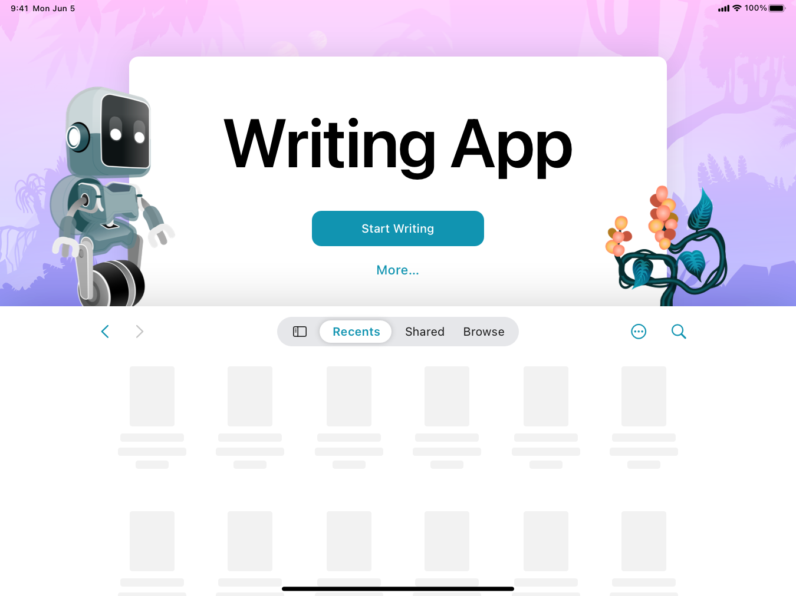

> 导航： [Technologies](../technologies.md) · [SwiftUI](../swiftui.md) · [Documents](documents.md)

# 使用 SwiftUI 构建基于文稿的 App

<sub>示例代码</sub>

在多平台 App 中创建、存储和打开文稿。

## 概述

Writing App 示例为 iOS、iPadOS 和 macOS 构建了一个基于文稿的 App。在 App 定义中，它有一个 [DocumentGroup](documentgroup.md) 场景，其文稿类型遵循 [FileDocument](filedocument.md) 协议。人们可以创建一篇写作 App 文稿、修改文稿的标题和内容，并以专注模式阅读故事。



<sub>一张截图，显示 iPad 上的文稿启动体验，标题视图的左右两侧分别有机器人和植物配饰。</sub>

## 配置示例代码项目

要在你的设备上构建并运行这个示例，请按以下步骤为项目的 target 选择你的开发团队：

1. 使用最新版本的 Xcode 打开这个示例。
2. 选择顶层项目。
3. 对于项目的 target，在 Signing & Capabilities 面板的 Team 弹出式菜单中选择你的团队，让 Xcode 自动管理你的描述文件。

## 定义 App 的场景

基于文稿的 SwiftUI App 从其 `body` 属性返回一个 `DocumentGroup` 场景。App 提供给文稿组的 [init(newDocument:editor:)](<documentgroup/init(newdocument_editor_)-4toe2.md>) 初始化方法的 `newDocument` 参数，遵循 [FileDocument](filedocument.md) 或 [ReferenceFileDocument](referencefiledocument.md)。在这个示例中，文稿类型遵循 `FileDocument`。这个初始化方法的尾随闭包返回一个渲染文稿内容的视图：

```swift
@main
struct WritingApp: App {
    var body: some Scene {
        DocumentGroup(newDocument: WritingAppDocument()) { file in
            StoryView(document: file.$document)
        }
    }
}
```

## 自定 iOS 和 iPadOS 的启动体验

你可以用自定标题、操作按钮和屏幕背景来更新 iOS 和 iPadOS 上的默认启动体验。要添加带自定标签的操作按钮，使用 [NewDocumentButton](newdocumentbutton.md) 来替换默认标签。你可以用多种方式自定背景，例如通过某个初始化方法添加视图或 `backgroundStyle`，例如 [init(_:backgroundStyle:_:backgroundAccessoryView:overlayAccessoryView:)](<documentgrouplaunchscene/init(__backgroundstyle___backgroundaccessoryview_overlayaccessoryview_)-2d13c.md>)。这个示例使用 [init(_:_:background:)](<documentgrouplaunchscene/init(____background_)-2iefz.md>) 初始化方法来自定标题视图的背景：

```swift
DocumentGroupLaunchScene("Writing App") {
    NewDocumentButton("Start Writing")
} background: {
    Image(.pinkJungle)
    .resizable()
    .scaledToFill()
    .ignoresSafeArea()
} 
```

你还可以使用初始化方法（例如 [init(_:_:background:backgroundAccessoryView:)](<documentgrouplaunchscene/init(____background_backgroundaccessoryview_)-1valf.md>) 和 [init(_:_:background:overlayAccessoryView:)](<documentgrouplaunchscene/init(____background_overlayaccessoryview_)-1143c.md>），根据定位需求向场景添加配饰。

```swift
overlayAccessoryView: { _ in
    AccessoryView()
}
```

这个示例在叠放位置包含两个配饰，定义在 `AccessoryView` 中。它通过应用修饰符来自定这些配饰，包括 [offset(x:y:)](<view/offset(x_y_).md>) 和 [frame(width:height:alignment:)](<view/frame(width_height_alignment_).md>)。

```swift
ZStack {
    Image(.robot)
        .resizable()
        .offset(x: size.width / 2 - 450, y: size.height / 2 - 300)
        .scaledToFit()
        .frame(width: 200)
        .opacity(horizontal == .compact ? 0 : 1)
    Image(.plant)
        .resizable()
        .offset(x: size.width / 2 + 250, y: size.height / 2 - 225)
        .scaledToFit()
        .frame(width: 200)
        .opacity(horizontal == .compact ? 0 : 1)
}
```

要同时添加背景和叠放配饰，请使用诸如 [init(_:_:background:backgroundAccessoryView:overlayAccessoryView:)](<documentgrouplaunchscene/init(____background_backgroundaccessoryview_overlayaccessoryview_)-1re6d.md>) 这样的初始化方法。如果你不提供任何配饰，系统默认会在标题视图下方显示两张淡化的表单。在 macOS 上，这个示例在启动时显示默认的系统文稿浏览器。你可以考虑在启动时添加额外的体验。

## 创建数据模型

这个示例有一个数据模型，把故事定义为一个 `String`，并用空字符串初始化 `story`：

```swift
var story: String

init(text: String = "") {
    self.story = text
}
```

## 采用文稿文件协议

`WritingAppDocument` 结构体采用 `FileDocument` 协议，把文稿与文件相互序列化。[readableContentTypes](filedocument/readablecontenttypes.md) 属性定义了示例可以读取和写入的类型，具体为 `.writingAppDocument` 类型：

```swift
static var readableContentTypes: [UTType] { [.writingAppDocument] }
```

[init(configuration:)](<filedocument/init(configuration_).md>) 初始化方法从文件加载文稿。在使用 `configuration` 输入的 [file](filedocumentreadconfiguration/file.md) 属性读取文件数据后，它将数据反序列化并存储到文稿的数据模型中：

```swift
init(configuration: ReadConfiguration) throws {
    guard let data = configuration.file.regularFileContents,
          let string = String(data: data, encoding: .utf8)
    else {
        throw CocoaError(.fileReadCorruptFile)
    }
    story = string
}
```

当有人写入文稿时，SwiftUI 会调用 [fileWrapper(configuration:)](<filedocument/filewrapper(configuration_).md>) 函数，把数据模型序列化为一个表示文件系统中数据的 `FileWrapper` 值：

```swift
func fileWrapper(configuration: WriteConfiguration) throws -> FileWrapper {
    let data = Data(story.utf8)
    return .init(regularFileWithContents: data)
}
```

由于文稿类型遵循 `FileDocument`，这个示例会自动处理撤销操作。

## 导出自定文稿类型

这个 App 为它创建的文稿定义并导出一种自定内容类型。它在项目的[信息属性列表](../bundleresources/information-property-list.md)文件中的 [UTExportedTypeDeclarations](../bundleresources/information-property-list/utexportedtypedeclarations.md) 键下声明这种自定类型。这个示例在 `Info.plist` 文件中使用 `com.example.writingAppDocument` 作为标识符：

```swift
<key>CFBundleDocumentTypes</key>
<array>
    <dict>
        <key>CFBundleTypeRole</key>
        <string>Editor</string>
        <key>LSHandlerRank</key>
        <string>Default</string>
        <key>LSItemContentTypes</key>
        <array>
            <string>com.example.writingAppDocument</string>
        </array>
        <key>NSUbiquitousDocumentUserActivityType</key>
        <string>$(PRODUCT_BUNDLE_IDENTIFIER).exampledocument</string>
    </dict>
</array>
<key>UTExportedTypeDeclarations</key>
<array>
    <dict>
        <key>UTTypeConformsTo</key>
        <array>
            <string>public.utf8-plain-text</string>
        </array>
        <key>UTTypeDescription</key>
        <string>Writing App Document</string>
        <key>UTTypeIconFiles</key>
        <array/>
        <key>UTTypeIdentifier</key>
        <string>com.example.writingAppDocument</string>
        <key>UTTypeTagSpecification</key>
        <dict>
            <key>public.filename-extension</key>
            <array>
                <string>story</string>
            </array>
        </dict>
    </dict>
</array>
```

为方便起见，你也可以在代码中定义内容类型。例如：

```swift
extension UTType {
    static var writingapp: UTType {
        UTType(exportedAs: "com.example.writingAppDocument")
    }
}
```

为确保操作系统知道你的应用可以打开 `Info.plist` 中所描述格式的文件，它为该内容类型定义了 `story` 文件扩展名。有关自定文件和数据类型的更多信息，参见[为你的 App 定义文件和数据类型](../uniformtypeidentifiers/defining-file-and-data-types-for-your-app.md)。

## 另请参阅

#### 相关示例

- [使用 SwiftData 构建基于文稿的 App](building-a-document-based-app-using-swiftdata.md)

#### 相关文章

- [为你的 App 定义文件和数据类型](../uniformtypeidentifiers/defining-file-and-data-types-for-your-app.md)
- [自定基于文稿的 App 的启动体验](../uikit/customizing-a-document-based-app-s-launch-experience.md)

#### 相关视频

- [演进你的文稿启动体验](../https_/developer.apple.com/videos/play/wwdc2024/10132.md)

## 下载

- [BuildingADocumentBasedAppWithSwiftUI.zip](https://docs-assets.developer.apple.com/published/ef10bd7eff0d/BuildingADocumentBasedAppWithSwiftUI.zip)
