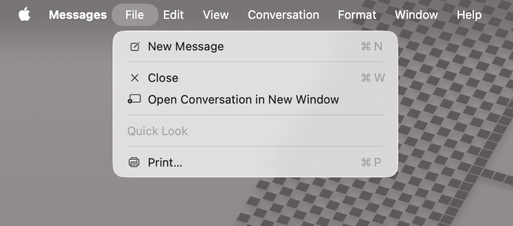
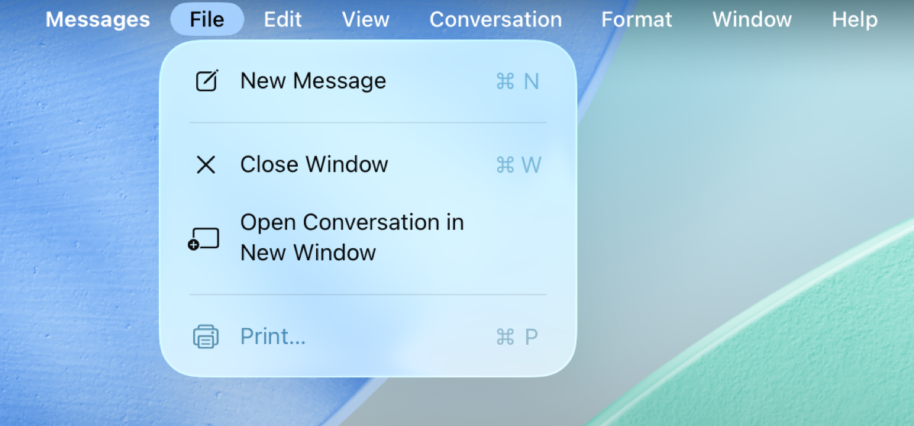
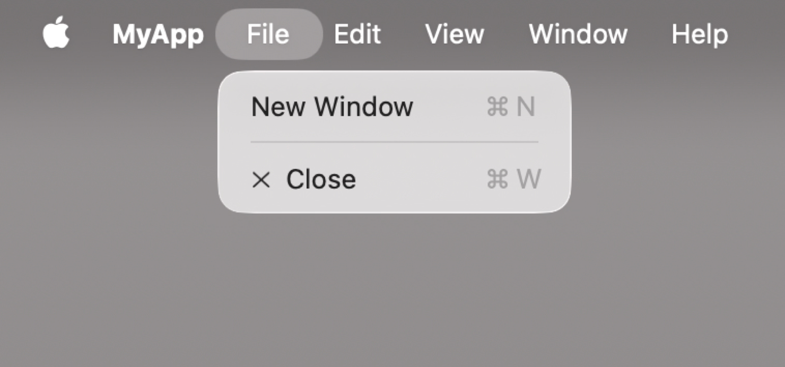
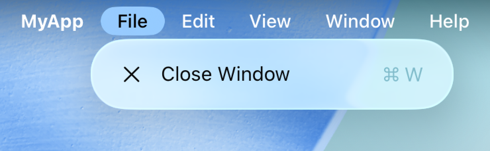
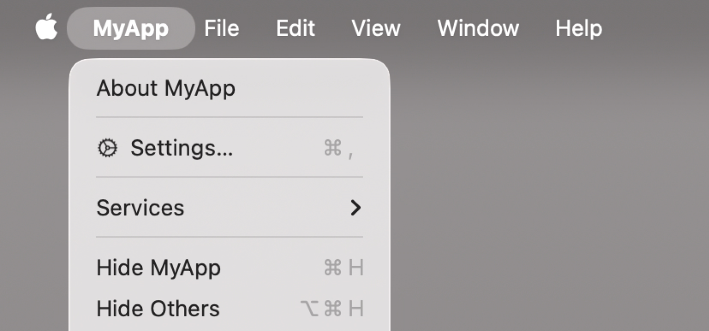
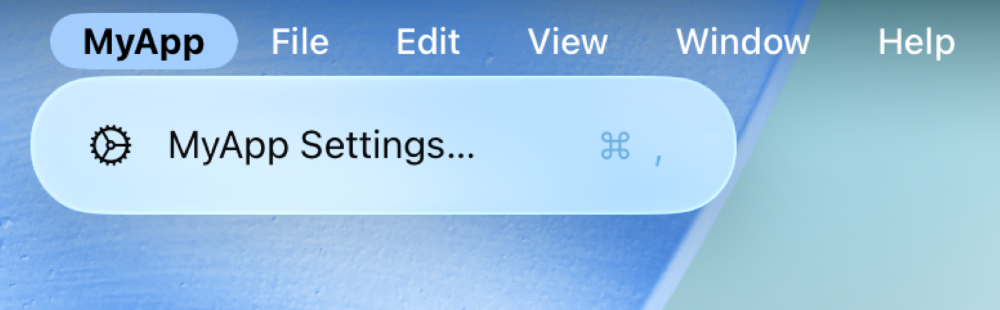
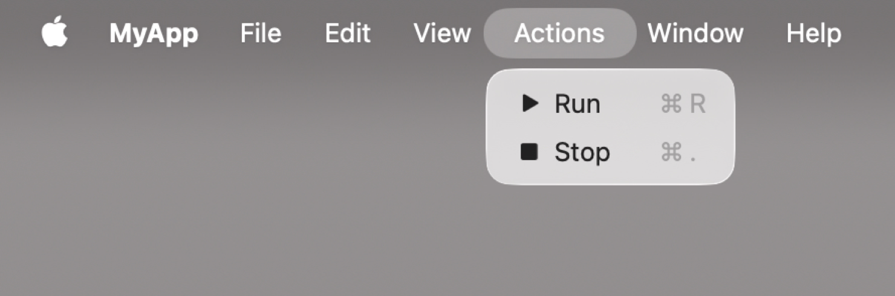
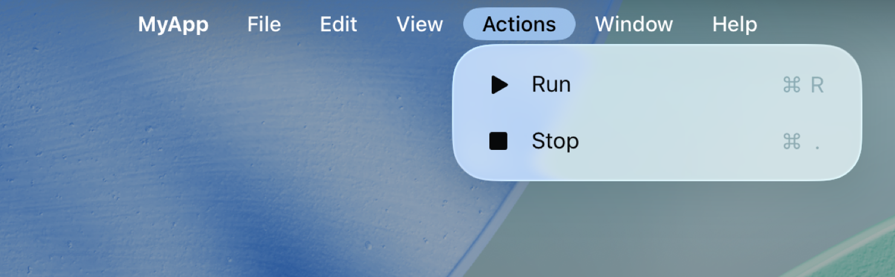
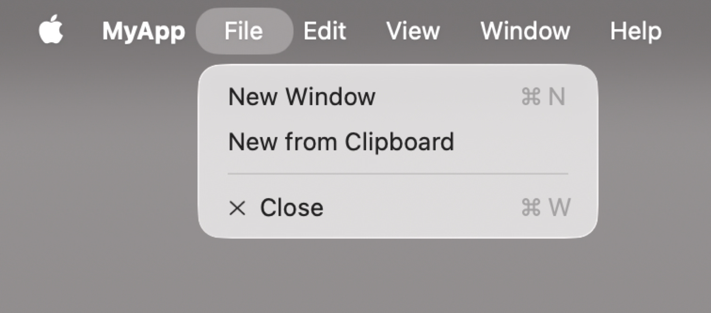
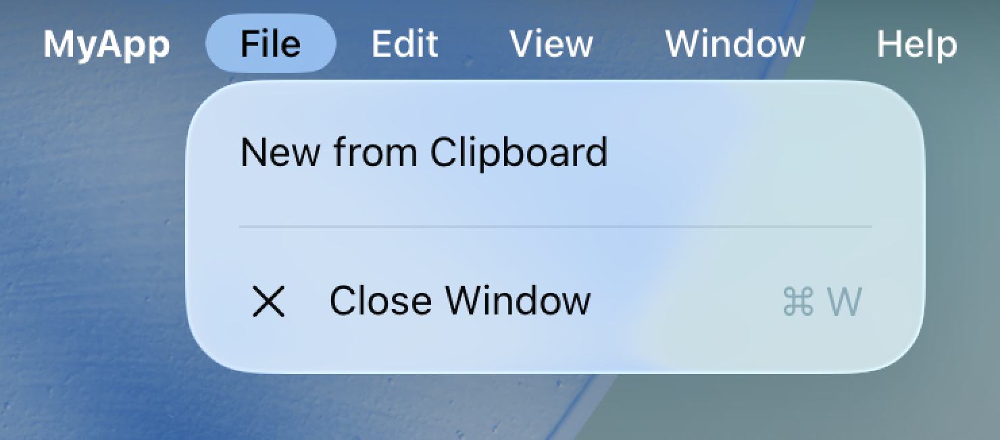

> 导航： [Technologies](../technologies.md) · [SwiftUI](../swiftui.md) · [Menus and commands](menus-and-commands.md)

# 使用 SwiftUI 构建和自定义菜单栏

<sub>文章</sub>

为 iPadOS 和 macOS 构建原生的菜单栏，提供无缝的跨平台用户体验。

## 概述

在 iPadOS 和 macOS 上，菜单栏提供了对剪切、拷贝、粘贴和窗口管理等系统提供的核心操作的访问。系统通过菜单栏把这些操作按功能分组为菜单和子菜单。App 可以添加与上下文相关的操作（例如显示和隐藏边栏），也可以创建自定菜单和菜单项，让人们从菜单栏执行 App 特有的操作。你还可以为菜单栏绑定键盘快捷键，让你的 App 更快捷、更易用。

**macOS**



<sub>macOS 上“信息”的菜单栏。“文件”菜单处于打开状态，其中包含“新信息”“关闭”“在新窗口中打开对话”和“打印”等可用的菜单项。</sub>

**iPadOS**



<sub>iPadOS 上“信息”的菜单栏。“文件”菜单处于打开状态，其中包含“新信息”“关闭窗口”和“在新窗口中打开对话”等可用的菜单项。</sub>

App 包含 [Scene](scene.md) 实例，用于显示 App 的主视图。每个场景都会在菜单栏中提供不同的默认菜单集和操作。与上下文相关的菜单和操作，甚至自定菜单和操作，都通过 [commands(content:)](<scene/commands(content_).md>) 修饰符来指定。

系统提供的菜单和菜单项的顺序在所有 App 中都保持一致，但有些菜单和菜单项会根据上下文添加。例如，基于文稿的 App 会在“文件”菜单中包含用于创建和打开文稿的选项。类似地，并非所有 App 都具备文本格式化能力，但包含文本编辑视图的 App 只要在场景的命令中加入 [TextFormattingCommands](textformattingcommands.md)，就会得到一个“格式”菜单，其中带有选择字体和设置文本样式等选项。随后系统会添加人们在此上下文中期望出现的相应菜单组和菜单项。

想一想人们会如何使用你的 App，哪些操作适合添加到菜单栏，以及应该放在哪里。如需设计指导，参见《人机界面指南》 \> [菜单栏](../design/human-interface-guidelines/the-menu-bar.md)。

## 填充菜单栏

当你的 App 启动时，菜单栏会根据已实现的场景和命令填充菜单和菜单项。对于有条件或依赖上下文的命令，其菜单项会根据当前活跃场景及其处于焦点中的视图层级结构的信息，动态地启用或停用。

每个场景都包含一组默认菜单和菜单项，你可以使用 [commands(content:)](<scene/commands(content_).md>) 修饰符，根据自己的 App 特定需求进行补充。

场景的默认菜单和菜单项取决于场景类型所支持的功能。例如，[WindowGroup](windowgroup.md) 包含用于退出和隐藏 App 的命令，以及拷贝、粘贴支持和窗口管理。

```swift
@main
struct MyApp: App {
    var body: some Scene {
        WindowGroup {
            ContentView()
        }
    }
}
```

**macOS**



**iPadOS**



在 macOS 上，[Settings](settings.md) 场景包含与 `Window` 相同的操作，但额外添加了一个用于显示 App 设置窗口的操作，人们选择 App 菜单 \> 设置时就会用到它。在 iPadOS 上，这个菜单栏项不需要额外的场景；执行该项时会切换到“设置”App 中的 App 设置。

```swift
@main
struct MyApp: App {
    var body: some Scene {
        WindowGroup {
            ContentView()
        }

        #if os(macOS)
        Settings {
            SettingsView()
        }
        #endif
    }
}
```

**macOS**



<sub>macOS 上 MyApp 的菜单栏。“MyApp”菜单处于打开状态，其中包含“关于 MyApp”“设置”、一个“服务”子菜单、“隐藏 MyApp”和“隐藏其他”等可用的菜单项。“设置”菜单项是通过 Settings 场景添加的。</sub>

**iPadOS**



[DocumentGroup](documentgroup.md) 场景包含 `WindowGroup` 所包含的操作，以及许多支持文稿管理能力的操作，例如“存储”和“复制”。

将多种场景组合使用，可以创建出一个菜单栏，其中包含 App 所有核心功能的菜单项：创建和编辑文稿、管理多个窗口，以及公开用户可配置的设置。

```swift
@main
struct MyApp: App {
    var body: some Scene {
        DocumentGroup(newDocument: MyAppDocument()) { file in
            // ...
        }

        #if os(macOS)
        Settings {
            // ...
        }
        #endif
    }
}
```

## 添加与上下文相关的系统菜单项

有些常用菜单项是可选的，但如果 App 具备相应的功能，它们会很有用。例如，并非每个场景都有导览边栏，但对于有导览边栏的场景，人们期望能找到一个控制导览边栏可见性的菜单项。如果你的场景包含导览边栏，可以使用 [commands(content:)](<scene/commands(content_).md>) 修饰符并实现 [SidebarCommands](sidebarcommands.md) 来加入这个菜单项：

```swift
@main
struct MyApp: App {
    var body: some Scene {
        DocumentGroup(newDocument: MyAppDocument()) { file in
            ContentView(document: file.$document)
        }
        .commands {
            SidebarCommands()
        }
    }
}
```

有关系统提供的命令组（例如文本格式化、工具栏和检查器）的更多信息，参见 [Commands](commands.md)。

## 创建自定菜单和菜单项

使用 [CommandMenu](commandmenu.md) 把 App 的自定菜单项组织和分组到自定菜单中。系统会把自定菜单插入到菜单栏中“显示方式”菜单之后。

自定菜单项使用标准 SwiftUI 视图创建，例如 [Button](button.md) 和 [Toggle](toggle.md)。[Menu](menu.md) 会创建一个子菜单。有关创建菜单项的更多信息，参见[使用自适应控制填充 SwiftUI 菜单](populating-swiftui-menus-with-adaptive-controls.md)。

菜单栏还会在菜单项旁边显示键盘快捷键信息，说明人们在不使用菜单栏时需要按下键盘上的哪些按键来执行操作。[keyboardShortcut(_:)](<scene/keyboardshortcut(__).md>) 修饰符允许你定义执行该操作的按键组合。请注意，系统提供了许多 App 无法覆盖的键盘快捷键。如需设计指导，参见《人机界面指南》 \> [键盘](../design/human-interface-guidelines/keyboards.md)。

```swift
WindowGroup {
    ContentView()
}
.commands {
    CommandMenu("Actions") {
        Button("Run", systemImage: "play.fill") { ... }
            .keyboardShortcut("R")

        Button("Stop", systemImage: "stop.fill") { ... }
            .keyboardShortcut(".")
    }
}
```

**macOS**



<sub>macOS 上 MyApp 的菜单栏。“Actions”菜单处于打开状态，其中包含“Run”和“Stop”菜单项。“Actions”菜单及其菜单项是通过一个内含两个按钮的 CommandMenu 添加的。</sub>

**iPadOS**



<sub>iPadOS 上 MyApp 的菜单栏。“Actions”菜单处于打开状态，其中包含“Run”和“Stop”菜单项。“Actions”菜单及其菜单项是通过一个内含两个按钮的 CommandMenu 添加的。</sub>

## 修改标准菜单

使用 [CommandGroup](commandgroup.md) 修改系统提供的菜单。这些命令组要么用额外的菜单项扩展现有菜单，要么替换指定命令组中已有的菜单项。以这种方式添加菜单项时，你可以根据系统提供的菜单项来指定菜单项的位置。

```swift
WindowGroup {
    ContentView()
}
.commands {
    CommandGroup(before: .systemServices) {
        Button("Check for Updates") { ... }
    }
    
    CommandGroup(after: .newItem) {
        Button("New from Clipboard") { ... }
    }
    
    CommandGroup(replacing: .help) {
        Button("User Manual") { ... }
    }
}

```

**macOS**



<sub>macOS 上 MyApp 的菜单栏。“文件”菜单处于打开状态，其中包含“新窗口”“从剪贴板新建”和“关闭”菜单项。“从剪贴板新建”菜单项是通过 CommandGroup 添加的。</sub>

**iPadOS**



<sub>iPadOS 上 MyApp 的菜单栏。“文件”菜单处于打开状态，其中包含“从剪贴板新建”和“关闭窗口”菜单项。“从剪贴板新建”菜单项是通过 CommandGroup 添加的。</sub>

## 动态更新菜单和菜单项

许多菜单项会根据场景是否活跃、场景是否获得焦点或当前选中的内容来更新其外观或操作。例如，当 App 的最后一个窗口关闭时，系统会把“文件”菜单中的“关闭窗口”命令置灰。类似地，只有当用户选中了可拷贝的数据时，“剪切”和“拷贝”菜单项才会在活跃窗口中可用。这种行为同样适用于你的 App 提供的自定菜单和菜单项。

使用 [FocusedValue](focusedvalue.md) 在菜单、菜单项与你的 App 之间建立与上下文相关的依赖。例如，当焦点当前位于照片或照片相册上时，菜单项的标题可以随之改变。焦点值是需要在活跃场景及其处于焦点中的视图层级结构中生效的状态数据。使用动态属性来响应场景视图中的变化。

在下面的示例中，一个带有 `WindowGroup` 场景的 App 为每个窗口提供了一个 [Observable()](<../observation/observable().md>) 数据模型，用于提供该窗口的内容。活跃窗口的数据模型通过窗口视图层级结构中的 [focusedSceneValue(_:)](<view/focusedscenevalue(__).md>) 修饰符，作为焦点值提供出来。

```swift
@Observable
final class DataModel {
    var messages: [Message]
    ...
}

struct ContentView: View {
    @State private var model = DataModel()

    var body: some View {
        VStack {
            ForEach(model.messages) { ... }
        }
        .focusedSceneValue(model)
    }
}
```

使用 [FocusedValue](focusedvalue.md) 属性包装器在菜单栏中表示活跃场景的数据模型。数据模型的变化会决定“新信息”按钮是启用还是停用：

```swift
struct MessageCommands: Commands {
    @FocusedValue(DataModel.self) private var dataModel: DataModel?

    var body: some Commands {
        CommandGroup(after: .newItem) {
            Button("New Message") {
                dataModel?.messages.append(...)
            }
            .disabled(dataModel == nil)
        }
    }
}

@main struct MessagesApp: App {
    var body: some Scene {
        WindowGroup {
            ContentView()
        }
        .commands {
            MessageCommands()
        }
    }
}
```

与 [Environment](environment.md) 动态属性类似，`FocusedValue` 使用你提供的键来查找当前值。当焦点值是一个 `Observable` 对象时，这个键可以就是该对象的类型。

要共享值类型的值，可以使用 [Entry()](<entry().md>) 宏为 `FocusedValues` 扩展一个自定条目，并在声明 `FocusedValue` 属性时传入生成的键路径。自定条目的值必须始终是可选值。

```swift
struct ContentView: View {
    @State private var items: [Item] = ...
    @State private var selection: UUID?
    
    var body: some View {
        List(items, selection: $selection) { item in
            ...
        }
        // 当处于活跃状态时，同一场景中的视图或菜单栏
        // 可以读取选中的项目 ID。
        .focusedSceneValue(\.selectedItemID, selection)
    }
}

struct ItemCommands: Commands {
    @FocusedValue(\.selectedItemID) var selectedItemID: UUID?
    
    var body: some Commands {
        ...
    }
}

extension FocusedValues {
    @Entry var selectedItemID: UUID?
}
```

当菜单项依赖于活跃场景视图层级结构内当前的焦点位置时，使用 [focusedValue(_:)](<view/focusedvalue(__).md>)。这样创建的焦点值只有在焦点位于被修饰的视图或其子视图上时，才对其他视图可见。当焦点位于其他位置时，对应的 `FocusedValue` 属性的值为 `nil`。

```swift
struct ContentView: View {
    @State private var items: [Item] = ...
    @State private var selection: UUID?

    var body: some View {
        NavigationSplitView {
            SidebarContent()
        } detail: {
            List(items, selection: $selection) { item in
                ...
            }

            // 当焦点位于导览详情列表上时，选中的项目 ID 可见。
            // 如果焦点位于边栏上，
            // `@FocusedValue(\.selectedItemID)` 的值为 `nil`。
            .focusedValue(\.selectedItemID, selection)
        }
    }
}
```
