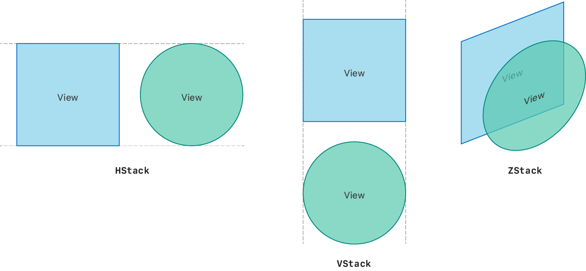
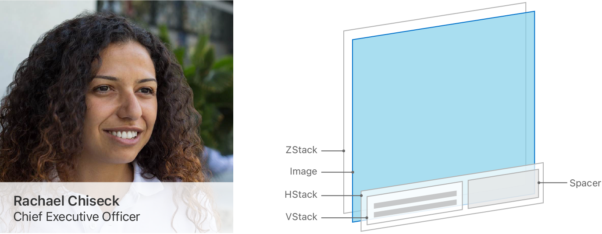
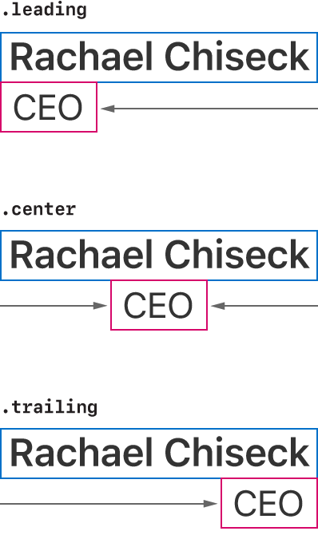
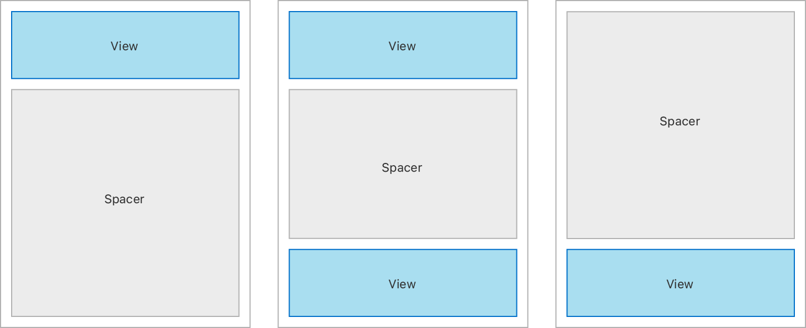

> 导航： [Technologies](../technologies.md) · [SwiftUI](../swiftui.md) · [Layout fundamentals](layout-fundamentals.md)

# 使用叠放视图构建布局

<sub>文章</sub>

用基础的容器视图组合出复杂的布局。

## 概述

单独来看，[HStack](hstack.md)、[VStack](vstack.md) 和 [ZStack](zstack.md) 都是简单的视图。[HStack](hstack.md) 把视图排成一条水平线，[VStack](vstack.md) 把它们排成一条垂直线，[ZStack](zstack.md) 则把视图一层层叠放在一起。



<sub>一张展示三种不同叠放视图的示意图：水平、垂直和深度。每个叠放包含一个方形和一个圆形，它们要么并排（水平）或上下（垂直）叠在一起，要么一层叠在另一层之上。</sub>

用默认参数初始化时，叠放视图会把内容居中对齐，并在每个包含的视图之间插入少量间距。但是，当你用视图修饰符、[Spacer](spacer.md) 和 [Divider](divider.md) 视图来组合并自定叠放时，就可以创建出高度灵活且复杂的布局。

### 规划你的布局层级

在开始把设计转化为代码时，就思考如何用各种叠放视图类型来构建布局。把复杂的设计拆解成更小、更简单的、可以用叠放视图搭建的部分。

例如，你可以用三个叠放视图来构建这个个人资料视图：



<sub>一张示意图，展示一个通用的用户资料布局可以如何利用叠放视图。图中把渲染后的布局与一张分解的 3D 插图并排放置，插图显示视图层级结构的四层视图彼此叠放。层级结构的最底层是 ZStack；其上是 Image 视图，然后是一个 HStack，最高层则是 VStack 和 Spacer 视图。</sub>

一个 [ZStack](zstack.md) 包含一个显示个人资料照片的 [Image](image.md) 视图，上面叠放着一个半透明的 [HStack](hstack.md)。这个 [HStack](hstack.md) 里有一个包含一对 [Text](text.md) 视图的 [VStack](vstack.md)，而 [Spacer](spacer.md) 视图把 [VStack](vstack.md) 推向前导一侧。

创建这个叠放视图的方式如下：

```swift
struct ProfileView: View {
    var body: some View {
        ZStack(alignment: .bottom) {
            Image("ProfilePicture")
                .resizable()
                .aspectRatio(contentMode: .fit)
            HStack {
                VStack(alignment: .leading) {
                    Text("Rachael Chiseck")
                        .font(.headline)
                    Text("Chief Executive Officer")
                        .font(.subheadline)
                }
                Spacer()
            }
            .padding()
            .foregroundColor(.primary)
            .background(Color.primary
                            .colorInvert()
                            .opacity(0.75))
        }
    }
}
```

### 用对齐和间隔视图定位视图

结合使用 `alignment` 属性、[Spacer](spacer.md) 和 [Divider](divider.md) 视图，可以对齐叠放视图内的所有包含视图。

在前面的示例布局中，包含两个 [Text](text.md) 视图的 [VStack](vstack.md) 使用了 [leading](horizontalalignment/leading.md) 对齐：



<sub>一张示意图，展示在垂直叠放视图中以三种不同方式对齐两个视图：前导对齐，两个视图都对齐到叠放的前缘；居中对齐，两个视图在叠放中居中；最后是后缘对齐，两个视图都与后缘对齐。</sub>

`alignment` 属性并不决定 [VStack](vstack.md) 在其容器中的位置；它决定的是 [VStack](vstack.md) 内部各视图的位置。

[VStack](vstack.md) 的 `alignment` 属性只作用于所含控制的水平对齐，使用 [HorizontalAlignment](horizontalalignment.md)。类似地，[HStack](hstack.md) 的 `alignment` 属性只通过 [VerticalAlignment](verticalalignment.md) 控制垂直对齐。最后，你可以用 [Alignment](alignment.md) 沿两个轴对齐 [ZStack](zstack.md) 内的视图。

使用 [Spacer](spacer.md) 视图沿 [HStack](hstack.md) 或 [VStack](vstack.md) 的主轴对齐视图。间隔视图会扩展以填满所有可用空间，并把内容与其他视图或叠放的边缘推开。



<sub>一张示意图，展示在三个垂直叠放视图中使用间隔视图。第一个叠放展示间隔视图把另一个视图推到其容器的顶部。第二个叠放展示间隔视图把两个视图推开，最终两个视图分别对齐到容器的顶部和底部。第三个叠放展示间隔视图把另一个视图推到其容器的底部。</sub>

[Divider](divider.md) 视图也会在叠放的子视图之间添加空间，但只插入足够画一条横跨叠放次轴的线的空间。它们不会扩展以填满可用空间。

### 创建自适应布局而非显式布局

只要有可能，就定义结构和层级，而不是显式地定位视图框架。不要为视图使用显式的高度和宽度，而是让它们扩展以填满可用空间。你构建的自适应布局更容易适配不同的设备尺寸和平台。

通过显式操纵 [Text](text.md) 视图的框架，用两个叠放视图而不是三个来创建本文的示例布局是可行的。虽然输出看起来可能一样，但实现它的代码更脆弱，而且可能无法在具有不同尺寸类别的设备间良好缩放。

你可能确实需要用 [frame(width:height:alignment:)](<view/frame(width_height_alignment_).md>) 或 [position(x:y:)](<view/position(x_y_).md>) 之类的视图修饰符对使用显式调整的布局作出调整，但只有当你无法以自适应、灵活的方式实现想要的布局时才考虑这样做。有关对视图布局进行微调的更多信息，参见[对视图位置进行微调](making-fine-adjustments-to-a-view-s-position.md)。

### 以其他方式添加层次感

在某些情况下，使用 [overlay(_:alignment:)](<view/overlay(__alignment_).md>) 和 [background(_:alignment:)](<view/background(__alignment_).md>) 视图修饰符来为布局添加层次感，比使用 [ZStack](zstack.md) 更合理。background 视图修饰符把另一个视图放在被修饰视图的背后，而 overlay 则把一个视图放在其上方。

在基于叠放的方案和视图修饰符方案之间做选择时，依据是你想如何确定最终布局的尺寸。如果你的布局中有一个决定布局尺寸的主导视图，就在该视图上使用 [overlay(_:alignment:)](<view/overlay(__alignment_).md>) 或 [background(_:alignment:)](<view/background(__alignment_).md>) 视图修饰符。如果你希望最终视图的尺寸来自所有包含视图的聚合，就使用 [ZStack](zstack.md)。

例如，下面的代码把一个 `ProfileDetail` 视图叠放在 [Image](image.md) 视图上方：

```swift
struct ProfileViewWithOverlay: View {
    var body: some View {
        VStack {
            Image("ProfilePicture")
                .resizable()
                .aspectRatio(contentMode: .fit)
                .overlay(ProfileDetail(), alignment: .bottom)
        }
    }
}

struct ProfileDetail: View {
    var body: some View {
        HStack {
            VStack(alignment: .leading) {
                Text("Rachael Chiseck")
                    .font(.headline)
                Text("Chief Executive Officer")
                    .font(.subheadline)
            }
            Spacer()
        }
        .padding()
        .foregroundColor(.primary)
        .background(Color.primary
                        .colorInvert()
                        .opacity(0.75))
    }
}
```

## 另请参阅

### 在一个维度上静态排列视图

- [HStack](hstack.md) — 一种把子视图排成水平线的视图。
- [VStack](vstack.md) — 一种把子视图排成垂直线的视图。
