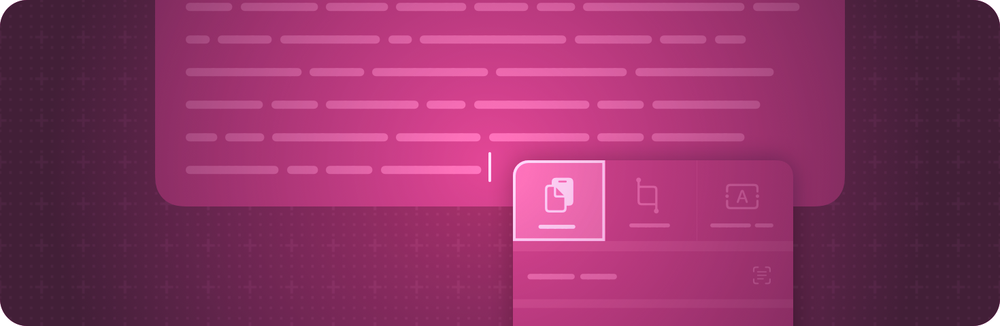

> 导航：[技术](../technologies.md) · [SwiftUI](../swiftui.md)

# 剪贴板

API 集合

让人们能够通过发出拷贝和粘贴命令来移动或复制条目。

## 概述

当人们发出标准的「拷贝」和「剪切」命令时，他们期望把条目移动到系统的剪贴板（Clipboard），然后可以将这些条目粘贴到同一 App 中的其他位置或另一个 App 中。如果你添加了指示如何响应这些标准命令的视图修饰符，你的 App 就可以参与到这一活动中。

在你的拷贝和粘贴修饰符中，请提供或接受符合 [Transferable](../coretransferable/transferable.md) 协议的类型，或继承自 [NSItemProvider](../foundation/nsitemprovider.md) 类的类型。在可能的情况下，优先使用可传输条目。

## 主题

### 拷贝可传输条目

- [copyable(_:)](<view/copyable(__).md>) — 指定响应系统「拷贝」命令时要拷贝的条目列表。
- [cuttable(for:action:)](<view/cuttable(for_action_).md>) — 指定响应系统「剪切」命令时将条目移动到剪贴板的操作。
- [pasteDestination(for:action:validator:)](<view/pastedestination(for_action_validator_).md>) — 指定响应系统「粘贴」命令时将经过验证的条目添加到视图的操作。

### 使用条目提供器拷贝条目

- [onCopyCommand(perform:)](<view/oncopycommand(perform_).md>) — 添加一个为响应系统「拷贝」命令而执行的操作。
- [onCutCommand(perform:)](<view/oncutcommand(perform_).md>) — 添加一个为响应系统「剪切」命令而执行的操作。
- [onPasteCommand(of:perform:)](<view/onpastecommand(of_perform_).md>) — 添加一个为响应系统「粘贴」命令而执行的操作。
- [onPasteCommand(of:validator:perform:)](<view/onpastecommand(of_validator_perform_).md>) — 添加一个为响应系统「粘贴」命令而执行的操作，其中的条目由你验证。

## 另请参阅

### 事件处理

- [手势](gestures.md) — 定义从点按、点击和轻扫到精细手势的各种交互。
- [输入事件](input-events.md) — 响应来自键盘或触控栏等硬件设备的输入。
- [拖放](drag-and-drop.md) — 让人们能够通过将条目从一个位置拖到另一个位置来移动或复制条目。
- [焦点](focus.md) — 识别并控制哪个可见对象响应用户交互。
- [系统事件](system-events.md) — 对系统事件（例如打开 URL）作出反应。
