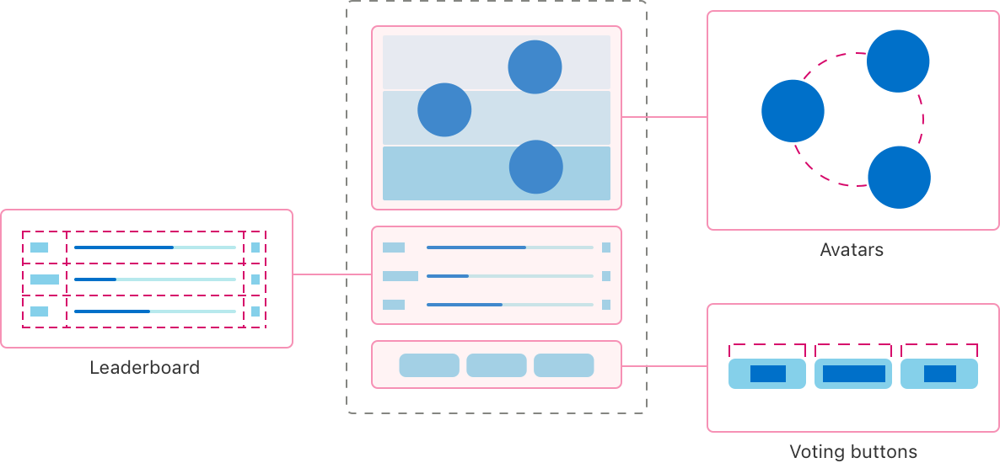
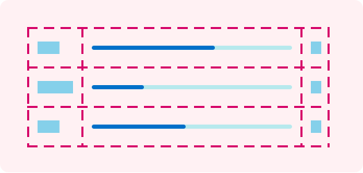
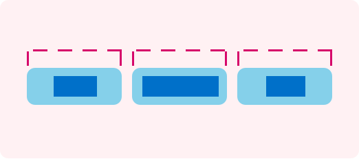
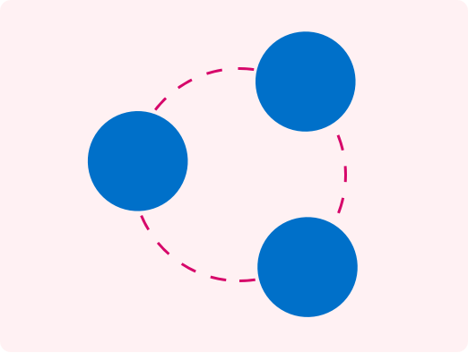

> 导航： [Technologies](../technologies.md) · [SwiftUI](../swiftui.md) · [Custom layout](custom-layout.md)

# 使用 SwiftUI 组合自定布局

<sub>示例代码</sub>

使用 SwiftUI 提供的布局工具来安排 App 界面中的视图。

## 概述

这个示例 App 通过构建一个让人们为自己最喜欢的宠物投票的界面，演示了 SwiftUI 提供的许多布局工具。这个 App 提供用于为特定宠物类型投票的按钮，并在排行榜上显示各个竞争者的票数和相对排名。它还显示宠物的头像，其排布方式反映当前排名。



<sub>一部显示该 App 布局的 iPhone，标出了三个主要部分。一组头像以圆形排布在顶部。排行榜网格位于中间。等宽的投票按钮位于底部。</sub>

> [!note] 注意
> 本示例代码项目关联 WWDC22 场次 [10056: Compose custom layouts with SwiftUI](https://developer.apple.com/wwdc22/10056/)。

### 用网格在两个维度上安排视图

为了在显示屏中间绘制一个显示票数和百分比的排行榜，这个示例使用了 [Grid](grid.md) 视图。



<sub>一个三行三列的网格。第一列和最后一列的每个单元格中都包含矩形。中间一列包含具有不同进度量的进度指示符。</sub>

网格在 [ForEach](foreach.md) 内部包含 [GridRow](gridrow.md)，行中的每个视图都会创建一个列单元格。因此第一个视图出现在第一列，第二个出现在第二列，依此类推。由于 [Divider](divider.md) 出现在网格行实例之外，它会创建一个横跨整个网格宽度的行。

```swift
Grid(alignment: .leading) {
    ForEach(model.pets) { pet in
        GridRow {
            Text(pet.type)
            ProgressView(
                value: Double(pet.votes),
                total: Double(max(1, model.totalVotes))) // 避免除以零。
            Text("\(pet.votes)")
                .gridColumnAlignment(.trailing)
        }

        Divider()
    }
}
```

这个示例以与前导边缘对齐的方式初始化网格，这种对齐方式会应用到网格中的每个单元格。与此同时，出现在票数单元格上的 [gridColumnAlignment(_:)](<view/gridcolumnalignment(__).md>) 视图修饰符会覆盖该列中单元格的对齐方式，改为使用后缘对齐。

### 创建自定的等宽布局

这个 App 在界面底部提供用于投票的按钮。



<sub>三个矩形排成一条水平线。每个矩形内包含一个更小的矩形。这些较小的矩形宽度各不相同。每个容器矩形上方的虚线表明这些较大的矩形彼此宽度相同。</sub>

为了确保所有按钮宽度相同、但又不会比最宽的按钮文字更宽，这个 App 创建了一个遵循 [Layout](layout.md) 协议的自定布局容器类型。等宽水平叠放（`MyEqualWidthHStack`）会测量其所有子视图的理想尺寸，并把最宽的理想尺寸提供给每个子视图。

这个自定叠放实现了协议要求的两个方法。第一个是 [sizeThatFits(proposal:subviews:cache:)](<layout/sizethatfits(proposal_subviews_cache_).md>)，它在给定一组子视图的情况下报告容器的大小。

```swift
func sizeThatFits(
    proposal: ProposedViewSize,
    subviews: Subviews,
    cache: inout Void
) -> CGSize {
    guard !subviews.isEmpty else { return .zero }

    let maxSize = maxSize(subviews: subviews)
    let spacing = spacing(subviews: subviews)
    let totalSpacing = spacing.reduce(0) { $0 + $1 }

    return CGSize(
        width: maxSize.width * CGFloat(subviews.count) + totalSpacing,
        height: maxSize.height)
}
```

这个方法把每个维度上的最大尺寸与子视图之间的水平间距相结合，得出容器的总尺寸。然后，[placeSubviews(in:proposal:subviews:cache:)](<layout/placesubviews(in_proposal_subviews_cache_).md>) 会告诉每个子视图在布局的边界内出现在哪里。

```swift
func placeSubviews(
    in bounds: CGRect,
    proposal: ProposedViewSize,
    subviews: Subviews,
    cache: inout Void
) {
    guard !subviews.isEmpty else { return }

    let maxSize = maxSize(subviews: subviews)
    let spacing = spacing(subviews: subviews)

    let placementProposal = ProposedViewSize(width: maxSize.width, height: maxSize.height)
    var nextX = bounds.minX + maxSize.width / 2

    for index in subviews.indices {
        subviews[index].place(
            at: CGPoint(x: nextX, y: bounds.midY),
            anchor: .center,
            proposal: placementProposal)
        nextX += maxSize.width + spacing[index]
    }
}
```

这个方法为子视图创建单一的大小提案，然后使用该提案以及一个随子视图变化的点，把按钮按默认间距排成一条水平线。

### 选择合适的视图

投票按钮的大小取决于它们所含文字的宽度。对于使用其他语言或使用更大字号的人来说，水平排列的按钮可能放不进显示屏。因此这个 App 使用 [ViewThatFits](viewthatfits.md)，让 SwiftUI 在按钮的水平排列和垂直排列之间选择一个能放进可用空间的方案。

```swift
ViewThatFits { // 选择第一个放得下的视图。
    MyEqualWidthHStack { // 如果放得下就水平排列……
        Buttons()
    }
    MyEqualWidthVStack { // ……否则垂直排列。
        Buttons()
    }
}
```

为了确保按钮在垂直排列时仍保持等宽特性，这个 App 使用了一个与水平版本非常相似的自定等宽垂直叠放（`MyEqualWidthVStack`）。

### 用缓存提高布局效率

[Layout](layout.md) 协议的方法都接受一个双向的 `cache` 参数。缓存提供了对可选存储空间的访问，这些存储空间在特定布局实例的所有方法之间共享。为了演示缓存的用法，这个示例 App 的等宽垂直布局创建了存储空间，在其 [sizeThatFits(proposal:subviews:cache:)](<layout/sizethatfits(proposal_subviews_cache_).md>) 和 [placeSubviews(in:proposal:subviews:cache:)](<layout/placesubviews(in_proposal_subviews_cache_).md>) 实现之间共享大小和间距的计算结果。

首先，该布局定义了一个用于存储的 `CacheData` 类型。

```swift
struct CacheData {
    let maxSize: CGSize
    let spacing: [CGFloat]
    let totalSpacing: CGFloat
}
```

然后它实现协议的可选方法 [makeCache(subviews:)](<layout/makecache(subviews_).md>)，为一组子视图执行计算，并返回一个上述类型的值。

```swift
func makeCache(subviews: Subviews) -> CacheData {
    let maxSize = maxSize(subviews: subviews)
    let spacing = spacing(subviews: subviews)
    let totalSpacing = spacing.reduce(0) { $0 + $1 }

    return CacheData(
        maxSize: maxSize,
        spacing: spacing,
        totalSpacing: totalSpacing)
}
```

如果子视图发生变化，SwiftUI 会调用布局的 [updateCache(_:subviews:)](<layout/updatecache(__subviews_).md>) 方法。该方法的默认实现会再次调用 [makeCache(subviews:)](<layout/makecache(subviews_).md>)，重新计算数据。随后，`sizeThatFits(proposal:subviews:cache:)` 和 `placeSubviews(in:proposal:subviews:cache:)` 方法利用各自的 `cache` 参数来获取数据。例如，`placeSubviews(in:proposal:subviews:cache:)` 会从缓存中读取大小和间距数组。

```swift
let maxSize = cache.maxSize
let spacing = cache.spacing
```

与之对比，等宽水平叠放没有使用缓存，而是在每次需要这些信息时重新计算大小和间距。

> [!note] 注意
> 大多数简单的布局（包括等宽垂直叠放）并不能从使用缓存中获得太多效率提升。开发者可以使用 Instruments 分析他们的 App，来判断某个特定的布局类型是否真正受益于缓存。

### 创建带偏移量的自定径向布局

为了把宠物头像显示在一个圆圈中，这个 App 定义了一个径向布局（`MyRadialLayout`）。



<sub>三个实心圆，沿一个更大的空心圆的轮廓等距放置。较大圆的轮廓使用虚线绘制。</sub>

与其他自定布局一样，这个布局也需要那两个必需的方法。对于 [sizeThatFits(proposal:subviews:cache:)](<layout/sizethatfits(proposal_subviews_cache_).md>)，该布局通过返回容器所提案的任何大小来填满可用空间。

```swift
proposal.replacingUnspecifiedDimensions()
```

这个 App 使用提案的 [replacingUnspecifiedDimensions(by:)](<proposedviewsize/replacingunspecifieddimensions(by_).md>) 方法把提案转换为具体大小。然后，为了放置子视图，该布局会旋转一个向量，把该向量平移到放置区域的中央，并将其用作子视图的锚点。

```swift
for (index, subview) in subviews.enumerated() {
    // 找到一个大小和旋转都合适的向量。
    var point = CGPoint(x: 0, y: -radius)
        .applying(CGAffineTransform(
            rotationAngle: angle * Double(index) + offset))

    // 把向量平移到区域的中央。
    point.x += bounds.midX
    point.y += bounds.midY

    // 放置子视图。
    subview.place(at: point, anchor: .center, proposal: .unspecified)
}
```

这个 App 应用到旋转上的偏移量考虑了当前排名，把排名较高的宠物放置在离界面顶部更近的位置。这个 App 使用 [LayoutValueKey](layoutvaluekey.md) 协议把排名存储在子视图上，然后在放置视图之前读取这些值来计算偏移量。

### 为布局之间的过渡添加动画

径向布局可以计算出一个偏移量，为除一组排名之外的所有排名创建合适的排布：当头像排在圆圈中时，无法显示三方并列的情况。为了解决这个问题，这个 App 会检测这种情况，并改用 [HStackLayout](hstacklayout.md) 类型把头像排成一行——它是内置 [HStack](hstack.md) 的一个遵循 [Layout](layout.md) 协议的版本。为了在这两种布局类型之间过渡，这个 App 使用了 [AnyLayout](anylayout.md) 类型。

```swift
let layout = model.isAllWayTie ? AnyLayout(HStackLayout()) : AnyLayout(MyRadialLayout())

Podium()
    .overlay(alignment: .top) {
        layout {
            ForEach(model.pets) { pet in
                Avatar(pet: pet)
                    .rank(model.rank(pet))
            }
        }
        .animation(.default, value: model.pets)
    }
```

由于这些视图的结构身份始终保持不变，[animation(_:value:)](<view/animation(__value_).md>) 视图修饰符会在布局类型之间创建带动画的过渡。由于计算出的偏移量依赖于相同的宠物数据，该修饰符也会为由排名变化引起的径向布局变化添加动画。

### 为这个 App 构建文档

要查看这个 App 定义的符号的更多信息，你可以构建该 App 的文档。在 Xcode 中打开项目，然后选择 Product \> Build Documentation。

有关如何在你自己的 App 中包含文档的信息，参见 [DocC](https://www.swift.org/documentation/docc)。

## 另请参阅

### 创建自定布局容器

- [Layout](layout.md) — 一种定义一组视图几何属性的类型。
- [LayoutSubview](layoutsubview.md) — 表示布局中某个子视图的代理。
- [LayoutSubviews](layoutsubviews.md) — 表示布局视图的子视图的一组代理值的集合。

## 下载

- [ComposingCustomLayoutsWithSwiftUI.zip](https://docs-assets.developer.apple.com/published/13cfc7c1502b/ComposingCustomLayoutsWithSwiftUI.zip)
