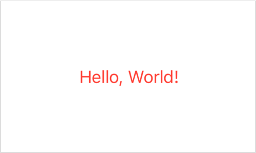
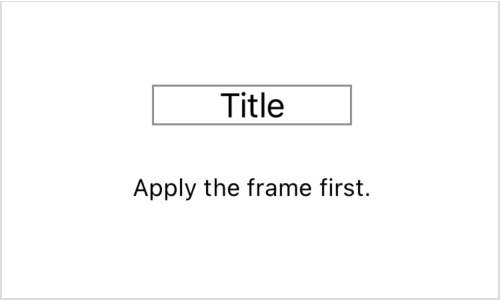
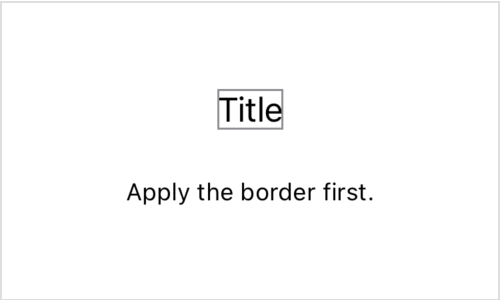
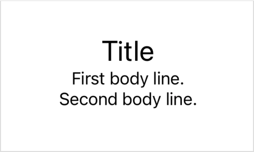

> 导航：[技术](../technologies.md) · [SwiftUI](../swiftui.md) · [视图基础](view-fundamentals.md)

# 配置视图

<sub>文章</sub>

通过应用视图修饰符来调整视图的特性。

## 概述

在 SwiftUI 中，你将视图组装成一个层级结构，用以描述你的 App 的用户界面。为了帮助你自定 App 视图的外观和行为，你需要使用_视图修饰符_。例如，你可以使用修饰符来：

- 为视图添加辅助功能特性。
- 调整视图的样式、布局和其他外观特性。
- 响应事件，例如拷贝和粘贴。
- 按条件呈现模态视图，例如弹出窗口。
- 配置支持视图，例如工具栏。

由于视图修饰符是行为由 [View](view.md) 协议提供的 Swift 方法，你可以将它们应用于任何符合 [View](view.md) 协议的类型。这包括 [Text](text.md)、[Image](image.md) 和 [Button](button.md) 等内置视图，以及你自己定义的视图。

### 用修饰符配置视图

与其他 Swift 方法一样，修饰符作用于一个实例——在本例中是某种视图——并可以选择接受输入参数。例如，你可以应用 [foregroundStyle(_:)](<view/foregroundstyle(__).md>) 修饰符来设置 [Text](text.md) 视图的颜色：

```swift
Text("Hello, World!")
    .foregroundStyle(.red) // 显示红色文本。
```

修饰符会返回一个包装原始视图的视图，并在视图层级结构中取代它。你可以把上面示例中的两行代码想象成解析为一个显示红色文本的单一视图。



虽然上面的代码符合 Swift 的规则，但对于刚接触 SwiftUI 的开发者来说，代码的结构可能比较陌生。SwiftUI 采用声明式方式：你在代码中与该视图在视图层级结构中的位置相对应的地方声明和配置视图。更多信息请参阅[声明自定义视图](declaring-a-custom-view.md)。

### 链式调用修饰符以实现复杂效果

你通常会把修饰符一个个依次调用，链接起来，每个修饰符包装前一个修饰符的结果。例如，你可以使用 [frame(width:height:alignment:)](<view/frame(width_height_alignment_).md>) 修饰符把一个文本视图包装在一个具有给定宽度的不可见框内以影响其布局，然后使用 [border(_:width:)](<view/border(__width_).md>) 修饰符在其周围绘制一个轮廓：

```swift
Text("Title")
    .frame(width: 100)
    .border(Color.gray)
```

应用修饰符的顺序很重要。例如，上面代码产生的边框会勾勒出框架的整个宽度。



<sub>一张显示字符串 Title 的文本视图截图，由一个灰色矩形勾勒轮廓，该矩形比它所包围的字符串更宽，在字符串两侧的矩形内部留有空白。图注写道：Apply the frame first。</sub>

通过把 frame 修饰符指定在 border 修饰符之后，SwiftUI 只会将边框应用于文本视图本身，而文本视图占用的空间永远不会超过渲染其内容所需的空间。

```swift
Text("Title")
    .border(Color.gray) // 这次先应用边框。
    .frame(width: 100)
```

把该视图包装在一个固定 100 点宽的不可见视图中，会影响复合视图的布局，但对边框没有影响。



<sub>一张显示字符串 Title 的文本视图截图，由一个紧密包围文本的灰色矩形勾勒轮廓。图注写道：Apply the border first。</sub>

### 配置子视图

你可以将 [View](view.md) 协议定义的任何视图修饰符应用于任何具体视图，即使该修饰符对其目标视图没有直接效果。修饰符的效果会传播到没有显式覆盖该修饰符的子视图。

例如，一个 [VStack](vstack.md) 实例本身只起垂直叠放其他视图的作用——它没有任何文本可显示。因此，对叠放应用 [font(_:)](<view/font(__).md>) 修饰符对叠放本身没有影响。然而，字体修饰符确实会应用于叠放的任何子视图，其中一些子视图可能会显示文本。不过，你可以通过向特定子视图添加另一个修饰符来局部覆盖叠放的修饰符：

```swift
VStack {
    Text("Title")
        .font(.title) // 覆盖此视图的字体。
    Text("First body line.")
    Text("Second body line.")
}
.font(.body) // 为叠放中的文本设置默认字体。
```



<sub>一张垂直叠放的文本视图截图。第一个文本以较大的标题字体显示，内容为 Title。其余文本以较小的正文（body）字体显示，内容分别为 First body line 和 Second body line。</sub>

### 使用视图专属修饰符

虽然许多视图类型依靠标准视图修饰符来进行自定和控制，但有些视图确实定义了特定于该视图类型的修饰符。你不能把这类修饰符用于适当视图类型以外的任何东西。例如，[Text](text.md) 定义了 [bold()](<text/bold().md>) 修饰符，作为为视图文本添加粗体效果的便捷方式。虽然你可以在任何视图上使用 [font(_:)](<view/font(__).md>)（因为它是 [View](view.md) 协议的一部分），但 [bold()](<text/bold().md>) 只能用于 [Text](text.md) 视图。因此，你不能在容器视图上使用它：

```swift
VStack {
    Text("Hello, world!")
}
.bold() // 失败，因为 'VStack' 没有 'bold' 修饰符。
```

在应用了另一个通用修饰符之后，你也不能在 [Text](text.md) 视图上使用它，因为通用修饰符返回的是[不透明类型](https://docs.swift.org/swift-book/LanguageGuide/OpaqueTypes.html)。例如，padding 修饰符的返回值不是 [Text](text.md)，而是一个无法接受 bold 修饰符的不透明结果类型：

```swift
Text("Hello, world!")
    .padding()
    .bold() // 失败，因为 'some View' 没有 'bold' 修饰符。
```

相反，应将 bold 修饰符直接应用于 [Text](text.md) 视图，然后再添加 padding：

```swift
Text("Hello, world!")
    .bold() // 成功。
    .padding()
```

## 另请参阅

### 修改视图

- [减少视图修饰符的维护工作](reducing-view-modifier-maintenance.md) — 把你经常重用的视图修饰符打包成一个自定义视图修饰符。
- [modifier(_:)](<view/modifier(__).md>) — 将修饰符应用于视图并返回一个新视图。
- [ViewModifier](viewmodifier.md) — 一种应用于视图或另一个视图修饰符的修饰符，会产生原始值的一个不同版本。
- [EmptyModifier](emptymodifier.md) — 空的（即恒等的）修饰符，在开发期间用于在编译期切换修饰符。
- [ModifiedContent](modifiedcontent.md) — 应用了修饰符的值。
- [EnvironmentalModifier](environmentalmodifier.md) — 一种必须先在环境中解析为具体修饰符才能使用的修饰符。
- [ManipulableModifier](manipulablemodifier.md)
- [ManipulableResponderModifier](manipulablerespondermodifier.md)
- [ManipulableTransformBindingModifier](manipulabletransformbindingmodifier.md)
- [ManipulationGeometryModifier](manipulationgeometrymodifier.md)
- [ManipulationGestureModifier](manipulationgesturemodifier.md)
- [ManipulationUsingGestureStateModifier](manipulationusinggesturestatemodifier.md)
- [Manipulable](manipulable.md) — 各种可操控相关类型的命名空间。
