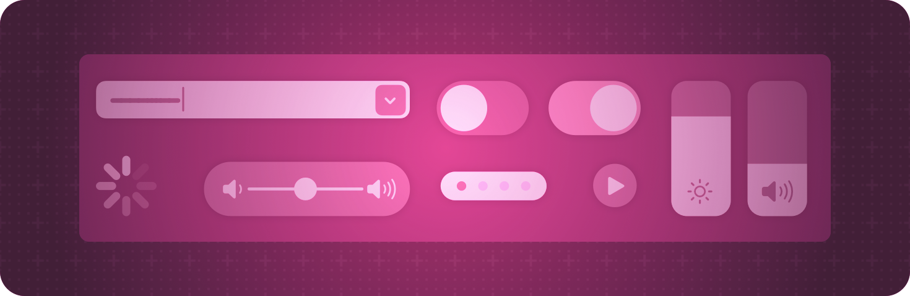

> 导航：[技术](../technologies.md) · [SwiftUI](../swiftui.md)

# 控制与指示符

API 集合

显示值并获取用户的选择。

## 概述

SwiftUI 提供的控制可针对每个平台和上下文实现特定的用户交互。例如，人们可以通过按钮和链接发起事件，或者用不同类型的选择器（picker）从一组离散值中进行选择。你还可以使用进度视图和仪表等指示符向用户显示信息。

在组合自定义视图时使用这些内置的控制和指示符，并设置它们的样式以匹配你的 App 用户界面的需要。有关设计指引，请参阅《人机界面指南》中的[菜单和操作](../design/human-interface-guidelines/menus-and-actions.md)、[选择和输入](../design/human-interface-guidelines/selection-and-input.md)以及[状态](../design/human-interface-guidelines/status.md)。

## 主题

### 创建按钮

- [Button](button.md) — 发起一个操作的控制。
- [buttonStyle(_:)](<view/buttonstyle(__).md>) — 将此视图内按钮的样式设置为具有自定义外观和标准交互行为的按钮样式。
- [buttonBorderShape(_:)](<view/buttonbordershape(__).md>) — 设置此视图内按钮的边框形状。
- [ButtonBorderShape](buttonbordershape.md) — 用于绘制按钮边框的形状。
- [buttonRepeatBehavior(_:)](<view/buttonrepeatbehavior(__).md>) — 设置此视图内的按钮在长时间交互时是否应重复触发其操作。
- [ButtonRepeatBehavior](buttonrepeatbehavior.md) — 控制按钮操作可重复性的选项。
- [buttonRepeatBehavior](environmentvalues/buttonrepeatbehavior.md) — 具有此关联环境的按钮在长时间交互时是否应重复触发其操作。
- [buttonSizing(_:)](<view/buttonsizing(__).md>) — 视图层级结构中按钮的首选尺寸调整行为。
- [ButtonSizing](buttonsizing.md) — `Button` 和其他类按钮控制的尺寸调整行为。
- [ButtonRole](buttonrole.md) — 一个描述按钮用途的值。

### 创建特殊用途的按钮

- [EditButton](editbutton.md) — 切换编辑模式环境值的按钮。
- [PasteButton](pastebutton.md) — 从剪贴板读取条目并将其传递给闭包的系统按钮。
- [RenameButton](renamebutton.md) — 触发标准重命名操作的按钮。

### 链接到其他内容

- [Link](link.md) — 用于导航到 URL 的控制。
- [ShareLink](sharelink.md) — 控制共享呈现的视图。
- [SharePreview](sharepreview.md) — 要在共享预览中显示的某种类型的表示。
- [TextFieldLink](textfieldlink.md) — 按下时请求用户输入文本的控制。
- [HelpLink](helplink.md) — 具有标准外观、可打开 App 专属帮助文档的按钮。

### 获取数值输入

- [Slider](slider.md) — 用于从有界线性值范围中选择一个值的控制。
- [Stepper](stepper.md) — 执行递增和递减操作的控制。
- [Toggle](toggle.md) — 在开和关状态之间切换的控制。
- [toggleStyle(_:)](<view/togglestyle(__).md>) — 设置视图层级结构中切换控件的样式。

### 从一组选项中选择

- [Picker](picker.md) — 用于从一组互斥的值中进行选择的控制。
- [pickerStyle(_:)](<view/pickerstyle(__).md>) — 设置此视图内选择器的样式。
- [horizontalRadioGroupLayout()](<view/horizontalradiogrouplayout().md>) — 将此视图内单选组样式选择器的样式设置为水平排布，单选按钮位于布局内部。
- [defaultWheelPickerItemHeight(_:)](<view/defaultwheelpickeritemheight(__).md>) — 设置默认的滚轮式选择器条目高度。
- [defaultWheelPickerItemHeight](environmentvalues/defaultwheelpickeritemheight.md) — 滚轮式选择器（例如日期选择器）中条目的默认高度。
- [paletteSelectionEffect(_:)](<view/paletteselectioneffect(__).md>) — 指定要应用于调色板条目的选择效果。
- [PaletteSelectionEffect](paletteselectioneffect.md) — 要应用于调色板条目的选择效果。

### 选择日期

- [DatePicker](datepicker.md) — 用于选择绝对日期的控制。
- [datePickerStyle(_:)](<view/datepickerstyle(__).md>) — 设置此视图内日期选择器的样式。
- [MultiDatePicker](multidatepicker.md) — 用于选择多个日期的控制。
- [calendar](environmentvalues/calendar.md) — 视图在处理日期时应使用的当前日历。
- [timeZone](environmentvalues/timezone.md) — 视图在处理日期时应使用的当前时区。

### 选择颜色

- [ColorPicker](colorpicker.md) — 用于从系统颜色选择器 UI 中选择颜色的控制。

### 指示值

- [Gauge](gauge.md) — 在某个范围内显示一个值的视图。
- [gaugeStyle(_:)](<view/gaugestyle(__).md>) — 设置此视图内仪表的样式。
- [ProgressView](progressview.md) — 显示任务完成进度的视图。
- [progressViewStyle(_:)](<view/progressviewstyle(__).md>) — 设置此视图内进度视图的样式。
- [DefaultDateProgressLabel](defaultdateprogresslabel.md) — 日期相关的进度视图使用的当前值标签的默认类型。
- [DefaultButtonLabel](defaultbuttonlabel.md) — 用于按钮的默认标签。

### 指示内容缺失

- [ContentUnavailableView](contentunavailableview.md) — 一个由标签和额外内容组成的界面，当你的 App 的内容对用户不可用时显示。

### 提供触感反馈

- [sensoryFeedback(_:trigger:)](<view/sensoryfeedback(__trigger_).md>) — 在提供的 `trigger` 值发生变化时播放指定的 `feedback`。
- [sensoryFeedback(trigger:_:)](<view/sensoryfeedback(trigger___).md>) — 在提供的 `trigger` 值发生变化后，播放 `feedback` 闭包返回的反馈。
- [sensoryFeedback(_:trigger:condition:)](<view/sensoryfeedback(__trigger_condition_).md>) — 在提供的 `trigger` 值发生变化且 `condition` 闭包返回 `true` 时播放指定的 `feedback`。
- [SensoryFeedback](sensoryfeedback.md) — 表示一种可播放的触感和/或音频反馈的类型。

### 设置控制的尺寸

- [controlSize(_:)](<view/controlsize(__).md>) — 设置此视图内控制的尺寸。
- [controlSize](environmentvalues/controlsize.md) — 应用于视图内控制的尺寸。
- [ControlSize](controlsize.md) — 可应用于视图内控制的尺寸类别，例如常规或小型。

## 另请参阅

### 视图

- [视图基础](view-fundamentals.md) — 使用视图层级结构定义你的 App 的视觉元素。
- [视图配置](view-configuration.md) — 调整层级结构中视图的特性。
- [视图样式](view-styles.md) — 为不同类型的视图应用内置和自定义的外观与行为。
- [动画](animations.md) — 创建流畅的视觉更新以响应状态变化。
- [文本输入与输出](text-input-and-output.md) — 显示带格式的文本，并获取用户的文本输入。
- [图像](images.md) — 向你的 App 的用户界面添加图像和符号。
- [菜单与命令](menus-and-commands.md) — 以节省空间、依赖上下文的方式提供对命令和控制的访问。
- [形状](shapes.md) — 用颜色、渐变或其他图案描边和填充内置及自定义形状。
- [绘图与图形](drawing-and-graphics.md) — 用图形效果和自定义绘图增强你的视图。
