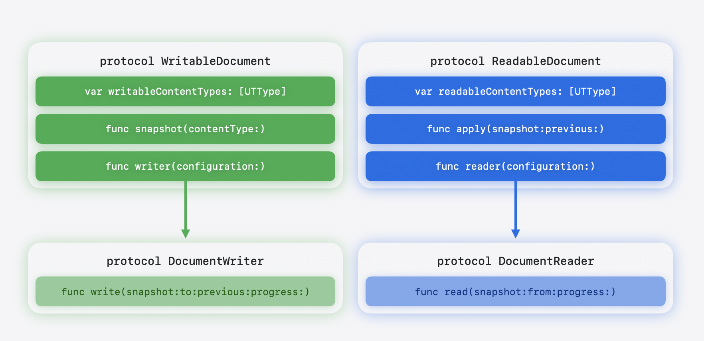

> 导航：[技术](../technologies.md) · [SwiftUI](../swiftui.md) · [文稿](documents.md)

# 创建基于文稿的 App

<sub>文章</sub>

构建让人们能够使用协调的文件访问来打开、编辑和储存文件的 App。

## 概述

借助基于文稿的 App，人们可以创建和管理自己的文件，例如文本文稿、绘图和电子表格。[Document](document.md) 协议——在 iOS 27、macOS 27 和 visionOS 27 中可用——让你可以直接访问文稿的文件 URL，从而：

- 读取和写入文件
- 将 URL 传递给 Core Graphics、AVFoundation 或 PDFKit 等其他框架，以便在长时间操作期间报告进度
- 使用由 [makeFileCoordinator()](<urldocumentconfiguration/makefilecoordinator().md>) 提供的 `FileCoordinator` 安全地访问文件

[Document](document.md) 组合协议本身没有任何要求，但符合 [ReadableDocument](readabledocument.md) 和 [WritableDocument](writabledocument.md)。有了它，你就可以像下面这样方便地声明你的类型的一致性：

```swift
 @Observable
 final class TextDocument: Document { }
```

由于 [Document](document.md) 是引用类型，SwiftUI 不需要在每次更改时重新创建文稿，而且你可以使用 [@Observable](https://developer.apple.com/documentation/observation/observable) 宏来观察各个属性的更改。

下面的示意图展示了文稿协议与读取器和写入器协议之间的关系：



<sub>示意图并排展示两个文稿协议。左侧的可写文稿协议列出三项要求，并用一个箭头连接到其下方的文稿写入器协议。右侧的可读文稿协议列出三项要求，并用一个箭头连接到其下方的文稿读取器协议。</sub>

## 搭建基于文稿的 App

要启用文稿基础设施——自动储存、文件协调、文件对话框、键盘快捷键、冲突解决等——请将 [DocumentGroup](documentgroup.md) 或 [DocumentGroupLaunchScene](documentgrouplaunchscene.md) 用作 App 的第一个场景。在 iOS 中，在信息属性列表里将 [UISupportsDocumentBrowser](https://developer.apple.com/documentation/bundleresources/information-property-list/uisupportsdocumentbrowser) 设为 `YES`，以呈现文稿浏览器。

一个最小的基于文稿的 App 如下所示：

```swift
@main
struct NotesApp: App {
    var body: some Scene {
        DocumentGroup { document in
            TextEditorView(document: document)
        } makeDocument: { configuration, context in
            TextDocument(configuration: configuration, context)
        }
    }
}
```

[DocumentGroup](documentgroup.md) 的初始化方法接受两个闭包：一个 `editor` 或 `viewer` 闭包参数，用于为打开的文稿构建用户界面；以及一个 `makeDocument` 或 `makeReadableDocument` 闭包，用于返回文稿实例。

SwiftUI 传递给你文稿初始化方法的 [URLDocumentConfiguration](urldocumentconfiguration.md) 类会公开文件 URL、[lastContentModificationDate](urldocumentconfiguration/lastcontentmodificationdate.md)，以及 [makeFileCoordinator()](<urldocumentconfiguration/makefilecoordinator().md>)——后者会创建一个文件协调器，用于在读取和写入之外访问文稿的 URL。此外，它还符合 [`Observable`](https://developer.apple.com/documentation/observation/observable)，因此你的代码可以对更改作出响应。

在 iOS 中，使用 [DocumentGroupLaunchScene](documentgrouplaunchscene.md) 来自定义文稿浏览器启动屏幕，例如添加自定义背景和多个创建按钮，如下例所示：

```swift
@main
struct NotesApp: App {
    var body: some Scene {
        DocumentGroupLaunchScene("My Notes and Lists") {
            NewDocumentButton("New Note", source: .note)
            NewDocumentButton("New List", source: .list)
        } background: {
            LinearGradient(
                colors: [.brandColorGradientStart, .brandColorGradientEnd],
                startPoint: .top,
                endPoint: .bottom
            )
        }

        DocumentGroup { document in
            TextEditorView(document: document)
        } makeDocument: { configuration, context in
            TextDocument(configuration: configuration, context)
        }
    }
}

extension DocumentCreationSource {
    static let note = DocumentCreationSource(id: "note")
    static let list = DocumentCreationSource(id: "list")
}
```

在你的 `TextDocument` 初始化方法中，检查 [creationSource](documentcreationcontext/creationsource.md) 来确定用户点按了哪个按钮，并将文稿设置为列表或笔记。

## 在呈现文稿前显示自定义界面

由于 `makeDocument` 和 `makeReadableDocument` 闭包是异步的，你还可以暂停文稿的创建，以便在文稿出现之前显示自定义用户界面——例如模板选择器、配置向导或导入预览。有关使用 [CheckedContinuation](https://developer.apple.com/documentation/swift/checkedcontinuation) 结构在文稿打开前呈现模板选择器或其他设置界面的端到端示例，请参阅 [NewDocumentButton](newdocumentbutton.md)。

## 创建简单的文稿

要让你的模型符合 [Document](document.md)，请提供符合 [DocumentReader](documentreader.md) 和 [DocumentWriter](documentwriter.md) 协议的值。在大多数情况下，使用 SwiftUI 提供的 [FileWrapperDocumentReader](filewrapperdocumentreader.md) 和 [FileWrapperDocumentWriter](filewrapperdocumentwriter.md) 便捷类型来代你处理写入和读取。

声明 [readableContentTypes](readabledocument/readablecontenttypes.md) 来列出你的文稿可以打开的格式，并声明 [writableContentTypes](writabledocument/writablecontenttypes.md) 来列出它可以储存的格式。文稿浏览器会查询 [readableContentTypes](readabledocument/readablecontenttypes.md) 来允许打开受支持类型的文件；储存面板则使用 [writableContentTypes](writabledocument/writablecontenttypes.md) 作为格式选项。

[DocumentReader](documentreader.md) 和 [DocumentWriter](documentwriter.md) 是相互独立的协议。储存时，SwiftUI 会调用 [snapshot(contentType:)](<writabledocument/snapshot(contenttype_).md>) 来捕获当前状态，然后在后台将结果传递给 [DocumentWriter](documentwriter.md)。读取时，[DocumentReader](documentreader.md) 在后台运行并返回一个快照，SwiftUI 再通过 [apply(snapshot:previous:)](<readabledocument/apply(snapshot_previous_).md>) 将该快照交付给你的文稿。

快照表示文稿在某一时刻的状态。一个文稿类型可以为读取和写入使用不同的快照类型。任何东西都可以用作快照，包括文稿类型本身。SwiftUI 会自动协调读取和写入的文件访问。

定义一个符合 `Document` 的 [Observable](../observation/observable.md) 类，如下所示：

```swift
import SwiftUI
import UniformTypeIdentifiers

@Observable
final class TextDocument: Document {
    static let readableContentTypes = [UTType.plainText]

    var text: String
    var configuration: URLDocumentConfiguration

    init(configuration: URLDocumentConfiguration) {
        self.text = ""
        self.configuration = configuration
    }

    // 返回一个将 `FileWrapper` 转换为快照的读取器。

    func reader(
        configuration: sending ReadConfiguration
    ) -> sending FileWrapperDocumentReader<String> {
        FileWrapperDocumentReader(configuration) { fileWrapper in
            if let data = fileWrapper.regularFileContents,
               let text = String(data: data, encoding: .utf8) {
                return text
            }
            return ""
        }
    }

    @MainActor
    func apply(snapshot: String, previous: String?) async throws {
        self.text = snapshot
    }

    // 返回一个将快照转换为 `FileWrapper` 的写入器。

    func writer(
        configuration: sending WriteConfiguration
    ) -> sending FileWrapperDocumentWriter<String> {
        FileWrapperDocumentWriter(configuration) { snapshot, previous in
            let data = Data(snapshot.utf8)
            return FileWrapper(regularFileWithContents: data)
        }
    }

    @MainActor
    func snapshot(contentType: UTType) async throws -> sending String {
        text
    }
}
```

有了这个文稿模型和上一节中的 [DocumentGroup](documentgroup.md) 设置，你就拥有了一个具备打开和储存支持的完整基于文稿的 App。

当 SwiftUI 自动储存文稿，或者用户按下 Command-S 时，它会在主要 Actor 上调用 [snapshot(contentType:)](<writabledocument/snapshot(contenttype_).md>) 来捕获当前状态，然后调用 `writer(configuration:)` 来获取 [DocumentWriter](documentwriter.md)。随后，SwiftUI 会在后台以协调的文件访问将快照和目标 URL 传递给 `write(snapshot:to:previous:progress:)`。

读取的工作方式相同：SwiftUI 调用 `reader(configuration:)`，在后台将文件 URL 传递给 `read(from:progress:)`，然后通过 [apply(snapshot:previous:)](<readabledocument/apply(snapshot_previous_).md>) 将快照交付给你的文稿。

## 支持只读文稿

要让你的 App 显示只读文稿，请符合 [ReadableDocument](readabledocument.md)，并使用会产生符合 `ReadableDocument` 的值的初始化方法：

```swift
DocumentGroup { document in
    PDFViewer(document: document)
} makeReadableDocument: { configuration, context in
    PDFDocument(configuration: configuration, context: context)
}
@Observable
final class PDFDocument: ReadableDocument { /* ... */}
```

在信息属性列表里将 [CFBundleTypeRole](https://developer.apple.com/documentation/bundleresources/information-property-list/cfbundleurltypes/cfbundletyperole) 设为 `Viewer`，以表明你的 App 不编辑这种文件类型。对于能够编辑文稿的 App，则将该角色设为 `Editor`。

## 注册撤销操作

SwiftUI 通过撤销操作来跟踪未保存的更改，因此每个基于文稿的 App 都需要注册这些操作。从环境中读取活跃的 [UndoManager](https://developer.apple.com/documentation/foundation/undomanager)，并通过注册撤销操作的方法来更新文稿。从撤销闭包中调用同一个方法也会自动注册重做操作，如下所示：

```swift
struct TextEditorView: View {
    @Bindable var document: TextDocument
    @Environment(\.undoManager) private var undoManager

    var body: some View {
        TextEditor(text: $document.text)
              .onChange(of: document.text) { oldValue, _ in
                  undoManager?.registerUndo(withTarget: document) { document in
                      document.text = oldValue
                  }
            }
    }
}
```

## 处理软件包文稿

软件包是系统呈现为单个项目的目录。人们在访达、「文件」App 和文稿浏览器中会看到一个图标，可以拖动、共享、备份和同步它。在内部，你的软件包可以存放你需要的任何文件，包括元数据、页面、图层或嵌入的媒体。

从 [FileWrapperDocumentReader](filewrapperdocumentreader.md) 和 [FileWrapperDocumentWriter](filewrapperdocumentwriter.md) 开始。只有当你需要流式传输数据或直接访问 URL，或者想优化磁盘操作时，才使用自定义的 [DocumentReader](documentreader.md) 和 [DocumentWriter](documentwriter.md)。

下面的示例展示了一个最小的笔记本文稿。它在磁盘上的布局如下：

```swift
MyNotebook.notebook/
├── metadata.json        ← title + ordered page IDs
└── pages/
    ├── <uuid>.txt       ← each page is plain text
    └── …
```

```swift
import UniformTypeIdentifiers

@Observable
final class NotebookDocument: Document {
    static let readableContentTypes: [UTType] = [.notebook]   // 记得在 Info.plist 中声明

    var metadata: NotebookMetadata
    var pages: [UUID: String]

    init() {
        let initialPageID = UUID()
        self.metadata = NotebookMetadata(
            title: "Untitled", pageOrder: [initialPageID]
        )
        self.pages = [initialPageID: ""]
    }

    func reader(
        configuration: sending ReadConfiguration
    ) -> sending FileWrapperDocumentReader<NotebookSnapshot> {
        FileWrapperDocumentReader(configuration) { directory in
            let children = directory.fileWrappers ?? [:]

            guard let metadataData = children["metadata.json"]?.regularFileContents else {
                throw CocoaError(.fileReadCorruptFile)
            }
            let metadata = try JSONDecoder().decode(NotebookMetadata.self, from: metadataData)

            guard let pagesDirectory = children["pages"]?.fileWrappers else {
                throw CocoaError(.fileReadCorruptFile)
            }

            var pages: [UUID: String] = [:]
            for (filename, wrapper) in pagesDirectory {
                guard let data = wrapper.regularFileContents
                else { continue }
                let withoutExtension = filename.replacingOccurrences(
                    of: ".txt", with: ""
                )
                if let id = UUID(uuidString: withoutExtension) {
                    pages[id] = String(decoding: data, as: UTF8.self)
                }
            }

            return NotebookSnapshot(metadata: metadata, pages: pages)
        }
    }

    func writer(
        configuration: sending WriteConfiguration
    ) -> sending FileWrapperDocumentWriter<NotebookSnapshot> {
        FileWrapperDocumentWriter(configuration) { snapshot, _ in
            let metadata = try JSONEncoder().encode(snapshot.metadata)
            let metadataWrapper = FileWrapper(regularFileWithContents: metadata)

            var pageNamesToFileWrappers: [String: FileWrapper] = [:]
            for (pageID, content) in snapshot.pages {
                pageNamesToFileWrappers["\(pageID.uuidString).txt"] =
                    FileWrapper(regularFileWithContents: Data(content.utf8))
            }
            let pagesDirectory = FileWrapper(directoryWithFileWrappers: pageNamesToFileWrappers)

            let root = FileWrapper(directoryWithFileWrappers: [
                "metadata.json": metadataWrapper,
                "pages": pagesDirectory,
            ])
            return root
        }
    }

    @MainActor
    func snapshot(contentType: UTType) async throws -> sending NotebookSnapshot {
        NotebookSnapshot(metadata: metadata, pages: pages)
    }

    @MainActor
    func apply(
        snapshot: sending NotebookSnapshot,
        previous: sending NotebookSnapshot?
    ) async throws {
        metadata = snapshot.metadata
        pages = snapshot.pages
    }
}

struct NotebookMetadata: Codable, Sendable {
    var title: String
    var pageOrder: [UUID]
}

struct NotebookSnapshot: Sendable {
    var metadata: NotebookMetadata
    var pages: [UUID: String]
}

extension UTType {
    static let notebook = UTType(exportedAs: "com.example.notebook")
}
```

[FileWrapper](https://developer.apple.com/documentation/foundation/filewrapper) 类按需加载文件内容。当你打开一个软件包时，[`FileWrapper`](https://developer.apple.com/documentation/foundation/filewrapper) 会读取目录结构，但不会加载任何文件内容。每个文件只有在你访问它的 [regularFileContents](https://developer.apple.com/documentation/foundation/filewrapper/regularfilecontents) 时才会加载，这使得 [`FileWrapper`](https://developer.apple.com/documentation/foundation/filewrapper) 非常适合只需要软件包一部分的场景。如果你只需要一个元数据文件、一张缩略图或前几页，遍历 [fileWrappers](https://developer.apple.com/documentation/foundation/filewrapper/filewrappers) 找到所需内容，并只对这些文件调用 [`regularFileContents`](https://developer.apple.com/documentation/foundation/filewrapper/regularfilecontents)。

> [!important] 重要
> 如果 App 决定以惰性方式读取文稿——例如，只读取某一时刻用户可见的软件包的一部分——那么 App 需要准备好应对后续从文件包装器读取可能失败的情况，因为文件可能已经消失或被移动。从 `FileWrapper` 读取时始终要处理错误。

## 实现自定义读取器和写入器

[FileWrapperDocumentReader](filewrapperdocumentreader.md) 和 [FileWrapperDocumentWriter](filewrapperdocumentwriter.md) 都将读取和写入委托给 [`FileWrapper`](https://developer.apple.com/documentation/foundation/filewrapper)。对于需要更多控制的文稿，例如流式读取、自定义写入逻辑，或直接通过 URL 访问 Core Graphics、AVFoundation 或 PDFKit 等框架，请实现你自己的符合 [DocumentReader](documentreader.md) 和 [DocumentWriter](documentwriter.md) 的类型。

下面的示例展示了一个使用 Core Graphics 加载和保存可调压缩质量的 JPEG 文件的图像文稿：

```swift
import SwiftUI
import CoreGraphics
import UniformTypeIdentifiers

struct ImageSnapshot {
    var image: CGImage?
    var compressionQuality: Double
}

@Observable
final class ImageDocument: Document {
    static let readableContentTypes: [UTType] = [.jpeg]

    var displayImage: CGImage?
    var compressionQuality: Double = 0.9

    init() { }
}
```

`ImageDocument.Reader` 通过实现 `read(from:progress:)` 来符合 [DocumentReader](documentreader.md)，它将源 URL 传递给 `CGImageSourceCreateWithURL(_:_:)`，由 Core Graphics 处理格式检测和解码，如下所示：

```swift
extension ImageDocument {
    struct Reader: DocumentReader {
        @concurrent 
        func read(from source: URL, progress: consuming Subprogress) async throws -> sending ImageSnapshot {
            guard let imageSource = CGImageSourceCreateWithURL(source as CFURL, nil),
                  let image = CGImageSourceCreateImageAtIndex(imageSource, 0, nil) else {
                throw CocoaError(.fileReadCorruptFile)
            }
            return ImageSnapshot(image: image, compressionQuality: 0.9)
        }
    }

    func reader(configuration: sending ReadConfiguration) -> sending Reader {
        Reader()
    }

    @MainActor
    func apply(snapshot: sending ImageSnapshot, previous: sending ImageSnapshot?) async throws {
        self.compressionQuality = snapshot.compressionQuality
        self.displayImage = snapshot.image
    }
}
```

SwiftUI 每次需要读取或重新读取文稿时都会调用 `reader(configuration:)`，例如在文稿打开时，或在另一个进程更改了文稿时。[DocumentReadConfiguration](documentreadconfiguration.md) 提供内容类型，文件 URL 则作为 `source` 参数传递给 `read(from:progress:)`。

接下来，下面的代码示例展示了如何使用 `CGImageDestination` 将图像编码为 JPEG 并应用快照的压缩质量。`ImageDocument.Writer` 通过实现 `write(snapshot:to:previous:progress:)` 来符合 [DocumentWriter](documentwriter.md)，它将目标 URL 传递给 `CGImageDestinationCreateWithURL(_:_:_:_:)`，由 Core Graphics 处理 JPEG 编码和压缩。

```swift
extension ImageDocument {
    struct Writer: DocumentWriter {
        @concurrent
        func write(
            content snapshot: sending ImageSnapshot, to destination: URL,
            previous: sending ImageSnapshot?, progress: consuming Subprogress
        ) async throws {
            guard let image = snapshot.image else { return }

            guard let imageDestination = CGImageDestinationCreateWithURL(
                destination as CFURL, UTType.jpeg.identifier as CFString, 1, nil
            ) else {
                throw CocoaError(.fileWriteUnknown)
            }

            let options: [CFString: Any] = [
                kCGImageDestinationLossyCompressionQuality: snapshot.compressionQuality
            ]
            CGImageDestinationAddImage(imageDestination, image, options as CFDictionary)

            guard CGImageDestinationFinalize(imageDestination) else {
                throw CocoaError(.fileWriteUnknown)
            }
        }
    }

    func writer(configuration: sending WriteConfiguration) -> sending Writer {
        Writer()
    }

    @MainActor
    func snapshot(contentType: UTType) async throws -> sending ImageSnapshot {
        ImageSnapshot(image: displayImage, compressionQuality: compressionQuality)
    }
}
```

`previous` 参数包含上一次成功写入的快照。对于 JPEG、文本文件或 PDF 这类单文件文稿，你可以忽略 `previous`，因为通常可以重写整个文件。对于软件包文稿，你可以将 `previous` 与当前快照进行比较，只写入发生更改的文件。

> [!important] 重要
> [snapshot(contentType:)](<writabledocument/snapshot(contenttype_).md>) 方法在主线程上运行。请尽量保持它轻量，并将序列化放在 [DocumentWriter](documentwriter.md) 中进行，因为写入在后台运行。快照负责捕获保存的_内容_；写入器负责处理保存的_方式_。

同样的方法适用于任何通过 URL 读取和写入文件的框架，包括 AVFoundation 的 [AVAssetExportSession](https://developer.apple.com/documentation/avfoundation/avassetexportsession)、PDFKit 的 [PDFDocument(url:)](<https://developer.apple.com/documentation/pdfkit/pdfdocument/init(url:)>)，或任何接受文件路径的 C 库。

## 导出文稿

要将文稿导出到新位置或新格式，请使用 [fileExporter(isPresented:document:contentType:defaultFilename:onCompletion:onCancellation:)](<view/fileexporter(ispresented_document_contenttype_defaultfilename_oncompletion_oncancellation_).md>) 视图修饰符，如下所示：

```swift
final class TextDocument: WritableDocument { /* ... */ }

struct TextEditorView: View {
    @Bindable var document: TextDocument
    @State private var isExporting = false

    var body: some View {
        TextEditor(text: $document.text)
            .toolbar {
                Button("Export…") { isExporting = true }
            }
            .fileExporter(
                isPresented: $isExporting, document: document,
                contentType: .utf8PlainText, defaultFilename: "Text"
            ) { result in
                switch result {
                case .success(let url):
                    // 在生产环境中，请使用 os 框架中的 Logger 而不是 print。
                    print("Exported to \(url)")
                case .failure(let error):
                    print("Export failed: \(error)")
                }
            }
    }
}
```

有关声明自定义文件格式、在读取和写入生命周期方法之外访问文件，以及为长时间操作报告进度的信息，请参阅[处理高级文稿场景](handling-advanced-document-scenarios.md)。

## 另请参阅

### 创建文稿

- [处理高级文稿场景](handling-advanced-document-scenarios.md) — 扩展你的基于文稿的 App，以支持自定义文件格式、按需文件访问和进度报告。
- [更新你的基于文稿的 App](updating-your-document-based-app.md) — 迁移现有 App，以采用基于 URL 的文稿读取和写入，并结合 Swift 并发。
- [使用 SwiftUI 构建基于文稿的 App](building-a-document-based-app-with-swiftui.md) — 在多平台 App 中创建、保存和打开文稿。
- [使用 SwiftData 构建基于文稿的 App](building-a-document-based-app-using-swiftdata.md) — 跟随 WWDC 讲者一起用 SwiftData 改造一个 App。
- [DocumentGroup](documentgroup.md) — 一个场景，支持打开、创建和保存文稿。
