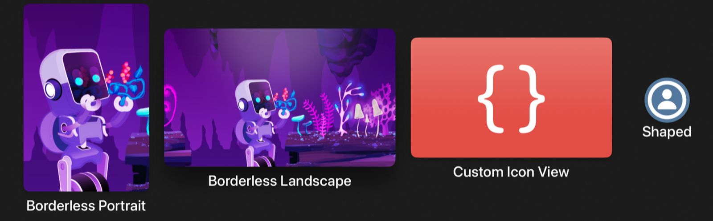
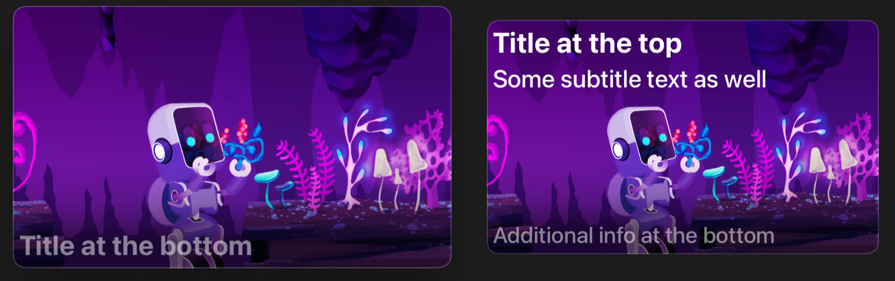
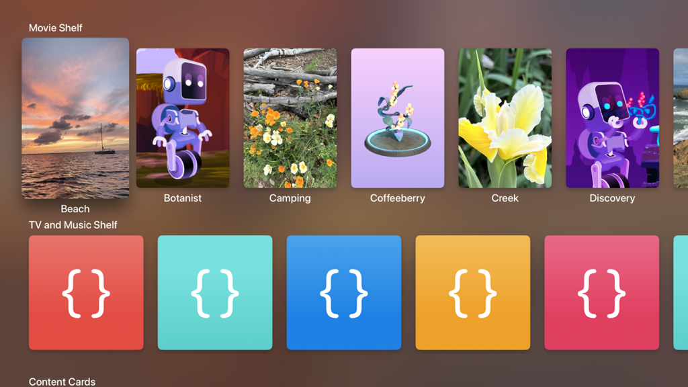
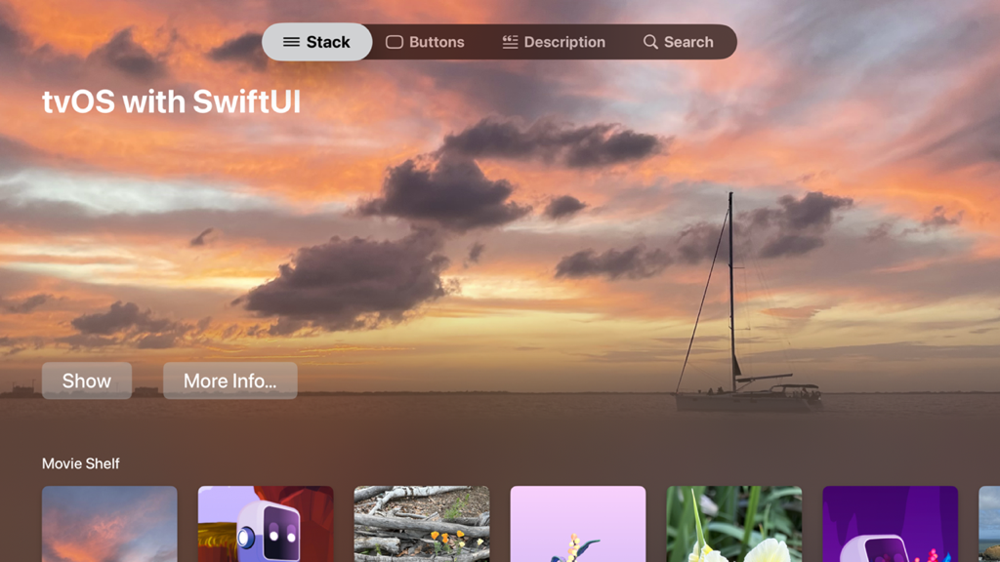
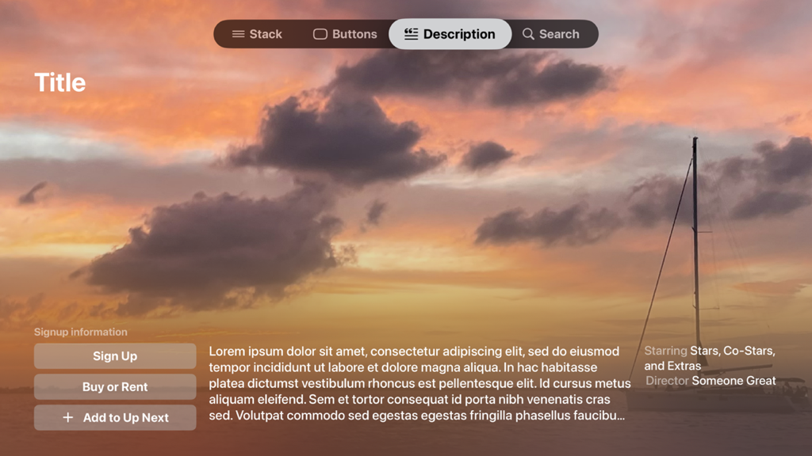
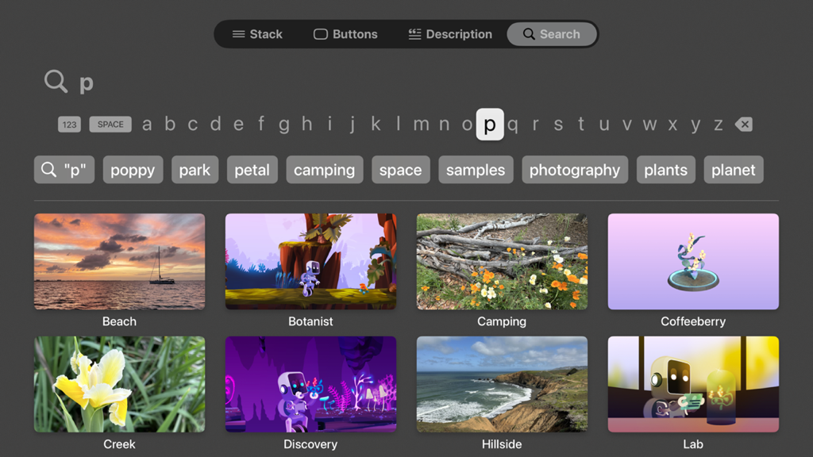

> 导航：[技术](../technologies.md) · [SwiftUI](../swiftui.md) · [App 组织](app-organization.md)

# 在 SwiftUI 中创建 tvOS 媒体目录 App

<sub>示例代码</sub>

为你的 tvOS App 构建标准的内容联锁（lockup）和一排排内容架。

## 概述

本示例代码项目展示了如何为 tvOS 创建标准的内容联锁（lockup），并提供了构建一排排内容架的最佳实践。它还包含产品页、搜索视图和标签页视图的示例，包括新的边栏自适应标签页视图样式（可在 tvOS 中提供边栏）。

> [!note] 注意
> 本示例代码项目关联 WWDC24 场次 10207：[Migrate your TVML app to SwiftUI](https://developer.apple.com/wwdc24/10207/)。

该示例项目包含以下示例：

- `StackView` 实现了一个内容目录 App 的示例着陆页，定义了多个内容架，并在它们上方设有一个展示区（即主视觉标头区域）。它还展示了折叠线上方与下方切换动画的示例。
- `ButtonsView` 展示了 tvOS 中可用的各种按钮样式。
- `DescriptionView` 提供了一个示例，演示如何构建与 Apple TV App 中类似的产品页，并带有自定义材质模糊。
- `SearchView` 展示了一个简单搜索页的示例，使用了 [searchable(text:placement:prompt:)](<view/searchable(text_placement_prompt_)-18a8f.md>) 和 [searchSuggestions(_:)](<view/searchsuggestions(__).md>) 修饰符。
- `SidebarContentView` 展示了如何使用 tvOS 18 中新的标签页栏 API 创建分区的边栏。
- `HeroHeaderView` 给出了一个创建材质渐变的示例，用于模糊某个区域内的内容，并将其渐隐到未模糊的内容中。

### 创建内容联锁

[borderless](primitivebuttonstyle/borderless.md) 按钮样式提供了你在 tvOS 中使用的主要联锁样式，包括所有焦点交互和悬停效果。当按钮的图像在获得焦点时放大，按钮的标题以及附近的任何分区标题会自动移开，为图像让出位置。



<sub>四个无边框按钮，每个按钮的图像都位于文字标题上方。从左到右，这些按钮分别是：标题为 Borderless Portrait 的竖版图像、标题为 Borderless Landscape 的横版图像、标题为 Custom Icon View 的 tvOS App 图标，以及一个描绘人物头部和肩部的圆形符号，标题为 Shaped。</sub>

在按钮的标签闭包中提供单独的 [Image](image.md) 和 [Text](text.md) 视图，以确保正确的纵向外观。使用 [Label](label.md) 通常会产生水平布局，并且根据当前的标签样式，可能无法得到你期望的外观。

```swift
Button { /* action */ } label: {
    Image("discovery_portrait")
        .resizable()
        .frame(width: 250, height: 375)
    Text("Borderless Portrait")
}
```

默认情况下，按钮样式会定位按钮标签中的第一个 `Image`，并为其附加 [highlight](hovereffect/highlight.md) 悬停效果，提供抬升、镜面高光和云台运动效果。

为确保悬停效果恰好应用于正确的视图，你可以使用 [hoverEffect(_:)](<view/hovereffect(__).md>) 修饰符将它手动附加到按钮标签的某个特定子视图上。例如，为确保 SF 符号图像与其背景一起悬停，可以这样做：

```swift
Button { /* action */ } label: {
    Image(systemName: "person.circle")
        .font(.title)
        .background(Color.blue.grayscale(0.7))
        .hoverEffect(.highlight)
    Text("Shaped")
}
.buttonBorderShape(.circle)
```

你还可以将悬停效果附加到自定义视图上。

```swift
Button { /* action */ } label: {
    CodeSampleArtwork(size: .appIconSize)
        .frame(width: 400, height: 240)
        .hoverEffect(.highlight)
    Text("Custom Icon View")
}
```

### 展示信息密集的联锁

对于信息更密集的联锁，可以考虑使用 [card](primitivebuttonstyle/card.md) 按钮样式，它提供了一个托盘，并在获得焦点时产生更细腻的运动效果。为按钮的标签提供带有内边距的容器，就能得到与 Apple TV App 中搜索结果联锁类似的效果。



<sub>两个横排的按钮。左侧是一张带有圆角和淡淡边框的图像，靠近其下边缘处有文字写着：Title at the bottom。右侧是同一张带有圆角和淡淡边框的图像，顶部有两行文字，写着：Title at the top 和 Some subtitle text as well。其下边缘处的文字写着：Additional info at the bottom。</sub>

```swift
Button { /* action */ } label: {
    HStack(alignment: .top, spacing: 10) {
        Image( . . . )
            .resizable()
            .aspectRatio(contentMode: .fit)
            .clipShape(RoundedRectangle(cornerRadius: 12))

        VStack(alignment: .leading) {
            Text(asset.title)
                .font(.body)
            Text("Subtitle text goes here, limited to two lines.")
                .font(.caption2)
                .foregroundStyle(.secondary)
                .lineLimit(2)
            Spacer(minLength: 0)
            HStack(spacing: 4) {
                ForEach(1..<4) { _ in
                    Image(systemName: "ellipsis.rectangle.fill")
                }
            }
            .foregroundStyle(.secondary)
        }
    }
    .padding(12)
}
```

你还可以使用自定义的 [LabelStyle](labelstyle.md) 来创建标准的基于卡片的联锁外观，同时让你的按钮声明在使用处保持简洁。

```swift
struct CardOverlayLabelStyle: LabelStyle {
    func makeBody(configuration: Configuration) -> some View {
        ZStack(alignment: .bottomLeading) {
            configuration.icon
                .resizable()
                .aspectRatio(400/240, contentMode: .fit)
                .overlay {
                    LinearGradient(
                        stops: [
                            .init(color: .black.opacity(0.6), location: 0.1),
                            .init(color: .black.opacity(0.2), location: 0.25),
                            .init(color: .black.opacity(0), location: 0.4)
                        ],
                        startPoint: .bottom, endPoint: .top
                    )
                }
                .overlay {
                    RoundedRectangle(cornerRadius: 12)
                        .stroke(lineWidth: 2)
                        .foregroundStyle(.quaternary)
                }

            configuration.title
                .font(.caption.bold())
                .foregroundStyle(.secondary)
                .padding(6)
        }
        .frame(maxWidth: 400)
    }
}

Button { /* action */ } label: {
    Label("Title at the bottom", image: "discovery_landscape")
}
```

### 显示内容架

内容架通常是滚动视图中的水平叠放。



<sub>两排显示彩色图标的水平按钮行。上面一排的标题是 Movie Shelf，包含竖排的图像，图像下方有标题。最左侧的图标被放大并抬升，带有投影，其标题位置更低以避免遮挡。下面一排包含方形图标，每个图标颜色各异，没有标题。</sub>

必须禁用滚动裁剪，才能让焦点效果放大并抬升每个联锁。内容架通常只包含一种样式的联锁，因此请在内容架容器的外层指定你的按钮样式。

```swift
ScrollView(.horizontal) {
    LazyHStack(spacing: 40) {
        ForEach(Asset.allCases) { asset in
            // . . .
        }
    }
}
.scrollClipDisabled()
.buttonStyle(.borderless)
```

要整齐地排布你的联锁，请使用 [containerRelativeFrame(_:count:span:spacing:alignment:)](<view/containerrelativeframe(__count_span_spacing_alignment_).md>) 修饰符，让 SwiftUI 确定每个联锁的最佳尺寸。你可以指定屏幕上要显示多少个联锁，以及你的叠放视图提供的间距大小。然后 SwiftUI 会排布内容，使第一个和最后一个条目的边缘与其容器的前导和尾随安全区内边距对齐。

对于无边框按钮，你可以将该修饰符附加到按钮标签闭包内的 `Image` 实例上，使图像成为框架计算和对齐的依据。

```swift
asset.portraitImage
    .resizable()
    .aspectRatio(250 / 375, contentMode: .fit)
    .containerRelativeFrame(.horizontal, count: 6, spacing: 40)
Text(asset.title)
```

### 显示折叠线上方和下方的内容

对于着陆页，你可以通过 [ScrollTargetBehavior](scrolltargetbehavior.md) 和一个带有渐变遮罩的背景视图相结合，实现折叠线上方与下方的两种外观。



<sub>一个 Apple TV App 屏幕，显示一张日落时分帆船的大幅照片。屏幕顶部是一个标签页栏，其中的条目从左到右依次为 Stack、Buttons、Description 和 Search。当前选中的是 Stack 条目。标签页栏下方是大字号的标题：tvOS with SwiftUI。屏幕底部附近有两个按钮，标题分别为 Show 和 More Info。在屏幕底部隐约可见一排水平排列的带圆角图像，上方有标题 Movie Shelf。</sub>

将你的展示区或标头分区定义为一个带有容器相对框架的叠放，使其占据可用空间的特定百分比。同时为该叠放附加一个 [focusSection()](<view/focussection().md>) 修饰符，使其整个宽度都能作为焦点移动的目标，然后再把焦点引导到其内容上。否则，从下方内容架的右侧向上移动焦点可能会失败，或者可能直接跳到标签页栏，因为焦点引擎会沿着从当前获得焦点的条目出发的直线搜索最近的可获得焦点的视图。

```swift
VStack(alignment: .leading) {
    // 标头内容。
}
.frame(maxWidth: .infinity, alignment: .leading)
.focusSection()
.containerRelativeFrame(.vertical, alignment: .topLeading) {
    length, _ in length * 0.8
}
```

上面的代码就是折叠线上方的分区。要检测焦点何时移动到折叠线下方，可以使用 [onScrollVisibilityChange(threshold:_:)](<view/onscrollvisibilitychange(threshold___).md>) 来检测标头视图何时移动到超过屏幕一半之外。

```swift
.onScrollVisibilityChange { visible in
    // 当标头滚动到超出屏幕 50% 以上时，切换到
    // 折叠线下方的状态。
    withAnimation {
        belowFold = !visible
    }
}
```

你可以使用一张全屏图像并在其叠加层中加入材质来定义着陆页的背景。然后，你可以通过用一个 [LinearGradient](lineargradient.md) 对材质进行遮罩，把材质变为渐变，并根据视图处于折叠线上方还是下方的状态来调整该渐变各个色标的不透明度。

```swift
Image("beach_landscape")
    .resizable()
    .aspectRatio(contentMode: .fill)
    .overlay {
        // 通过用材质填充一个区域来构建渐变材质，
        // 然后使用线性渐变对该区域进行遮罩。
        Rectangle()
            .fill(.regularMaterial)
            .mask {
                LinearGradient(
                    stops: [
                        .init(color: .black, location: 0.25),
                        .init(color: .black.opacity(belowFold ? 1 : 0.3), location: 0.375),
                        .init(color: .black.opacity(belowFold ? 1 : 0), location: 0.5)
                    ],
                    startPoint: .bottom, endPoint: .top
                )
            }
    }
    .ignoresSafeArea()
```

通过调整渐变色标的不透明度，而不是更换遮罩视图，你可以在两种外观之间获得平滑的动画：一种是折叠线上方的外观——材质在超过某个高度后渐隐，露出背后的图像；另一种是折叠线下方的外观——整张图像被模糊。

### 在折叠点处吸附

你可以实现一个自定义的 [ScrollTargetBehavior](scrolltargetbehavior.md) 来创建折叠点吸附效果。然后添加一个检查，判断滚动事件的目标是否跨越了折叠阈值，并将该目标更新为页面顶部（如果向上移动）或你的第一个内容架的顶部（如果向下移动）。由于你的视图已经在追踪折叠线上方/下方的状态，它可以把该信息传入行为中，以指示要检查哪种操作。

```swift
ScrollView {
    // . . .
}
.scrollTargetBehavior(
    FoldSnappingScrollTargetBehavior(
        aboveFold: !belowFold, showcaseHeight: showcaseHeight))

struct FoldSnappingScrollTargetBehavior: ScrollTargetBehavior {
    var aboveFold: Bool
    var showcaseHeight: CGFloat

    func updateTarget(_ target: inout ScrollTarget, context: TargetContext) {
        // 视图处于折叠线上方，且向下移动的距离不够，因此
        // 不做更改。
        if aboveFold && target.rect.minY < showcaseHeight * 0.3 {
            return
        }

        // 视图处于折叠线下方，且标头不会进入屏幕，因此
        // 不做更改。
        if !aboveFold && target.rect.minY > showcaseHeight {
            return
        }

        // 向上移动：要求标头露出超过 30%，否则不允许
        // 滚动继续向上。
        let showcaseRevealThreshold = showcaseHeight * 0.7
        let snapToHideRange = showcaseRevealThreshold...showcaseHeight

        if aboveFold || snapToHideRange.contains(target.rect.origin.y) {
            // 吸附以将第一个内容架对齐到屏幕顶部。
            target.rect.origin.y = showcaseHeight
        }
        else {
            // 向上吸附以露出标头。
            target.rect.origin.y = 0
        }
    }
}
```

### 提供产品亮点页面

产品页通常会使用带有折叠点上方/下方吸附效果的材质渐变外观。你很可能需要对渐变做一些不同的微调，以照顾屏幕底部更高的内容条，但通常你希望保留内容的展示图像（带适当的模糊），作为向下滚动时视图的背景。



<sub>一个 Apple TV App 屏幕，显示一张日落时分帆船的大幅照片。屏幕顶部是一个标签页栏，其中的条目从左到右依次为 Stack、Buttons、Description 和 Search。当前选中的是 Description 条目。标签页栏下方以大字号显示单词 Title。屏幕下方的四分之一区域是一个三栏分区，包含某个产品的信息。左栏的标题是 Signup Information，下方垂直排列三个按钮，标题分别为 Sign Up、Buy or Rent 和 Add to Up Next。中栏包含一段占位文字，右栏包含两行垂直排列的文字，第一行写着 Starring: Stars, costars, and extras，第二行写着 Director: Someone great。</sub>

这让每个产品页都独一无二，其标志性艺术作品为内容着色。这与 Apple TV 的根屏幕所使用的效果相同——系统会模糊最近显示的推荐项目（Top Shelf）图像，并将其用作 tvOS 主屏幕的背景。

在你的描述视图中，你可能想要显示一叠带边框的按钮，并将每个按钮拉伸到相同的宽度。SwiftUI 通过为按钮的标签附加背景来实现带边框的按钮，因此增大按钮视图的尺寸不一定会让背景托盘随之变大。相反，你需要指定_标签内容_可以扩展，这样它的背景也会随之扩展。为按钮的标签内容附加 [frame(minWidth:idealWidth:maxWidth:minHeight:idealHeight:maxHeight:alignment:)](<view/frame(minwidth_idealwidth_maxwidth_minheight_idealheight_maxheight_alignment_).md>) 修饰符即可为你实现这一点。

```swift
VStack(spacing: 12) {
    Button { /* action */ } label: {
        Text("Sign Up")
            .font(.body.bold())
            .frame(maxWidth: .infinity)
    }

    Button { /* action */ } label: {
        Text("Buy or Rent")
            .font(.body.bold())
            .frame(maxWidth: .infinity)
    }

    Button { /* action */ } label: {
        Label("Add to Up Next", systemImage: "plus")
            .font(.body.bold())
            .frame(maxWidth: .infinity)
    }
}
```

在显示内容的描述时，允许它在页面上截断，并将它放在一个使用 `.plain` 样式的 [Button](button.md) 中。这样人们就可以选中它，你可以使用通过 [fullScreenCover(isPresented:onDismiss:content:)](<view/fullscreencover(ispresented_ondismiss_content_).md>) 修饰符附加的叠加视图来呈现完整的描述。

```swift
.fullScreenCover(isPresented: $showDescription) {
    VStack(alignment: .center) {
        Text(loremIpsum)
            .frame(maxWidth: 600)
    }
}
```

### 搜索内容

对于你的搜索页，最好使用 [LazyVGrid](lazyvgrid.md) 来容纳结果，并让联锁本身采用横排方向。这样可以让更多内容同时出现在屏幕上，呈现若干行、每行三到五个条目。较高的内容容器区域让人更容易看到搜索词更改所产生的效果。



<sub>一个 Apple TV App 屏幕，显示一个搜索面板。屏幕顶部是一个标签页栏，其中的条目从左到右依次为 Stack、Buttons、Description 和 Search。当前选中的是“Search”条目。标签页栏下方是一个搜索栏，其左侧有一个放大镜图标，栏内已输入字母 P。再下方是一个包含罗马字母的键盘，键盘下方是一列圆角矩形中的单词，代表潜在的匹配项。底部是一个四列两行的网格，其中是横排方向的图像，图像下方有标题。</sub>

搜索功能的实现由一些简单的视图修饰符组成，它们在每个 Apple 平台上的行为完全相同。[searchable(text:placement:prompt:)](<view/searchable(text_placement_prompt_)-18a8f.md>) 修饰符会为你提供整套搜索 UI，并将搜索栏绑定到提供的文本。通过附加一个 [searchSuggestions(_:)](<view/searchsuggestions(__).md>) 修饰符，你可以呈现一个潜在搜索关键词补全列表。这些通常是 `Text` 实例，但 `Button` 和 [Label](label.md) 也可以。

请务必对搜索结果进行排序，使网格的内容稳定且可预测。

```swift
ScrollView(.vertical) {
    LazyVGrid(
        columns: Array(repeating: .init(.flexible(), spacing: 40), count: 4), 
        spacing: 40
    ) {
        ForEach(/* matching assets, sorted */) { asset in
            Button { /* action */ } label: {
                asset.landscapeImage
                    .resizable()
                    .aspectRatio(16 / 9, contentMode: .fit)
                Text(asset.title)
            }
        }
    }
    .buttonStyle(.borderless)
}
.scrollClipDisabled()
.searchable(text: $searchTerm)
.searchSuggestions {
    ForEach(/* keywords matching search term */, id: \.self) { suggestion in
        Text(suggestion)
    }
}
```

## 下载

- [CreatingATvOSMediaCatalogAppInSwiftUI.zip](https://docs-assets.developer.apple.com/published/4151095c6511/CreatingATvOSMediaCatalogAppInSwiftUI.zip)
