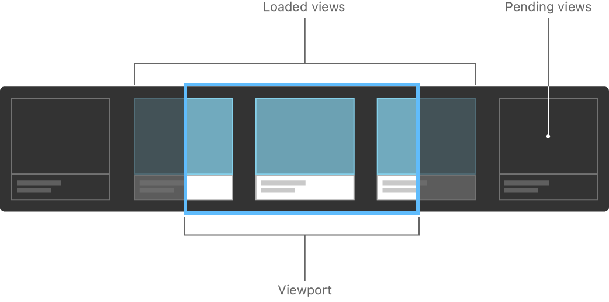
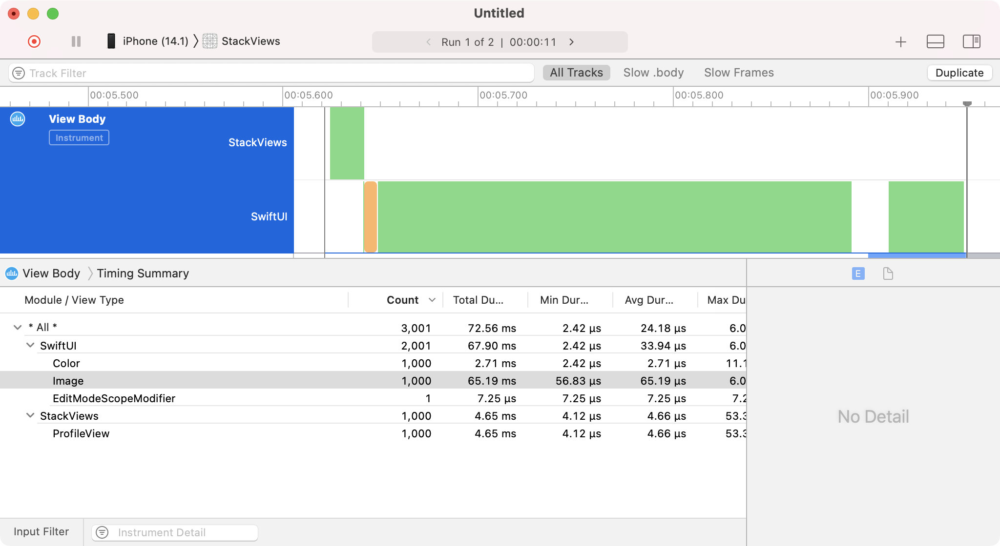
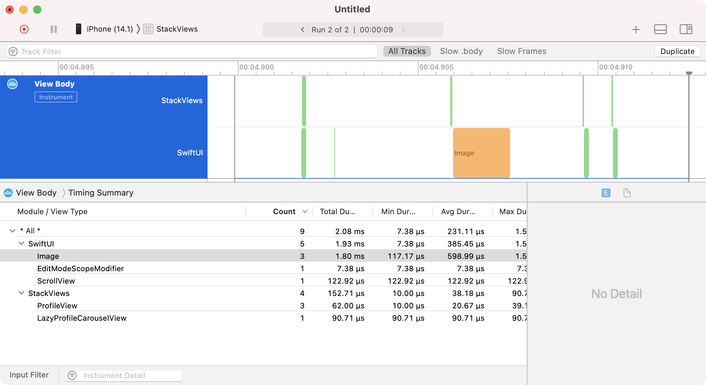

> 导航：[技术](../technologies.md) · [SwiftUI](../swiftui.md) · [布局基础](layout-fundamentals.md)

# 创建高性能的可滚动叠放

<sub>文章</sub>

使用滚动视图、叠放视图和惰性叠放高效地显示大量重复视图。

## 概述

你的 App 常常需要在容器视图中显示超出设备屏幕所能容纳的数据量。水平和垂直叠放是重复显示视图或视图组的好方案，但它们没有内置的滚动机制。你可以把叠放包装在 [ScrollView](scrollview.md) 中来添加滚动，并在出现性能问题时切换到惰性叠放。

### 在可滚动容器中显示视图组

实现重复的视图或视图组可以简单到把它们包装在 [ScrollView](scrollview.md) 内的 [HStack](hstack.md) 或 [VStack](vstack.md) 中。

```swift
ScrollView(.horizontal) {
    HStack {
        ProfileView()
        ProfileView()
        ProfileView()
        ProfileView()
        ProfileView()
    }
}
.frame(maxWidth: 500)
```

如果上面示例代码中的 `ProfileView` 具有固有内容尺寸 200 x 200 点，那么 [frame(minWidth:idealWidth:maxWidth:minHeight:idealHeight:maxHeight:alignment:)](<view/frame(minwidth_idealwidth_maxwidth_minheight_idealheight_maxheight_alignment_).md>) 视图修饰符应用到 [ScrollView](scrollview.md) 的 500 点最大宽度会导致叠放在其中滚动。


<sub>在一个叠放视图内一行显示五个个人资料视图。滚动视图的最大宽度裁剪了其内容，导致叠放中最后两个半个人资料视图位于视口之外。</sub>

有关使用叠放将视图组合在一起的介绍，请参阅[使用叠放视图构建布局](building-layouts-with-stack-views.md)。

### 为你的数据重复视图

使用 [ForEach](foreach.md) 为你的 App 中的数据重复视图。对于一个 `profiles` 数组中的个人资料数据列表，使用 [ForEach](foreach.md) 在 [HStack](hstack.md) 内为数组中的每个元素创建一个 `ProfileView`。

```swift
ScrollView(.horizontal) {
    HStack {
        ForEach(profiles) { profile in
            ProfileView(profile: profile)
        }
    }
}
.frame(maxWidth: 500)
```

> [!note] 注意
> 使用 [ForEach](foreach.md) 时，你迭代的每个元素都必须是可唯一标识的。要么让元素符合 [Identifiable](../swift/identifiable.md) 协议，要么向 [init(_:id:content:)](<foreach/init(__id_content_).md>) 的 `id` 参数传递一个指向唯一标识符的键路径。

### 视图数量很大时考虑使用惰性叠放

三个标准叠放视图 [HStack](hstack.md)、[VStack](vstack.md) 和 [ZStack](zstack.md) 都会在显示时加载其包含的视图层级结构，一次加载大量视图可能导致运行时性能缓慢。

在上面的示例中，`ProfileView` 是一个复合视图，由嵌套的叠放视图、文本标签和一个图像视图组成。一次加载大量个人资料会导致明显的性能下降。

随着叠放内视图数量的增长，请考虑使用 [LazyHStack](lazyhstack.md) 和 [LazyVStack](lazyvstack.md) 而不是 [HStack](hstack.md) 和 [VStack](vstack.md)。惰性叠放按需加载和渲染子视图，在加载大量子视图时能带来显著的性能提升。



<sub>示意图，显示滚动视图容器内的一个惰性叠放视图。已加载的视图显示在中间的视口中，尚未加载的视图在右侧等待。</sub>

叠放视图和惰性叠放具有相似的功能，可能让人觉得可以互换，但它们在不同情况下各有优势。叠放视图一次性加载所有子视图，使布局快速而可靠，因为系统在加载它们时就知道每个子视图的大小和形状。惰性叠放则牺牲了一定程度的布局正确性来换取性能，因为系统只在子视图变为可见时才计算其几何信息。

在选择要使用的叠放视图类型时，请始终从标准叠放视图开始，只有当对你的代码进行性能分析表明惰性叠放能带来值得的性能提升时才切换到惰性叠放。

### 用性能分析找出性能问题

在考虑使用哪种类型的叠放时，请使用 Instruments 工具对你的应用程序进行性能分析，以找出用户界面代码中在叠放内加载大量视图的区域。

要对 SwiftUI 视图加载进行性能分析，请从 Xcode 的 Product 菜单中选择 Profile，并选择 SwiftUI 性能分析模板来打开 Instruments 工具。该模板会加载四个 instrument：View Body、View Properties、Core Animation Commits 和 Time Profiler。这些 instrument 的组合为找到加速你的 App 的机会提供了一个很好的起点。

> [!note] 注意
> 切勿使用 iOS 模拟器对你的代码进行性能分析。进行性能测试时请始终使用真机。



分析上面的代码时，View Body instrument 显示 1,000 个 `ProfileView` 实例与 [HStack](hstack.md) 同时加载到内存中。你还可以看到系统加载每个个人资料时，有相同数量的 [Image](image.md) 视图被加载。

在这种情况下，解决方案是将 [HStack](hstack.md) 替换为 [LazyHStack](lazyhstack.md)，如下面的代码所示：

```swift
ScrollView(.horizontal) {
    LazyHStack {
        ForEach(profiles) { profile in
            ProfileView(profile: profile)
        }
    }
}
.frame(maxWidth: 500)
```

再运行一次追踪可以看到，最初加载的视图数量急剧减少，因为只有四个 `ProfileView` 实例一开始是可见的。你还可以看到 Total Duration 列的数值相应下降。



有关使用 Instruments 工具的更多信息，请参阅[改进你的 App 的性能](../xcode/improving-your-app-s-performance.md)。

## 另请参阅

### 在一维中动态排布视图

- [使用惰性叠放视图分组数据](grouping-data-with-lazy-stack-views.md) — 在惰性叠放视图内将内容拆分为逻辑分区。
- [LazyHStack](lazyhstack.md) — 一种将其子视图排列成水平增长的一条线的视图，仅在需要时才创建条目。
- [LazyVStack](lazyvstack.md) — 一种将其子视图排列成垂直增长的一条线的视图，仅在需要时才创建条目。
- [PinnedScrollableViews](pinnedscrollableviews.md) — 一组可以被固定到滚动视图边界的视图类型。
