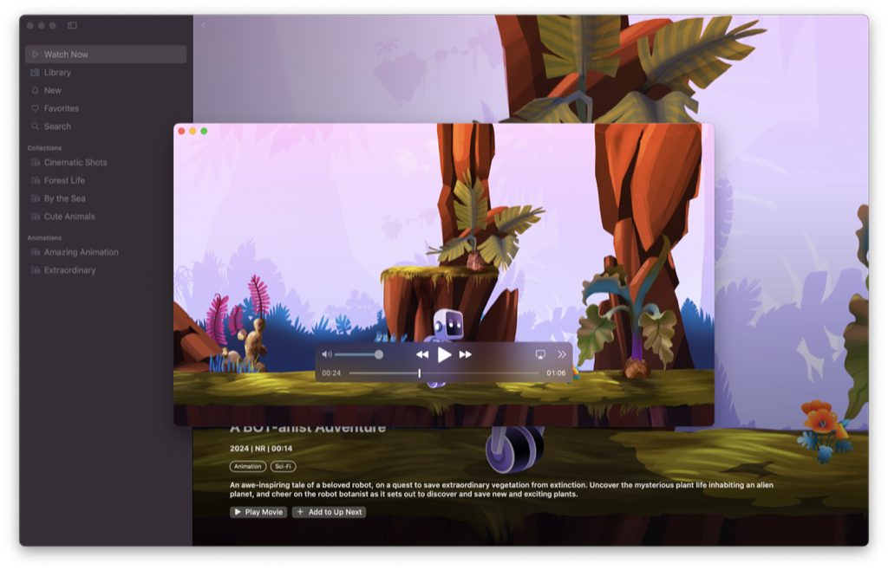
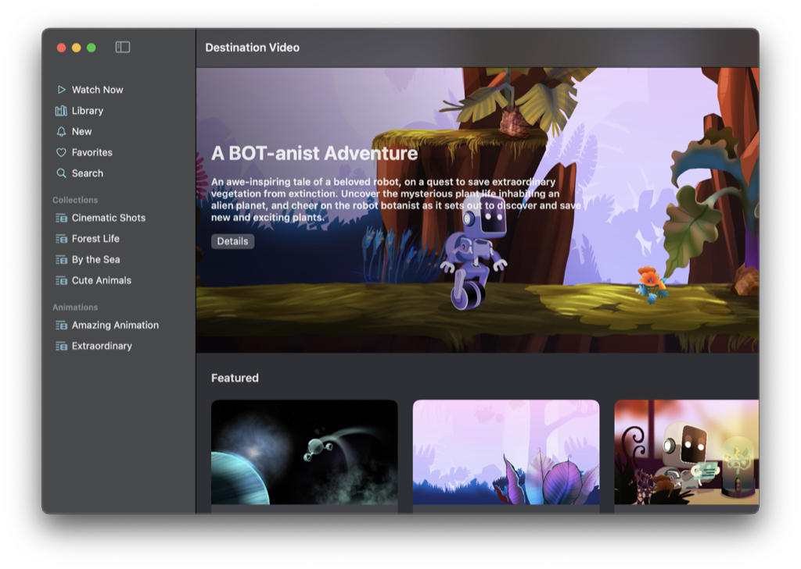
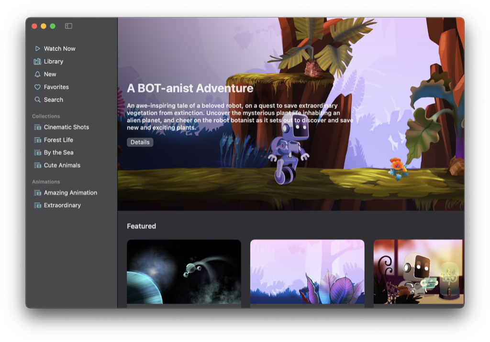
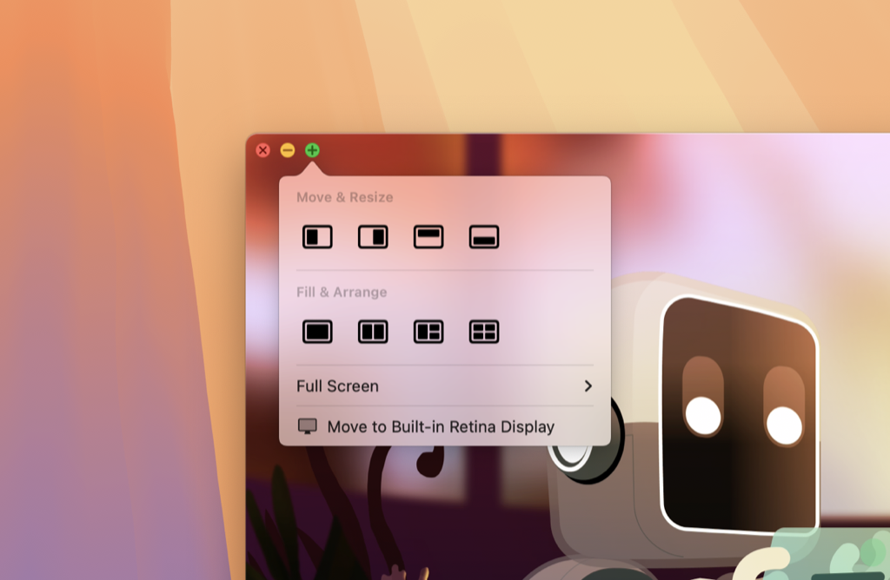

> 导航：[技术](../technologies.md) · [SwiftUI](../swiftui.md) · [窗口](windows.md)

# 在 macOS 中自定窗口样式与状态恢复行为

<sub>示例代码</sub>

配置你的 App 的窗口在 macOS 中的外观和功能，以提供引人入胜且更连贯的体验。

## 概述

[Destination Video](../visionos/destination-video.md) 的 macOS 目标平台演示了如何利用窗口和场景自定 API（macOS 15 及更高版本提供）来为 App 在 macOS 中的体验量身定制。这包括更改工具栏的外观和可见性、扩展窗口的拖拽区域、参与窗口的缩放操作，以及修改窗口的状态恢复行为。



## 移除窗口工具栏的标题和背景

Destination Video 使用标签页视图作为其主要的用户界面组件，在 macOS 上，它的外观类似于双栏导航拆分视图。在这种配置下，每个标签页都会显示为边栏中的一个条目，并参与 App 的导航。由于边栏已经直观地表明了你在导航层级结构中的位置，而且 App 的内容不需要任何额外的工具栏条目，因此没有必要使用工具栏。移除工具栏可以让底层内容直接延伸到窗口边缘，从而提升内容的呈现效果。

要移除工具栏的背景，`ContentView` 调用了 [toolbarBackgroundVisibility(_:for:)](<view/toolbarbackgroundvisibility(__for_).md>) 视图方法：

```swift
.toolbarBackgroundVisibility(.hidden, for: .windowToolbar)
```

然后移除工具栏的标题：

```swift
.toolbar(removing: .title)
```

在本例中，App 仍然需要窗口控制按钮来关闭或最小化窗口，或进入全屏模式，因此它使用单独的视图方法只移除标题和栏背景。要完全移除工具栏，请改用 [toolbarVisibility(_:for:)](<view/toolbarvisibility(__for_).md>) 视图方法。

**之前**



**之后**



需要注意的是，这些只是视觉上的更改。系统仍会向屏幕阅读器等辅助功能工具提供窗口标题，并且在窗口打开期间，App 的「窗口」菜单也会继续显示该标题。

## 扩展窗口的拖拽区域

在 macOS 上移动窗口时，你通常拖拽的是该窗口的工具栏。但是，如果你选择移除工具栏的背景，或者完全隐藏工具栏，请使用 [WindowDragGesture](windowdraggesture.md) 来扩展该窗口的拖拽区域，确保窗口仍然可以拖动。

Destination Video 的 `PlayerView` 将这个手势添加到一个透明叠加层上，并将该叠加层插入到视频内容和播放控制之间。这使你能够安全地拖动窗口，而不会干扰 AVKit 提供的系统播放 UI。

```swift
.gesture(WindowDragGesture())
```

播放器还使用 [allowsWindowActivationEvents(_:)](<view/allowswindowactivationevents(__).md>) 视图方法，让已安装的窗口拖拽手势能够接收激活窗口的事件——例如，当窗口处于后台时你点击它并立即拖动。

```swift
.allowsWindowActivationEvents(true)
```

## 自定窗口的缩放行为

默认情况下，窗口的工具栏提供用于关闭窗口、最小化窗口和进入全屏模式的按钮。如果你按住 Option 键并点按绿色按钮，窗口会缩放而不是进入全屏。



<sub>一张截图，显示一个窗口的工具栏按钮。绿色按钮上指向着一个弹出窗口。该弹出窗口包含用于排布窗口和调整窗口大小的不同选项。</sub>

通常，窗口会缩放到其定义的最大尺寸，或显示器所允许的最大尺寸。不过，你可以使用 [windowIdealPlacement(_:)](<scene/windowidealplacement(__).md>) 场景方法来覆盖这一行为，并提供更适合窗口内容的尺寸和位置。该 App 使用这个方法为视频播放器提供最大尺寸，以保持视频的宽高比，避免在其上方和下方出现黑边。

```swift
.windowIdealPlacement { proxy, context in
    let displayBounds = context.defaultDisplay.visibleRect
    let idealSize = proxy.sizeThatFits(.unspecified)
    
    // 计算内容的宽高比。
    let aspectRatio = aspectRatio(of: idealSize)
    // 确定显示器尺寸与内容尺寸之间的差值。
    let deltas = deltas(of: displayBounds.size, idealSize)
    
    // 在保持内容宽高比的同时
    // 计算窗口缩放后的尺寸
    let size = calculateZoomedSize(
        of: idealSize,
        inBounds: displayBounds,
        withAspectRatio: aspectRatio,
        andDeltas: deltas
    )
    
    // 将窗口置于显示器中心，并返回相应的
    // 窗口放置位置。
    let position = position(of: size, centeredIn: displayBounds)
    return WindowPlacement(position, size: size)
}
```

此实现还确保缩放后的窗口在缩放时出现在显示器的中心。

## 修改窗口参与状态恢复的方式

在 macOS 上，状态恢复是可选的，人们可以在系统设置中全系统启用（或停用）它。默认情况下，你的 SwiftUI App 会遵循这一设置，但你可以选择覆盖它，并为你的 App 的每个窗口指定首选的恢复行为。例如，对于代表临时活动的窗口，或者从上一个会话恢复底层状态很困难或代价高昂的窗口，你可能希望不参与状态恢复。

在 macOS 上运行时，Destination Video 使用 [SceneRestorationBehavior](scenerestorationbehavior.md) 视图修饰符来停用视频播放器视图的状态恢复。

```swift
.restorationBehavior(.disabled)
```

由于该 App 中的视频都很简短，而且人们与它们的交互是短暂的，在下一次启动时恢复视频播放器并没有什么意义。

## 另请参阅

#### 相关示例

- [Destination Video](../visionos/destination-video.md)

#### 相关视频

- [Tailor macOS windows with SwiftUI](../https_/developer.apple.com/videos/play/wwdc2024/10148.md)

## 另请参阅

### 基础

- [为你的 SwiftUI App 带来多个窗口](bringing-multiple-windows-to-your-swiftui-app.md) — 通过响应状态变化来组合丰富的视图，并在 iPadOS 和 macOS 上自定你的 App 的场景呈现与行为。

## 下载

- [DestinationVideo.zip](https://docs-assets.developer.apple.com/published/08bd3c5ea0b3/DestinationVideo.zip)
